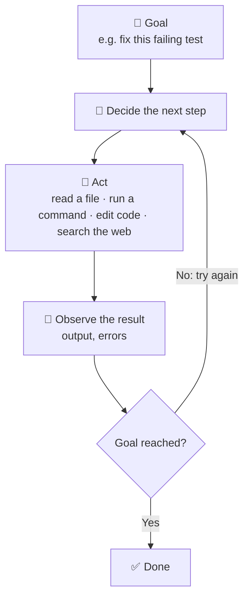

# Lesson 1 — What is Claude Code?

**Course:** [Claude Code 101](https://academy.claude.com/courses/claude-code-101) &nbsp;·&nbsp; **Chapter 1:** What is Claude Code? &nbsp;·&nbsp; **Completed:** October 17, 2026

| Previous | Course | Next |
|:---|:---:|---:|
| Start of course | [📚 Course index](README.md) | [How Claude Code works →](02-how-claude-code-works.md) |

---

**On this page**

| # | Section |
|:---:|:---|
| 1 | [Revision summary](#revision-summary) |
| 2 | [Definition](#definition) |
| 3 | [Where it's available](#where-its-available) |
| 4 | [Claude Code vs. Claude.ai](#claude-code-vs-claudeai) |
| 5 | [What is an AI agent?](#what-is-an-ai-agent) |
| 6 | [What Claude Code can do (examples)](#what-claude-code-can-do-examples) |
| 7 | [Three key concepts for using it well](#three-key-concepts-for-using-it-well) |
| 8 | [Recap](#recap) |
| 9 | [My notes / practice](#my-notes--practice) |
| 10 | [FAQ](#faq) |

---

### Revision summary

*Every key fact from this lesson in one place, for quick revision. The sections below explain each point.*

- **What Claude Code is:** an *agentic* coding tool. "Agentic" means it takes actions, not just answers. It reads your codebase, edits files, runs terminal commands, and connects to tools like Git.
- **Where you can use it:** the terminal (CLI), a VS Code extension, a JetBrains plugin (IntelliJ, PyCharm…), the Claude Desktop app, and the web.
- **Claude Code vs. Claude.ai:** same model. In Claude.ai, Claude only sees what you paste, and you copy its answers back yourself. Claude Code works inside your project and makes the changes itself.
- **"AI agent"** = software that takes actions in its environment (your files, terminal, the web) to reach a goal (your task).
- **The agent loop:** decide the next step → act → observe the result → repeat until done. Observing is what lets it recover when a test fails.
- **What an agent acts with:** tools (read, edit, run commands), external services (APIs, databases, issue trackers), and other AI agents.
- **Key concept 1, the context window:** Claude's short-term memory. Fixed size, measured in **tokens** (pieces of words). A real codebase usually won't fit, and extra files distract, so Claude Code **searches** and reads only the files it needs.
- **Key concept 2, permissions:** by default Claude Code **asks before it runs a command or changes code**. You can approve step by step, or allow some actions ahead of time.
- **Key concept 3, mistakes:** it can misunderstand you, add a new bug while fixing one, or over-engineer. Always review its changes and run tests.
- **Exam:** permission prompts are a **human-in-the-loop** control (a person approves before an action happens): **Governance, Safety & Risk**. Plan for mistakes with code review, tests, clear acceptance criteria, and small tasks.

---

### Definition

Claude Code is an **agentic coding tool**. "Agentic" means it doesn't just answer questions. It takes actions on its own to finish a task you give it.

In practice, Claude Code can:
- **Read and understand your codebase**, so it knows how your project fits together.
- **Edit files**, so it can make the changes itself instead of telling you what to type.
- **Run commands** in your terminal, such as builds, tests, and installs.
- **Connect to the developer tools you already use**, such as Git or external services.

The goal is to help you get coding work done faster.

### Where it's available

You can use the same Claude Code in several places:

- **Terminal (CLI)**: the command-line version. This is the one the lesson uses.
- **Visual Studio Code**: as an extension inside the editor.
- **JetBrains IDEs**: as a plugin (IntelliJ, PyCharm, and others).
- **Claude Desktop app**: a standalone app on your computer.
- **Web**: in the browser, with nothing to install.

### Claude Code vs. Claude.ai

Both use the same Claude model. The difference is what Claude can reach.

- With **Claude.ai**, Claude only sees what you paste into the chat. It suggests code, and you copy it back into your project yourself.
- With **Claude Code**, Claude works inside your project. It opens your files, runs commands, and makes the changes directly.

| | Claude.ai | Claude Code |
|---|---|---|
| Access to your files | No. You paste code in. | Yes, directly. |
| Terminal access | No. | Yes. It runs commands. |
| What it knows about your code | Only what you paste. | Anything in the codebase it chooses to open. |
| Who does the work | You copy and paste the answers. | Claude makes the changes. |
| What it is | A chat assistant. | An AI agent. |

### What is an AI agent?

An **AI agent** is software that **interacts with its environment and takes actions to reach a goal**.

- **Environment** means the world the agent works in. For Claude Code, that's your files, your terminal, and the web.
- **Actions** are the things it can do there, such as reading a file, running a test, or editing code.
- **Goal** is the task you gave it, such as "fix this failing test."

The simplest version of an agent is a **large language model (LLM) running in a loop**:

1. **Decide** the next step toward the goal.
2. **Act**: take that step.
3. **Observe** the result: read the output, check for errors.
4. **Repeat** until the goal is reached.

The key part is step 3. The agent looks at what actually happened and uses it to decide what to do next. That's how it can recover when a test fails or a command errors.

To take actions, an agent can use:
- **Tools**: built-in abilities such as reading files, editing files, or running shell commands.
- **External services**: outside systems such as APIs, databases, or issue trackers.
- **Other AI agents**: an agent can hand part of a task to another agent.

### What Claude Code can do (examples)

1. **Read and understand your codebase.** Ask it to explain how a feature works, or to trace a bug from the symptom back to the line of code that causes it.
2. **Run commands and act on the output.** It can run build scripts and tests or install packages, then read the results and decide what to do next. For example, if a test fails, it reads the error and tries a fix.
3. **Search the web.** For example, it can look up the current documentation for a library's API, so it isn't relying on outdated knowledge.

### Three key concepts for using it well

#### 1. The context window is Claude's short-term memory
- The **context window** is all the text Claude can see at one time: your messages, its replies, the files it has read, and command output. Anything outside the window, Claude can't see.
- The window is large but has a fixed size, measured in **tokens** (pieces of words).
- A real codebase is usually too big to fit. Even when it fits, filling the window with unrelated files makes it harder for Claude to focus.
- So Claude Code **searches for what it needs** (finding files by name, searching for a function) and reads only the relevant files, the way a developer new to a project would.

#### 2. It asks for permission
- By default, Claude Code **asks you before it runs a command or changes your code**. Nothing happens until you approve it.
- **You stay in control.** You can approve each step one at a time, or allow certain actions ahead of time so it can work with fewer interruptions. You choose how hands-on to be.

#### 3. It can make mistakes
Claude Code is capable but not perfect. It might:
- **misunderstand what you meant** and solve a different problem
- **introduce a new bug** while fixing another one
- **over-engineer a solution**, writing more complex code than the task needs

→ Always review its changes and check them with tests. (This connects to the study guide's rule: *verify, don't trust blindly*.)

### Recap

Claude Code is an agentic coding tool. It **reads your codebase, edits your files, runs commands, and connects to external tools** to help you get work done faster. It runs as a loop: decide, act, check the result, repeat. It's available in the terminal, VS Code, JetBrains IDEs, the Claude Desktop app, and on the web.

To use it well, remember three things:
1. It can't see everything at once, so it searches for what it needs.
2. It asks permission before acting, and you decide how much to allow.
3. It can be wrong, so review what it does.

---

## My notes / practice

- [ ] Install Claude Code and run it in a test repo.
- [ ] Ask it to explain a feature of a small codebase.
- [ ] Ask it to run tests and fix one failure, reviewing each permission prompt.
- [ ] Note one mistake it made and how I caught it.

---

## FAQ

**Q1. What is Claude Code, in one sentence?**
An agentic coding tool that reads your codebase, edits files, runs commands, and connects to external tools to help you get coding work done faster.

**Q2. How is Claude Code different from Claude.ai?**
Both use the same Claude model, but they can reach different things. In Claude.ai, Claude only sees what you paste into the chat, and you copy its answers back into your project yourself. Claude Code works inside your project: it opens your files, runs commands in your terminal, and makes the changes directly.

**Q3. What does "agent" mean, and why is Claude Code called one?**
An agent is software that takes actions in its environment to reach a goal. Claude Code does this by running in a loop:
1. Decide the next step.
2. Take the action (read a file, run a command, edit code).
3. Look at the result.
4. Repeat until the goal is reached.

Step 3 is what makes it an agent rather than a chatbot. It reacts to what actually happened, such as a failing test, instead of just generating one answer and stopping.

**Q4. What can an AI agent use to get a task done?**
- **Tools**: built-in abilities such as reading files, editing code, or running commands.
- **External services**: outside systems such as APIs, databases, or issue trackers.
- **Other AI agents**: it can hand part of the task to another agent.

**Q5. Where can I use Claude Code?**
The terminal (CLI), VS Code, JetBrains IDEs, the Claude Desktop app, and the web.

**Q6. What does "context window" mean?**
The context window is all the text Claude can see at one time. That includes your messages, Claude's replies, the files it has read, and the output of commands it has run. Think of it as Claude's short-term memory. Anything outside the window, Claude can't see. The window is large but has a fixed size, measured in tokens (pieces of words).

**Q7. Why doesn't Claude Code read my whole project at the start?**
Two reasons:
1. **It usually won't fit.** A real codebase is often bigger than the context window.
2. **More isn't better.** Even when it fits, filling the window with unrelated files leaves less room for the conversation and makes it harder for Claude to focus on what matters.

So Claude Code works the way a developer new to a project would. It searches (for example, finding files by name or grepping for a function), opens only the files that matter, and reads more when it needs to. Choosing for itself what to look at next is part of what makes it agentic.

**Q8. Will Claude Code change my files or run commands without asking?**
Not by default. It asks for your approval before running a command or changing your code, and nothing happens until you say yes. You can approve each step one at a time, or allow certain actions ahead of time so it works with fewer interruptions. You decide how hands-on to be.

**Q9. Can Claude Code make mistakes?**
Yes. Three common ones:
- It **misunderstands what you meant** and solves a different problem.
- It **introduces a new bug** while fixing another.
- It **over-engineers**, writing more complex code than the task needs.

So review its changes and run tests before you accept them.

**Q10. What kinds of tasks can Claude Code do?**
- **Understand code**: explain how a feature works, or trace a bug back to its cause.
- **Run things**: run builds and tests, install packages, then read the output and decide what to do next.
- **Look things up**: search the web for current API documentation.

**Q11. (Exam angle) A team asks why Claude Code stops to ask permission. Why does that matter?**
Asking permission is a **human-in-the-loop** control: a person has to approve an action before it happens. That matters for anything with real consequences, such as deleting files, changing production config, or running commands with side effects. On the exam, this maps to the **Governance, Safety & Risk** domain. In the capstone project, it's the **approval gate**.

**Q12. (Exam angle) Claude Code can make mistakes. How should a team plan for that?**
Assume the agent's output might be wrong, and design ways to catch it:
- **Code review**: a person reads the changes before they're merged.
- **Automated tests**: tests confirm the code still works.
- **Clear acceptance criteria**: a definition of "done" that you can check.
- **Small, bounded tasks**: small changes are easier to review and less risky when wrong.

Never treat agent output as correct without checking it.

---

| Previous | Course | Next |
|:---|:---:|---:|
| Start of course | [📚 Course index](README.md) | [How Claude Code works →](02-how-claude-code-works.md) |
