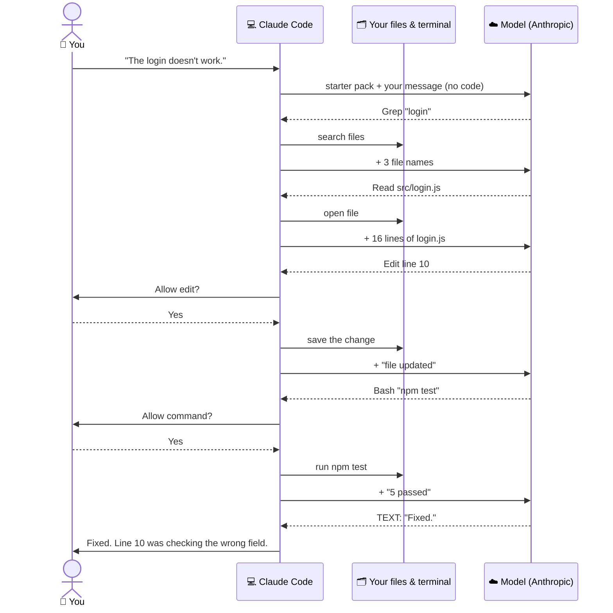

# Lesson 2 — How Claude Code works

**Course:** [Claude Code 101](https://academy.claude.com/courses/claude-code-101) &nbsp;·&nbsp; **Chapter 1:** What is Claude Code? &nbsp;·&nbsp; **Completed:** October 17, 2026

| Previous | Course | Next |
|:---|:---:|---:|
| [← What is Claude Code?](01-what-is-claude-code.md) | [📚 Course index](README.md) | [Installing Claude Code →](03-installing-claude-code.md) |

---

**On this page**

| # | Section |
|:---:|:---|
| 1 | [Revision summary](#revision-summary) |
| 2 | [In one sentence](#in-one-sentence) |
| 3 | [The four parts](#the-four-parts) |
| 4 | [1. The loop: look, do, check, repeat](#1-the-loop-look-do-check-repeat) |
| 5 | [2. The context window: what the model can see right now](#2-the-context-window-what-the-model-can-see-right-now) |
| 6 | [3. Tools: how Claude Code actually does things](#3-tools-how-claude-code-actually-does-things) |
| 7 | [4. Permissions: what Claude Code can do without asking](#4-permissions-what-claude-code-can-do-without-asking) |
| 8 | [5. Behind the scenes: your computer vs. Anthropic's servers](#5-behind-the-scenes-your-computer-vs-anthropics-servers) |
| 9 | [Recap](#recap) |
| 10 | [My notes / practice](#my-notes--practice) |
| 11 | [FAQ](#faq) |

---

### Revision summary

- **The loop:** look (the course says *gather context*) → change (*take action*) → check (*verify results*) → repeat until it works. You can add information, stop it, or redirect it at any time.
- **Brain vs. hands:** the **model** (on Anthropic's servers) decides. **Claude Code** (on your computer) reads files, edits them, runs commands, and asks your permission. The model can't touch your computer.
- **"Tool call"** = a request from the model to Claude Code, like "read this file." Every model reply is either a tool call (the loop keeps going) or plain text (the loop ends and Claude Code waits for you).
- **Context window:** everything the model can see right now. Fixed size. When it's full, Claude Code **compacts** it automatically: old parts become short summaries, so details like an exact old error can be lost. Paste it again if needed.
- **Tools:** read a file, edit a file, run a command, search the web. You don't name the tool; the model picks it.
- **Permission modes (Shift+Tab to switch):**

  | Mode | Edits without asking? | Commands without asking? |
  |---|---|---|
  | Manual | ❌ | ❌ |
  | Auto-accept | ✅ | ❌ |
  | Plan mode | Can't edit at all | Only looks |
  | Auto mode | ✅ | ✅, but a safety checker blocks dangerous actions |

- **Why auto-accept still asks before commands:** an edit is easy to see and undo; a command can delete a folder or install software.
- **Auto mode's checker blocks** actions that can't be undone, that destroy things, or that reach outside your project.
- **⚠️ Turning off the questions** means a mistake happens before you can say "no, wait."
- **The "starter pack"** at the top of every message to the model: Anthropic's built-in instructions (the **system prompt**), the tool list, facts about your computer (folder, OS, Git status, date), and your `CLAUDE.md`. **No code and no file names.**
- **The model forgets after every reply**, so Claude Code resends the whole conversation each round. *Prompt caching* makes this cheaper.
- **What leaves your computer:** only what Claude Code **reads** (files or parts of files, command output, search results). Files it never opens are never sent, not even their names. Edits come back as "replace this text with that."
- **Compaction doesn't take anything back:** what was sent was sent. Subagents' reads are also sent.
- **Permissions are checked on your computer** by Claude Code, so the model can't get around them.
- **Keep secrets in files like `.env`** that Claude Code has no reason to open. Searches skip `.gitignore`d files.
- **Exam:** pick the mode by how much a mistake would cost, and set it in the team's shared settings file. Data that leaves = what Claude Code read, not the project size. Both are **Governance, Safety & Risk**.

---

### In one sentence

Claude Code works like a helper who doesn't give up after one try: it **looks** at your code, **makes a change**, **checks** if the change worked, and **tries again** if it didn't.

### The four parts

| Part | What it means in plain words |
|---|---|
| **1. The loop** | It repeats *look → do → check* until the job is done. |
| **2. The context window** | Everything the model can see right now. |
| **3. Tools** | The things Claude Code can actually do, like open a file or run a command. |
| **4. Permissions** | What Claude Code is allowed to do without asking you first. |

Section 5 shows how they fit together. One example runs through the whole lesson:

> **You:** "The login test is failing. Fix it."

---

### 1. The loop: look, do, check, repeat

Think of a mechanic fixing a strange noise. They listen, replace a part, then start the car to hear if the noise is gone. If not, they try something else. Claude Code works the same way (the course calls this the **agentic loop**).

1. **You ask.** "The login test is failing. Fix it."
2. **Claude Code looks around** (the course says *gathering context*). It opens the test, runs it to see the error, and finds the login code.
3. **It makes a change** (*taking action*). It edits the login code.
4. **It checks its work** (*verifying results*). It runs the test again.
5. **Done, or go round again.** If the test passes, it stops. If not, it reads the new error and goes back to step 2.

```text
You:    The login test is failing. Fix it.

Claude: opens tests/login.test.js           ← look
        runs the test, reads the error       ← look
        opens src/login.js                   ← look
        edits src/login.js                   ← do
        runs the test again → still fails    ← check: go round again
        edits src/login.js again             ← do
        runs the test again → passes ✅      ← check: done

Claude: Fixed. The password check was comparing the wrong field.
```


**Who does the work?** The **model** (the brain, on Anthropic's servers) decides; **Claude Code** (the hands, on your computer) opens files, edits them, and runs commands. Every reply from the model is either a **tool call** ("do this for me," so the loop keeps going) or **plain text** ("here's my answer," so the loop ends). Section 5 shows this message by message.

**You can jump in at any time.** While it works, you can add information ("the login settings are in `config/auth.json`"), stop it, or change its direction ("only fix the test, don't touch the database code").

**Why this matters:** a normal chatbot gives one answer and never finds out if it worked. Claude Code checks its own work and keeps going until it does.

---

### 2. The context window: what the model can see right now

Think of a **whiteboard**. Everything from your session gets written on it: your messages, the replies, the files Claude Code opened, and the output of commands. The model can only use what's on the whiteboard, and the whiteboard has a **fixed size**.

When it fills up, Claude Code **compacts** it: it erases what isn't needed and replaces long parts with short summaries. For example, 500 lines of old test output might become *"Ran the tests. 2 failed, both in login."* This happens automatically.

**The downside:** a summary loses detail. If an exact error message from an hour ago is needed, it may be gone. Just paste it again. (Lesson 6 covers this in depth.)

---

### 3. Tools: how Claude Code actually does things

If your car breaks down and you **phone a friend**, they can only tell you what to try. If the friend is **standing next to the car with a wrench**, they can fix it. Most AI chat apps are the friend on the phone. **Tools** make Claude Code the friend with the wrench.

A **tool** is one specific thing Claude Code can do:

| Tool | Example |
|---|---|
| Read a file | Open `src/login.js` to see how login works. |
| Edit a file | Change one line in `src/login.js`. |
| Run a command | Run `npm test` to check if the tests pass. |
| Search the web | Look up current docs for a library. |

**You don't name the tool.** Ask "Why does the login page crash?" and the model works out that it should open the login code and look at the error.

---

### 4. Permissions: what Claude Code can do without asking

Think of a **new assistant** on their first day. You decide which keys to give them. Permissions decide what Claude Code can do alone, and what it must ask about first. By default, it **asks before it edits a file or runs a command**.

<!-- IMAGE: Claude Code asking for permission before running a bash command → images/02-permission-prompt.png -->

Press **Shift+Tab** to switch between four modes:

| Mode | Edits without asking? | Runs commands without asking? | Good for |
|---|---|---|---|
| **Manual** | ❌ Asks | ❌ Asks | Learning, or important code |
| **Auto-accept** | ✅ Yes | ❌ Asks | Everyday work |
| **Plan mode** | ❌ Can't edit at all | Only looks | Big or unfamiliar changes: see a plan first |
| **Auto mode** | ✅ Yes | ✅ Yes, but a safety checker watches | Long tasks |

Which mode you **start** in depends on your Claude Code version and settings. You can set all of this in your settings file.

- **Why does auto-accept still ask before commands?** An edit is easy to see and undo. A command can delete a folder or install software.
- **What does the auto mode checker block?** Actions that can't be undone (deleting a database), that destroy things (wiping a folder), or that reach outside your project (sending files to a website). Claude Code then tries a safer way, or asks you.

> ⚠️ **Be careful turning off the questions.** When Claude Code asks first, you can say "no, wait" before a mistake. Without the question, the mistake happens first. *Example:* it misunderstands you and deletes files you haven't saved to Git. In Manual mode you'd have said no.

---

### 5. Behind the scenes: your computer vs. Anthropic's servers

> 🧠 **Remember this:** **Brain on the server. Hands on your computer.** The model **asks**. Claude Code **does**. You **approve**.

#### Who's who

| Player | Where it lives | What it does | Example |
|---|---|---|---|
| 🧑 **You** | At your computer | Ask for things. Approve or reject actions. | Type "The login doesn't work." Click **Yes**. |
| 💻 **Claude Code** (the hands) | **Your computer**: the program you start by typing `claude` | Carries messages to and from the model. Runs tools. Asks your permission. Keeps the conversation history. | Opens `login.js` when the model asks. |
| 🗂️ **Your files and terminal** | **Your computer** | Where tools actually run. | `npm test` runs here. |
| ☁️ **The model** (the brain) | **Anthropic's servers** | Reads what Claude Code sends and decides the next step. **Can't touch your computer.** Forgets everything after each reply. | Decides "search for login," then "read login.js." |
| 🔌 **Tool servers** (optional) | Other computers | Extra tools you connect, like GitHub (called **MCP**, lesson 11). | Not used here. |

A request from the model to Claude Code, like "open this file," is called a **tool call**.

#### The example project

```text
C:\projects\my-app\
├── .env                    ← secret keys (ignored by Git)
├── node_modules\           ← thousands of library files (ignored by Git)
├── src\
│   ├── login.js            ← the bug is in here
│   ├── crypto.js
│   └── users.js
└── tests\
    └── login.test.js
```

In `src/login.js`, **line 10** checks the password against the user's **email** instead of their **password hash** (the safely scrambled password). So every login fails:

```js
 5  function login(email, password) {
 6    const user = users.findByEmail(email);
 7    if (!user) {
 8      return { ok: false, error: 'No such user' };
 9    }
10    if (!checkPassword(password, user.email)) {      // ❌ BUG: should be user.passwordHash
11      return { ok: false, error: 'Wrong password' };
12    }
13    return { ok: true, user };
14  }
```

#### Before you type: the "starter pack"

The model knows nothing about you, your project, or even that it's a coding helper. So when you start `claude`, Claude Code builds a block of background text and puts it at the **top of every message** to the model. (Let's call it the **starter pack**. The instructions part is called the **system prompt**.)

| Piece | What it tells the model | Where Claude Code gets it |
|---|---|---|
| **Instructions** | "You are Claude Code. Help with coding. Ask before risky actions…" | Built into the Claude Code program by Anthropic. Not a file you can open. |
| **Tool list** | Which tools it can ask for (Grep, Read, Edit, Bash…) and what each does | Built into the program (plus MCP tools you add) |
| **Facts about this computer** | Folder, operating system, Git status, date | Checked on your computer when you start `claude` |
| **Your project rules** | Whatever you wrote in `CLAUDE.md` (lesson 8) | Read from `CLAUDE.md` in your project folder, if it exists |

Roughly what it looks like (shortened; the real one is much longer):

```text
=== INSTRUCTIONS (written by Anthropic, built into Claude Code) ===
You are Claude Code, a tool that helps people with coding tasks.
Ask the user before doing anything risky.   ...many more lines...

=== TOOLS YOU CAN ASK FOR ===
Grep   Search the text inside files.   You give it: a word to look for.
Read   Open a file.                    You give it: a file path.
Edit   Change part of a file.          You give it: the old text and the new text.
Bash   Run a terminal command.         You give it: the command.

=== FACTS ABOUT THIS COMPUTER (checked at startup) ===
Working folder: C:\projects\my-app    Operating system: Windows
Git: on branch "main", no changed files    Today's date: 2026-10-17

=== PROJECT RULES (copied from C:\projects\my-app\CLAUDE.md) ===
Use JavaScript, not TypeScript. Run npm test after every change.
```

- **Installed vs. collected:** the instructions and tool list are the same in every project. The computer facts and `CLAUDE.md` are collected fresh each time you start `claude`. *Example:* start `claude` in `C:\projects\shop-site` instead, and the model gets the same job description but different facts (folder `shop-site`, branch `checkout-fix`) and that project's `CLAUDE.md`.
- **You didn't write most of it.** Only `CLAUDE.md` is yours.
- **The tool list is why the model can ask for things.** Without it, the model wouldn't know it *can* search or open files.
- **It isn't one saved file.** Claude Code puts it together each session.
- **You can't read Anthropic's instructions**; they're inside the program (on Windows, usually `C:\Users\<you>\.local\bin\claude.exe`). `/context` shows how much space they use. You add your own instructions with `CLAUDE.md`, or `claude --append-system-prompt "..."`.
- **None of your code is in it.** Not even a list of file names. The model only sees a file if it later asks to read it.

#### The five rounds

The model forgets everything after each reply, so **every message repeats the whole conversation so far**, plus the newest result. (That growing message *is* the context window from section 2.)

| Round | 💻 Claude Code does (your computer) | 📤 Added to the message | ☁️ The model replies |
|:---:|---|---|---|
| **1** | Adds your words under the starter pack and sends it. | "The login doesn't work." | Tool call: **Grep** (search file text) for `"login"` |
| **2** | Searches every file in `my-app`, skipping what `.gitignore` ignores. | 3 file **names**: `src/login.js`, `src/routes/auth.js`, `tests/login.test.js` | Tool call: **Read** `src/login.js` |
| **3** | Opens `src/login.js` from your disk. | All 16 lines of `login.js`. **The first code that leaves your computer.** | Tool call: **Edit**: replace `user.email` with `user.passwordHash` |
| **4** | Asks you *"Allow edit to src/login.js?"* You click **Yes**. It saves the change on your disk. | "The file has been updated." | Tool call: **Bash** (run a command) `npm test` |
| **5** | Asks *"Allow command npm test?"* You click **Yes**. It runs the tests on your computer. | `Tests: 5 passed, 5 total` | **Plain text, no tool call:** "Fixed. Line 10 was checking the password against user.email…" |

- **The model sends edits as "find this text, replace it with that,"** not a whole new file.
- **If you click No** in round 4, the file stays unchanged and Claude Code tells the model "the user said no."
- **How the loop ends:** a reply with no tool call means nothing is left to do. Claude Code shows you the answer and waits.



Things to notice:
- **You** only talk to **Claude Code**. The **model** only talks to **Claude Code**.
- Every arrow into **your files** comes from **Claude Code**. The model never reaches them.

#### What left your computer, and what didn't

| 📤 Sent to Anthropic's servers | 🔒 Never left your computer |
|---|---|
| Your message, the starter pack | Contents of `users.js`, `crypto.js`, `auth.js` |
| 3 file names from the search | `.env` and its secret keys |
| All 16 lines of `login.js` | `node_modules\` |
| "file updated" and the test output | Everything else |

> **Note:** the tool calls are simplified here. Behind the scenes they're sent as structured data (JSON), with the same information. In a real session Claude Code often reads a few more files first (like `crypto.js`, to see how `checkPassword` works); each one is sent the same way.

**All the real work happens on your computer:** searching, reading, editing, and running tests use your files, your tools, and your processor. So if your tests need a database running on your laptop, that works fine.

**The rule:** Claude Code sends what it **reads**, not what's in your project. On a big job (say "Rename `calcTotal` to `calculateTotal` everywhere," used in 50 of your 1,000 files), the 950 unopened files are never sent, not even their names. The 50 it reads are sent, often only the lines it needs, a few at a time. Edits come back as small "replace this with that" pieces.

What keeps a big job smaller than "50 whole files at once":
1. **It often reads only part of a file.** A search can return just the matching lines, like `src/cart.js:42: return calcTotal(items);`, and Read can open only lines 30–60 of a long file.
2. **It reads as it goes**, a few files at a time, not one big upload.
3. **The context window has a limit.** When full, old file contents get summarized. ⚠️ That only changes what's sent **from then on**; anything already sent was sent.
4. **Helpers (subagents, lesson 9) can do the reading** in their own conversation and report a short summary. But they also use a model on Anthropic's servers, so **what they read is still sent**.

Files already read ride along again every round until compacting removes them. The servers recognize content they've seen (*prompt caching*), so this is faster and cheaper than it sounds.

| To keep big tasks under control | Why | Example |
|---|---|---|
| **Be specific** | Claude Code reads less when it knows where to look. | "Rename `calcTotal` in `src/cart/`," not "clean up the cart code." |
| **Use Plan mode first** | You see which files it will change before it changes them. | "Plan the rename. Don't edit yet." |
| **Keep secrets out of reach** | Searches skip `.gitignore`d files, and permission settings can block sensitive ones. | Keep API keys in `.env`, not `config.js`. |
| **Split huge jobs** | Smaller conversations, less compacting, less lost detail. | Do `src/cart/` first, then `src/checkout/`. |

> ⚠️ A file that **was** read **did** go to the server. Keep passwords and keys in files like `.env` that Claude Code has no reason to open.

**Permissions are checked on your computer.** The model can **ask** for anything, even something dangerous. Claude Code checks your permission mode before doing it, and the model has no other way to act, so it can't get around your permissions.

> **Note:** with Claude Code **on the web** or in a **cloud environment** (lesson 3), "your computer" is a remote machine that holds your code. The split is the same: brain on Anthropic's servers, hands where your code lives.

#### Common mix-ups

| ❌ Wrong idea | ✅ What really happens |
|---|---|
| "The model only gets the words I type." | Claude Code adds the starter pack on top of every message. |
| "The model reads my whole codebase." | It only sees files it asked to read. |
| "My tests run in the cloud." | They run on your computer. The model only sees the output. |
| "The model remembers what we did." | It forgets after every reply. Claude Code resends the history each time. |
| "The model could delete my files directly." | It can only ask. Claude Code checks your permissions first. |
| "Permissions are controlled by Anthropic's servers." | They're checked by Claude Code, on your computer. |

#### Test yourself

<details>
<summary>1. Claude Code fixes a bug in <code>login.js</code>. Where is the file changed?</summary>

On your computer. The model only sends "replace this text with that text." Claude Code makes the change on your disk, after checking you allow it.
</details>

<details>
<summary>2. You type "The login doesn't work." What else gets sent with your words?</summary>

The starter pack: Anthropic's instructions, the tool list, facts about your computer, and your `CLAUDE.md`. No code yet.
</details>

<details>
<summary>3. Can the model see a file that Claude Code never opened?</summary>

No. A file that was never opened stays on your computer.
</details>

<details>
<summary>4. Your project has 1,000 files. You rename a function used in 50 of them. Which files get sent to the model?</summary>

Only what Claude Code reads: the search result, plus the parts of the 50 files it opens. The other 950 are never sent.
</details>

---

### Recap

- **The loop:** look, change, check, repeat until it works. You can step in at any time.
- **The context window:** everything the model can see right now. It has a fixed size; when full, old parts get summarized and some detail is lost.
- **Tools:** let Claude Code read, edit, run commands, and search, not just talk. It picks the tool itself.
- **Permissions:** you decide what it can do without asking. Shift+Tab switches Manual, Auto-accept, Plan mode, and Auto mode.
- **Behind the scenes:** the model (brain) is on Anthropic's servers; Claude Code (hands) is on your computer. Every message resends the whole conversation. Only what Claude Code reads is sent.

---

## My notes / practice

- [ ] Give Claude Code a small task and spot when it looks, changes, and checks.
- [ ] Stop it partway through and give it a new direction.
- [ ] Press Shift+Tab to cycle the modes. Note which one a new session starts in.
- [ ] Ask it to fix something small. For each step, say whether it happened on my computer or on the server.

---

## FAQ

In these answers, **Claude Code** means the program on your computer. **The model** means the AI on Anthropic's servers.

**Q1. How does Claude Code work?**
In a loop: look at the code, make a change, check if it worked. If it didn't work, it tries again. If it did, it stops and waits for you.

**Q2. What does "tool call" mean?**
A request from the model to Claude Code, such as "open this file" or "run this command." The model can't touch your computer, so it asks Claude Code, which does it and sends back the result.

**Q3. What does "context window" mean?**
Everything the model can see right now: your messages, its replies, the files Claude Code opened, and command output. It has a fixed size. When it's full, Claude Code summarizes older parts (the course calls this **compacting**), and some detail is lost.

**Q4. What are the four permission modes?**
- **Manual:** asks before every edit and command.
- **Auto-accept:** edits without asking, but asks before commands.
- **Plan mode:** only looks and writes a plan. Changes nothing.
- **Auto mode:** doesn't ask, but a safety checker blocks dangerous actions.

Press **Shift+Tab** to switch.

**Q5. What's the difference between Claude Code and the model?**
Claude Code is the program you start by typing `claude`. It runs on your computer, reads and edits files, runs commands, and asks your permission. The model is the AI that decides what to do next. It runs on Anthropic's servers and can't touch your computer.

**Q6. What does Claude Code send to the model before my request?**
A "starter pack": Anthropic's built-in instructions (the *system prompt*), the tool list, facts about your computer (folder, system, Git status, date), and your `CLAUDE.md`. No code and no file names.

**Q7. Does the model see all my code?**
No. It only sees what Claude Code sends: your messages and the results of tools it asked for, like files it opened. Files that were never opened stay on your computer. Your tests and commands also run on your computer; the model only reads their output.

**Q8. Why does every message to the model get longer?**
The model forgets everything after each reply. So Claude Code sends the whole conversation every time, plus the newest result. The servers reuse parts they've already seen (*prompt caching*), so this is cheaper than it sounds.

**Q9. How does Claude Code know the task is done?**
The model replies with plain text instead of a tool call. No tool call means nothing is left to do.

**Q10. (Exam angle) Your team is choosing a permission mode. How should they decide?**
The more a mistake would cost, the less freedom Claude Code should get:
- **Plan mode** for big or risky changes, so a person approves the plan first.
- **Manual** or **auto-accept** for everyday work, so a person still approves commands.
- **Auto mode** only where its safety checks are good enough for that project.

Put the choice in the team's shared settings file, so everyone works the same way. This fits the **Governance, Safety & Risk** exam domain.

**Q11. (Exam angle) A developer wants to turn off all permission questions. What could go wrong, and how do you make it safer?**
Without the questions, a mistake happens before anyone can stop it, for example a command that deletes files. To make it safer:
- Keep a person approving anything that can't be undone.
- Use Plan mode to agree on the approach first.
- Run Claude Code in a separate test environment, so a bad command can't harm real systems.
- Use tests to catch mistakes after changes are made.

**Q12. (Exam angle) A security team asks: "What data leaves our machines when developers use Claude Code?" What do you tell them?**
- **What leaves:** the messages Claude Code sends to the model. That's the developer's requests, plus the tool results: the files Claude Code read, command output, and search results.
- **What stays:** everything Claude Code never read. All the code runs, the files change, and the commands execute on the developer's machine.
- **On big tasks:** the amount sent depends on how much Claude Code **reads**, not on the size of the project. If it reads 50 files in a 1,000-file project, it sends those 50 (or parts of them), not 1,000.
- **How to control it:** limit what Claude Code can read and run with permission settings, keep secrets out of files it's likely to open, and set these rules for the whole team in one place.

This fits the **Governance, Safety & Risk** exam domain.

---

| Previous | Course | Next |
|:---|:---:|---:|
| [← What is Claude Code?](01-what-is-claude-code.md) | [📚 Course index](README.md) | [Installing Claude Code →](03-installing-claude-code.md) |
