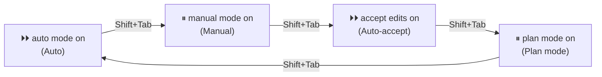

# Lesson 4 — Your first prompt

**Course:** [Claude Code 101](https://academy.claude.com/courses/claude-code-101) &nbsp;·&nbsp; **Chapter 2:** Your first prompt &nbsp;·&nbsp; **Completed:** October 17, 2026

| Previous | Course | Next |
|:---|:---:|---:|
| [← Installing Claude Code](03-installing-claude-code.md) | [📚 Course index](README.md) | [The explore → plan → code → commit workflow →](05-explore-plan-code-commit.md) |

---

**On this page**

| # | Section |
|:---:|:---|
| 1 | [Revision summary](#revision-summary) |
| 2 | [In one sentence](#in-one-sentence) |
| 3 | [The three parts](#the-three-parts) |
| 4 | [1. Choose a permission mode](#1-choose-a-permission-mode) |
| 5 | [2. Plan mode: look and plan, change nothing](#2-plan-mode-look-and-plan-change-nothing) |
| 6 | [3. Example: add a dark mode toggle](#3-example-add-a-dark-mode-toggle) |
| 7 | [4. Write a descriptive prompt](#4-write-a-descriptive-prompt) |
| 8 | [Recap](#recap) |
| 9 | [My notes / practice](#my-notes--practice) |
| 10 | [FAQ](#faq) |

---

### Revision summary

*Every key fact from this lesson in one place, for quick revision. The sections below explain each point.*

- **"Prompt"** = the message you type to Claude Code.
- **Permission modes:** how often Claude Code stops to ask "Can I do this?"

  | Mode | Status bar | Edits without asking? | Commands without asking? |
  |---|---|---|---|
  | Manual | `⏸ manual mode on` | ❌ | ❌ |
  | Auto-accept | `⏵⏵ accept edits on` | ✅ | ❌ (most) |
  | Plan mode | `⏸ plan mode on` | Can't edit | Only exploring commands, checked first |
  | Auto | `⏵⏵ auto mode on` | ✅ | ✅, a second AI model (the *classifier*) checks each action |

- **Shift+Tab** moves to the next mode. Glance at the status bar before typing: recent versions start new terminal sessions in Auto mode. Auto mode only appears if your company allows it.
- **No right or wrong mode.** Manual for learning or important code, auto-accept for everyday work, Auto for long tasks, plan mode for big or unfamiliar changes.
- **⚠️ Auto-accept exception:** simple file commands inside the project run without asking: `mkdir`, `touch`, `mv`, `cp`, `rm`, `rmdir`, `sed`. `rm` deletes files, so commit your work first.
- **Plan mode:** Claude Code researches with read-only tools, asks questions, writes a plan (which files, what changes, what order), and **waits**. Nothing is edited until you approve.
- **Files read in plan mode are still sent to the model.** Plan mode stops edits, not reading.
- **Turn plan mode on:** Shift+Tab, or `/plan <your prompt>` for one prompt, or start with `claude --permission-mode plan`. Leave without approving: Shift+Tab again.
- **When the plan is ready:** **Yes, and use auto mode** (or **Yes, auto-accept edits**), **Yes, manually approve edits**, or **No, keep planning**. **Ctrl+G** opens the plan in your text editor.
- **When plan mode is worth it:** multi-step features, unfamiliar code, safe code reviews, anything costly to get wrong. A typo? Just ask.
- **Esc** stops or redirects Claude Code at any time, even after you approve the plan.
- **A descriptive prompt says:** how far to go, what to build and where, how it behaves, and rules to follow. Even better: what "done" looks like, what not to touch, and extra behavior.
- **Dark mode example:** the plan found two CSS files with fixed colors, and turned "a good contrast color" into real colors with contrast of at least **4.5 : 1** (the WCAG AA readability rule).
- **Exam:** make plan mode the default with `defaultMode: "plan"` in the project's `.claude/settings.json`. Auto mode is fine for low-risk work; admins can turn it off in managed settings. Plan mode prevents edits but not reading.

---

### In one sentence

You talk to Claude Code in plain words, but before you press Enter you choose **how much it should ask you first**, and for big jobs you let it **make a plan before it changes anything**.

### The three parts

| Part | What it means in plain words |
|---|---|
| **1. Permission mode** | How often Claude Code stops to ask "Can I do this?" You switch with **Shift+Tab**. |
| **2. Plan mode** | Claude Code only reads and thinks, then hands you a plan. Nothing changes until you say yes. |
| **3. A descriptive prompt** | The clearer you say what you want, the better the plan and the result. |

A **prompt** is the message you type to Claude Code. The course's example prompt runs through the lesson:

> **You:** "My app needs a dark mode implemented across the entire app. Can you create a toggle switch on the header that allows a user to toggle between light mode and dark mode? I need you to find a good contrast color that works based on my existing light theme."

---

### 1. Choose a permission mode

Think of a builder in your house. **Manual:** they ask before every job. **Auto-accept:** they paint on their own, but ask before using power tools. Paint is easy to redo; a hole in the wall is not. **Auto:** they work alone all day while a supervisor stops anything dangerous. For Claude Code, file edits are the paint and commands are the power tools.

| Mode | Edits files without asking? | Runs commands without asking? |
|---|---|---|
| **Manual** | ❌ Asks every time | ❌ Asks every time |
| **Auto-accept** | ✅ Yes | ❌ Asks (most commands) |
| **Auto** | ✅ Yes | ✅ Yes. A second AI model (the docs call it the *classifier*) checks each action first and blocks dangerous ones. |

The course says **there's no right or wrong mode.** Pick what you're comfortable with.

<!-- IMAGE: Claude Code in auto-accept mode, reading files and working through a task → images/04-auto-accept-mode.png -->

#### How to switch: Shift+Tab

Each press of **Shift+Tab** moves to the next mode. The **status bar** (the line under the box where you type) shows which one you're in:



- **Plan mode is in the same cycle** (section 2).
- **Auto mode only appears if it's available to you.** Your company can turn it off.
- **Which mode you start in** depends on your version and settings. In recent versions, new terminal sessions start in Auto mode by default. Glance at the status bar before you type.

| Pick | When | Example |
|---|---|---|
| **Manual** | Learning, or important code | Your first week. Payment code. |
| **Auto-accept** | Everyday work | A bug in a project you know well |
| **Auto** | Long tasks where clicking "allow" slows you down | "Add tests for every file in `src/utils/`." |
| **Plan mode** | Big, multi-step, or unfamiliar changes | "Add dark mode across the whole app." |

> ⚠️ **Auto-accept doesn't ask about *every* command.** The docs say a few simple file commands inside your project run without asking: `mkdir`, `touch`, `mv`, `cp`, `rm`, `rmdir`, and `sed`. `rm` deletes files. If a deleted file was never saved to Git, it's gone. Commit your work first, or use Manual mode.

---

### 2. Plan mode: look and plan, change nothing

Before builders touch your house, an architect walks through it and draws a plan. You say "yes" or "change this." Plan mode is the architect.

In plan mode, Claude Code:
1. **Researches with read-only tools.** It opens files and searches your code. (**Read-only** means it can look but not change anything.) Commands it runs to explore, like listing files, are checked first: by the safety check if Auto mode is available, otherwise by asking you.
2. **Asks you questions** when something isn't clear.
3. **Writes a detailed plan:** which files it will change, what, and in what order.
4. **Waits.** Nothing is edited until you approve.

| To… | Do this |
|---|---|
| Turn it on during a session | Press **Shift+Tab** until the status bar shows `⏸ plan mode on` |
| Use it for one prompt only | Start the prompt with `/plan`, e.g. `/plan add a dark mode toggle` |
| Start Claude Code in it | `claude --permission-mode plan` |
| Leave without approving | Press **Shift+Tab** again |

<!-- IMAGE: Claude Code with plan mode on, showing the status bar indicator → images/04-plan-mode-indicator.png -->

When the plan is ready, you choose:

| Choice | What happens |
|---|---|
| **Yes, and use auto mode** | Approves and builds without asking. (Shows **Yes, auto-accept edits** if Auto isn't available.) |
| **Yes, manually approve edits** | Approves, but asks before each edit. |
| **No, keep planning** | You say what to change; Claude Code updates the plan. |

You can also press **Ctrl+G** to open the plan in your text editor and change it yourself.

**When is plan mode worth it?** Multi-step features, unfamiliar code, safe code reviews (it can't edit, so nothing changes by accident), and anything costly to get wrong. Fixing a bad plan costs a sentence; fixing bad code in 10 files costs much more. For a typo, just ask.

---

### 3. Example: add a dark mode toggle

The project, questions, and plan below are **made up to show the steps**. A real session will look different.

```text
C:\projects\recipe-app\
└── src\
    ├── components\
    │   └── header.js          ← where the toggle should go
    └── styles\
        ├── theme.css          ← the light theme colors
        ├── cards.css
        └── footer.css
```

`src/styles/theme.css` holds the light colors as **CSS variables** (named colors the rest of the app reuses):

```css
:root {
  --color-background: #ffffff;
  --color-surface:    #f5f7fa;
  --color-text:       #1f2933;
  --color-primary:    #2563eb;
  --color-border:     #e4e7eb;
}
```

**Step 1. Start and switch.** Run `cd C:\projects\recipe-app`, then `claude`. Press **Shift+Tab** until you see `⏸ plan mode on`.

**Step 2. Type the prompt** from the top of this lesson.

<!-- IMAGE: Entering the dark mode prompt in Claude Code with plan mode enabled → images/04-dark-mode-prompt.png -->

**Step 3. Claude Code researches.** You see it search for `"color"` and read `theme.css`, `cards.css`, `footer.css`, and `header.js`. Nothing is changed, but every file it reads is sent to the model ([lesson 2](02-how-claude-code-works.md)).

**Step 4. It asks questions** your prompt left open:

```text
1. Should the app remember the user's choice the next time they visit?
2. On a first visit, should the app follow the computer's light/dark setting?
```

**Step 5. It shows the plan:**

```text
Plan: Add dark mode with a toggle in the header

What I found
- The light theme is 5 color variables in theme.css.
- cards.css (line 4) and footer.css (line 7) use fixed colors instead
  of the variables, so they'd stay light in dark mode.

Steps
1. theme.css: add dark versions of the 5 colors, used when
   <html data-theme="dark">:
     background #121417   surface #1c1f24   text #e4e7eb
     primary    #60a5fa   border  #2d3239
   (primary is a lighter blue, so it still stands out on dark)
2. cards.css, footer.css: replace the fixed colors with the variables.
3. header.js: add a 🌙 / ☀️ toggle on the right of the header.
4. New file src/theme-toggle.js: switch the theme and remember the choice.
5. Check every text color has contrast of at least 4.5 : 1.

Files to change: theme.css, cards.css, footer.css, header.js
File to create:  src/theme-toggle.js
```

Things to notice:
- **The plan caught a problem you might have missed:** two files with fixed colors. Without it, dark mode would have had white cards on a dark page.
- **"A good contrast color" became real numbers**, based on your light colors as you asked. 4.5 : 1 is the common readability rule (WCAG AA) for normal text: the text must stand out that much from its background.

**Step 6. Approve or revise.** Pick a **Yes**, or **No, keep planning** and say "Put the toggle on the left." After approval, plan mode ends and Claude Code builds it, asking as often as the option you picked says. When it's done, it tells you what it changed and why. Open the app and try the toggle yourself.

---

### 4. Write a descriptive prompt

"Make me a table" gets you *a* table. "A round oak table, 120 cm wide, seats four" gets you *your* table. The carpenter is just as skilled both times. Claude Code can only act on what you tell it and what it finds in your code.

| Part of the course's prompt | What it tells Claude Code |
|---|---|
| "across **the entire app**" | **How far** to go |
| "a **toggle switch** on the **header**" | **What** to build and **where** |
| "toggle between light mode and dark mode" | **How it behaves** |
| "based on **my existing light theme**" | **A rule to follow** |

| ❌ Vague | ✅ Descriptive |
|---|---|
| "Fix the login." | "Login fails with 'Wrong password' even when the password is right. `tests/login.test.js` shows it." |
| "Make it faster." | "The recipe search page takes 5 seconds to load. Find out why and suggest fixes. Don't change the database." |

To make a prompt even clearer, add **what "done" looks like** ("the toggle works on every page and tests pass"), **what not to touch** ("don't change the logo colors"), and **extra behavior** ("remember the user's choice," which saves plan mode a question).

**You stay in control as much as you want.** The course says: "If you want to stay in the loop at every step, you can." Use Manual mode, plan mode, or both.

> 🧠 **Remember this:** **Shift+Tab sets the leash. Plan mode draws the map. A clear prompt picks the destination.**

#### Common mix-ups

| ❌ Wrong idea | ✅ What really happens |
|---|---|
| "Auto-accept means Claude Code does everything without asking." | It skips questions for **file edits**. Most **commands** still ask. |
| "Auto mode means no safety at all." | A second AI model checks each action and blocks dangerous ones. |
| "Plan mode makes changes and shows me afterward." | It changes **nothing** until you approve the plan. |
| "In plan mode, nothing is sent to Anthropic." | Files it reads while planning are still sent to the model. |
| "Once I approve the plan, I can't stop Claude Code." | You can stop or redirect it at any time (press **Esc**). |
| "There's a correct mode everyone should use." | No right or wrong mode. It depends on the task and your comfort. |

#### Test yourself

<details>
<summary>1. You're in auto-accept mode. Claude Code wants to edit a file and then run <code>npm test</code>. Which one asks you first?</summary>

`npm test`. In auto-accept, edits happen without asking, but most commands still need your OK, because a command can do things that are hard to undo.
</details>

<details>
<summary>2. How do you switch to plan mode during a session?</summary>

Press **Shift+Tab** until the status bar shows `⏸ plan mode on`. Or start one prompt with `/plan`.
</details>

<details>
<summary>3. Claude Code shows you a plan, but you want the toggle on the left. What do you pick?</summary>

**No, keep planning**, then say what to change. Or press **Ctrl+G** to edit the plan yourself.
</details>

<details>
<summary>4. Why is "Add dark mode" a weaker prompt than the course's version?</summary>

It doesn't say how far to go, where the toggle goes, or how to pick colors. Claude Code has to guess, or ask.
</details>

---

### Recap

- **Permission modes (Shift+Tab):** Manual asks about everything. Auto-accept edits freely but asks before most commands. Auto asks nothing, but a safety check screens each action.
- **Plan mode** (same Shift+Tab cycle): Claude Code reads, asks questions, and writes a plan. Nothing changes until you approve.
- **After the plan:** approve with auto mode, approve with manual edits, or keep planning.
- **Be descriptive:** say what to build, where, how far to go, and any rules.

---

## My notes / practice

- [ ] Press Shift+Tab and write down the status bar text for each mode.
- [ ] In auto-accept mode, ask Claude Code to create a file and then run a command. Note which one asks.
- [ ] In plan mode, ask for a small feature. Pick **No, keep planning** once and change something.
- [ ] Write the same request two ways, vague and descriptive, and compare the plans.

---

## FAQ

In these answers, **Claude Code** means the program on your computer. **The model** means the AI on Anthropic's servers.

**Q1. What does "permission mode" mean?**
A setting that decides how often Claude Code stops to ask "Can I do this?" before it edits a file or runs a command. Press **Shift+Tab** to switch; the status bar shows the current one.

**Q2. What are the permission modes?**
- **Manual:** asks before every edit and command.
- **Auto-accept:** edits without asking, asks before most commands.
- **Auto:** asks nothing, but a safety check screens each action.
- **Plan mode:** only reads and plans.

**Q3. In auto-accept mode, why does Claude Code still ask before commands?**
An edit is easy to see and undo. A command can do things that are hard to undo, like deleting a folder or installing software.

**Q4. Does auto-accept mode ask before every command?**
No. A few simple file commands inside your project, like `mkdir`, `mv`, `cp`, and `rm`, run without asking. Other commands still ask.

**Q5. What does "plan mode" mean?**
A mode where Claude Code only reads and thinks. It looks through your code, asks questions, and writes a plan. It doesn't change your files until you approve.

**Q6. How do I turn on plan mode?**
Press **Shift+Tab** until the status bar shows `⏸ plan mode on`, start a single prompt with `/plan`, or start Claude Code with `claude --permission-mode plan`.

**Q7. What can I do when the plan is ready?**
Approve and build without asking (**Yes, and use auto mode**), approve with a question before each edit (**Yes, manually approve edits**), or **No, keep planning** and say what to change. **Ctrl+G** opens the plan in your editor.

**Q8. In plan mode, are my files still sent to the model?**
Yes. Every file Claude Code reads while planning is sent, the same as in any mode. Plan mode stops edits, not reading.

**Q9. Why should I write a descriptive prompt?**
Claude Code only knows what you tell it and what it finds in your code. Say what to build, where, how far to go, and any rules to follow, and you get a better plan with fewer surprises.

**Q10. (Exam angle) Your team keeps getting large changes that touch the wrong files. What process change would you suggest?**
Make plan mode the first step for multi-step changes. The developer reviews which files Claude Code will change before any edit happens, and a bad plan is fixed with one sentence instead of a cleanup. To make it the default for a project's terminal sessions, set `defaultMode` to `plan` in the project's `.claude/settings.json`. This fits the **Developer Productivity & Operational Enablement** exam domain.

**Q11. (Exam angle) A manager wants all developers in Auto mode to go faster. How do you answer?**
Auto mode removes the questions, but a background safety check still blocks dangerous actions. Whether that's enough depends on the code:
- For everyday work in a test environment, Auto mode can be fine.
- For important or sensitive code, keep a person approving commands (Manual or auto-accept), or agree on a plan first.
- Admins can turn Auto mode off for the whole company in managed settings if it isn't allowed.

This fits the **Governance, Safety & Risk** exam domain.

**Q12. (Exam angle) A security team asks: "If we use plan mode to review code, is that completely safe?" How do you answer?**
Mostly, with two points to know:
- **It doesn't edit files.** Source files stay unchanged until someone approves a plan.
- **It still reads and can run checked commands.** Files it reads are sent to the model on Anthropic's servers. Commands it runs to explore are checked first, by the safety check or by asking the user.

So plan mode prevents accidental changes, but it doesn't stop data from being read. Keep secrets out of files Claude Code is likely to open, and use permission settings to block sensitive files. This fits the **Governance, Safety & Risk** exam domain.

---

| Previous | Course | Next |
|:---|:---:|---:|
| [← Installing Claude Code](03-installing-claude-code.md) | [📚 Course index](README.md) | [The explore → plan → code → commit workflow →](05-explore-plan-code-commit.md) |
