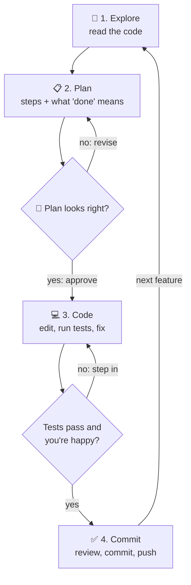

# Lesson 5 — The explore → plan → code → commit workflow

**Course:** [Claude Code 101](https://academy.claude.com/courses/claude-code-101) &nbsp;·&nbsp; **Chapter 3:** Daily workflows &nbsp;·&nbsp; **Completed:** October 17, 2026

| Previous | Course | Next |
|:---|:---:|---:|
| [← Your first prompt](04-your-first-prompt.md) | [📚 Course index](README.md) | [Context management →](06-context-management.md) |

---

**On this page**

| # | Section |
|:---:|:---|
| 1 | [Revision summary](#revision-summary) |
| 2 | [In one sentence](#in-one-sentence) |
| 3 | [The four steps](#the-four-steps) |
| 4 | [1. Explore and plan: research before any code](#1-explore-and-plan-research-before-any-code) |
| 5 | [2. Code: build it and check it](#2-code-build-it-and-check-it) |
| 6 | [3. Commit: review, then save your work](#3-commit-review-then-save-your-work) |
| 7 | [Recap](#recap) |
| 8 | [My notes / practice](#my-notes--practice) |
| 9 | [FAQ](#faq) |

---

### Revision summary

#### The workflow

For any task bigger than a one-sentence change, work in four steps: Claude Code reads the code (**explore**), you agree on an approach (**plan**), Claude Code builds and tests it (**code**), and you review and save it to Git (**commit**). Each step is a prompt you type in the right permission mode, not a button. For a one-sentence change, such as a typo, just ask.

#### Steps 1 and 2: explore and plan

Do both steps in plan mode, which blocks all file edits. Typing "don't change anything" is only a request; plan mode enforces it.

- **Explore prompt:** ask Claude Code to read part of the code and explain it without planning yet, for example "Read `src/upload/` and explain how an uploaded image is processed. Don't make a plan yet." Ask follow-ups until you could explain the code yourself.
- **Plan prompt:** ask for a plan ending in a "Done when" list. This is the *success criteria*: the checks that prove the work is finished, such as "all tests pass and the saved file is in the new format."
- **The plan is the cheapest place to fix mistakes.** There, a fix costs a sentence; in code, undoing edits across files; after release, a bug your users see.
- **Plan options:** besides the usual **Yes** options, **Yes, clear context and auto-accept edits** empties the conversation so the build starts fresh with only the plan. The last option is a text box for typing a change.
- **Plans are saved as files** in `~/.claude/plans/`. Ctrl+G opens the plan in your text editor.

#### Helpers Claude Code uses while exploring

- **"← 1 agent" in the status bar** means Claude Code has started the built-in *Plan subagent* to do the reading in its own separate conversation, keeping yours small. It starts on its own.
- **The Explore subagent** is a read-only helper for understanding code without changing it. Ask: "Use the Explore subagent to summarize how this codebase is organized." It returns only a summary.

#### Step 3: code

Picking a **Yes** option ends plan mode, and Claude Code starts building right away; the option you picked sets how often it asks you. Press Esc to stop and redirect it. If you left plan mode without approving, type "Implement the plan."

- **Four tips for a good build:**
  1. Give success criteria, so Claude Code knows when it is done.
  2. Give it tools to check its own work, such as Claude in Chrome.
  3. Keep a test suite (automated pass/fail checks) you trust.
  4. Save fixes you keep repeating in `CLAUDE.md`, the notes file Claude Code reads every session.
- **Claude in Chrome** is a browser extension that lets Claude Code open your web page, click through it, read browser errors, and take screenshots. It works in Chrome, Edge, and Brave, needs a paid plan signed in with `/login` (not an API key), and connects with `claude --chrome` or `/chrome`.
- **Warning:** a *false positive* is a test that passes although the code is wrong, such as a test checking only that "a file was saved" when the format matters. Read tests, including ones Claude Code writes, before trusting them.

#### Step 4: commit

Try the change yourself, run `/code-review`, and fix what matters. Then ask "Commit these changes in the same style as our recent commits" (Claude Code copies your past commit messages), and push to GitHub.

- **A separate AI should review the code.** Your main conversation wrote it and tends to see what it meant to write. A reviewer subagent starts empty and sees only the code, like a friend proofreading your essay.
- **Reviewer controls:** Ctrl+O shows its steps; Ctrl+B runs it in the background. Save your own reviewer's instructions in `.claude/agents/code-reviewer.md`.
- **Warning:** a reviewer asked to find problems usually finds some, even in good code. Ask for only problems affecting correctness or your requirements.

#### Exam takeaways

- **A team wastes hours undoing Claude Code's changes.** Recommend explore, plan, code, commit: plan mode first, success criteria in every plan, trusted tests, and a subagent review before committing. (Developer Productivity & Operational Enablement)
- **Claude Code says all tests pass, but the feature is broken in production.** The tests were probably false positives. Review tests, define success criteria, have a person test the change, and add an independent review. (Governance, Safety & Risk)
- **An architect asks why a separate subagent should review code.** The writing conversation carries its own assumptions and confirms its work; a fresh subagent judges only the result, like not approving your own pull requests. (Governance, Safety & Risk)

---

### In one sentence

Don't ask Claude Code to write code straight away: first let it **look around**, then agree on a **plan**, then let it **build and check**, and only then **review and save** your work. The course says: *"If you take one thing away from Claude Code, let it be this workflow."*

### The four steps

**None of the steps is a button.** Each one is a prompt you type, in the right mode (shown in the status bar; change it with **Shift+Tab**).

| Step | Who leads | Mode | What you type (example) | What you get |
|---|---|---|---|---|
| **1. Explore** | Claude Code reads | `⏸ plan mode on` | "Read src/upload/ and explain how an uploaded image flows through the pipeline. Don't plan yet." | An explanation. No files changed. |
| **2. Plan** | You and Claude Code | Still plan mode | "Now convert uploads to WebP. Where should it happen? New dependencies? Create a plan with a 'Done when' list." | A plan to approve or change |
| **3. Code** | Claude Code, you watch | Whatever your "Yes…" option names | Nothing: pick a **Yes…** option under the plan | Edits, test runs, fixes |
| **4. Commit** | You | Any mode except plan | Test it yourself, then `/code-review`, then "Commit in the style of our recent commits." | A review, then a saved commit |

A **commit** is a saved snapshot of your changes in **Git**, the tool that keeps your code's history.

Think of a house extension: the builder walks through first (explore), an architect draws a plan you can still change with a pencil (plan), the builders build it (code), and an inspector who didn't build it checks the work before you sign off (commit). **Changing the drawing costs a pencil stroke. Changing a built wall costs a week.**



#### The running example

> **You:** "I need to add WebP conversion to our image upload pipeline. Figure out where in the pipeline it should happen, whether we need new dependencies, and how to approach it."

- **WebP** is an image format from Google. Files are usually smaller than JPEGs, so pages load faster.
- An **image upload pipeline** is the chain of steps an uploaded picture goes through: check it, shrink it, save it.
- A **dependency** is an outside library your code relies on, like `sharp` for image processing.

A made-up project to show the steps:

```text
C:\projects\photo-share\
├── package.json              ← lists dependencies, including "sharp"
├── src\upload\
│   ├── pipeline.js           ← runs the 3 steps in order
│   ├── validate.js           ← step 1: check file type and size
│   ├── resize.js             ← step 2: shrink the image, save as JPEG (line 7)
│   └── storage.js            ← step 3: save to uploads/<id>.jpg
└── tests\upload.test.js
```

`src/upload/resize.js` today:

```js
1  // src/upload/resize.js
2  const sharp = require('sharp');
3
4  module.exports = async function resize(file) {
5    return sharp(file.buffer)
6      .resize({ width: 1600, withoutEnlargement: true })
7      .jpeg({ quality: 80 })            // every upload is saved as JPEG
8      .toBuffer();
9  };
```

---

### 1. Explore and plan: research before any code

Steps 1 and 2 both happen in **plan mode** ([lesson 4](04-your-first-prompt.md)): Claude Code can read, search, and run look-only commands, but **can't edit your code** until you approve a plan. Why not just say "don't change anything"? That's only a request. Plan mode actually **blocks** edits.

| To… | Do this |
|---|---|
| Turn plan mode on | **Shift+Tab** until `⏸ plan mode on`, or start one prompt with `/plan` (e.g. `/plan how does the upload pipeline work?`), or start with `claude --permission-mode plan` |
| Leave by approving | Pick a **Yes…** option under the plan |
| Change the plan | Pick **No, keep planning** (or type in the last option) |
| Leave without a plan | **Shift+Tab** again |


**What does "← 1 agent" mean?** Claude Code has handed the reading to one built-in helper, the **Plan subagent**. It reads files in its own separate conversation and sends back what it found, so your main conversation doesn't fill up. You don't start it yourself. (Subagents are lesson 9.)

#### Explore: your first prompt

1. Run `cd C:\projects\photo-share`, then `claude`. Press **Shift+Tab** until `⏸ plan mode on`.
2. Ask Claude Code to read and explain, not plan:

   ```text
   Read src/upload/ and package.json. Explain how an uploaded image
   flows through the pipeline and which image library we use.
   Don't make a plan yet.
   ```

3. Claude Code reads the files and answers, something like: *"An upload goes through validate → resize → save. resize.js always saves JPEG (line 7). sharp is already installed."*
4. **Check it understood.** Ask follow-ups until you'd be happy explaining the code yourself.

Exploring can also mean **searching the web**, for example "sharp webp output options," to check how a library works. Neither reading nor searching changes anything (but files it reads are sent to the model, [lesson 2](02-how-claude-code-works.md)).

#### Plan: your second prompt

Stay in plan mode and ask for the plan, including what "done" means:

```text
Now I want to convert uploads to WebP. Where in the pipeline should it
happen? Do we need new dependencies? Create a plan, with a "Done when" list.
```

```text
Plan: Convert uploaded images to WebP

Where: resize.js (step 2). The image is already decoded there.
New dependencies: none. sharp can already write WebP.

Steps
1. resize.js: replace .jpeg({ quality: 80 }) with .webp({ quality: 80 }).
2. storage.js: save new files as <id>.webp.
3. Leave old .jpg files alone, so old links keep working.
4. Add tests.

Done when
- All existing tests pass.
- A new test checks the saved file really is WebP.
- A new test checks the WebP is smaller than the original.
```

The plan found something you didn't ask about: old `.jpg` links. A plan is the cheap place to discover that.

**One prompt or two?** The course's single prompt does both at once. That's fine for code you know. Two prompts let you check Claude Code understood the code **before** it plans, because a wrong understanding leads to a wrong plan.

#### Review the plan: the best place to course-correct

**Course-correcting** means steering Claude Code in a new direction. Ask: *does this plan meet my criteria?*

| When you spot a mistake | What fixing it costs |
|---|---|
| **In the plan** | One sentence: "Use quality 75, not 80." or "Keep the original JPEG too." |
| **After the code is written** | Undoing and redoing edits across several files |
| **After it's committed and shipped** | Users see the bug. You debug, fix, and release again. |


In the course's screenshot:
- **The "Verification" list** is the success criteria, written into the plan.
- **"Yes, clear context and auto-accept edits"** empties the conversation first, so the build starts fresh with only the plan.
- **Option 4 is a text box.** Type a change ("Can you make the upload limit 10mb?") instead of approving.
- **The plan is saved as a file**, here `~/.claude/plans/merry-moseying-dijkstra.md`. Press **Ctrl+G** to open it in your editor (here, VS Code) and edit it yourself.

#### Only want to understand the code? Use the Explore subagent

If you don't plan to change anything, ask for the built-in **Explore subagent**: a fast, read-only helper that reads the code in its own conversation and sends back only a summary.

```text
Use the Explore subagent to give me a summary of how this codebase is organized.
```

#### Four things with "Explore" or "Plan" in the name

| Name | What it is | Who starts it |
|---|---|---|
| **Explore step** | Step 1 of the workflow: a prompt asking Claude Code to read and explain | You, by typing it |
| **Plan mode** | A permission mode: "look, don't touch" | You, with **Shift+Tab** or `/plan` |
| **Plan subagent** | A read-only helper that does the reading **in** plan mode ("← 1 agent") | Claude Code, on its own |
| **Explore subagent** | A read-only helper that searches code **outside** plan mode | Claude Code, or you by asking |

So: you do the **Explore step** in **plan mode**, and Claude Code may use a **subagent** behind the scenes to do the reading.

**When can you skip the plan?** The docs' rule: **if you can describe the change in one sentence, skip it** (a typo, a rename).

---

### 2. Code: build it and check it

1. **Approve the plan** by picking a **Yes…** option. Plan mode turns off and Claude Code starts building right away. You don't type "go."
2. **Watch it work.** Depending on the option you picked, it may ask before some edits or commands.
3. **Step in if needed.** Press **Esc** to stop it, then type what to change. The conversation is kept.
4. **It finishes** when the "Done when" list is met, for example "All 9 tests pass."

The **Yes…** option you pick sets the permission mode for the build: manual (asks before every edit), auto-accept (asks before most commands), or auto mode (asks nothing; a safety check watches). See [lesson 4](04-your-first-prompt.md). **Left plan mode without approving** (e.g. pressed Shift+Tab)? Then type: "Implement the plan. Run npm test and fix any failures."

Claude Code fixes many problems itself: it runs the tests, sees a failure, reads the error, and fixes it. But sometimes you step in. *Example:* the tests pass, but portrait photos show up sideways. You tell Claude Code, and because the whole story (files read, plan, changes) is in the conversation, it finds the cause fast. (Phones store "which way is up" as hidden data in the photo; `sharp` drops it unless you call `.rotate()`.)

#### Four tips

| Do | Why | Example |
|---|---|---|
| **Define success criteria** | Claude Code can only know it's done if it knows what "done" means. | "Done when the saved file is WebP and all tests pass." |
| **Add tools so it can check itself** | Every check you do by hand is another round of back and forth. | **Claude in Chrome** lets Claude Code open and test your web page (below). |
| **Have a test suite you trust** | A **test suite** is a set of automated pass/fail checks Claude Code can rerun as it works. | `npm test` with a test that really checks the file format |
| **Save repeated fixes to `CLAUDE.md`** | Claude Code reads that file every session ([lesson 8](08-claude-md-file.md)), so the fix sticks. | "Add to CLAUDE.md: always call `.rotate()` with sharp." |


**Claude in Chrome** (from the docs): works with Chrome, Edge, and other Chromium browsers like Brave; needs a paid Claude plan (Pro, Max, Team, or Enterprise) signed in with `/login`, not an API key; and you connect it with `claude --chrome` or `/chrome`. It can open pages, fill forms, read **console errors** (error messages the browser prints), and take screenshots. Example prompt:

```text
Open localhost:3000, upload tests/fixtures/portrait.jpg, and check that
the image on the page shows the right way up and is a .webp file.
```

Claude Code can also **write the tests** for you. Read them before trusting them.

> ⚠️ **Watch for false positives.** A **false positive** is a test that passes even though the code is wrong. *Example:* a test only checks "a file was saved." It passes even if the file is still a JPEG. Check that tests test the real result before you trust them. Then they're a **source of truth** for you, your team, and Claude Code.

---

### 3. Commit: review, then save your work

Stay in the same session, in any mode except plan mode:

| # | You do | You type |
|:---:|---|---|
| 1 | **Try the change yourself** | Nothing. Run the app and upload a few photos. |
| 2 | **Get a fresh review** | `/code-review` |
| 3 | **Fix what matters** | "Fix issue 1. Ignore the style suggestions." |
| 4 | **Commit** | "Commit these changes with a message in the same style as our recent commits." |
| 5 | **Push** (optional) | "Push to GitHub," or run `git push` yourself |

#### Why a subagent should review, not your main session

Your main Claude Code session wrote the code, so it tends to see what it **meant** to write. A **code-reviewer subagent** starts with a fresh, empty conversation and sees only the code. The course says it "doesn't carry the bias the main agent might have from the session." It's like asking a friend to proofread your essay. (Lesson 7 covers `/code-review` in full.)


In the screenshot, the prompt is plain English ("Spawn the code reviewer subagent to review the code we last created"). The subagent shows up by name, `code-reviewer(Review recent code changes)`, with its own tool calls under it: a `Bash` search for `.ts` files, two `Read`s, and "+17 more tool uses." Those happen in **its** conversation, not yours. **Ctrl+O** shows them; **Ctrl+B** lets it run in the background.

Three ways to get the review: run `/code-review`; ask in plain words ("Use a subagent to review my changes to `src/upload/` for bugs"); or save your own reviewer's instructions in `.claude/agents/code-reviewer.md` and ask for it by name (lesson 9).

> ⚠️ A reviewer asked to find problems usually finds some, even in fine code. Ask it to report only problems that affect correctness or your requirements.

#### The commit message

Claude Code reads your recent commits (`git log`) and copies their style. If your history looks like `feat(upload): limit file size to 10 MB`, it might write:

```text
feat(upload): convert uploaded images to WebP

- Output WebP from the resize step (quality 80)
- Save new files as .webp; existing .jpg files are unchanged
- Auto-rotate images so phone photos keep their orientation
```

Then push and start the next feature.

> 🧠 **Remember this:** **Look, plan, build, check, save.** Fix ideas in the plan, where it costs a sentence, not in the code, where it costs an afternoon.

#### Common mix-ups

| ❌ Wrong idea | ✅ What really happens |
|---|---|
| "Planning slows me down." | Skipping it usually means more course-correcting later. |
| "Every task needs a plan." | Not if you can describe the change in one sentence. |
| "After approving the plan, I have to type 'now build it'." | Approving turns plan mode off and Claude Code starts right away. |
| "If the tests pass, the code is right." | Only if the tests check the right thing (watch for false positives). |
| "The session that wrote the code is the best reviewer." | It's biased toward its own work. A subagent reviews fresh. |
| "Commit as soon as Claude Code says it's done." | Test it yourself, review, then commit. |

#### Test yourself

<details>
<summary>1. How do you do the Explore step in Claude Code?</summary>

Press Shift+Tab until `⏸ plan mode on`. Then ask Claude Code to read part of the code and explain it, without planning yet.
</details>

<details>
<summary>2. Why is the plan the best place to course-correct?</summary>

No code exists yet. Changing a plan costs one sentence; changing code means undoing and redoing edits.
</details>

<details>
<summary>3. A test checks only that "a file was saved." Why is that a problem for the WebP feature?</summary>

It passes even if the file is still a JPEG. That's a false positive. The test should check the file really is WebP.
</details>

<details>
<summary>4. Why use a subagent to review code before committing?</summary>

The main session wrote the code and is biased toward it. A subagent starts fresh and sees only the code.
</details>

---

### Recap

- **Every step is a prompt** in the right mode. Shift+Tab changes the mode.
- **Explore and plan** in plan mode: ask for an explanation, check it, then ask for a plan with "Done when." Revise the plan; it's the cheapest place to fix mistakes.
- **Code:** approve with a **Yes…** option and Claude Code builds and tests. Give it success criteria, tools, and tests you trust. Save repeated fixes to `CLAUDE.md`.
- **Commit:** try it yourself, get a fresh subagent review, commit in your style, push.

---

## My notes / practice

- [ ] Do all four steps on a small feature, as separate prompts.
- [ ] Watch for "← 1 agent" while Claude Code explores in plan mode.
- [ ] Add a "Done when" list to a plan prompt.
- [ ] Run `/code-review` before committing, then ask for a commit in my style.
- [ ] Do the course's "Check your understanding" questions.

---

## FAQ

In these answers, **Claude Code** means the program on your computer. **The model** means the AI on Anthropic's servers.

**Q1. What is the explore, plan, code, commit workflow?**
Four steps: Claude Code reads the code (explore), writes a plan you review (plan), builds and tests it (code), and you test, review, and save it to Git (commit).

**Q2. Why shouldn't I ask Claude Code to write code straight away?**
It may pick the wrong approach, and you spend longer course-correcting later. Exploring and planning catch mistakes while they're cheap.

**Q3. How do I do each of the four steps?**
Each is a prompt. Explore and plan: turn on plan mode (Shift+Tab), ask for an explanation, then for a plan. Code: pick a **Yes…** option under the plan. Commit: test it, run `/code-review`, then ask for a commit.

**Q4. What does "← 1 agent" mean in the status bar?**
Claude Code has started one helper, usually the built-in Plan subagent, to do the reading in its own conversation. It's normal.

**Q5. What does "Explore subagent" mean?**
A built-in, read-only helper that reads your code in its own conversation and sends back a summary. Use it when you want to understand code without planning a change.

**Q6. Do I always need to make a plan?**
No. If you can describe the change in one sentence, like a typo or a rename, just ask.

**Q7. What happens after I approve the plan?**
Plan mode turns off and Claude Code starts building right away. The option you picked decides how often it asks you.

**Q8. What does "success criteria" mean?**
A clear description of what "correct" looks like, like "all tests pass and the saved file is really WebP." Put it in the plan so Claude Code knows when it's finished.

**Q9. What does "false positive" mean for tests?**
A test that passes even though the code is wrong. For example, "a file was saved" passes even if it's still a JPEG.

**Q10. Why should a subagent review the code instead of the main session?**
The main session wrote the code and tends to confirm its own work. A subagent starts with a fresh conversation and sees only the code.

**Q11. (Exam angle) A team lead says their developers waste hours undoing Claude Code's changes. What workflow would you recommend?**
Explore, plan, code, commit:
- Start multi-step work in plan mode, so the approach is agreed before any edit.
- Put clear success criteria in every plan.
- Keep a trusted test suite so Claude Code can check its own work.
- Review with a subagent before committing.

This fits the **Developer Productivity & Operational Enablement** exam domain.

**Q12. (Exam angle) Claude Code says a feature is done and all tests pass, but it's broken in production. What went wrong, and how do you prevent it?**
Probably the tests gave a **false positive**: they passed without checking the real behavior. To prevent it:
- Review tests before trusting them, so they're a true source of truth.
- Define clear success criteria in the plan.
- Have a human test the change before committing.
- Add an independent subagent review, which isn't biased by having written the code.

This fits the **Governance, Safety & Risk** exam domain.

**Q13. (Exam angle) An architect asks why code review should use a separate subagent instead of the same Claude Code session. How do you answer?**
The session that wrote the code carries its own reasoning and assumptions in its context, so it tends to confirm its own work. A subagent starts with a fresh context and sees only the changes and the criteria you give it, so it judges the result on its own. It's the same idea as not letting authors approve their own pull requests. This fits the **Governance, Safety & Risk** exam domain.

---

| Previous | Course | Next |
|:---|:---:|---:|
| [← Your first prompt](04-your-first-prompt.md) | [📚 Course index](README.md) | [Context management →](06-context-management.md) |
