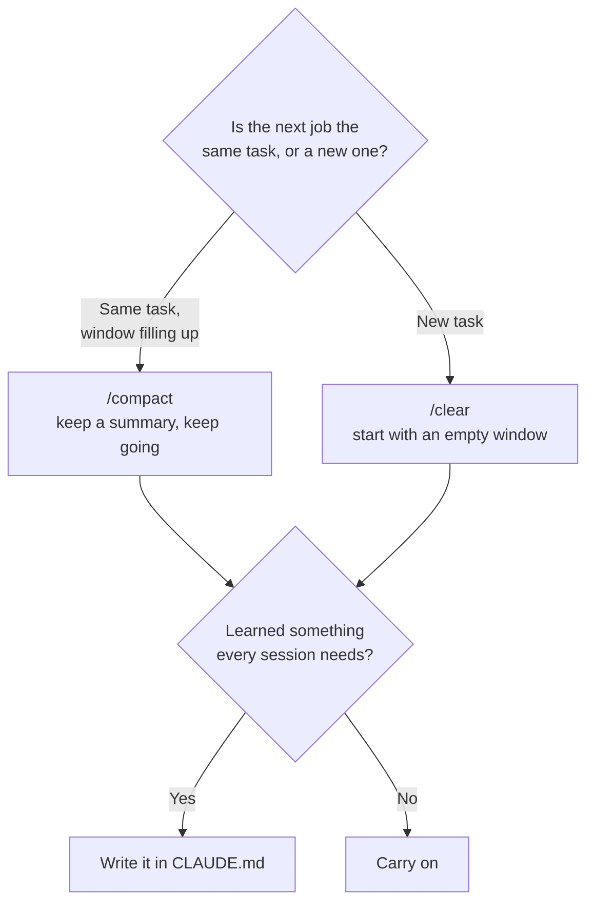
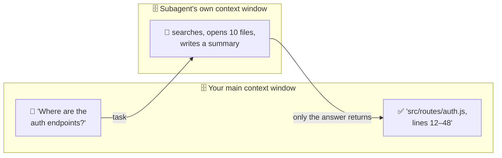

# Lesson 6 — Context management

**Course:** [Claude Code 101](https://academy.claude.com/courses/claude-code-101) &nbsp;·&nbsp; **Chapter 3:** Daily workflows &nbsp;·&nbsp; **Completed:** October 18, 2026

| Previous | Course | Next |
|:---|:---:|---:|
| [← The explore → plan → code → commit workflow](05-explore-plan-code-commit.md) | [📚 Course index](README.md) | [Code review →](07-code-review.md) |

---

**On this page**

| # | Section |
|:---:|:---|
| 1 | [Revision summary](#revision-summary) |
| 2 | [In one sentence](#in-one-sentence) |
| 3 | [The five parts](#the-five-parts) |
| 4 | [1. The context window: the model's working memory](#1-the-context-window-the-models-working-memory) |
| 5 | [2. When the window fills up: compaction](#2-when-the-window-fills-up-compaction) |
| 6 | [3. Three commands: /context, /compact, /clear](#3-three-commands-context-compact-clear) |
| 7 | [4. Compact or clear?](#4-compact-or-clear) |
| 8 | [5. Three ways to save space](#5-three-ways-to-save-space) |
| 9 | [Recap](#recap) |
| 10 | [My notes / practice](#my-notes--practice) |
| 11 | [FAQ](#faq) |

---

### Revision summary

#### What the context window is

The context window is everything the model can see during one Claude Code session: its short-term memory, with a fixed size.

- It holds Anthropic's built-in instructions, the tool list, your `CLAUDE.md`, your prompts, every file Claude Code read, every command's output, and every reply.
- Nothing leaves it automatically. A file read an hour ago still takes up space.
- Size is measured in **tokens**: small pieces of text, usually a short word or part of one. 100 tokens is roughly 75 English words.
- A typical window holds 200,000 tokens; some newer models hold 1 million.

#### Why the size of the context window matters

A full context window causes three problems:

1. **Claude Code runs out of room.** On a long task, it must shorten the conversation to continue, which loses detail.
2. **The model's answers get worse.** Everything in the window competes for its attention, so leftovers from an unrelated task can mislead it, for example into copying code from the wrong part of the project.
3. **Every message costs more.** The model doesn't remember earlier messages, so Claude Code resends the whole conversation each time. A fuller window means larger messages and more of your plan or budget used.

#### How Claude Code makes room: compaction

**Compaction** replaces the conversation with a short summary to free space. It happens automatically when the window is nearly full, or when you type `/compact`.

- The summary keeps your request, the key decisions, and which files were involved.
- It drops long command output, the full text of earlier files, and the exact wording of past errors. If an old error matters again, paste it again.
- Afterwards, Claude Code reloads `CLAUDE.md` from disk, plus up to five recently used files, so project rules always survive.

#### Three commands for managing the context window

| Command | What it does | Afterwards, Claude Code remembers |
|---|---|---|
| `/context` | Shows how full the window is and what uses the space | Everything |
| `/compact` | Replaces the conversation with a summary now | A summary |
| `/clear` | Starts a new, empty conversation | Nothing from before |

- **`/context`:** Anthropic's instructions and the tool list use about 17,500 tokens before you type. The **autocompact buffer** (about 45,000 tokens) is kept free so compaction has room to run, and counts as used. Subagents, skills, and memory files are listed with their sizes.
- **`/compact`** takes instructions on what to keep, such as `/compact Focus on the failing email tests`. A "Compact instructions" section in `CLAUDE.md` guides every automatic compaction.
- **`/clear`** doesn't change your files, and `CLAUDE.md` loads again. `/resume` reopens the old conversation. `/reset` and `/new` do the same as `/clear`.

#### When to compact and when to clear

- **Partway through a task, with the window filling up:** use `/compact`, so the history stays in summary form.
- **Starting an unrelated task:** use `/clear`, so the old task doesn't influence the new one.
- **Something every future session needs:** put it in `CLAUDE.md`, which loads at every start and after both commands.

#### How to use less of the context window

1. **Write specific prompts.** A vague prompt like "add password reset" makes Claude Code open many files to work out what you mean, and each one takes space. Naming the exact files uses far less, even though the prompt is longer.
2. **Turn off unused MCP servers.** MCP servers are add-ons that give Claude Code extra tools, such as reading GitHub issues. Each takes some space at the start of every session, even unused. Type `/mcp` to switch them off. A command-line tool such as `gh` uses even less.
3. **Hand research to a subagent.** A subagent is a helper with its own separate context window; only its answer returns to your conversation. It still uses the model, so it still counts against your plan or budget.
4. **Move rarely used instructions into skills.** Only a skill's one-line description loads at the start; the full instructions load when used.

#### Exam takeaways

- **A developer says Claude Code gets worse late in long sessions.** The window is full of old material. Recommend `/clear` between tasks, `/compact` with focus instructions, lasting rules in `CLAUDE.md`, and subagents for research. (Developer Productivity & Operational Enablement)
- **A team lead sees high usage costs.** Recommend clearing between tasks, specific prompts, fewer MCP servers, a short `CLAUDE.md`, and subagents for work with long output. (Developer Productivity & Operational Enablement)
- **A security reviewer asks whether compaction removes code from Anthropic's servers.** No. It only changes what is sent from then on. To control what reaches the servers, limit which files Claude Code can read. (Governance, Safety & Risk)

---

### In one sentence

Each Claude Code session has a **limited memory**, and everything it reads or does fills it up, so you keep it useful by **checking** it (`/context`), **shrinking** it (`/compact`), **emptying** it (`/clear`), and **not filling it with junk**.

### The five parts

| Part | What it means in plain words |
|---|---|
| **1. The context window** | The model's working memory for this session. Fixed size. |
| **2. Compaction** | When it's nearly full, Claude Code replaces the old conversation with a short summary. |
| **3. Three commands** | `/context` shows what's in it. `/compact` summarizes it. `/clear` empties it. |
| **4. Compact or clear?** | Same task → compact. New task → clear. Needed forever → `CLAUDE.md`. |
| **5. Saving space** | Be specific, turn off tools you don't need, send side research to a helper. |

The running example, in the `my-app` project from [lesson 2](02-how-claude-code-works.md):

> **You:** "Add a 'forgot password' feature: a reset link sent by email."

It's a big job with lots of file reads and test runs. Afterwards you'll start a **new** feature, dark mode.

---

### 1. The context window: the model's working memory

Think of a **desk**. While you work, you spread papers on it: notes, open files, printouts of test results. You can only work with what's on the desk, and the desk has a fixed size. The **context window** is that desk: everything the model can see right now, in this session.

What goes on the desk:
- **Before you type:** Anthropic's instructions, the tool list, and your `CLAUDE.md` (lesson 2's "starter pack").
- **Your prompts:** "Add a 'forgot password' feature…"
- **Files Claude Code reads:** `src/login.js`, `src/users.js`, `src/routes/auth.js`…
- **Tool calls and their results:** often the biggest items. One test run can print hundreds of lines.
- **The model's replies.**

**Nothing leaves the desk by itself.** A file read an hour ago still takes space.

Space is counted in **tokens**. A **token** is a small piece of text, usually a short word or part of one; 100 tokens is about 75 English words. The window in this lesson's screenshots holds **200,000 tokens**. Some newer models hold up to 1 million.


Pink stacks are taken; grey stacks are free. Every prompt, file read, and result turns another stack pink.

**Why it matters:**
1. **Space runs out** on long tasks.
2. **Junk gets in the way.** Old, unrelated material can distract the model.
3. **Every message costs more.** Claude Code sends the whole conversation to the model every round, so a fuller window means bigger messages and more usage.

---

### 2. When the window fills up: compaction

When the window is nearly full, Claude Code **compacts** it automatically: it replaces the long conversation with a short summary. On the desk, you write a one-page summary, bin the papers, and carry on with the summary.


The summary keeps what you asked for, the key ideas, and which files were involved. For the example:

| ✅ Kept | ❌ Dropped |
|---|---|
| "The user wants a forgot-password feature with an email link." | The full output of each test run |
| "We added `resetPassword()` in `src/users.js`." | Full contents of files read early on |
| "Tests for the reset link are still failing." | The exact wording of an old error |

After compacting, Claude Code also **re-reads your project's `CLAUDE.md`** from disk, plus up to five files it recently used. So your project rules always survive.

> ⚠️ **Details can get lost.** An hour ago a test failed with `Error: SMTP_HOST is not set`, and you fixed it. After compaction the summary only says "fixed an email config error," so if it comes back, Claude Code has to hunt for the cause again. Paste the error again.

---

### 3. Three commands: /context, /compact, /clear

| Command | What it does | On the desk | Memory of past work? |
|---|---|---|---|
| `/context` | Shows how full the window is and what's using it | Look at the desk | Unchanged |
| `/compact` | Summarizes the conversation now | Write a summary, bin the papers | ✅ As a summary |
| `/clear` | Starts a new, empty conversation | Clear the whole desk | ❌ None |

#### `/context`: see what's using space


| Line in the screenshot | What it means |
|---|---|
| `claude-haiku-4-5-20251001 · 64k/200k tokens (32%)` | The model in use, and how full the window is |
| `System prompt: 2.9k tokens (1.4%)` | Anthropic's instructions. Always there. |
| `System tools: 14.6k tokens (7.3%)` | The tool list. Always there. |
| `Messages: 1.3k tokens (0.7%)` | Your actual conversation so far (small: the session just started) |
| `Free space: 136k (68.1%)` | Room left |
| `Autocompact buffer: 45.0k tokens (22.5%)` | Space **kept free on purpose** so automatic compaction has room to run |

So the 64k "used" is 2.9k + 14.6k + 1.3k + the 45k buffer: most of it isn't your conversation. About 17.5k is used before you type anything. `/context` can also list **custom agents** (subagents) and **skills** with their sizes, which helps you spot what's taking space.

#### `/compact`: summarize now


**Extra (from the docs):** tell it what to keep:

```text
/compact Focus on the password reset flow and the failing email tests
```

To make **every** automatic compaction keep what you care about, add a "Compact instructions" section to `CLAUDE.md`, e.g. "When compacting, focus on test output and code changes."

#### `/clear`: start from scratch


- Your **files are not touched.** Only the conversation is emptied.
- Your **`CLAUDE.md` still loads** in the new conversation.
- **Extra (from the docs):** the old conversation isn't deleted. Get it back with `/resume`. `/reset` and `/new` do the same as `/clear`.

---

### 4. Compact or clear?



In the running example:
1. **Halfway through "forgot password,"** `/context` shows 80% full, mostly old test output. You run `/compact Focus on the reset flow and failing tests` and keep going.
2. **Feature done and committed.** Now dark mode. You run `/clear`. The old conversation would only **bias** the new work: pull it in the wrong direction, like copying a pattern from the email code or "also fixing" the reset page.
3. **You learned the email tests need `npm run test:mail`, not `npm test`.** That's true in every session, so it goes in `CLAUDE.md`.

`CLAUDE.md` is a text file in your project that Claude Code reads at the start of every session, after `/clear`, and after compaction ([lesson 8](08-claude-md-file.md)):


> 🧠 **Remember this:** **Same job → compact. New job → clear. Forever → `CLAUDE.md`.**

---

### 5. Three ways to save space

| Do this | Why it helps | Example |
|---|---|---|
| **Be specific** | Claude Code reads fewer files to work out what you mean. | "Add a reset link to `src/routes/auth.js`" instead of "add password reset" |
| **Turn off MCP servers you don't need** | Each connected server takes some space, even unused. | Switch off the Jira server in a project with no Jira |
| **Use subagents for "just the answer" questions** | The helper's research stays in **its** context window. | "Use a subagent to find where the auth endpoints are." |

**Short prompts don't save space.** Rough, made-up numbers to show the idea:

| | Vague prompt | Specific prompt |
|---|---|---|
| **You type** | "Add password reset." | "Add a 'forgot password' route to `src/routes/auth.js`. Use the `sendEmail()` function in `src/mailer.js`. Add tests to `tests/auth.test.js`." |
| **Prompt size** | ~5 tokens | ~50 tokens |
| **What Claude Code does next** | Searches and opens ~10 files to find routes, users, and email code | Opens the 3 files you named |
| **Context used** | ~25,000 tokens | ~6,000 tokens |

The course calls this the irony of short prompts: **the smaller prompt uses more context in the long run.**

**MCP servers** are add-ons that give Claude Code extra tools, like reading GitHub issues (lesson 11). At the start, only each tool's name and the server's short instructions load; full details load when needed. (The video said all tools load at once; the written course and docs say this, so I followed them.) Run `/mcp` to switch servers off. For services with a command-line tool, like `gh` for GitHub, using the tool directly takes even less space than an MCP server.

A **subagent** is a helper with its own separate context window (lesson 9). It does the searching there and sends back only the answer:



⚠️ The subagent still uses the model, so it **still uses your plan or budget**. It keeps your main window clean; it doesn't make the work free.

**Extra (from the video and docs):** **skills** (lesson 10) are packaged instructions where only a one-line description sits in the context window until used. Moving rarely needed instructions from `CLAUDE.md` into a skill keeps every session smaller.

#### Common mix-ups

| ❌ Wrong idea | ✅ What really happens |
|---|---|
| "A shorter prompt uses less context." | A vague prompt makes Claude Code explore, which uses much more. |
| "Compacting keeps everything, just smaller." | It keeps a **summary**. Details can be lost. |
| "`/clear` deletes my code changes." | It only empties the conversation. Files stay. |
| "After `/clear`, Claude Code forgets my project rules." | `CLAUDE.md` loads in every conversation. |
| "Subagents are free because they don't use my context." | They still use the model, so they still use your plan or budget. |

#### Test yourself

<details>
<summary>1. You're halfway through a feature and the context window is 85% full. Which command should you run?</summary>

`/compact`, ideally with focus instructions like `/compact Focus on the open test failures`.
</details>

<details>
<summary>2. You've finished and committed a feature. Your next task is unrelated. Which command should you run?</summary>

`/clear`. The old conversation would only add noise and could bias the new work.
</details>

<details>
<summary>3. Why can a one-line vague prompt use more context than a three-line specific one?</summary>

Claude Code has to search and open files to work out what you mean, and each file goes into the context window.
</details>

<details>
<summary>4. After compaction, Claude Code repeats a mistake you corrected earlier. Why, and what should you do?</summary>

The correction was probably lost in the summary. Tell it again. If it's a rule for every session, add it to `CLAUDE.md`.
</details>

---

### Recap

- **The context window** is the model's working memory for a session, measured in tokens. Everything fills it, and nothing leaves by itself.
- **Compaction** replaces the conversation with a summary when it's nearly full. It frees space; some detail is lost. `CLAUDE.md` is re-read.
- **Commands:** `/context` shows usage, `/compact` summarizes now, `/clear` starts fresh (`/resume` brings the old one back).
- **Same task → compact. New task → clear. Every session → `CLAUDE.md`.**
- **Save space:** be specific, turn off unused MCP servers, send research to subagents.

---

## My notes / practice

- [ ] Run `/context` before typing anything. How much do instructions and tools already use?
- [ ] Run `/compact` with focus instructions and read the summary. What was lost?
- [ ] Run `/clear`, then `/resume` to find the old conversation.
- [ ] Try the same request vague and specific, and compare `/context` after each.
- [ ] Run `/mcp` and switch off a server this project doesn't need.

---

## FAQ

In these answers, **Claude Code** means the program on your computer. **The model** means the AI on Anthropic's servers.

**Q1. What does "context window" mean?**
Everything the model can see right now in your session: your prompts, files Claude Code read, tool results, and replies. Like a desk with a fixed size.

**Q2. What does "token" mean?**
A small piece of text, usually a short word or part of a word. The context window is measured in tokens; 100 tokens is about 75 English words.

**Q3. What does "compaction" mean?**
Replacing the long conversation with a short summary to free space. It happens automatically when the window is nearly full, or when you run `/compact`.

**Q4. What do I lose when the conversation is compacted?**
Details that didn't make the summary, like an old error's exact text or full test output. Your `CLAUDE.md` is re-read, so project rules survive.

**Q5. What does "autocompact buffer" mean in the `/context` output?**
Space Claude Code keeps free on purpose, so automatic compaction has room to run. It counts as "used" even though it's empty.

**Q6. What does the `/clear` command do?**
It starts a new conversation with an empty context window. Your files aren't changed, `CLAUDE.md` still loads, and `/resume` brings the old conversation back.

**Q7. When should I use `/compact` instead of `/clear`?**
`/compact` when you're mid-way through one task and need to keep going. `/clear` when you're starting something new, so old work doesn't bias it.

**Q8. Doesn't a short prompt save context?**
Usually the opposite. A vague prompt makes Claude Code search and open files to work out what you mean. Naming the right files costs far less.

**Q9. What does "subagent" mean, and how does a subagent save context?**
A helper Claude Code starts for a side task, with its own separate context window. It reads files there and sends back only a short answer. It still uses your plan or budget.

**Q10. (Exam angle) A developer complains that Claude Code "gets worse" late in long sessions and starts mixing up earlier tasks. What do you recommend?**
The context window is full of old, unrelated material. Recommend:
- `/clear` between unrelated tasks, so old work can't bias new work.
- `/compact` with focus instructions during a long single task.
- Rules that every session needs go in `CLAUDE.md`, so they survive both.
- Research-heavy side questions go to subagents.

This fits the **Developer Productivity & Operational Enablement** exam domain.

**Q11. (Exam angle) A team lead sees high Claude Code usage costs across the team. Which context habits would you roll out first?**
- **Clear between unrelated tasks.** Every message resends the whole conversation, so stale context costs tokens every round.
- **Write specific prompts,** so Claude Code reads fewer files.
- **Turn off unused MCP servers** in shared settings.
- **Keep `CLAUDE.md` short** and move specialist instructions into skills, which load only when used.
- **Send verbose work** (long logs, test runs, research) to subagents, ideally on a smaller model.

This fits the **Developer Productivity & Operational Enablement** exam domain.

**Q12. (Exam angle) A security reviewer asks: "If Claude Code compacts the conversation, is the code it read earlier taken back from Anthropic's servers?" How do you answer?**
No. Compaction only changes what Claude Code sends **from now on**. Anything already sent was already sent. To control what reaches the servers, limit what Claude Code can read (permission settings, keeping secrets out of files it's likely to open), not how often it compacts. This fits the **Governance, Safety & Risk** exam domain.

---

| Previous | Course | Next |
|:---|:---:|---:|
| [← The explore → plan → code → commit workflow](05-explore-plan-code-commit.md) | [📚 Course index](README.md) | [Code review →](07-code-review.md) |
