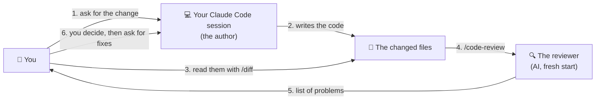
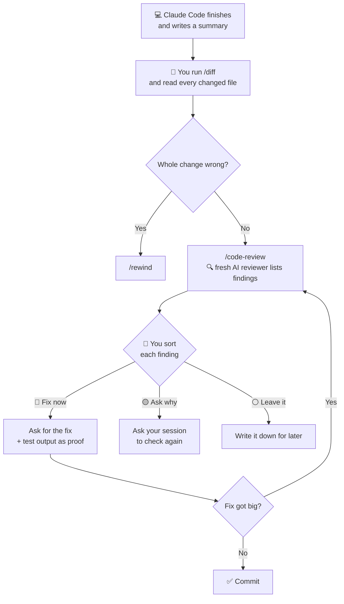

# Lesson 7 — Code review

**Course:** [Claude Code 101](https://academy.claude.com/courses/claude-code-101) &nbsp;·&nbsp; **Chapter 3:** Daily workflows &nbsp;·&nbsp; **Completed:** October 18, 2026

| Previous | Course | Next |
|:---|:---:|---:|
| [← Context management](06-context-management.md) | [📚 Course index](README.md) | [The CLAUDE.md file →](08-claude-md-file.md) |

---

**On this page**

| # | Section |
|:---:|:---|
| 1 | [Revision summary](#revision-summary) |
| 2 | [In one sentence](#in-one-sentence) |
| 3 | [The big picture](#the-big-picture) |
| 4 | [Who's who in a code review](#whos-who-in-a-code-review) |
| 5 | [1. Why Claude Code's summary isn't enough](#1-why-claude-codes-summary-isnt-enough) |
| 6 | [2. Step 1: read the changes yourself with /diff](#2-step-1-read-the-changes-yourself-with-diff) |
| 7 | [3. Step 2: get a second opinion with /code-review](#3-step-2-get-a-second-opinion-with-code-review) |
| 8 | [4. Step 3: you decide what to do with each problem](#4-step-3-you-decide-what-to-do-with-each-problem) |
| 9 | [5. How much reviewing is enough?](#5-how-much-reviewing-is-enough) |
| 10 | [Recap](#recap) |
| 11 | [My notes / practice](#my-notes--practice) |
| 12 | [FAQ](#faq) |

---

### Revision summary

#### Why you review Claude Code's work

When Claude Code finishes a task, it writes a short report of what it did. That report can be completely true and still leave out important changes.

- For example, Claude Code might switch off a test, add a new code package, or change a settings file, and not mention any of it in the report.
- The Claude Code conversation that wrote the code is a poor judge of its own work. It remembers its own reasoning, so it sees what it meant to write rather than what it actually wrote, much like proofreading your own essay.
- The solution is a three-step review: read the changes yourself, get an independent AI review, then decide what to fix.

#### Who takes part in a review

| Who | What it is | Its job in the review |
|---|---|---|
| You | The person using Claude Code | Read the changes and make every decision |
| Your Claude Code conversation | The conversation that wrote the code | Makes the fixes you ask for, and re-checks findings you doubt |
| The reviewer | A separate AI that `/code-review` starts. Same model, but no memory of your conversation. Not a person. | Reads only the changed code and reports problems. Changes nothing. |

#### Step 1: Read the changes yourself with `/diff`

A **diff** shows the before and after of every change. Lines starting with `-` were removed, and lines starting with `+` were added.

- Type `/diff` to list every file with uncommitted changes (changes not yet saved to Git). Use the arrow keys to move between files and Enter to open one. You can also view what changed in each turn of the conversation.
- Check every diff for three warning signs:
  1. **Changes you did not ask for**, such as an edited settings file when you only asked for a change to a form.
  2. **Weakened tests.** A test that was switched off (for example with `it.skip`) or made less strict still "passes," so "all tests pass" no longer proves anything.
  3. **New packages and hard-coded values.** A new package is outside code that you now have to trust and keep up to date. A **hard-coded value** is a fixed value typed directly into the code, such as the server address `http://localhost:3000`, which only works on your own computer.
- If the whole change is wrong, undo it: type `/rewind` (or press Esc twice on an empty prompt), select the message where things went wrong, and choose **Restore code and conversation**. `/rewind` only reverses file edits. It does not undo what commands did, so a package installed with `npm install` stays installed.

#### Step 2: Get an independent review with `/code-review`

`/code-review` starts a separate AI reviewer with a **clean context**: it knows nothing about your conversation, what you asked for, or why choices were made. It sees only the changed code, which is why it notices things the author missed.

- It runs in the background and returns a list of problems, called **findings**. It does not change any code.
- Each finding gives a location (such as `src/config.ts:1`, meaning line 1 of that file), a category, and a one-sentence description. The category `correctness` means the code may behave wrongly; `style` means it works but breaks the project's conventions.
- It uses your plan or budget like any other task, so save it for changes that justify it.
- `/review` is another name for the same command. The `--fix` option applies the findings automatically, you can set how thorough the review is (from `low` to `max`), and you can point it at a pull request. `/security-review` is a separate command that checks only for security problems.

#### Step 3: Decide what to do with each finding

The reviewer only reports; you decide. Fixing everything is a mistake, because not every finding is urgent and the reviewer can be wrong.

- For each finding, ask two questions:
  1. **Is it real?** Open the file at the line the finding names and check the code yourself.
  2. **If it is real, does it matter?** It matters if it changes how the software behaves, risks losing or exposing data, weakens tests, or affects users.
- Then put the finding in one of three groups:

  | Group | Choose it when | What to do |
  |---|---|---|
  | Fix now | The problem is real and it matters | Ask your Claude Code conversation to fix it and show the test output as proof |
  | Ask why | You are not sure the problem is real | Ask your Claude Code conversation to re-check the finding, pointing it to the line in question |
  | Leave it | The problem is real but minor, such as a style issue | Write it down and fix it later together with other minor issues (the course calls this *batching*) |

- Give all your decisions in one message, for example: "Fix findings 1 and 3, then run the tests and show me the output. Check finding 2 again, because line 4 already removes extra spaces. Skip finding 4 for now."
- Always ask for proof. "I fixed it" is just another report; test output is evidence you can see. If a fix turns into a large change, run `/code-review` again.

#### How much review a change needs

- **A small, simple change** (such as a typo in a button label): a quick look at the diff is enough.
- **A change that is large, touches sensitive code** (login, payments, personal data), **is hard to undo, or is about to go to a teammate:** read the diff and also run `/code-review`.
- **A problem the reviewer keeps finding:** add a rule to `CLAUDE.md` so Claude Code stops making it, for example "Never skip or loosen a test to make it pass."

#### Exam takeaways

- **A team wants Claude Code to write and approve its own changes in one conversation.** Advise against it: the author conversation tends to confirm its own work, the same reason people do not approve their own pull requests. Require a human to read the diff, a fresh `/code-review`, and test output as proof of every fix. (Governance, Safety & Risk)
- **A change passes every test but sends live website traffic to `localhost`.** Passing tests do not prove a change is correct. Reading the diff for unrequested changes and hard-coded values would have caught it, and so would `/code-review`. (Governance, Safety & Risk)
- **A manager asks how to keep code review worth its cost.** Match the amount of checking to the risk of the change, turn repeated findings into `CLAUDE.md` rules, and fix minor findings together in one later session. (Developer Productivity & Operational Enablement)

---

### In one sentence

When Claude Code says "done," don't just trust its report: **look at what it actually changed**, **ask a fresh AI reviewer to check it**, and then **you decide** what to fix.

---

### The big picture

| Step | Who does it | What happens | Command |
|---|---|---|---|
| **1. Read the changes** | 🧑 You | You look at every line Claude Code added or removed. | `/diff` |
| **2. Get a second opinion** | 🔍 A fresh AI reviewer | It reads the changes with no background and lists problems. | `/code-review` |
| **3. Decide** | 🧑 You | For each problem: fix it now, double-check it, or leave it for later. | (you decide) |

The course's example. You asked Claude Code:

> **You:** "Add input validation to the signup form: check the email format and require passwords of at least 8 characters, with inline error messages."

In plain words: the signup form should **stop** someone whose email doesn't look like an email, or whose password is under 8 characters, and show a red message right under the wrong field. Claude Code worked on it and said it was done.

---

### Who's who in a code review

| Player | What it is | What it does in this lesson |
|---|---|---|
| 🧑 **You** (a human) | The person at the keyboard | Read the changes. **Decide** what happens to each problem. |
| 💻 **Your Claude Code session** (the author) | The Claude Code conversation you've been working in | **Wrote** the code. Later makes the fixes you ask for, and re-checks problems you doubt. |
| 🔍 **The reviewer** (an AI, **not a person**) | What `/code-review` starts: a separate check run by Claude Code, same AI model, but with **no memory of your conversation** | Reads only the changed code. Lists problems. **Changes nothing.** |
| 👥 **A teammate** (optional) | Someone else on your team | May review the work later, e.g. before it's merged. Not part of `/code-review`. |



> 🧠 **Remember this:** **Claude Code writes. A fresh Claude Code reviews. You decide.**

---

### 1. Why Claude Code's summary isn't enough

A builder redid your kitchen and says: *"New cupboards are in, the tap is fixed, everything works."* All true. But you still walk around before you pay, because they might also have moved a socket. They didn't lie; they just didn't mention it.

#### What Claude Code's summary said

```text
Added input validation to the signup form.
- Email format and password length are checked before submit
- Inline error messages appear under each field
- All tests pass

File changes: 8 files
```

Every line is true. But **8 files** changed. The numbers below mean lines **added** and **removed** (`+34 −6` = 34 added, 6 removed):

| File | What the file is | Change | Expected? |
|---|---|---|---|
| `src/components/SignupForm.tsx` | The signup form | +34 −6 | ✅ The main work |
| `src/lib/validate.ts` | New: the email and password checks | +14 | ✅ |
| `src/lib/validate.test.ts` | New: tests for those checks | +31 | ✅ |
| `src/styles/form.css` | Styles, e.g. red error text | +9 | ✅ |
| `src/components/SignupForm.test.tsx` | Tests that **already existed** | +2 **−8** | ⚠️ Why did old tests lose lines? |
| `package.json` | List of outside code packages the project uses | +1 | ⚠️ A new package was added |
| `package-lock.json` | Automatic record of exact package versions | +14 | Changes whenever `package.json` does |
| `src/config.ts` | Project settings, like the server address | +2 −1 | ⚠️ You never asked for a settings change |

#### Why Claude Code can't fairly check its own work

Your Claude Code session remembers every file it read and every choice it made ([lesson 6](06-context-management.md)). So when it looks back at its work, it tends to agree with itself. It's like proofreading your own essay: you read what you **meant** to write, not what's on the page.

> 🧠 **Remember this:** **A true summary can still be an incomplete summary.** Read the changes, not just the report.

---

### 2. Step 1: read the changes yourself with /diff

A **diff** shows the **before and after** of a change. Here's the diff for `src/config.ts`:

```diff
- export const API_URL = import.meta.env.VITE_API_URL;
+ export const API_URL = "http://localhost:3000"; // local testing
```

A line starting with **`-`** was **removed**. A line starting with **`+`** was **added**.

To open the diff viewer:
1. Type `/diff` in Claude Code.
2. It lists the files with **uncommitted changes**: changes not yet saved to Git. (**Git** keeps your project's history; saving a change to it is a **commit**.)
3. Press **↑ / ↓** to move between files, and **Enter** to see a file's diff.

The viewer can also show what each of Claude Code's **turns** changed (a turn is one round of you asking and it answering).

#### Three things to look for every time

| Look for | Why it matters | In the signup task |
|---|---|---|
| **1. Changes you didn't ask for** | Claude Code sometimes "tidies up" other things while it works. | `src/config.ts` changed. |
| **2. Tests that got weaker** | A **test** is a small program that checks your code works. A test that's switched off or made easier still "passes," so "all tests pass" proves nothing. | `SignupForm.test.tsx`: −8 lines, +2. |
| **3. New packages and typed-in values** | A **package** is someone else's code you now have to trust and update. A **typed-in value** (the course says **hard-coded**) is a fixed address or key written into the code; it may only work on your computer, or leak a secret. | `package.json` +1, and a typed-in address in `config.ts`. |

#### Practice: which 3 files look suspicious?

The course gives you a small practice question here. Try it before you open the answer.

**The question:** look back at the list of 8 changed files in [section 1](#what-claude-codes-summary-said). Using the three checks above, which **3 files** would you open in `/diff` and read carefully before keeping the change?

<details>
<summary>Show the answer</summary>

| File | Which check it fails | Why it looks suspicious |
|---|---|---|
| `src/components/SignupForm.test.tsx` | **2. Tests that got weaker** | An old test file lost more lines (−8) than it gained (+2). |
| `package.json` | **3. New packages** | A new package was added, probably just to check emails. You didn't ask for that. |
| `src/config.ts` | **1. Changes you didn't ask for** | A settings file changed. You only asked for form validation. |

The other 5 files are what you'd expect: the form, the new checks, their tests, the error style, and `package-lock.json`, which follows `package.json` automatically.

</details>

#### ⚠️ If the whole change is wrong: /rewind

1. Type `/rewind`, or press **Esc** twice on an empty prompt.
2. Pick the message that led to the bad change.
3. Choose **Restore code and conversation**.

**One limit:** `/rewind` only undoes edits Claude Code made with its file-editing tools, not what **terminal commands** did. If it ran `npm install`, that package stays. Clean it up yourself, e.g. with Git.

---

### 3. Step 2: get a second opinion with /code-review

A friend who reads your essay once often spots mistakes you missed after five reads. They aren't smarter; they just don't know what you **meant**. `/code-review` is that friend, except **it's not a person**: it's Claude Code with the same model, starting fresh.

1. **You type** `/code-review`.
2. **Claude Code starts a separate reviewer** with a **clean context**: no memory of your conversation. It doesn't know what you asked for or why choices were made. It only sees the changed code.
3. **It works in the background** (seconds to a few minutes). You can keep working.
4. **It sends back a list of problems** into your conversation. Each problem is a **finding**.
5. **Nothing has been changed.** It only reports.

It uses your plan or budget like any task, so save it for changes that deserve it (section 5). You can also ask in plain words: "Review the changes you just made. Report problems; don't fix anything yet." If Claude Code just answers in the chat instead of starting a review, type `/code-review` yourself.

**Extra (from the docs):** `/review` is the same command. `--fix` makes it apply its findings; you can set how thorough it is (`low` to `max`) or point it at a pull request. `/security-review` is a separate security check.

#### What the reviewer sent back

```text
/code-review
Reviewed 8 changed files. 4 findings:

1. src/components/SignupForm.test.tsx:18  [correctness]
   A test was skipped and an assertion weakened; a form that submits
   empty values would still pass.

2. src/lib/validate.ts:4  [correctness]
   isValidEmail doesn't trim leading or trailing spaces, so an address
   pasted with a stray space is rejected.

3. src/config.ts:1  [correctness]
   API_URL is hard-coded to localhost:3000; a production build would
   send signups to a development address.

4. src/styles/form.css:1  [style]
   Error text uses a hex color instead of the project's --color-danger
   variable.
```

Each finding has a **place** (`src/config.ts:1` = file, line 1), a **kind** (`correctness`: the code may do the wrong thing; `style`: it works but breaks the project's usual way), and **one sentence** on the problem.

---

### 4. Step 3: you decide what to do with each problem

The reviewer is done. **You** decide what happens to each finding. Why not "fix them all"?
1. **Not every finding is urgent.** A switched-off test is serious; a shade of red isn't. Fixing everything at once makes a bigger change that's harder to check.
2. **The reviewer can be wrong.** It has no background (the course says it reads the code **"cold"**). That helps it spot surprises, but it can also misread code.

Sort them like your mail: a bill due tomorrow you pay **now**; a strange letter you **call and check**; an ad you put **aside**.

| Pile | Pick it when… | What **you** do | Who does the work |
|---|---|---|---|
| 🔴 **Fix now** | The problem is real and matters. | Ask your Claude Code session to fix it **and show proof**. | Your Claude Code session |
| 🟡 **Ask why** | You're not sure it's real. | Copy the finding into your Claude Code session and ask it to check again (or look yourself). | Your Claude Code session |
| ⚪ **Leave it** | Real, but small. | Write it down; fix it later with other small problems (the course calls this **batching**). | Nobody, for now |

#### How to sort: two questions per finding

There's no button or command for this. You read each finding and ask yourself:

1. **Is the problem real?** Open the file at the line the finding names (`src/lib/validate.ts:4` = line 4), in `/diff` or your editor, and look yourself.
   - Not sure, or the code seems to say otherwise → 🟡 **Ask why**
2. **If it's real, does it matter?** Would it break how the app works, lose or leak data, weaken tests, or affect real users?
   - Yes → 🔴 **Fix now**
   - No, it's cosmetic or style → ⚪ **Leave it**

| # | Is it real? | Does it matter? | Pile |
|:---:|---|---|---|
| 1 | Yes: the diff shows `it.skip` | Yes: tests no longer protect the form | 🔴 Fix now |
| 2 | Not sure: line 4 calls `trim()` | — | 🟡 Ask why |
| 3 | Yes: the diff shows `localhost` | Yes: the live site would break | 🔴 Fix now |
| 4 | Yes: the color is typed in | No: it still shows red | ⚪ Leave it |

Then act on all your decisions with **one message** in your Claude Code session:

```text
Fix findings 1 and 3, then run the tests and show me the output.
For finding 2: line 4 already calls trim(). Check again and tell me if the finding stands.
Skip finding 4 for now.
```

For the "leave it" pile, write each item where you'll see it again (a TODO list, an issue in your tracker, a note). Later, fix them together in one session: "Fix these 5 style issues: …"

#### Sorting the four signup findings, in detail

**Finding 1 → 🔴 Fix now.** The test file diff:

```diff
- it("blocks submit when the email is empty", async () => {
+ it.skip("blocks submit when the email is empty", async () => {
  …
- expect(onSubmit).toHaveBeenCalledWith({ email: "sam@example.com", password: "correct-horse-battery" });
+ expect(onSubmit).toHaveBeenCalled();
```

- `it(...)` is one test. `it.skip(...)` means **"skip this test."** The "empty email" test no longer runs at all.
- `expect(...)` is the check inside a test (an **assertion**). Before, it checked **exactly what** the form sent. Now it only checks the form sent **something**.

So "all tests pass" was true only because the tests got easier.

**Finding 2 → 🟡 Ask why.** The claim: if someone pastes `sam@example.com ` with a space at the end, the form says the email is wrong. You open `src/lib/validate.ts`:

```ts
export function isValidEmail(value: string) {
  return isEmail(value.trim());
}
```

`trim()` removes spaces from the start and end. So the finding looks wrong. Type this in your Claude Code session:

```text
The review reported that isValidEmail doesn't trim spaces, but line 4 calls trim(). Check again and tell me whether the finding stands.
```

If the reviewer was wrong, drop it. If it was right after all (say, another email check elsewhere doesn't trim), it moves to Fix now.

**Finding 3 → 🔴 Fix now.** Before, the server address came from a setting outside the code that's different on your computer and on the live website. Now it's typed in as `http://localhost:3000`. **localhost** means "this same computer," so on the live site, real users' signups would go nowhere. And you never asked for this.

**Finding 4 → ⚪ Leave it.** The error color is typed in as `#c0392b` (a **hex color**) instead of the project's shared `--color-danger` setting. It works and shows red; it just won't update if the team changes its "danger red."

#### Ask for proof with every fix

```text
Fix the first finding: don't skip the empty-email test and restore the original assertion. Then run the tests and show me the output.
```

"I fixed it" is just another summary. Test output is evidence you can see. **If a fix grows into a big change, run `/code-review` again.**

---

### 5. How much reviewing is enough?

You don't get a lawyer to check a text message, but you do for a contract. Match the checking to the risk:

| The change… | What to do |
|---|---|
| Is small and simple (a typo in a button label) | You glance at the diff. Enough. |
| Is too big to keep in your head | You read the diff **and** run `/code-review`. |
| Touches something **sensitive** (login, payments, personal data) | Same: both. |
| Is **hard to undo** (deleting data, changing a database) | Same: both. |
| Is about to go to a **teammate** | Same: both. |

**Turn repeat problems into rules.** If the reviewer keeps finding the same thing, write a rule in `CLAUDE.md`, the file Claude Code reads at the start of every session ([lesson 8](08-claude-md-file.md)): *"Never skip or loosen a test to make it pass."*



#### Common mix-ups

| ❌ Wrong idea | ✅ What really happens |
|---|---|
| "The summary is true, so the change is fine." | A true summary can still leave out changes. |
| "All tests pass, so it works." | Tests can be switched off or made easier. Check the test files in the diff. |
| "`/code-review` sends my code to a human reviewer." | The reviewer is Claude Code itself, starting fresh. No person is involved. |
| "The reviewer decides what gets fixed." | **You** decide. It only lists problems, and it can be wrong. |
| "There's a command that sorts the findings." | You sort them yourself: is it real? does it matter? Then you tell Claude Code what to do in one message. |
| "`/rewind` undoes everything." | It doesn't undo what terminal commands did, like installing a package. |

#### Test yourself

<details>
<summary>1. Claude Code's summary says "All tests pass." Why should you still look at the test files?</summary>

Tests may have been switched off or made easier until they passed. In the example, `it.skip` switched one off and another was changed to accept any data.
</details>

<details>
<summary>2. When you run /code-review, who is the reviewer?</summary>

An AI, not a person: a separate check run by Claude Code with the same model, but no memory of your conversation. It lists problems and changes nothing.
</details>

<details>
<summary>3. The reviewer says a function is missing a check, but you can see the check in the code. What do you do?</summary>

"Ask why." Copy the finding into your Claude Code session, point to the line, and ask it to check again.
</details>

<details>
<summary>4. You used /rewind, but a package Claude Code installed is still there. Why?</summary>

`/rewind` only undoes edits made with Claude Code's file-editing tools, not what terminal commands like `npm install` did.
</details>

---

### Recap

- **Who's who:** you decide; your Claude Code session wrote the code and makes fixes; the reviewer is an AI started fresh by `/code-review`.
- **Summaries can leave things out,** and the session that wrote the code tends to agree with itself.
- **Step 1, `/diff`:** look for unrequested changes, weaker tests, new packages, typed-in values. If it's all wrong, `/rewind`.
- **Step 2, `/code-review`:** a fresh reviewer reads only the changed code and reports findings.
- **Step 3, you sort each finding:** fix now (with proof), ask why, or leave it.
- **Match the checking to the risk,** and turn repeat findings into `CLAUDE.md` rules.

---

## My notes / practice

- [ ] After my next task, run `/diff` before reading the summary closely. Did anything change that the summary didn't mention?
- [ ] Run `/code-review` and sort its findings into the three piles.
- [ ] Ask for one fix "and show me the test output."
- [ ] Try `/rewind` on a throwaway change.

---

## FAQ

In these answers, **Claude Code** means the program on your computer. **The model** means the AI on Anthropic's servers.

**Q1. Why should I check Claude Code's work if its summary is accurate?**
Accurate isn't the same as complete. In the example, every line of the summary was true, but it didn't mention a switched-off test, a new package, or a settings change.

**Q2. What does "diff" mean?**
The before and after of a change, file by file. Lines starting with `-` were removed; lines starting with `+` were added. Type `/diff` to see yours.

**Q3. What should I look for when I read a diff?**
Changes you didn't ask for, tests that got weaker, and new packages or typed-in values like a server address.

**Q4. What does "hard-coded" mean?**
A value typed straight into the code instead of coming from a setting. In the example, the server address became `http://localhost:3000`, which only works on your own computer.

**Q5. What does `/rewind` not undo?**
Anything a terminal command did, like installing a package. It only undoes edits made with Claude Code's file-editing tools.

**Q6. Who is the reviewer when I run `/code-review`?**
An AI, not a person. It's Claude Code with the same model, but starting with no memory of your conversation, so it sees only the changed code. No human sees your code.

**Q7. What does "clean context" mean?**
Starting with a blank memory. The reviewer doesn't see what you asked for or why Claude Code made its choices, the way a stranger wouldn't.

**Q8. What are the three piles for findings, and who decides?**
You decide. **Fix now** (real and matters), **ask why** (you're not sure it's real), or **leave it** (real but small, fix later).

**Q9. How do I sort a finding into a pile?**
Ask two questions. Is the problem real? Open the file at that line and look; if you're not sure, it goes in "ask why." If it's real, does it matter (behavior, data, tests, users)? Yes means "fix now"; no means "leave it." Then tell your Claude Code session what to do with every finding in one message.

**Q10. If I doubt a finding, who checks it again?**
Your normal Claude Code session. Copy the finding in, point to the line, and ask it to check. If the finding was right after all, move it to "fix now."

**Q11. Why should I ask for proof when I ask for a fix?**
"I fixed it" is just another summary. Asking it to "run the tests and show me the output" gives you evidence you can see.

**Q12. (Exam angle) A team wants Claude Code to write and approve its own changes in one session to save time. What's the risk, and what do you recommend?**
The session that wrote the code remembers its own reasoning and tends to confirm its own work. Problems like weakened tests or unrequested settings changes slip through. Recommend:
- A human reads the diff.
- A separate fresh review (`/code-review`) before the change is committed.
- Every fix comes with evidence, such as test output.

It's the same idea as not letting people approve their own pull requests. This fits the **Governance, Safety & Risk** exam domain.

**Q13. (Exam angle) A change passes all tests but sends live website traffic to localhost. How could the review process have caught it?**
Reading the diff for **changes you didn't ask for** and **typed-in values** would have shown `API_URL` changed to `"http://localhost:3000"` in `src/config.ts`. A fresh `/code-review` also flags it. Passing tests don't prove a change is right, especially if no test covers that setting. This fits the **Governance, Safety & Risk** exam domain.

**Q14. (Exam angle) An engineering manager asks how to make code review with Claude Code worth the cost. How do you answer?**
Match the checking to the risk:
- Small, simple changes: a quick look at the diff only.
- Large, sensitive, or hard-to-undo changes, and anything going to a teammate: a human reads the diff, plus `/code-review`.
- Turn repeat findings into `CLAUDE.md` rules so they stop happening.
- Fix small "leave it" findings together in one later session.

This fits the **Developer Productivity & Operational Enablement** exam domain.

---

| Previous | Course | Next |
|:---|:---:|---:|
| [← Context management](06-context-management.md) | [📚 Course index](README.md) | [The CLAUDE.md file →](08-claude-md-file.md) |
