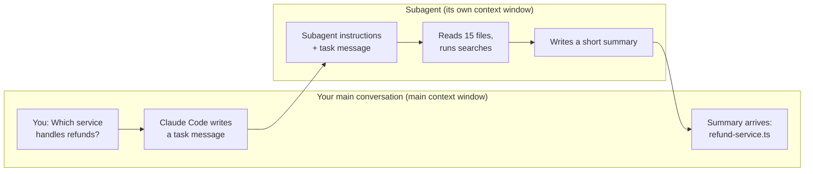

# Lesson 9 — Subagents

**Course:** [Claude Code 101](https://academy.claude.com/courses/claude-code-101) &nbsp;·&nbsp; **Chapter 4:** Customizing Claude Code &nbsp;·&nbsp; **Completed:** October 25, 2026

| Previous | Course | Next |
|:---|:---:|---:|
| [← The CLAUDE.md file](08-claude-md-file.md) | [📚 Course index](README.md) | [Skills →](10-skills.md) |

---

**On this page**

| # | Section |
|:---:|:---|
| 1 | [Revision summary](#revision-summary) |
| 2 | [The big picture](#the-big-picture) |
| 3 | [Who's who](#whos-who) |
| 4 | [1. The problem: exploring fills your context window](#1-the-problem-exploring-fills-your-context-window) |
| 5 | [2. How a subagent works, step by step](#2-how-a-subagent-works-step-by-step) |
| 6 | [3. The built-in subagents](#3-the-built-in-subagents) |
| 7 | [4. Creating your own subagent](#4-creating-your-own-subagent) |
| 8 | [5. Extra settings: memory and skills](#5-extra-settings-memory-and-skills) |
| 9 | [Recap](#recap) |
| 10 | [My notes / practice](#my-notes--practice) |
| 11 | [FAQ](#faq) |

---

### Revision summary

#### In one sentence

A subagent is a second AI helper that your Claude Code conversation starts for one job, such as searching the code for where refunds are handled: the helper reads files in its own separate memory and sends back only a short answer, so your main conversation does not fill up with everything the helper read.

#### What a subagent is and why it helps

A subagent is a helper AI conversation that your Claude Code session starts to do one task, in its own separate context window. Its main benefit is that your main context window stays clean.

- **The problem it solves:** every file Claude Code reads, every search, and every tool result is stored in your conversation's context window (its working memory, [lesson 6](06-context-management.md)). A long investigation can fill that window with material you don't need afterwards.
- **What the subagent gets at the start:** its own instructions (the *system prompt*, written in the subagent's file) and a task message that your main Claude Code session writes for it. It does not get your conversation history. From the docs: it also gets your `CLAUDE.md` files and the Git status, except the built-in Explore and Plan subagents, which skip both.
- **What comes back:** only a short summary of what it found. All the files it read and the searches it ran stay in the subagent's own context window, which is then thrown away.
- **The trade-off:** your main conversation can't see how the subagent reached its answer. If you need the evidence, ask for file paths and line numbers in the summary.
- **Example:** to answer "Which service handles refunds?", a subagent might read 15 files and run several searches. Your main conversation receives only the answer, such as "`services/refund-service.ts` handles refunds."

#### The built-in subagents

Claude Code includes subagents you can use straight away, and it chooses one by itself when a task fits.

| Subagent | Can it change files? | Use it for |
|---|---|---|
| **general-purpose** | Yes, it has every tool | Multi-step tasks that need both exploring and acting |
| **Explore** | No, it is read-only | Fast searching of a codebase |
| **Plan** | No, it is read-only | Research during plan mode, before Claude Code presents a plan |

#### Creating your own subagent

A custom subagent is one Markdown file with a settings block at the top (*YAML frontmatter*) and its instructions below.

- **Easiest way:** ask Claude Code, for example "Create a code-reviewer subagent in .claude/agents/ that reviews code for bugs and readability. Make it read-only." Claude Code writes the name, the description, and the instructions.
- **Where the file goes:** `.claude/agents/code-reviewer.md` inside a project works in that project only, and can be shared with the team through Git. `~/.claude/agents/code-reviewer.md` in your home folder (Windows: `C:\Users\you\.claude\agents\`) works in all your projects.
- **Required fields:** `name` and `description`. The description tells Claude Code when to use the subagent, so write it clearly.
- **Limiting tools:** `tools: Read, Glob, Grep` makes a subagent read-only. Claude Code enforces this list, so the subagent cannot edit files even if its instructions are ignored.
- **Restart rule:** Claude Code notices new or edited agent files within seconds. You must restart Claude Code only if the `agents` folder did not exist when the session started.
- **Running one on purpose:** say "Use the code-reviewer subagent to review my changes," or type `@` and pick it, which guarantees that subagent runs.

#### Extra settings

- **`memory`:** gives the subagent a notes folder that survives between conversations, useful when you use the same subagent on the same project often. `memory: project` saves notes in `.claude/agent-memory/<name>/`.
- **`skills`:** lists skills by name to preload. Unlike in your main conversation, where only a skill's short description loads until it is needed, the **full** skill is loaded into the subagent's context at the start.
- **`model`:** picks the model, such as `haiku` for cheap, fast searching, or `inherit` to use the same model as your main conversation.

#### Exam takeaways

- **Long investigations keep filling the context window and sessions slow down.** Hand research to subagents, such as Explore or a custom researcher, so only summaries return to the main conversation. (Solution Design & Architecture)
- **A security team wants an AI reviewer that can never change code.** Set `tools: Read, Glob, Grep` or `disallowedTools: Write, Edit` in the subagent file, because Claude Code enforces tool lists while instructions in the prompt are only advice. (Governance, Safety & Risk)
- **A team wants everyone to use the same reviewer.** Commit `.claude/agents/code-reviewer.md` to Git so every developer's Claude Code gets it, and use `memory: project` so its notes can be shared too. (Developer Productivity & Operational Enablement)

---

### The big picture

| Part | What it means in plain words |
|---|---|
| **1. The problem** | Exploring a project fills your context window with files and search results you only needed once. |
| **2. How a subagent works** | Claude Code starts a second, separate conversation for the task. That conversation does the work and sends back a summary. |
| **3. Built-in subagents** | general-purpose, Explore, and Plan come with Claude Code. |
| **4. Your own subagent** | One Markdown file in `.claude/agents/` or `~/.claude/agents/` with a name, a description, and instructions. |
| **5. Extra settings** | Memory that lasts between conversations, and skills loaded at the start. |

#### The running example: who handles refunds?

You've just joined a team that builds an online shop. You've never seen the code:

```text
shop-app/
├── .claude/
│   └── agents/                  ← where project subagent files go (section 4)
├── services/
│   ├── payment-service.ts       ← takes card payments
│   ├── refund-service.ts        ← gives money back (the answer you need)
│   ├── order-service.ts         ← tracks orders
│   └── ... 12 more files
└── CLAUDE.md
```

You want to know one fact: **"Which service handles refunds?"**

---

### Who's who

| Player | Where it lives | What it does | Example |
|---|---|---|---|
| **You** | At your computer | Ask the question | "Which service handles refunds?" |
| **Your main Claude Code session** | The program on your computer, in the conversation you are typing into | Decides to hand the task off, writes the task message, and reads the summary that comes back | Writes "Find which service handles refunds and report the file" |
| **The subagent** | A second conversation that Claude Code runs on your computer, with its own context window. It is not a person and not a separate program you install. | Does the work: reads files, runs searches, then writes a summary | Reads 15 files, then replies "refund-service.ts" |
| **The model** | Anthropic's servers | Does the thinking for **both** conversations. Each conversation sends its own context separately. | The same kind of model, or a cheaper one if the subagent file says so |
| **The subagent file** | `shop-app/.claude/agents/` or `~/.claude/agents/` | Holds the subagent's name, description, allowed tools, and instructions | `code-reviewer.md` |

---

### 1. The problem: exploring fills your context window

Your context window ([lesson 6](06-context-management.md)) is the conversation's working memory. Every **tool call** (a request from the model asking Claude Code to do something, such as read a file) and its result is kept there.

**Without a subagent**, to answer "Which service handles refunds?", Claude Code might:

1. Search all files for the word "refund."
2. Open `payment-service.ts`, `order-service.ts`, and 13 more files.
3. Follow function calls from one file to the next.
4. Find the answer: `refund-service.ts`.

All 15 files and every search result now sit in your context window. You needed one line. The rest takes up space, costs tokens in every later message, and can distract the model from your real task.

Think of asking a colleague where the stapler is. You want "second drawer," not a tour of every drawer they opened. A subagent gives you the answer without the journey.

---

### 2. How a subagent works, step by step



1. **You** ask the question.
2. **Your main Claude Code session** decides the task suits a subagent. It writes a **task message** describing the job, for example: "Find which service in `services/` handles refunds. Report the file and the main function."
3. **Claude Code starts the subagent** in a new, empty context window. The subagent receives two things the course names: its **system prompt** (the instructions in its file, which describe its role) and the **task message**. It does **not** see your conversation so far.
4. **The subagent works on its own.** It reads, searches, and uses tools. None of this appears in your main conversation.
5. **The subagent returns a summary**, such as: "`services/refund-service.ts` handles refunds, in the function `issueRefund()`."
6. **The subagent's conversation is set aside.** Only the summary is added to your main context window.

Things to notice:

- The subagent can run **in parallel** (at the same time) as your main conversation, so you can keep working.
- **The trade-off:** your main conversation loses sight of *how* the subagent got its answer and anything else it noticed. If the details matter, ask for them in the summary: "include file paths and line numbers."

> **Remember this:** The subagent takes the journey. You get the answer.

---

### 3. The built-in subagents

These come with Claude Code. You don't create them. Claude Code chooses one on its own when a task fits, or you can ask for one by name.

| Subagent | Tools | When it is used | Example |
|---|---|---|---|
| **general-purpose** | All tools, including editing files and running commands | Multi-step tasks that need both exploring and acting | "Find every place we format dates and switch them to the new helper." |
| **Explore** | Read-only: it cannot write or edit files | Fast searching of a codebase | "Which service handles refunds?" |
| **Plan** | Read-only | In plan mode ([lesson 4](04-your-first-prompt.md)), to research the code before Claude Code shows you a plan | Plan mode looking up how payments are tested |

**Extra (from the docs):** Explore and Plan skip your `CLAUDE.md` files to stay fast; other subagents load them. Claude Code also has two small built-in helpers, `statusline-setup` and `claude-code-guide`, for setting up the status bar and answering questions about Claude Code.

---

### 4. Creating your own subagent

#### Step 1: Ask Claude Code to write it

The course's prompt, typed in your main Claude Code session:

```text
Create a code-reviewer subagent in .claude/agents/ that reviews code for bugs and readability. Make it read-only.
```

Claude Code writes the name, the description, and the instructions for you.

#### Step 2: Know where the file goes

| Folder | Full path (Windows) | Works in | Shared with the team? |
|---|---|---|---|
| **Project** | `shop-app\.claude\agents\code-reviewer.md` | This project only | Yes, if you commit it to Git |
| **User** ("user" means you) | `C:\Users\you\.claude\agents\code-reviewer.md` (Mac: `/Users/you/.claude/agents/`) | All your projects | No, it stays on your computer |

If both folders have a subagent with the same name, the project one wins.

**Warning:** if the `agents` folder didn't exist when your Claude Code session started, Claude Code won't see the new subagent until you restart it (type `exit`, then `claude`). Once the folder exists, new or edited files are picked up within seconds.

#### Step 3: Read what was created

`shop-app/.claude/agents/code-reviewer.md` might look like this:

```markdown
---
name: code-reviewer
description: Reviews code for bugs and readability. Use after code changes, or when the user asks for a review.
tools: Read, Glob, Grep
model: sonnet
---

You are a code reviewer. When invoked, read the changed files and report:
1. Bugs, with the file and line number.
2. Readability problems, with a suggested fix.
Do not change any files.
```

| Line | What it means |
|---|---|
| `---` (top and bottom) | Marks the settings block (*YAML frontmatter*: a few `key: value` lines that Claude Code reads as settings) |
| `name` | The subagent's ID. Required. |
| `description` | Tells your main Claude Code session **when** to use this subagent. Required. A vague description means it is used at the wrong times or never. |
| `tools` | The only tools it may use. **Read** opens a file, **Glob** finds files by name (such as `*.ts`), **Grep** searches text inside files. With no Edit or Write, it is read-only. If you leave `tools` out, it gets all tools. |
| `model` | Which model runs it. Optional; leave it out to use the same model as your main conversation. |
| The text below | The **system prompt**: the subagent's standing instructions. |

**Why "read-only" belongs in `tools`, not just in the text:** "Do not change any files" is advice the model tries to follow. The `tools` list is enforced by Claude Code, so the subagent has no way to edit files.

#### Step 4: Use it

| You type | What happens |
|---|---|
| "Review my latest changes." | Your main Claude Code session reads the subagent descriptions and may choose `code-reviewer` by itself. |
| "Use the code-reviewer subagent to check `refund-service.ts`." | You name it, so Claude Code will almost certainly use it. |
| `@` then pick `code-reviewer (agent)` | Guaranteed to run that subagent. |

**Extra (from the docs):** in current versions, `/agents` only tells you to ask Claude Code or edit the folders directly. Older versions opened a menu for managing subagents.

#### Common mix-ups

| ❌ Wrong idea | ✅ What really happens |
|---|---|
| "The subagent sees my whole conversation." | It starts empty. It gets its instructions, the task message, and your `CLAUDE.md` files. |
| "Everything the subagent read is added to my context window." | Only its summary is added. |
| "A subagent is a separate program I install." | It is a text file. Claude Code runs it as a second conversation. |
| "Writing 'don't edit files' in the prompt makes it read-only." | Only the `tools` list enforces it. |
| "I always need to restart after adding a subagent." | Only when the `agents` folder didn't exist at startup. |

---

### 5. Extra settings: memory and skills

| Setting | What it does | Example |
|---|---|---|
| `memory: project` | Gives the subagent a notes folder that survives between conversations. It can write down what it learns and read it next time. Good for a subagent you use often on the same project. | The code reviewer remembers "this team always forgets to check for empty carts." Notes go in `shop-app/.claude/agent-memory/code-reviewer/`. |
| `skills: [...]` | Loads the listed skills ([lesson 10](10-skills.md)) at the start. | `skills: [security-checklist]` |

From the docs, the three memory options are `user` (`~/.claude/agent-memory/<name>/`, all projects), `project` (`.claude/agent-memory/<name>/`, can be shared through Git), and `local` (`.claude/agent-memory-local/<name>/`, this project, not shared).

**Warning: skills cost more space in a subagent.** In your main conversation, only a skill's short description loads at the start; the full skill loads only when it is used. In a subagent, the course says the **entire** skill is loaded at the start. So preload only the skills that subagent always needs.

#### Test yourself

<details>
<summary>1. A subagent read 15 files to answer your question. How much of that ends up in your main context window?</summary>

Only the summary it returns. The 15 files stay in the subagent's own context window.
</details>

<details>
<summary>2. You want a code reviewer in every project you work on. Which folder should its file go in?</summary>

Your user folder: `~/.claude/agents/` (Windows: `C:\Users\you\.claude\agents\`).
</details>

<details>
<summary>3. You created `.claude/agents/` and a subagent file during a session, but Claude Code can't find the subagent. Why?</summary>

The `agents` folder didn't exist when the session started. Restart Claude Code.
</details>

<details>
<summary>4. What is the downside of using a subagent?</summary>

Your main conversation can't see how the subagent reached its answer or what else it found. Ask for evidence, such as file paths, in the summary.
</details>

---

### Recap

- **The problem:** exploring fills your context window with material you only needed once.
- **How it works:** a subagent gets its own instructions and a task message, works in its own context window, and returns only a summary.
- **Built-in:** general-purpose (can change things), Explore and Plan (read-only).
- **Your own:** one Markdown file in `.claude/agents/` (this project) or `~/.claude/agents/` (all projects). Ask Claude Code to write it. Use `tools` to limit what it can do.
- **Extras:** `memory` keeps notes between conversations; `skills` preloads whole skills.

---

## My notes / practice

- [ ] In a project, ask "Use the Explore subagent to find where errors are logged," then run `/context` and see that only the summary was added.
- [ ] Ask Claude Code to create the read-only `code-reviewer` subagent in `.claude/agents/`, then open the file and check its `tools` line.
- [ ] Run the reviewer with `@` and compare its findings with `/code-review` ([lesson 7](07-code-review.md)).
- [ ] Move the reviewer to `C:\Users\<me>\.claude\agents\` and check it works in another project.

---

## FAQ

In these answers, **Claude Code** means the program on your computer. **The model** means the AI on Anthropic's servers.

**Q1. What does "subagent" mean?**
A helper conversation that Claude Code starts to do one task, with its own context window and its own instructions. When it finishes, it sends a short summary back to your main conversation.

**Q2. Why should I use a subagent instead of letting Claude Code do the work directly?**
To keep your context window clean. If Claude Code reads 15 files to find one fact, all 15 stay in your context window. A subagent reads them in its own window and returns only the fact.

**Q3. What does the subagent know when it starts?**
Its own instructions from its file, the task message your Claude Code session wrote, and (except Explore and Plan) your `CLAUDE.md` files. It does not see your conversation, so the task message must include everything it needs.

**Q4. What happens to the files a subagent read after it finishes?**
They stay in the subagent's own context window and do not come back to your main conversation. Only the summary does.

**Q5. What is the downside of using a subagent?**
You lose visibility. Your main conversation can't see how the subagent reached its conclusion or what else it noticed. Ask it to include evidence, such as file paths and line numbers, in its summary.

**Q6. What are the built-in subagents, and what is each one for?**
- **general-purpose:** multi-step tasks that need exploring and changing things.
- **Explore:** fast, read-only searching of a codebase.
- **Plan:** read-only research during plan mode, before Claude Code shows you a plan.

**Q7. How do I create my own subagent?**
Ask Claude Code, for example: "Create a code-reviewer subagent in .claude/agents/ that reviews code for bugs and readability. Make it read-only." It writes a Markdown file with a name, a description, a tool list, and instructions.

**Q8. What is the difference between `.claude/agents/` and `~/.claude/agents/`?**
`.claude/agents/` is inside one project, works only there, and can be shared with the team through Git. `~/.claude/agents/` is in your home folder (Windows: `C:\Users\you\.claude\agents\`) and works in all your projects, just for you.

**Q9. Why does the "description" field matter so much?**
Your main Claude Code session reads it to decide when to use the subagent. If it is vague, the subagent gets used at the wrong times or not at all.

**Q10. How do I make a subagent read-only?**
List only reading tools in its file: `tools: Read, Glob, Grep`. Claude Code enforces this list, so the subagent cannot edit files even if it ignores its instructions.

**Q11. (Exam angle) A team says long investigation sessions keep running out of context space. What do you recommend?**
Hand the research to subagents. The built-in Explore subagent, or a custom read-only researcher, reads the files in its own context window and returns only a summary, so the main conversation stays focused on the feature. Ask for file paths in the summary so nothing important is lost. This fits the **Solution Design & Architecture** exam domain.

**Q12. (Exam angle) A security team wants an AI code reviewer that can never change code, and asks if writing "do not edit files" in its instructions is enough. How do you answer?**
No. Instructions are advice the model tries to follow. Set the subagent's `tools` field to `Read, Glob, Grep`, or add `disallowedTools: Write, Edit`, because Claude Code itself blocks any tool not allowed. This fits the **Governance, Safety & Risk** exam domain.

**Q13. (Exam angle) A team lead wants every developer to use the same code-review subagent. How do you set this up?**
Save it as `.claude/agents/code-reviewer.md` in the project and commit it to Git, so every developer's Claude Code loads the same subagent. If it should learn over time, add `memory: project` so its notes live in `.claude/agent-memory/code-reviewer/`, which can also be committed. This fits the **Developer Productivity & Operational Enablement** exam domain.

---

| Previous | Course | Next |
|:---|:---:|---:|
| [← The CLAUDE.md file](08-claude-md-file.md) | [📚 Course index](README.md) | [Skills →](10-skills.md) |
