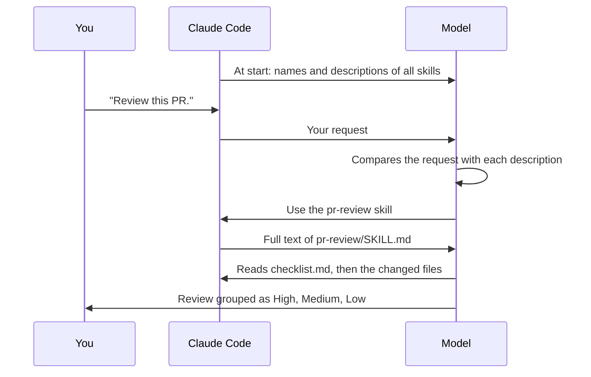
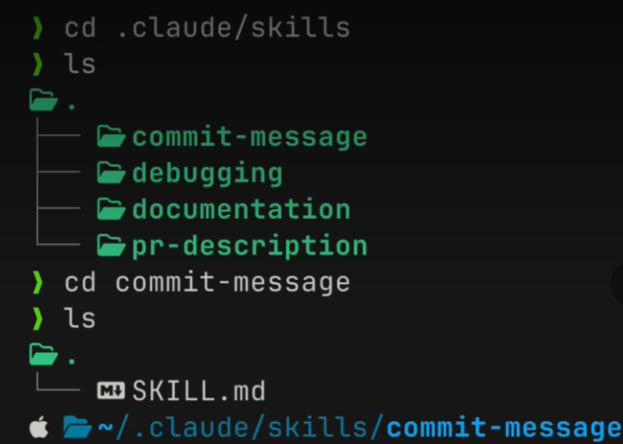
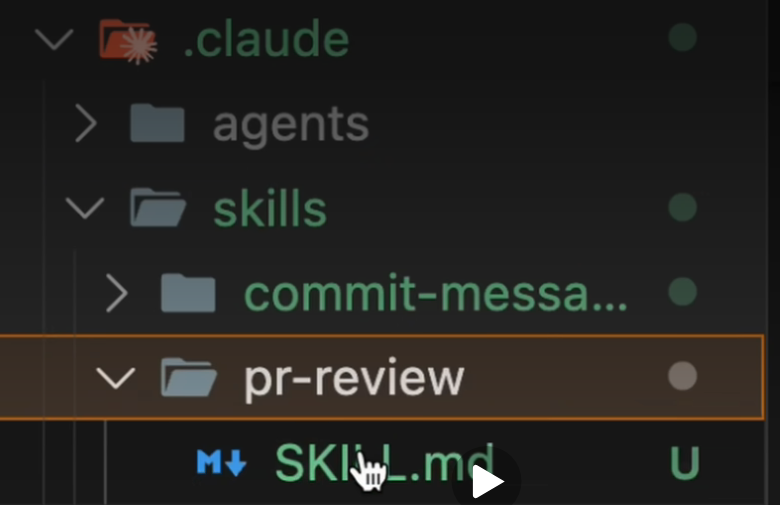

# Lesson 10 — Skills

**Course:** [Claude Code 101](https://academy.claude.com/courses/claude-code-101) &nbsp;·&nbsp; **Chapter 4:** Customizing Claude Code &nbsp;·&nbsp; **Completed:** October 25, 2026

| Previous | Course | Next |
|:---|:---:|---:|
| [← Subagents](09-subagents.md) | [📚 Course index](README.md) | [MCP →](11-mcp.md) |

---

**On this page**

| # | Section |
|:---:|:---|
| 1 | [Revision summary](#revision-summary) |
| 2 | [The big picture](#the-big-picture) |
| 3 | [Who's who](#whos-who) |
| 4 | [1. The problem: repeating yourself](#1-the-problem-repeating-yourself) |
| 5 | [2. What a skill looks like](#2-what-a-skill-looks-like) |
| 6 | [3. How Claude Code picks a skill](#3-how-claude-code-picks-a-skill) |
| 7 | [4. Where skills live](#4-where-skills-live) |
| 8 | [5. Skills compared with CLAUDE.md, slash commands, and subagents](#5-skills-compared-with-claudemd-slash-commands-and-subagents) |
| 9 | [Recap](#recap) |
| 10 | [My notes / practice](#my-notes--practice) |
| 11 | [FAQ](#faq) |

---

### Revision summary

#### In one sentence

A skill is a file of step-by-step instructions for one kind of task, such as reviewing a pull request, that you write once and save in a skills folder, and whenever you ask for that kind of task, Claude Code opens the file and follows its steps without you having to type them again.

#### What a skill is and why it helps

A skill is a set of instructions that you write once, in a Markdown file, so that you don't have to explain the same thing to Claude Code again and again. Claude Code uses the skill by itself whenever your request matches it.

- **The problem it solves:** without skills, you re-explain your team's code review checklist, your commit message format, or your coding standards in every conversation.
- **What a skill is made of:** a folder that contains a file named `SKILL.md`. The folder can also hold scripts, examples, and reference documents that the instructions point to.
- **What `SKILL.md` contains:** a short settings block at the top (*YAML frontmatter*, the `key: value` lines between two `---` lines) and the instructions below it. The two important settings are `name` and `description`.
- **Good uses:** specialized knowledge for specific tasks, such as code review standards, commit message formats, and brand guidelines. The course's rule of thumb is that if you keep explaining the same thing to Claude Code, that explanation should become a skill.

#### How Claude Code decides to use a skill

The `description` field is how Claude Code decides whether a skill fits your request.

1. At the start of a conversation, Claude Code loads only the **name and description** of every available skill into the context window (the conversation's working memory, [lesson 6](06-context-management.md)).
2. When you make a request, such as "Review this PR," the model compares the request with every skill description.
3. When a description matches, Claude Code loads that skill's **full instructions** and follows them.

This means a skill uses almost no space until it is needed. The official Claude Code documentation calls this *progressive disclosure*. Write the description so it states both what the skill does and when to use it, with the main use case first, because the listing cuts descriptions off after 1,536 characters.

#### Where skill files go

| Kind | Path | Who gets it |
|---|---|---|
| **Personal** | `~/.claude/skills/<name>/SKILL.md` (Windows: `C:\Users\you\.claude\skills\<name>\SKILL.md`) | Only you, in all your projects |
| **Project** | `.claude/skills/<name>/SKILL.md` at the root of the repository | Everyone who clones the repository, once it is committed to Git |
| **Enterprise** | The `.claude/skills/` folder in your organization's managed settings directory | Every user on machines where the organization deploys it |

- If two skills have the same name, enterprise beats personal, and personal beats project. This is the opposite of subagents, where the project file wins.
- New or edited skill files take effect in the current session without a restart. If you create the top-level `skills` folder during a session, run `/reload-skills` once.

#### When to use a skill, `CLAUDE.md`, a slash command, or a subagent

- **Use `CLAUDE.md`** ([lesson 8](08-claude-md-file.md)) for a rule that applies to every task. For example: "Always use TypeScript strict mode." Its full text loads in every conversation, so keep only always-true rules there.
- **Use a skill** for instructions needed only for one kind of task, that Claude Code should apply without being asked. For example: the team's pull request review checklist. Only its name and description load until a request matches, so it takes almost no space while you debug.
- **Use a slash command** when you want to start something yourself, by typing it. For example: `/compact`. You can also start any skill this way by typing `/` and its name, such as `/pr-review`.
- **Use a skill with `disable-model-invocation: true`** for risky tasks, such as deploying, that must start only when you type the command and never by the model's choice.
- **Use a subagent** ([lesson 9](09-subagents.md)) when a task should run in its own separate context window and send back only a summary. For example: searching 15 files to find which service handles refunds.
- **Use a personal skill** (`~/.claude/skills/`) for your own habits, such as your commit message style, and a **project skill** (`.claude/skills/` in the repository) for team standards, such as the review checklist.

#### Exam takeaways

- **A team keeps pasting the same review checklist into every conversation.** Write it once as a project skill in `.claude/skills/pr-review/SKILL.md` and commit it, so every developer's Claude Code applies it automatically when they ask for a review. (Developer Productivity & Operational Enablement)
- **A `CLAUDE.md` file has grown huge with task-specific instructions and fills the context window.** Keep only always-true rules in `CLAUDE.md` and move task-specific instructions into skills, because only a skill's description loads until it is needed. (Solution Design & Architecture)
- **A company wants every developer to follow the same brand guidelines, and individuals must not override them.** Deploy the skill at the enterprise level, because an enterprise skill overrides a personal or project skill with the same name. (Governance, Safety & Risk)

---

### The big picture

| Part | What it means in plain words |
|---|---|
| **1. The problem** | You keep explaining the same standards to Claude Code. |
| **2. What a skill is** | A folder with a `SKILL.md` file: a name, a description, and instructions. |
| **3. How it is picked** | The model reads every skill's description and loads the one that matches your request. |
| **4. Where it lives** | In your home folder (just for you) or in the project (for the whole team). |
| **5. How it compares** | `CLAUDE.md` is always loaded, a skill loads on demand, a slash command needs typing. |

#### The running example: reviewing pull requests in the shop

You work on the online shop from [lesson 9](09-subagents.md). A **pull request** (PR) is a request to merge your code changes into the main code, which a teammate or Claude Code reviews first. Your team wants every PR review to check the same things and to report feedback in the same layout.

```text
shop-app/
├── .claude/
│   └── skills/
│       └── pr-review/
│           ├── SKILL.md          ← the skill (section 2)
│           └── checklist.md      ← an extra reference file the skill points to
├── services/
│   └── refund-service.ts
└── CLAUDE.md
```

---

### Who's who

| Player | Where it lives | What it does | Example |
|---|---|---|---|
| **You** | At your computer | Write the skill once, then make normal requests | "Review this PR." |
| **Claude Code** | The program on your computer | Finds skill folders, puts their names and descriptions in the context window, and loads the full skill when needed | Loads `pr-review/SKILL.md` |
| **The model** | Anthropic's servers | Compares your request with the skill descriptions and follows the chosen skill's instructions | Decides "this is a review, use `pr-review`" |
| **The skill folder** | `shop-app/.claude/skills/pr-review/` or `~/.claude/skills/<name>/` | Holds `SKILL.md` and any extra files | `SKILL.md`, `checklist.md` |
| **Your teammates** | Their own computers | Get project skills automatically when they clone or pull the repository | A new hire gets `pr-review` on day one |

---

### 1. The problem: repeating yourself

Without a skill, every review starts the same way. You type: "Check for missing tests, check error handling, and list problems by severity with file and line numbers." Next week you type it again, and you probably forget one point.

The same happens with commit message formats and coding standards. A skill fixes this: you write the explanation once, and Claude Code applies it every time the task comes up.

Think of a recipe card in a kitchen drawer. You don't recite the recipe to the cook each time. The cook sees the card's title, "Lasagna," and pulls it out only when someone orders lasagna.

---

### 2. What a skill looks like

A skill is a **folder**, not just a file. The folder's main file must be named `SKILL.md`. Here is `shop-app/.claude/skills/pr-review/SKILL.md`:

```markdown
---
name: pr-review
description: Reviews pull requests using the team's checklist. Use when the user asks to review a PR, a diff, or recent changes.
---

When reviewing a pull request:
1. Read the changed files.
2. Check every item in checklist.md.
3. Report problems grouped as High, Medium, and Low.
4. For each problem, give the file, the line number, and a suggested fix.
```

| Line | What it means |
|---|---|
| `---` (top and bottom) | Marks the settings block (*YAML frontmatter*). It must start on the file's first line. |
| `name` | The skill's ID. If you leave it out, Claude Code uses the folder name. |
| `description` | What the skill does **and when to use it**. This is the line the model reads to decide whether to load the skill. |
| The text below | The instructions the model follows once the skill is loaded. |
| `checklist.md` | An extra file in the same folder. The model reads it only when the instructions point to it, so long reference material costs nothing until needed. |

**Not in the course, from the official Claude Code documentation:** keep `SKILL.md` under 500 lines and move long material into extra files. Two optional settings are worth knowing:

- `disable-model-invocation: true` means only you can start the skill (by typing `/pr-review`). Use it for risky tasks, such as deploying, that should never start by accident.
- `allowed-tools` lists tools the skill may use without asking you for permission.

---

### 3. How Claude Code picks a skill



1. **At the start**, Claude Code sends the model only one short entry per skill: the name and description. The full instructions stay on your computer.
2. **You ask** "Review this PR." You don't mention the skill.
3. **The model matches** your request against all descriptions. "Review a PR" matches `pr-review`.
4. **Claude Code loads** the full `SKILL.md` into the context window.
5. **The model follows** the instructions, including reading `checklist.md`.

Things to notice:

- If you ask "Why is the refund test failing?", no description matches, so the review checklist never enters the context window.
- A vague description such as "Helps with code" makes the skill load at the wrong times or never.
- Once loaded, the skill's text stays in the conversation.

> **Remember this:** The description is always there. The instructions arrive only when needed.

---

### 4. Where skills live

| Kind | Full path (Windows) | Works in | Shared? | Good for |
|---|---|---|---|---|
| **Personal** | `C:\Users\you\.claude\skills\commit-style\SKILL.md` (Mac: `~/.claude/skills/...`) | All your projects | No | Your commit message style, how you like code explained |
| **Project** | `shop-app\.claude\skills\pr-review\SKILL.md` | This repository | Yes, once committed to Git | Team review checklist, brand colors and fonts |

"Personal" means it lives in your home folder and follows you to every project on this computer. "Project" means it lives inside the repository, so anyone who clones the repository gets it automatically. No setup step is needed.

The course's personal skills folder, `~/.claude/skills/`, holds four skills. Each skill is its own folder, and the `commit-message` folder contains one `SKILL.md` file:



A project skill sits in the repository's own `.claude` folder, next to the `agents` folder from [lesson 9](09-subagents.md). Here the project has a `pr-review` skill with its `SKILL.md`:



**Warning: the name priority is the opposite of subagents.** If a personal skill and a project skill share a name, the personal one wins. An enterprise skill, set by your organization, beats both. So give personal skills names that won't clash with team skills, or your teammates' review checklist may be silently replaced on your computer by your own.

---

### 5. Skills compared with CLAUDE.md, slash commands, and subagents

| Use this | When | Example |
|---|---|---|
| **`CLAUDE.md`** | A rule should apply to **every** conversation | "Always use TypeScript strict mode." |
| **Skill** | Knowledge is needed only for **one kind of task**, and Claude Code should apply it without being asked | The PR review checklist |
| **Slash command** | You want to start something yourself, by typing it | `/compact` |
| **Subagent** | A task should run in a **separate** context window and return a summary | The Explore subagent finding the refund service |

**Why not put everything in `CLAUDE.md`?** `CLAUDE.md` is loaded in full in every conversation. A 200-line review checklist would take up space while you debug, when it isn't needed. A skill costs one description line until you ask for a review.

**Skills and slash commands overlap.** The course says skills, unlike slash commands, don't need to be typed. The official Claude Code documentation adds that every skill can also be typed as `/skill-name`, and that older custom commands in `.claude/commands/` still work. A skill adds automatic loading and extra files on top.

#### Common mix-ups

| ❌ Wrong idea | ✅ What really happens |
|---|---|
| "A skill's full instructions load at the start of every conversation." | Only its name and description load. The full text loads when a request matches. |
| "A skill is a single Markdown file." | It is a folder with `SKILL.md` inside, plus optional extra files. |
| "I must type a command to use a skill." | The model uses it automatically. Typing `/skill-name` is optional. |
| "Skills and `CLAUDE.md` do the same job." | `CLAUDE.md` is always loaded. A skill is loaded only for matching tasks. |
| "A project skill beats my personal skill with the same name." | The personal skill wins. Enterprise beats both. |

#### Test yourself

<details>
<summary>1. You ask Claude Code to fix a bug. How much of the PR review skill is in the context window?</summary>

Only its name and description. The full instructions load only when you ask for a review.
</details>

<details>
<summary>2. Your team wants every developer to get the same commit message format. Where should the skill go?</summary>

In the project: `.claude/skills/commit-format/SKILL.md`, committed to Git, so everyone who clones the repository gets it.
</details>

<details>
<summary>3. A skill never gets used, even when you ask for exactly that task. What should you check first?</summary>

Its `description`. The model decides using only the description, so it must say clearly what the skill does and when to use it.
</details>

<details>
<summary>4. Should "always use TypeScript strict mode" be a skill or a line in `CLAUDE.md`?</summary>

A line in `CLAUDE.md`, because it applies to every task, not to one kind of task.
</details>

---

### Recap

- **The problem:** you repeat the same standards to Claude Code in every conversation.
- **What a skill is:** a folder with a `SKILL.md` file holding a name, a description, and instructions.
- **How it is picked:** the model compares your request with every description and loads only the matching skill.
- **Where it lives:** `~/.claude/skills/` for you in all projects, `.claude/skills/` in the repository for the team.
- **How it compares:** `CLAUDE.md` is always loaded, a skill loads on demand, a slash command needs typing, a subagent works in a separate context window.

---

## My notes / practice

- [ ] Create `C:\Users\<me>\.claude\skills\commit-style\SKILL.md` with my preferred commit message format, then ask Claude Code to commit a change and check that it follows the format.
- [ ] Type `/skills` to see which skills Claude Code found.
- [ ] Run `/context` before and after asking for a task that matches a skill, and see the skill's text appear only after.
- [ ] Write a deliberately vague description, see whether the skill still triggers, then fix the description.

---

## FAQ

In these answers, **Claude Code** means the program on your computer. **The model** means the AI on Anthropic's servers.

**Q1. What does "skill" mean in Claude Code?**
A set of instructions, saved in a folder as `SKILL.md`, that teaches Claude Code how to do one kind of task. You write it once, and Claude Code applies it whenever a request matches.

**Q2. What problem do skills solve?**
They stop you repeating yourself. Instead of explaining your review checklist or commit format in every conversation, you write it once as a skill.

**Q3. What goes inside a `SKILL.md` file?**
A settings block at the top with a `name` and a `description`, then the instructions below it. The folder can also hold extra files, such as checklists or scripts, that the instructions point to.

**Q4. How does Claude Code know when to use a skill?**
At the start, the model sees every skill's name and description. When you make a request, the model compares it with the descriptions and loads the full skill that matches.

**Q5. Why is the "description" field so important?**
It is the only part the model sees before deciding. A clear description, such as "Reviews pull requests. Use when the user asks to review a PR," makes the skill load at the right time.

**Q6. Does a skill fill up my context window?**
Hardly. Only its name and description are loaded until it is needed. The full instructions load only when a request matches.

**Q7. What is the difference between a personal skill and a project skill?**
A personal skill lives in `~/.claude/skills/` in your home folder and works in all your projects, just for you. A project skill lives in `.claude/skills/` inside the repository, and everyone who clones it gets it.

**Q8. Which skill wins if a personal skill and a project skill have the same name?**
The personal skill. An enterprise skill, set by your organization, beats both. This is the opposite of subagents, where the project file wins.

**Q9. When should I use `CLAUDE.md` instead of a skill?**
Use `CLAUDE.md` for rules that apply to every task, such as "always use TypeScript strict mode." Use a skill for knowledge needed only for one kind of task, such as a review checklist.

**Q10. What is the difference between a skill and a slash command?**
You must type a slash command yourself. The model uses a skill by itself when your request matches, though you can also start a skill yourself by typing `/` and its name.

**Q11. (Exam angle) A team lead says developers keep pasting the same PR review checklist into Claude Code, and reviews still come out inconsistent. What do you recommend?**
Write the checklist once as a project skill, `.claude/skills/pr-review/SKILL.md`, with a description that says to use it for PR reviews, and commit it to Git. Every developer's Claude Code then applies the same checklist automatically. This fits the **Developer Productivity & Operational Enablement** exam domain.

**Q12. (Exam angle) A project's `CLAUDE.md` has grown to 800 lines of task-specific instructions, and sessions run out of context space quickly. How do you fix it?**
Keep only the rules that apply to every task in `CLAUDE.md`, and move task-specific instructions, such as review, release, and documentation steps, into separate skills. Only each skill's short description is loaded until a task needs it, so the context window stays free. This fits the **Solution Design & Architecture** exam domain.

**Q13. (Exam angle) A company wants every developer to follow the official brand guidelines, and asks how to stop individuals from replacing them with their own version. How do you answer?**
Deploy the brand guidelines as an enterprise skill through the organization's managed settings. An enterprise skill overrides any personal or project skill with the same name, so a developer's own copy cannot replace it. This fits the **Governance, Safety & Risk** exam domain.

---

| Previous | Course | Next |
|:---|:---:|---:|
| [← Subagents](09-subagents.md) | [📚 Course index](README.md) | [MCP →](11-mcp.md) |
