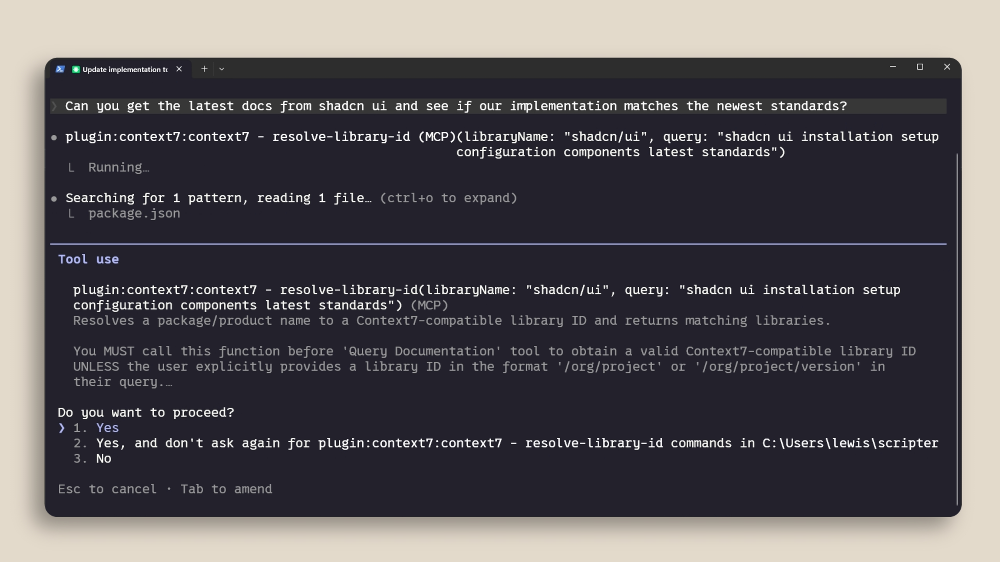
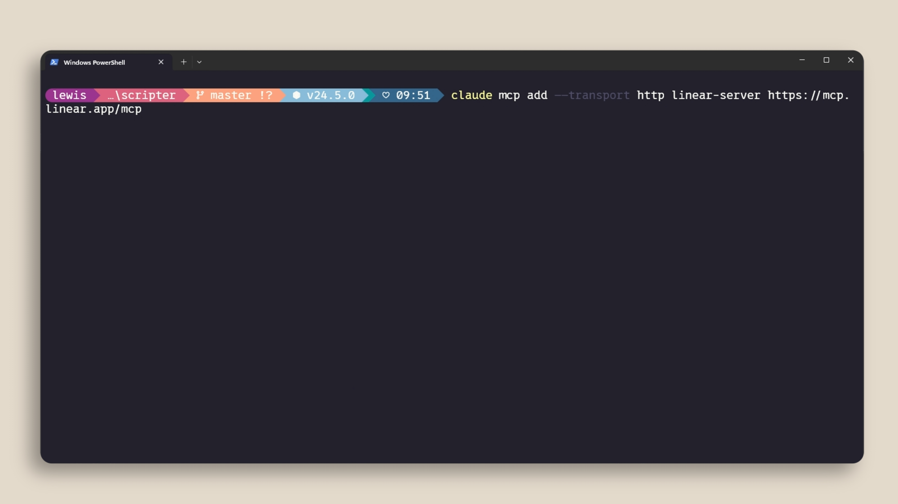
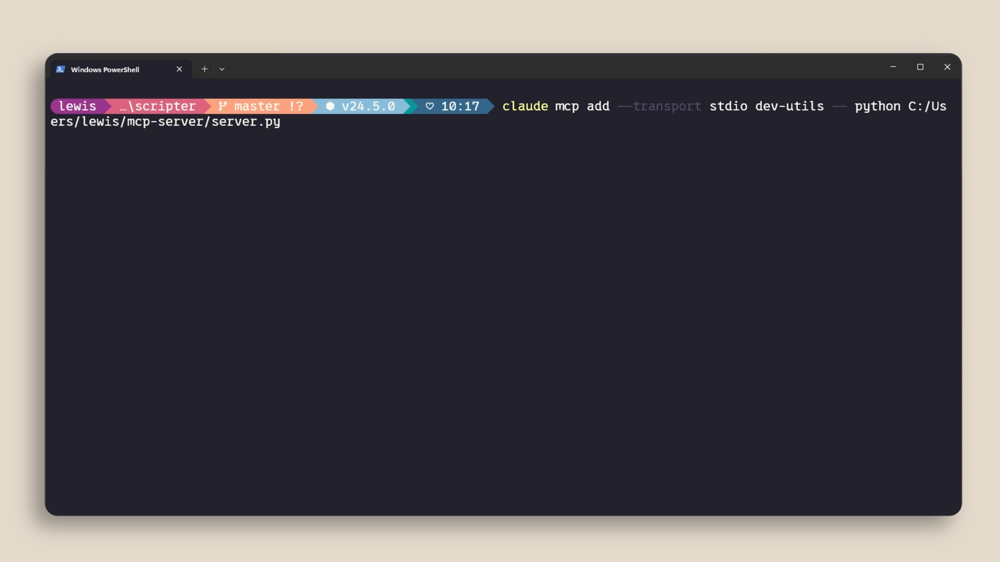
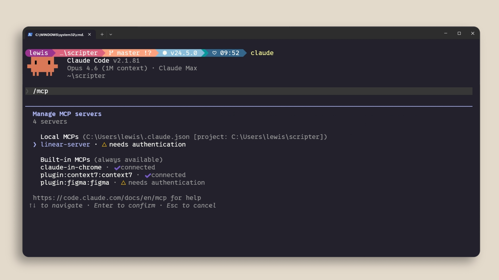
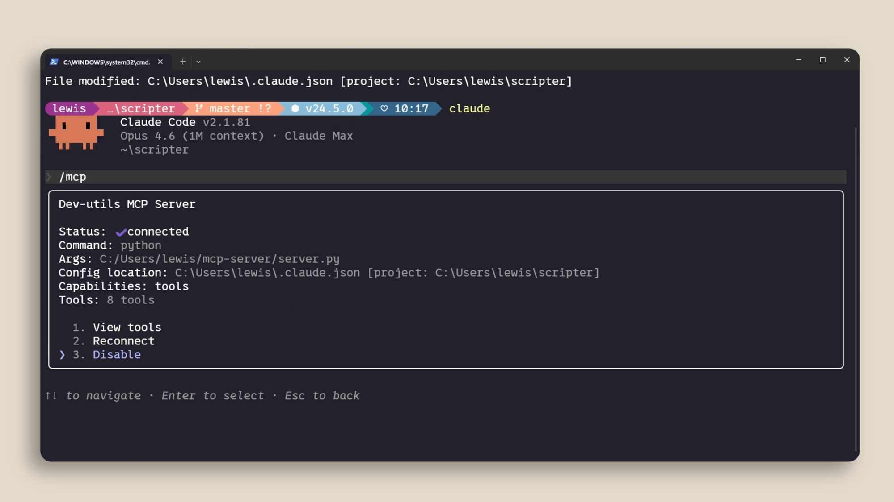

# Lesson 11 — MCP

**Course:** [Claude Code 101](https://academy.claude.com/courses/claude-code-101) &nbsp;·&nbsp; **Chapter 4:** Customizing Claude Code &nbsp;·&nbsp; **Completed:** October 25, 2026

| Previous | Course | Next |
|:---|:---:|---:|
| [← Skills](10-skills.md) | [📚 Course index](README.md) | [Hooks →](12-hooks.md) |

---

**On this page**

| # | Section |
|:---:|:---|
| 1 | [Revision summary](#revision-summary) |
| 2 | [The big picture](#the-big-picture) |
| 3 | [Who's who](#whos-who) |
| 4 | [1. What MCP lets Claude Code do](#1-what-mcp-lets-claude-code-do) |
| 5 | [2. Adding an MCP server](#2-adding-an-mcp-server) |
| 6 | [3. Checking your servers with /mcp](#3-checking-your-servers-with-mcp) |
| 7 | [4. Scoping servers: who gets which server](#4-scoping-servers-who-gets-which-server) |
| 8 | [5. Context costs](#5-context-costs) |
| 9 | [Recap](#recap) |
| 10 | [My notes / practice](#my-notes--practice) |
| 11 | [FAQ](#faq) |

---

### Revision summary

#### In one sentence

MCP (Model Context Protocol) is a standard way to connect Claude Code to services outside your project, such as your team's issue tracker or a library's latest documentation, so that the model can read from and use those services by itself whenever your request needs them.

#### What MCP is and why it helps

MCP (*Model Context Protocol*) is an open standard that lets Claude Code connect to tools and data outside your project, such as an issue tracker, a database, or up-to-date library documentation. Once a server is connected, the model decides by itself when to use its tools.

- **Why it matters:** much of the information Claude Code needs lives outside your code, in databases, productivity apps, and public repositories. MCP brings that information into the conversation.
- **What a tool is:** an action that an AI agent can take, such as reading a ticket or searching documentation. This is what separates an agent like Claude Code from a chat AI that only writes text back.
- **What an MCP server is:** a small program that offers a set of tools to Claude Code. Examples are the Linear server (reads your team's issues from the Linear project management app) and the Context7 server (fetches current documentation for a library you use). Hundreds more are listed at `claude.com/connectors`.
- **Permissions still apply:** Claude Code asks before it runs an MCP tool for the first time, just like it asks before other actions.

#### How to add a server

You add a server by running `claude mcp add` in your normal terminal, not inside a Claude Code conversation. There are two types of server.

| Type | Where the server runs | Example command |
|---|---|---|
| **HTTP** (remote) | On the service provider's computers, reached over the internet | `claude mcp add --transport http linear-server https://mcp.linear.app/mcp` |
| **stdio** (local) | As a program on your own computer | `claude mcp add --transport stdio dev-utils -- python C:/Users/you/mcp-server/server.py` |

- In a stdio command, everything after the `--` is the command that starts the server program. Everything before it is an option for Claude Code.
- Some services also offer an older kind of remote connection called SSE (*Server-Sent Events*). Claude Code still accepts it, but SSE is being phased out (*deprecated*), so when a service offers both SSE and HTTP, choose HTTP.
- Three more terminal commands manage the servers you added: `claude mcp list` lists every server, `claude mcp get linear-server` shows the settings of one server (here, the one named `linear-server`), and `claude mcp remove linear-server` deletes it.

#### When to use what

- **Use an MCP server** when Claude Code needs a service that it can't reach with a terminal command. For example: your team's issues in Linear, or current library documentation from Context7.
- **Use the service's command-line tool instead** when one exists, such as `gh` for GitHub, because a command takes no space in the context window until it runs.
- **Use an HTTP server** when the service provider runs the server for you, such as Linear. You only need its web address.
- **Use a stdio server** when the server is a program on your own computer, such as a Python script you wrote.

#### How to check and manage servers

Inside a Claude Code conversation, type `/mcp` to manage your servers.

- The list shows every server, where its settings are stored, and its status, such as "connected" or "needs authentication."
- Select a server to sign in to it (for remote services such as Linear), view its tools, reconnect it, or disable it.
- Disabling a server switches it off without deleting its settings.

#### Who gets a server: the three scopes

The scope decides which projects and which people get a server. You choose it with `--scope` when you add the server.

| Scope | Who gets it | Where it is saved |
|---|---|---|
| **Local** (the default) | Only you, only in the current project | Your personal settings file, `~/.claude.json` (Windows: `C:\Users\you\.claude.json`), under that project's path |
| **User** | Only you, in all your projects | `~/.claude.json` |
| **Project** | Everyone who works on the repository | A `.mcp.json` file at the root of the repository, committed to Git |

- **Use local** (the default) to try a server, or for a server that uses your personal access, in one project.
- **Use user** for a server you want in every project, such as Context7 for documentation.
- **Use project** when the whole team should get the same server automatically, such as the team's Linear connection.
- Before Claude Code uses servers from a project's `.mcp.json`, it asks you to approve them, because anyone who can change the repository can add a server.
- If the same server name exists in several scopes, local wins over project, and project wins over user.
- **Warning:** never write passwords or access tokens directly in `.mcp.json`, because the file is shared through Git. The docs let you write `${API_KEY}` instead, and Claude Code fills in the value from your computer's environment variables.

#### How MCP servers use your context window

Every connected server takes up some space in the context window (the conversation's working memory, [lesson 6](06-context-management.md)), even when you don't use it.

1. Each server adds its tool names and instructions to the context window at the start of a conversation.
2. Tool search is on by default, so the full definition of each tool stays out of the context window until the model needs that tool.
3. To save space, run `/mcp` and disable servers you are not using.
4. If a tool has a command-line version, such as `gh` for GitHub or `aws` for Amazon Web Services, using that command is cheaper, because a command adds nothing to the context window until it runs.
5. You can pair a server with a skill ([lesson 10](10-skills.md)) that teaches the model how to use the server's tools well. Only the skill's name and description load until it is needed.

#### Exam takeaways

- **A team wants every developer to have the same issue-tracker connection without manual setup.** Add the server with the project scope so it is saved in `.mcp.json`, and commit that file to Git. Keep tokens out of the file by using `${VAR}` placeholders. (Developer Productivity & Operational Enablement)
- **A security team worries that a cloned repository can quietly connect Claude Code to unknown services.** Claude Code asks each developer to approve servers from a project's `.mcp.json` before using them, MCP tools still go through permission prompts, and teams should only add servers they trust. (Governance, Safety & Risk)
- **Sessions with many MCP servers fill the context window quickly.** Disable unused servers with `/mcp`, prefer command-line tools such as `gh` where they exist, and rely on tool search, which keeps full tool definitions out until needed. (Solution Design & Architecture)

---

### The big picture

| Part | What it means in plain words |
|---|---|
| **1. What MCP does** | It gives Claude Code extra tools that reach outside apps and data. |
| **2. Adding a server** | One `claude mcp add` command, for a remote (HTTP) or local (stdio) server. |
| **3. Checking servers** | `/mcp` shows what is connected and lets you sign in or switch servers off. |
| **4. Scoping** | Decides who gets the server: just you here, just you everywhere, or the whole team. |
| **5. Context costs** | Every server uses a little memory, so keep only the ones you use. |

#### The running example: connecting the shop to the issue tracker

You work on the online shop from [lesson 10](10-skills.md). Your team tracks bugs in **Linear**, a project management app where each bug or task is an *issue* with an ID such as `SHOP-142`. Today you want to say "Fix issue SHOP-142" without copying the issue text into the chat. You also have a small Python program on your own computer, `dev-utils`, that you want Claude Code to use.

```text
shop-app/
├── .mcp.json                ← team MCP servers, shared through Git (section 4)
├── .claude/
│   └── skills/pr-review/SKILL.md
├── services/
│   └── refund-service.ts
└── CLAUDE.md
```

---

### Who's who

| Player | Where it lives | What it does | Example |
|---|---|---|---|
| **You** | At your computer | Add servers with `claude mcp add` and approve tool use | Approve "read issue SHOP-142" |
| **Claude Code** | The program on your computer | Connects to MCP servers and passes the model's tool requests to them | Calls the Linear server |
| **The model** | Anthropic's servers | Sees the list of available tools and decides when to use one | Decides "I need the issue text first" |
| **An MCP server** | Remote (the provider's computers) or local (a program on your computer) | Offers tools and does the work when a tool is called | The Linear server, your `dev-utils` program |
| **The outside service** | The provider's systems | Holds the real data | Linear's database of issues |
| **Your teammates** | Their own computers | Get project-scope servers automatically from `.mcp.json` | A new hire gets Linear on day one |

---

### 1. What MCP lets Claude Code do

On its own, Claude Code can read files, edit files, and run commands on your computer. These actions are its **tools** (a tool is an action the agent can take, not just text it writes back). It cannot read your Linear issues or today's documentation for a library, because that information lives somewhere else.

An **MCP server** adds new tools. Think of a power strip with a standard socket shape: any device built to the standard plugs straight in. MCP is that standard shape, so any service that offers an MCP server can plug into Claude Code.

Two examples from the course:

- **Linear server:** brings in the details of your team's issues, so the model can read `SHOP-142` itself.
- **Context7 server:** fetches up-to-date documentation for a library, so the model doesn't rely on what it learned during training, which may be out of date.

Here the user asks for the latest docs of a library called shadcn/ui. The model calls a Context7 tool by itself, and Claude Code asks permission first:



<!-- IMAGE: the course may have a second image in "What can you do with it?" (image 18 was the same file as image 17) → images/11-what-can-you-do.png -->

Things to notice:

- The user never named Context7. The model chose the tool from the request.
- The tool name starts with `plugin:context7:context7`, which tells you which server the tool comes from, and it is labelled `(MCP)`.
- The normal permission prompt still appears. "Yes, and don't ask again" stops the questions for this tool in this project only.

---

### 2. Adding an MCP server

You type `claude mcp add` in your normal terminal (PowerShell, Terminal, and so on), **before** starting a conversation. It is not a slash command.

#### HTTP servers: remote services

An HTTP server runs on the provider's computers, and Claude Code talks to it over the internet. Linear hosts one:

```text
claude mcp add --transport http linear-server https://mcp.linear.app/mcp
```

| Part | Meaning |
|---|---|
| `claude mcp add` | Add a new MCP server. |
| `--transport http` | The server is remote and is reached over the web (*transport* means "how Claude Code talks to it"). |
| `linear-server` | A name you choose. It shows up in `/mcp`. |
| `https://mcp.linear.app/mcp` | The server's web address, given by the provider. |



#### stdio servers: programs on your computer

A stdio server is a program that runs on your own computer. Claude Code starts it and talks to it through the program's standard input and output (*stdio*), the same channel a program uses to read typed input and print text.

```text
claude mcp add --transport stdio dev-utils -- python C:/Users/you/mcp-server/server.py
```

The `--` is a divider. Everything before it is for Claude Code. Everything after it is the exact command that starts the server: run `python` on the file `server.py`.



| Use | When | Example |
|---|---|---|
| **HTTP** | The service is online and the provider hosts the server | Linear, Notion, Sentry |
| **stdio** | The server needs your computer: local files, local databases, or your own script | Your `dev-utils` Python program |

**Not in the course, from the official Claude Code documentation:** some services also offer an older kind of remote connection called SSE (*Server-Sent Events*). Claude Code still accepts it, but SSE is being phased out (*deprecated*), so when a service offers both SSE and HTTP, choose HTTP. Three more terminal commands manage your servers: `claude mcp list` lists every server, `claude mcp get linear-server` shows the settings of the server named `linear-server`, and `claude mcp remove linear-server` deletes it.

---

### 3. Checking your servers with /mcp

Inside a conversation, type `/mcp`. It lists every server, where its settings are stored, and its status:



Things to notice:

- `linear-server` says **needs authentication**. Adding a remote server only saves its address. You still have to sign in to Linear: select the server in `/mcp` and log in through your browser.
- The heading says `Local MCPs (C:\Users\lewis\.claude.json [project: C:\Users\lewis\scripter])`. The server was saved in the local scope (section 4), inside the user's personal settings file, for one project only.

Select a server to see its details and options:



| Option | What it does |
|---|---|
| **View tools** | Lists the server's tools (here, 8 tools). |
| **Reconnect** | Restarts the connection if the server stopped working. |
| **Disable** | Switches the server off for this project without deleting its settings. You can enable it again later. |

---

### 4. Scoping servers: who gets which server

The scope answers two questions: in which projects does the server work, and for which people? You pick it with `--scope local`, `--scope user`, or `--scope project`. If you leave it out, you get **local**.

| Scope | Who and where | Saved in | Good for |
|---|---|---|---|
| **Local** (default) | Only you, only in this project | `C:\Users\you\.claude.json`, under this project's path | Trying a server, or a server with your personal access |
| **User** | Only you, in every project | `C:\Users\you\.claude.json` | Tools you want everywhere, such as Context7 |
| **Project** | Everyone on the repository | `shop-app/.mcp.json`, committed to Git | Servers the whole team needs, such as Linear |

"Local" does not mean "a stdio server on your computer." It means "saved just for you, just for this project." A remote HTTP server can be local scope, as `linear-server` was in the screenshot.

To share Linear with the team, add it with the project scope:

```text
claude mcp add --transport http --scope project linear-server https://mcp.linear.app/mcp
```

Claude Code creates `shop-app/.mcp.json`:

```json
{
  "mcpServers": {
    "linear-server": {
      "type": "http",
      "url": "https://mcp.linear.app/mcp"
    }
  }
}
```

You commit this file. When a teammate pulls the repository and starts Claude Code, they get `linear-server` automatically. Each teammate still signs in to Linear with their own account in `/mcp`, so nobody shares your login.

**Not in the course, from the official Claude Code documentation:**

- Claude Code asks each person to approve the servers in a project's `.mcp.json` before using them, because anyone who can change the repository could add a server.
- If the same name exists in more than one scope, local wins over project, and project wins over user.

**Warning:** a server that needs an access key may tempt you to paste the key into `.mcp.json`. Everyone with access to the repository would then see it. Write `"Authorization": "Bearer ${LINEAR_KEY}"` instead, and each person sets `LINEAR_KEY` on their own computer.

---

### 5. Context costs

Each connected server adds its tool names and instructions to the context window at the start of every conversation, even if you never use it. Ten servers mean ten lists of tools taking space your conversation could use.

Think of apps on a phone's home screen. Each icon takes a little space even when you don't open it, so you remove the ones you never use.

How to keep the cost low:

| Do | Why | Example |
|---|---|---|
| Disable unused servers in `/mcp` | A disabled server adds nothing to the context window | Switch off Figma while working on the refund service |
| Prefer a command-line tool when one exists | A command such as `gh` adds nothing until the model runs it | Use `gh pr list` instead of a GitHub MCP server |
| Pair a server with a skill | The skill teaches the model to use the server's tools well, and only its name and description load until needed | A `linear-triage` skill that explains your issue labels |
| Rely on tool search | It is on by default and keeps each tool's full definition out until the model needs that tool | Linear's 20 tool definitions load only when you ask about an issue |

> **Remember this:** Every connected server costs a little memory. Keep only the ones you use.

#### Common mix-ups

| ❌ Wrong idea | ✅ What really happens |
|---|---|
| "I type `claude mcp add` inside the conversation." | You type it in your normal terminal. Inside the conversation, you use `/mcp`. |
| "Local scope means the server runs on my computer." | Local scope means the settings are saved only for you, only in this project. A remote server can be local scope. |
| "Adding a remote server is enough to use it." | You often still need to sign in through `/mcp`. |
| "A server costs nothing until I use it." | Its tool names and instructions sit in the context window from the start. |
| "Putting a server in `.mcp.json` shares my login with the team." | It shares only the server's address. Each teammate signs in separately. |

#### Test yourself

<details>
<summary>1. You want Claude Code to use a Python script on your own computer as an MCP server. Which transport do you use?</summary>

stdio. The script runs on your computer, and Claude Code starts it with the command after the `--`.
</details>

<details>
<summary>2. Your whole team needs the Linear server. Which scope do you choose, and which file appears?</summary>

The project scope. Claude Code writes the server into `.mcp.json` at the root of the repository, and you commit that file to Git.
</details>

<details>
<summary>3. `/mcp` shows "needs authentication" next to a server. What does that mean?</summary>

The server is added, but you haven't signed in to the service yet. Select the server in `/mcp` and log in.
</details>

<details>
<summary>4. You have eight MCP servers and conversations fill up quickly. What two things can you do?</summary>

Disable servers you aren't using in `/mcp`, and use command-line tools such as `gh` instead of a server where one exists.
</details>

---

### Recap

- **What MCP does:** connects Claude Code to outside tools and data, and the model uses them when a request needs them.
- **Adding a server:** run `claude mcp add` in your terminal, with `--transport http` for remote services or `--transport stdio` for programs on your computer.
- **Checking servers:** `/mcp` shows status and lets you sign in, view tools, reconnect, or disable.
- **Scoping:** local is just you in one project, user is just you everywhere, and project shares the server with the team through `.mcp.json`.
- **Context costs:** every server takes some context space, so disable unused ones and prefer command-line tools where they exist.

---

## My notes / practice

- [ ] Add the Context7 server with `--scope user`, then ask Claude Code for the latest docs of a library I use and watch it call the tool.
- [ ] Type `/mcp`, open one server, and look at "View tools."
- [ ] Run `/context` with a server enabled, then disable it in `/mcp` and compare the space used.
- [ ] In a test repository, add a server with `--scope project` and open the `.mcp.json` file it creates.

---

## FAQ

In these answers, **Claude Code** means the program on your computer. **The model** means the AI on Anthropic's servers.

**Q1. What does "MCP" mean?**
MCP stands for Model Context Protocol. It is an open standard that lets Claude Code connect to outside tools and data sources, such as an issue tracker or a documentation service.

**Q2. What does "tool" mean in agentic AI?**
A tool is an action an AI agent can take, such as reading a file, running a command, or fetching an issue from Linear. A chat AI only writes text back. An agent such as Claude Code can also act.

**Q3. What does "MCP server" mean?**
A small program that offers tools to Claude Code. The Linear server, for example, offers tools to read and update issues in Linear.

**Q4. What is the difference between an HTTP server and a stdio server?**
An HTTP server runs on the provider's computers and is reached over the internet, like Linear's. A stdio server is a program that runs on your own computer, like a Python script you wrote.

**Q5. How do I add an MCP server to Claude Code?**
Run `claude mcp add` in your normal terminal, for example `claude mcp add --transport http linear-server https://mcp.linear.app/mcp`. For a stdio server, put the command that starts the program after `--`.

**Q6. What does the `/mcp` command do?**
Inside a conversation, it lists your servers with their status, such as "connected" or "needs authentication." You can select a server to sign in, view its tools, reconnect it, or disable it.

**Q7. What are the three MCP scopes?**
Local means only you, only in the current project, and it is the default. User means only you, in all your projects. Project means everyone on the repository, through a `.mcp.json` file committed to Git.

**Q8. Where are local and user scope servers saved?**
Both are saved in your personal settings file, `C:\Users\you\.claude.json` (Mac: `~/.claude.json`). Local scope servers are saved under the current project's path, so they work only there.

**Q9. Does an MCP server use context space when I'm not using it?**
Yes. Each connected server adds its tool names and instructions to the context window at the start. Tool search, which is on by default, keeps each tool's full definition out until the model needs it.

**Q10. Why is a command-line tool such as `gh` cheaper than an MCP server?**
A command-line tool adds nothing to the context window until the model runs it. An MCP server adds its tool list to every conversation, even when unused.

**Q11. (Exam angle) A platform team wants every developer on a repository to have the same issue-tracker and documentation servers, without manual setup and without sharing anyone's credentials. What do you recommend?**
Add the servers with `--scope project` so they are saved in `.mcp.json`, and commit that file. Use `${VAR}` placeholders for any keys, and each developer signs in with their own account through `/mcp`. This fits the **Developer Productivity & Operational Enablement** exam domain.

**Q12. (Exam angle) A security team asks whether cloning a repository could silently connect Claude Code to an unknown outside service. How do you answer?**
Claude Code asks each person to approve the servers in a project's `.mcp.json` before using them, and MCP tool calls still go through permission prompts. The team should review changes to `.mcp.json` like code and only add servers from providers it trusts. This fits the **Governance, Safety & Risk** exam domain.

**Q13. (Exam angle) Developers have connected many MCP servers, and their sessions keep running short of context space. How do you fix it?**
Disable unused servers with `/mcp`, use command-line tools such as `gh` or `aws` where they exist, and pair the servers you keep with skills. Tool search, on by default, already keeps full tool definitions out until needed. This fits the **Solution Design & Architecture** exam domain.

---

| Previous | Course | Next |
|:---|:---:|---:|
| [← Skills](10-skills.md) | [📚 Course index](README.md) | [Hooks →](12-hooks.md) |
