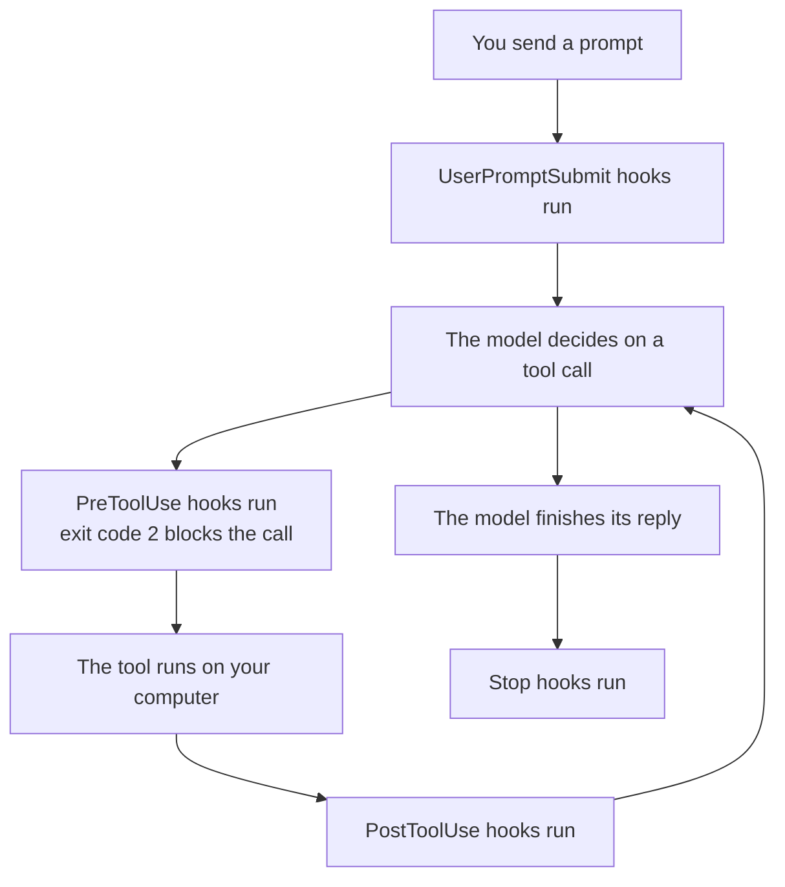
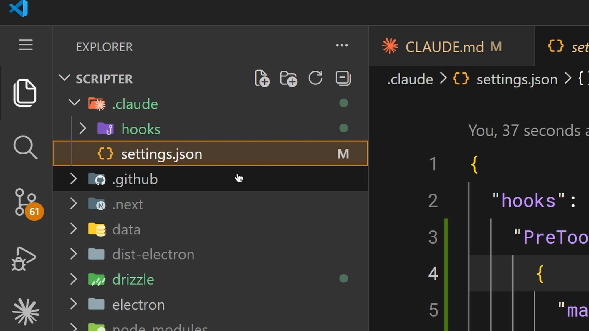
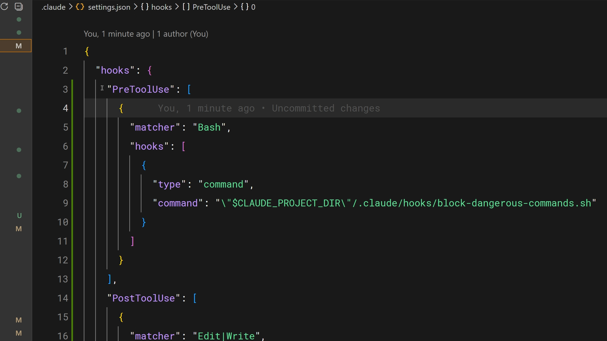
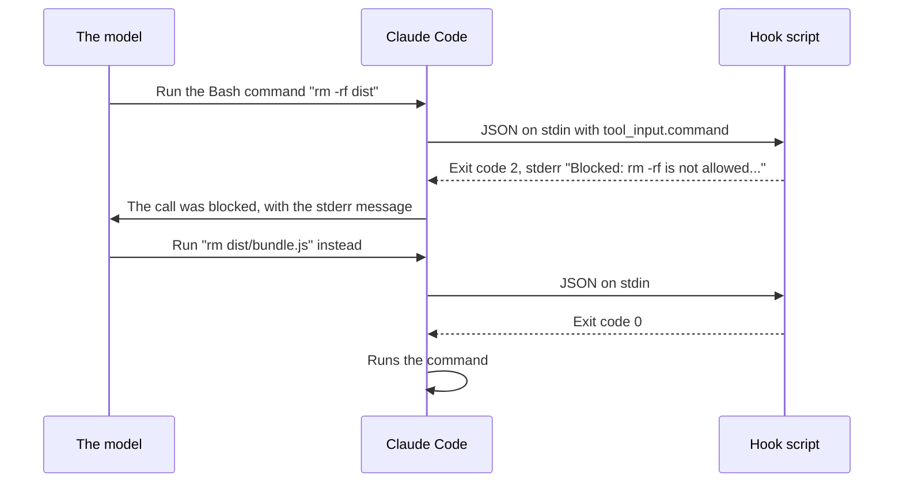

# Lesson 12 — Hooks

**Course:** [Claude Code 101](https://academy.claude.com/courses/claude-code-101) &nbsp;·&nbsp; **Chapter 4:** Customizing Claude Code &nbsp;·&nbsp; **Completed:** October 25, 2026

| Previous | Course | Next |
|:---|:---:|---:|
| [← MCP](11-mcp.md) | [📚 Course index](README.md) | End of course |

---

**On this page**

| # | Section |
|:---:|:---|
| 1 | [Revision summary](#revision-summary) |
| 2 | [The big picture](#the-big-picture) |
| 3 | [Who's who](#whos-who) |
| 4 | [1. Why use hooks](#1-why-use-hooks) |
| 5 | [2. How hooks work](#2-how-hooks-work) |
| 6 | [3. A practical example: auto-formatting](#3-a-practical-example-auto-formatting) |
| 7 | [4. Blocking with PreToolUse](#4-blocking-with-pretooluse) |
| 8 | [5. Sharing hooks with your team](#5-sharing-hooks-with-your-team) |
| 9 | [Recap](#recap) |
| 10 | [My notes / practice](#my-notes--practice) |
| 11 | [FAQ](#faq) |

---

### Revision summary

#### In one sentence

A hook is a command that you list in a settings file and that Claude Code runs automatically at a fixed moment, such as right after every file edit or right before every terminal command, so the action happens every single time instead of depending on the model remembering an instruction.

#### What a hook is and why it is different

A hook is a command that Claude Code runs automatically at a fixed moment, such as right after it edits a file. Hooks are *deterministic*, which means they run every single time, with no exceptions.

- **Why this matters:** a rule in `CLAUDE.md` ([lesson 8](08-claude-md-file.md)) is a request to the model, and the model follows it most of the time but not always. A hook is run by the Claude Code program itself, so the model cannot forget it or choose to skip it.
- **Common uses:** formatting files after every edit, logging every command for compliance, blocking dangerous actions such as changing production files, and sending yourself a notification when Claude Code finishes a task.
- **The rule of thumb:** if something must happen every time without fail, do not put it in a prompt. Put it in a hook.

#### When to use a hook, and which event

- **Use `CLAUDE.md`** for guidance where an occasional miss is acceptable, such as "prefer short functions."
- **Use a hook** when something must happen every time, such as formatting every edited file or logging every command.
- **Use a deny rule in `settings.json`** ([lesson 8](08-claude-md-file.md)) when a simple pattern is enough to block an action, such as never editing `config/production.json`. **Use a `PreToolUse` hook** when the check needs a script, such as reading a command and blocking it if it commits to the `main` branch.
- **Use `PreToolUse`** to check or block a tool call before it runs.
- **Use `PostToolUse`** to react after a tool call, such as formatting a file or writing a log line.
- **Use `UserPromptSubmit`** to check or add to your prompt before the model sees it.
- **Use `Stop`** to run something when Claude Code finishes its reply, such as a final check.
- **Use `Notification`** to alert yourself when Claude Code needs your input.

#### How a hook is set up

You write hooks in a `settings.json` file. Each hook has three parts: an event (when it runs), an optional matcher (which tools it applies to), and a command (what runs).

| Event | When Claude Code runs the hook |
|---|---|
| `PreToolUse` | Before a tool call runs. This is the only one of the five that can stop a tool call. |
| `PostToolUse` | After a tool call finishes successfully. |
| `UserPromptSubmit` | When you send a prompt, before the model sees it. |
| `Stop` | When Claude Code finishes its reply. |
| `Notification` | When Claude Code sends you a notification, for example because it needs your input. |

- **There are many more events**, about thirty in total, such as `SessionStart`. The hooks reference page in the official Claude Code documentation lists them all.
- **The matcher** compares against the tool name. `"Edit|Write"` means "the Edit tool or the Write tool." Leaving the matcher out, or writing `"*"`, matches every tool. Matchers are case-sensitive, so `"bash"` does not match the `Bash` tool.
- **The `/hooks` command** inside Claude Code shows a read-only list of your hooks and which file each comes from. You cannot edit hooks there. You edit the `settings.json` file directly.
- **Which settings file to use:** use `~/.claude/settings.json` (Windows: `C:\Users\you\.claude\settings.json`) for hooks you want in all your projects, such as a desktop pop-up. Use the project's `.claude/settings.json` for hooks the whole team needs, such as formatting, because it is shared through Git. Use `.claude/settings.local.json` for hooks only you need in this project, because it is not committed. Hooks from all these files add together rather than replace each other.

#### How a hook talks to Claude Code

Claude Code sends the hook details about the tool call, and the hook answers with an exit code.

- **Input:** the hook receives the tool name and the tool's input as JSON (a structured text format) on *stdin* (the channel a program reads input from). For a Bash tool call, the input includes `tool_input.command`, the exact command the model wants to run. For an edit, it includes `tool_input.file_path`.
- **Exit code 0** means "everything is fine, carry on."
- **Exit code 2** means "block this." In a `PreToolUse` hook, the tool call does not run, and the text the hook wrote to *stderr* (the error output channel) is sent to the model, so the model knows why and can try another way.
- **Any other exit code**, such as 1, is a non-blocking error. You see a short error notice, but the action still goes ahead. **Warning:** a script that exits 1 by mistake will not block anything.
- **Exit 2 on other events:** on `PostToolUse` it cannot undo the tool call, which already ran, but the message still reaches the model. On `UserPromptSubmit` it stops your prompt from reaching the model. On `Stop` it makes Claude Code keep working instead of stopping.

#### The two most common hooks

1. **Auto-formatting:** a `PostToolUse` hook with the matcher `"Edit|Write"` runs after every file edit. Its command reads the file path and runs the right formatter for the file type, such as Prettier for TypeScript, `gofmt` for Go, or Ruff for Python.
2. **Blocking dangerous actions:** a `PreToolUse` hook checks the tool call and exits with code 2 to stop it. Examples are blocking writes to a production config folder, blocking Bash commands that contain `rm -rf`, and blocking commits to the `main` branch.

#### How to share hooks with your team

Hooks in the project's `.claude/settings.json` can be committed to Git, so every teammate gets the same hooks automatically.

- Keep hook scripts in the project, for example in `.claude/hooks/`, and commit them too.
- Refer to scripts with the `CLAUDE_PROJECT_DIR` environment variable, which holds the project's root folder. Write `"\"$CLAUDE_PROJECT_DIR\"/.claude/hooks/block-dangerous-commands.sh"` so the script is found even when Claude Code has moved into a subfolder.

#### Other facts about hooks

- A hook that blocks a tool call works in every permission mode, even when a developer turns off permission questions entirely.
- An `Edit|Write` hook does not see files changed by a Bash command, such as `sed`. A hook that must catch every change needs to match `Bash` too, or check the files in a `Stop` hook.
- Hooks run with your full user permissions, so review every hook before you add it. Claude Code also waits until you trust a project folder before it runs any hooks there.
- On Windows, command hooks run in Git Bash by default. Add `"shell": "powershell"` to a hook to run it in PowerShell instead.
- Press `Ctrl+O` to open the transcript view and see what a hook did, or start Claude Code with `claude --debug` for full details.

#### Exam takeaways

- **A compliance team needs a guaranteed record of every command Claude Code runs.** Add a `PostToolUse` hook with the matcher `Bash` that appends `tool_input.command` to a log file, and commit it in the project's `.claude/settings.json`. A `CLAUDE.md` instruction is not enough because the model may skip it. (Governance, Safety & Risk)
- **A security team worries that a developer could turn off permission questions and let Claude Code change production config.** A `PreToolUse` hook that exits with code 2 blocks the change in every permission mode, and an organization can enforce it for everyone through managed settings. (Governance, Safety & Risk)
- **A team wants every developer's code formatted the same way without anyone setting it up.** Put a `PostToolUse` `Edit|Write` formatting hook in `.claude/settings.json`, keep the script in `.claude/hooks/`, refer to it with `CLAUDE_PROJECT_DIR`, and commit both. (Developer Productivity & Operational Enablement)

---

### The big picture

| Part | What it means in plain words |
|---|---|
| **1. Why use hooks** | Instructions in `CLAUDE.md` work most of the time. Hooks work every time. |
| **2. How hooks work** | Pick a moment (event), pick which tools (matcher), and give a command. |
| **3. Auto-formatting** | After every edit, run the formatter on the changed file. |
| **4. Blocking** | Before a tool call, check it, and stop it with exit code 2. |
| **5. Sharing** | Commit `.claude/settings.json` and the scripts so the whole team gets them. |

#### The running example: guardrails for the shop

You work on the online shop from [lesson 10](10-skills.md) and [lesson 11](11-mcp.md). Your `CLAUDE.md` says "Run Prettier after editing a file," but you keep finding unformatted files. You also never want Claude Code to run `rm -rf`, a command that deletes a folder and everything in it without asking. You add two hooks:

```text
shop-app/
├── .claude/
│   ├── settings.json                      ← the hooks are configured here (shared through Git)
│   └── hooks/
│       ├── format-file.sh                 ← runs after every edit
│       └── block-dangerous-commands.sh    ← runs before every Bash command
├── services/
│   └── refund-service.ts
└── CLAUDE.md
```

A `.sh` file is a *shell script*: a text file of terminal commands that run one after another.

---

### Who's who

| Player | Where it lives | What it does | Example |
|---|---|---|---|
| **You** | At your computer | Write the hooks in `settings.json` and the scripts | Write `block-dangerous-commands.sh` |
| **The model** | Anthropic's servers | Decides which tool calls to make. It cannot skip or turn off a hook. | Asks to run `rm -rf dist` |
| **Claude Code** | The program on your computer | Runs the matching hooks at each event and acts on their exit codes | Runs the script before the Bash command |
| **The hook script** | A file on your computer, in `.claude/hooks/` | Reads the tool call details and answers with an exit code | Exits with code 2 and explains why |
| **Your teammates** | Their own computers | Get the project's hooks when they pull the repository | A new hire's edits are formatted on day one |

---

### 1. Why use hooks

A `CLAUDE.md` rule is like a sticky note asking a colleague to lock the door. They usually do it. A hook is an automatic lock that clicks shut every time the door closes.

The difference comes from **who does the work**:

- A `CLAUDE.md` rule is text the model reads. The model decides whether to follow it, and in a long, busy conversation it sometimes forgets.
- A hook is run by Claude Code, the program on your computer, not by the model. When the event happens, Claude Code runs the command. Nothing is left to the model's judgment.

Good jobs for hooks:

| Use | Event | Example |
|---|---|---|
| Format files after edits | `PostToolUse` | Run Prettier on `refund-service.ts` |
| Log commands for compliance | `PostToolUse` | Append every Bash command to `command-log.txt` |
| Block dangerous actions | `PreToolUse` | Refuse any edit inside `config/production/` |
| Get notified when work is done | `Notification` or `Stop` | Show a pop-up when Claude Code needs you |

> **Remember this:** A prompt is a request. A hook is a guarantee.

---

### 2. How hooks work

You add a `"hooks"` section to a `settings.json` file. Each hook answers three questions:

1. **When?** The *event*, such as `PostToolUse`.
2. **For which tools?** The *matcher*, such as `"Edit|Write"`. It is optional. Leaving it out means "all tools."
3. **What runs?** The *command*, such as a script path.

This diagram shows where the five main events happen during one request:



`Notification` hooks run whenever Claude Code sends you a notification, for example when it is waiting for your permission. There are about thirty events in total. The five above are the ones the course covers.

The hooks sit in a `.claude` folder at the root of the project, next to the scripts they call:



Inside Claude Code, type `/hooks` to see a list of your hooks and which file each comes from. The list is read-only. To add or change a hook, edit `settings.json` itself.

**Where the settings file can be:**

| File | Who gets the hooks | Shared through Git? |
|---|---|---|
| `C:\Users\you\.claude\settings.json` (Mac: `~/.claude/settings.json`) | Only you, in all your projects | No |
| `shop-app/.claude/settings.json` | Everyone on the project | Yes |
| `shop-app/.claude/settings.local.json` | Only you, in this project | No |

**Not in the course, from the official Claude Code documentation:** hooks from all these files add together. A company can also set hooks for everyone through managed settings, which developers cannot turn off.

---

### 3. A practical example: auto-formatting

A *formatter* is a tool that rewrites code into one consistent style, such as the same spacing and quote marks everywhere. **Prettier** formats TypeScript and JavaScript, **gofmt** formats Go, and **Ruff** formats Python.

This is the most common hook. In `shop-app/.claude/settings.json`:

```json
{
  "hooks": {
    "PostToolUse": [
      {
        "matcher": "Edit|Write",
        "hooks": [
          {
            "type": "command",
            "command": "\"$CLAUDE_PROJECT_DIR\"/.claude/hooks/format-file.sh"
          }
        ]
      }
    ]
  }
}
```

- `"PostToolUse"`: run after a tool call finishes.
- `"matcher": "Edit|Write"`: only after the Edit tool (changes part of a file) or the Write tool (creates or replaces a whole file).
- `"type": "command"`: the hook runs a terminal command.
- `"command"`: the script to run.

The script, `shop-app/.claude/hooks/format-file.sh`:

```bash
#!/bin/bash
FILE=$(jq -r '.tool_input.file_path')       # read the edited file's path from the JSON input

case "$FILE" in
  *.ts|*.tsx|*.js) npx prettier --write "$FILE" ;;   # TypeScript and JavaScript
  *.go)            gofmt -w "$FILE" ;;               # Go
  *.py)            ruff format "$FILE" ;;            # Python
esac
exit 0
```

Line by line:

- `#!/bin/bash` tells the computer to run the file with Bash, a common terminal program.
- `jq` is a small tool that pulls one value out of JSON. Here it reads `tool_input.file_path`, for example `services/refund-service.ts`.
- `case` checks the file's ending and picks the matching formatter. `npx` runs a tool installed in the project, here Prettier.
- `exit 0` tells Claude Code that everything went fine.

Now every time the model edits `refund-service.ts`, Claude Code runs Prettier on it. When the hook works, nothing appears in the conversation. The file is simply formatted.

**Not in the course, from the official Claude Code documentation:** this hook only sees the Edit and Write tools. If the model changes a file with a Bash command instead, the hook does not run. On Windows, command hooks run in Git Bash by default, and `jq` must be installed.

---

### 4. Blocking with PreToolUse

A `PreToolUse` hook runs **before** the tool call, so it can stop the call. Think of a security guard checking a bag before you enter, not after you've left.

#### What the hook receives and how it answers

When the model asks to run `rm -rf dist`, Claude Code sends the hook this JSON on stdin (*stdin* is the channel a program reads its input from):

```json
{
  "hook_event_name": "PreToolUse",
  "tool_name": "Bash",
  "tool_input": { "command": "rm -rf dist" }
}
```

The hook answers with an *exit code*, a number every program returns when it finishes:

| Exit code | What Claude Code does |
|---|---|
| **0** | Lets the tool call go ahead. |
| **2** | Blocks the tool call and sends the hook's stderr message to the model. *stderr* is the program's error output channel. |
| **Any other** (such as 1) | Shows you a short error notice, but the tool call still goes ahead. It does not block. |

#### The settings and the script

In `settings.json`, the `PreToolUse` hook matches the `Bash` tool and calls the script:



The `\"` marks are quote marks escaped inside a JSON string. They wrap the folder path in quotes, so a project folder with a space in its name still works.

The script, `shop-app/.claude/hooks/block-dangerous-commands.sh`:

```bash
#!/bin/bash
COMMAND=$(jq -r '.tool_input.command')      # the command the model wants to run

if [[ "$COMMAND" == *"rm -rf"* ]]; then
  echo "Blocked: rm -rf is not allowed in this project. Delete specific files instead." >&2
  exit 2                                     # 2 = block
fi
exit 0                                       # 0 = allow
```

`>&2` sends the message to stderr, which is the text the model receives when the hook blocks.

#### What happens, step by step



Things to notice:

- The command `rm -rf dist` never runs. The hook stops it before it reaches your computer's terminal.
- The model is not just refused. It reads the reason and changes its approach.

#### What teams block this way

- Writes to a production config folder, such as `config/production/`.
- Bash commands that contain `rm -rf`.
- Commits to the `main` branch.

**Not in the course, from the official Claude Code documentation:** a hook that blocks works in every permission mode, even when permission questions are turned off ([lesson 2](02-how-claude-code-works.md)). That is what makes it a hard rule.

**Warning:** a text check like this catches only what it looks for. The command `rm -r -f dist` does the same thing but does not contain `rm -rf`, so the script above lets it through. Write checks carefully and combine hooks with permission rules.

**Warning:** command hooks run with your full user permissions, so a bad hook can delete or read any of your files. Read every hook script before you add it, especially one you copied from someone else.

---

### 5. Sharing hooks with your team

Hooks in `shop-app/.claude/settings.json` belong to the project. Commit that file and the `.claude/hooks/` scripts to Git, and every teammate who pulls the repository gets the same formatting and the same blocks automatically.

**Why `CLAUDE_PROJECT_DIR`:** Claude Code sometimes works inside a subfolder, such as `shop-app/services/`. A relative path like `.claude/hooks/format-file.sh` would then point to `shop-app/services/.claude/hooks/format-file.sh`, which does not exist. `CLAUDE_PROJECT_DIR` is an environment variable (a named value that programs can read) holding the project's root folder, such as `C:/Projects/shop-app`. Starting the path with it always finds the script.

**Not in the course, from the official Claude Code documentation:** Claude Code holds back all hooks in a project folder until you accept the "trust this folder" question, so a repository you clone cannot run hooks before you agree.

#### Common mix-ups

| ❌ Wrong idea | ✅ What really happens |
|---|---|
| "A rule in `CLAUDE.md` is just as reliable as a hook." | The model follows `CLAUDE.md` most of the time. Claude Code runs a hook every time. |
| "I can add hooks in the `/hooks` screen." | `/hooks` is a read-only list. You edit `settings.json`. |
| "Exit code 1 blocks the action." | Only exit code 2 blocks. Exit code 1 is a non-blocking error, and the action goes ahead. |
| "A `PostToolUse` hook can stop a bad edit." | The edit already happened. Only `PreToolUse` can stop a tool call before it runs. |
| "An `Edit|Write` hook sees every file change." | It misses files changed by Bash commands. |
| "The model runs the hook." | Claude Code runs it. The model cannot skip it or turn it off. |

#### Test yourself

<details>
<summary>1. You want Prettier to run after every file Claude Code edits. Which event and matcher do you use?</summary>

The `PostToolUse` event with the matcher `"Edit|Write"`.
</details>

<details>
<summary>2. Your blocking script finds a dangerous command. Which exit code should it use, and where should the explanation go?</summary>

Exit code 2, with the explanation written to stderr. Claude Code blocks the call and sends that message to the model.
</details>

<details>
<summary>3. Why does a hook command start with "$CLAUDE_PROJECT_DIR"?</summary>

So the script is found from the project's root folder, even when Claude Code is working in a subfolder.
</details>

<details>
<summary>4. Your team says "Claude Code usually remembers to run the tests, but not always." Should the fix go in `CLAUDE.md` or in a hook?</summary>

In a hook. Anything that must happen every time belongs in a hook, because Claude Code runs it without relying on the model.
</details>

---

### Recap

- **Why use hooks:** they are deterministic. Claude Code runs them every time, while the model follows `CLAUDE.md` only most of the time.
- **How hooks work:** in `settings.json`, pick an event, an optional matcher, and a command. View them with `/hooks`.
- **Auto-formatting:** a `PostToolUse` hook with `"Edit|Write"` runs the right formatter on each edited file.
- **Blocking:** a `PreToolUse` hook reads the tool call as JSON on stdin and exits with 2 to block, with its stderr message sent to the model.
- **Sharing:** commit `.claude/settings.json` and the scripts, and use `CLAUDE_PROJECT_DIR` in the paths.

---

## My notes / practice

- [ ] Type `/hooks` in a project and look at which events have hooks and which file each comes from.
- [ ] In a test project, add the `PostToolUse` Prettier hook, ask Claude Code to add a line with single quotes to a JavaScript file, and check that the quotes become double quotes.
- [ ] Add the `block-dangerous-commands.sh` hook, ask Claude Code to delete a folder with `rm -rf`, and watch it get blocked and try another way.
- [ ] Press `Ctrl+O` after a hook runs and find the hook's result in the transcript view.

---

## FAQ

In these answers, **Claude Code** means the program on your computer. **The model** means the AI on Anthropic's servers.

**Q1. What does "hook" mean in Claude Code?**
A hook is a command that Claude Code runs automatically at a fixed moment, such as after every file edit or before every Bash command. You set it up once in a `settings.json` file.

**Q2. What does "deterministic" mean for hooks?**
It means the hook runs every time its event happens, with no exceptions. Claude Code runs it, so it does not depend on the model remembering an instruction.

**Q3. Why not just write the rule in `CLAUDE.md`?**
The model reads `CLAUDE.md` and follows it most of the time, but it can forget in a long conversation. A hook is run by Claude Code itself, so it always happens.

**Q4. What are the main hook events?**
`PreToolUse` runs before a tool call, `PostToolUse` runs after a tool call, `UserPromptSubmit` runs when you send a prompt, `Stop` runs when Claude Code finishes its reply, and `Notification` runs when Claude Code sends a notification. There are about thirty events in total.

**Q5. What does "matcher" mean in a hook?**
The matcher says which tools the hook applies to, by tool name. `"Edit|Write"` means the Edit tool or the Write tool, and leaving it out means all tools. It is case-sensitive.

**Q6. Where do I write hooks, and what does `/hooks` do?**
You write them in `settings.json`: `C:\Users\you\.claude\settings.json` for all your projects, or `.claude/settings.json` in a project for the whole team. `/hooks` only shows a read-only list of your hooks and where each comes from.

**Q7. How does a hook know what the model is trying to do?**
Claude Code sends the hook JSON on stdin with the tool name and the tool's input. For a Bash call, `tool_input.command` holds the exact command, and for an edit, `tool_input.file_path` holds the file.

**Q8. What do exit codes 0 and 2 mean for a hook?**
Exit code 0 means carry on. Exit code 2 means block: in a `PreToolUse` hook the tool call does not run, and the hook's stderr message is sent to the model so it can adjust. Any other code is a non-blocking error, so the action still goes ahead.

**Q9. Can a `PostToolUse` hook stop a bad edit?**
No. The edit has already happened when `PostToolUse` runs. Use a `PreToolUse` hook to stop a tool call before it runs.

**Q10. What does `CLAUDE_PROJECT_DIR` do?**
It is an environment variable that holds the project's root folder. Starting a script path with `"$CLAUDE_PROJECT_DIR"` means the script is found even when Claude Code is working in a subfolder.

**Q11. (Exam angle) A compliance team needs a guaranteed record of every command Claude Code runs on the team's repository. What do you recommend?**
Add a `PostToolUse` hook with the matcher `Bash` that appends `tool_input.command` to a log file, and commit it in the project's `.claude/settings.json` so every developer has it. A `CLAUDE.md` instruction is not enough, because the model may skip it. This fits the **Governance, Safety & Risk** exam domain.

**Q12. (Exam angle) A security team asks how to make sure Claude Code can never change files in `config/production/`, even if a developer turns off permission questions. How do you answer?**
Add a `PreToolUse` hook on `Edit|Write` that exits with code 2 when the file path is inside `config/production/`. A blocking hook works in every permission mode, and the organization can enforce it for everyone through managed settings. This fits the **Governance, Safety & Risk** exam domain.

**Q13. (Exam angle) A team lead wants every developer's code formatted the same way, with no setup for each person. What do you recommend?**
Put a `PostToolUse` hook with the matcher `Edit|Write` in `.claude/settings.json`, keep the formatter script in `.claude/hooks/`, refer to it with `CLAUDE_PROJECT_DIR`, and commit both to Git. Every teammate gets the hook when they pull the repository. This fits the **Developer Productivity & Operational Enablement** exam domain.

---

| Previous | Course | Next |
|:---|:---:|---:|
| [← MCP](11-mcp.md) | [📚 Course index](README.md) | End of course |
