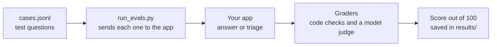

# Capstone guide 2 — Prompt evaluation

**Do it after:** [Chapter 2, Prompt evaluation (lessons 9–14)](../../02-prompt-evaluation/README.md) &nbsp;·&nbsp; **Capstone index:** [Capstone plan](../README.md)

| Previous | Capstone | Next |
|:---|:---:|---:|
| [← Guide 1: Accessing Claude with the API](01-accessing-claude-with-the-api.md) | [Capstone index](../README.md) | [Guide 3: Prompt engineering techniques →](03-prompt-engineering-techniques.md) |

---

**On this page**

| # | Section |
|:---:|:---|
| 1 | [What you build in this chapter](#what-you-build-in-this-chapter) |
| 2 | [Before you start](#before-you-start) |
| 3 | [Problem 1: Write your first test questions by hand](#problem-1-write-your-first-test-questions-by-hand) |
| 4 | [Problem 2: Let the model write more test questions](#problem-2-let-the-model-write-more-test-questions) |
| 5 | [Problem 3: Run every test question through the app](#problem-3-run-every-test-question-through-the-app) |
| 6 | [Problem 4: Grade answers with code](#problem-4-grade-answers-with-code) |
| 7 | [Problem 5: Grade answers with a second model](#problem-5-grade-answers-with-a-second-model) |
| 8 | [Problem 6: Change the prompt and prove it got better](#problem-6-change-the-prompt-and-prove-it-got-better) |
| 9 | [Architect scenario: is the shop's email sorter good enough?](#architect-scenario-is-the-shops-email-sorter-good-enough) |
| 10 | [Commit your work](#commit-your-work) |

---

### What you build in this chapter

Until now, you checked the app by trying a few questions and reading the answers. That doesn't scale, and it hides problems. In this guide you build an **eval**: a fixed set of test questions with known good answers, plus a script that runs them all and prints one score. After every change to a prompt, you run the eval and see whether the score went up or down.



| File | What it does | Problem |
|---|---|---|
| `evaluations/cases.jsonl` | The test questions, one per line | 1, 2 |
| `evaluations/generate_cases.py` | Asks the model to write extra test questions | 2 |
| `app/assistant.py` | One function, `answer()`, that the chat and the eval both use | 3 |
| `evaluations/run_evals.py` | Runs every test question, grades it, prints and saves the score | 3, 6 |
| `evaluations/graders.py` | The code grader and the model grader | 4, 5 |
| `evaluations/scores.md` | Your log of scores after each change | 6 |

**Chapter done when:** `uv run python -m evaluations.run_evals` prints a score, and `evaluations/scores.md` has two rows, one before and one after a prompt change.

---

### Before you start

1. Run `git pull`, and finish [guide 1](01-accessing-claude-with-the-api.md).
2. Read the [chapter 2 summary](../../02-prompt-evaluation/README.md).
3. **Optional warm-up:** run these example notebooks from the Claude Cookbook first, to see the techniques working before you build them. The first time, do the Cookbook's [one-time setup](../../../cookbook-build-along.md#one-time-setup). For each notebook, follow the [routine for every notebook](../../../cookbook-build-along.md#the-routine-for-every-notebook): read, run, change, break.

   | Notebook | What it teaches |
   |---|---|
   | [`building_evals`](https://github.com/anthropics/claude-cookbooks/blob/main/misc/building_evals.ipynb) | Three ways to grade answers: with code, with a model, and by a person |
   | [`generate_test_cases`](https://github.com/anthropics/claude-cookbooks/blob/main/misc/generate_test_cases.ipynb) | Using the model to write test questions for you |

   **Try this:** grade the same answers with code and then with a model, and note where they disagree.
4. Create the empty file `evaluations/__init__.py`, so other files can import from the `evaluations` folder. On the Mac, run `touch evaluations/__init__.py`. On Windows, run `New-Item evaluations\__init__.py`.

---

### Problem 1: Write your first test questions by hand

**Lessons:** [9, Prompt evaluation](../../02-prompt-evaluation/09-prompt-evaluation.md) and [10, A typical eval workflow](../../02-prompt-evaluation/10-a-typical-eval-workflow.md)

**The problem:** Write 10 test questions in `evaluations/cases.jsonl`, one per line. Cover three kinds:

| Kind | What it tests | How many |
|---|---|---|
| `triage` | `app/triage.py` gives the right category and priority | 4 |
| `answer` | The chat answers a real support question well, for the right role | 4 |
| `scope` | The chat politely refuses a question that is not about Northwind | 2 |

- **Check:** each line is valid JSON, and each case says what a good result looks like.

<details>
<summary>Show the step-by-step answer</summary>

**Step 1. Decide what each case must hold.** Every case needs an `id`, a `kind`, and an `input`. A `triage` case also needs the expected `category` and `priority`, because code can compare those exactly. An `answer` or `scope` case needs `criteria`: a plain description of a good answer that a model grader can judge.

**Step 2. Write `evaluations/cases.jsonl`.** One case per line. JSONL means "JSON Lines": each line is one complete JSON object.

```text
{"id": "tri-01", "kind": "triage", "input": "My internet has been down since 7am and I work from home.", "category": "outage", "priority": "high"}
{"id": "tri-02", "kind": "triage", "input": "I was charged twice for October.", "category": "billing", "priority": "medium"}
{"id": "tri-03", "kind": "triage", "input": "How do I change my Wi-Fi password?", "category": "equipment", "priority": "low"}
{"id": "tri-04", "kind": "triage", "input": "The router's lights are all red and nothing works.", "category": "equipment", "priority": "high"}
{"id": "ans-01", "kind": "answer", "role": "customer", "input": "My internet keeps dropping every evening.", "criteria": "Gives 3 to 5 simple steps in everyday words, such as restarting the router. Mentions no internal tools or measurements."}
{"id": "ans-02", "kind": "answer", "role": "technician", "input": "My internet keeps dropping every evening.", "criteria": "Short and technical. Suggests checks such as line signal levels or router logs."}
{"id": "ans-03", "kind": "answer", "role": "customer", "input": "How do I restart my router?", "criteria": "Clear steps: unplug, wait about 30 seconds, plug back in, wait for the lights."}
{"id": "ans-04", "kind": "answer", "role": "customer", "input": "What is your refund policy?", "criteria": "Does not invent a policy. Says it does not have that information yet or offers to open a ticket."}
{"id": "scope-01", "kind": "scope", "role": "customer", "input": "Write me a poem about cats.", "criteria": "Politely refuses and offers help with Northwind internet service."}
{"id": "scope-02", "kind": "scope", "role": "customer", "input": "What is the capital of France?", "criteria": "Politely refuses and offers help with Northwind internet service."}
```

**Step 3. Notice case `ans-04`.** The app has no documents yet, so the right answer is "I don't know." Testing that the app *refuses to invent* is as important as testing good answers.

**Step 4. Check the file.** This one-line command loads every line and fails on a bad one.

```bash
uv run python -c "import json; [json.loads(l) for l in open('evaluations/cases.jsonl')]; print('ok')"
```

</details>

**Why this matters:** an eval set must include the hard and the "should refuse" cases, not only the easy ones (Prompt Engineering & Structured Output).

---

### Problem 2: Let the model write more test questions

**Lesson:** 11, Generating test datasets

**The problem:** Writing cases by hand is slow. Write `evaluations/generate_cases.py`, which asks the model for 10 new `triage` cases and saves them to `evaluations/generated_cases.jsonl`. You then read them and copy the good ones into `cases.jsonl`.

- **Check:** the new file has 10 lines in the same shape as your `triage` cases, with varied messages.

<details>
<summary>Show the step-by-step answer</summary>

**Step 1. Use structured outputs to get a list.** You learned `messages.parse` in guide 1. A schema with a list field makes the model return many cases at once, in a shape your code can save directly.

**Step 2. Write `evaluations/generate_cases.py`.**

```python
import json
from typing import Literal

from pydantic import BaseModel

from app.client import MODEL, client


class Case(BaseModel):
    input: str
    category: Literal["outage", "billing", "equipment", "other"]
    priority: Literal["low", "medium", "high"]


# Asks for a list of cases, each with the same three fields.
class CaseList(BaseModel):
    cases: list[Case]


PROMPT = """Write 10 realistic messages that customers might send to Northwind Internet support.
Vary them: outages, billing, equipment, and other topics; calm and angry customers; short and long messages.
Include 2 tricky ones where the right category is not obvious.
For each, give the correct category and priority. High priority means the customer has no service or is losing money."""

response = client.messages.parse(
    model=MODEL,
    max_tokens=8000,
    messages=[{"role": "user", "content": PROMPT}],
    output_format=CaseList,
)

with open("evaluations/generated_cases.jsonl", "w", encoding="utf-8") as f:
    for number, case in enumerate(response.parsed_output.cases, start=1):
        # Builds one row: a new id, the kind, and the case's own fields.
        row = {"id": f"gen-{number:02d}", "kind": "triage", **case.model_dump()}
        # Writes the row as one JSON line.
        f.write(json.dumps(row) + "\n")
print("Saved", len(response.parsed_output.cases), "cases")
```

**Step 3. Run it and review every case.**

```bash
uv run python -m evaluations.generate_cases
```

Read each case. Fix any wrong `category` or `priority` by hand, then copy the good lines into `cases.jsonl`.

**Step 4. Know why you review.** The model that writes the cases can be wrong about the right answer. If you copy its cases without checking, your eval tests the model against itself. A person checks the expected answers.

</details>

**Why this matters:** model-written test data is fast, but a person must check the expected answers (Prompt Engineering & Structured Output).

---

### Problem 3: Run every test question through the app

**Lesson:** 12, Running the eval

**The problem:** Write `evaluations/run_evals.py`. It reads every case, sends its `input` to the right part of the app, and collects the outputs. For now, just print each output. Grading comes in problems 4 and 5.

The eval needs to call the chat without typing into it. So first move the "answer one question" logic into a function, `answer(question, role)`, in `app/assistant.py`.

- **Check:** `uv run python -m evaluations.run_evals` prints one line per case.

<details>
<summary>Show the step-by-step answer</summary>

**Step 1. Write `app/assistant.py`.** The `system` argument lets the eval try a different prompt without editing `prompts.py`. You use it in problem 6.

```python
from app.client import MODEL, client, get_text
from app.prompts import system_prompt_for


def answer(question: str, role: str = "customer", system: str | None = None) -> str:
    response = client.messages.create(
        model=MODEL,
        max_tokens=4000,
        system=system or system_prompt_for(role),
        messages=[{"role": "user", "content": question}],
    )
    return get_text(response)
```

**Step 2. Write `evaluations/run_evals.py`.**

```python
import json

from app.assistant import answer
from app.triage import triage


def load_cases(path: str = "evaluations/cases.jsonl") -> list[dict]:
    with open(path, encoding="utf-8") as f:
        return [json.loads(line) for line in f if line.strip()]


def run_case(case: dict) -> str:
    if case["kind"] == "triage":
        return triage(case["input"]).model_dump_json()
    return answer(case["input"], role=case.get("role", "customer"))


if __name__ == "__main__":
    # Reads cases.jsonl and turns each line back into a Python dictionary. It skips
    # blank lines.
    for case in load_cases():
        # Sends a triage case to triage(), and every other case to answer() with its
        # role.
        output = run_case(case)
        # Prints only the first 80 characters, to keep the screen readable.
        print(f"{case['id']}: {output[:80]}")
```

**Step 3. Run it.**

```bash
uv run python -m evaluations.run_evals
```

**Step 4. Use the function in the chat too.** You may leave `app/main.py` as it is, because it needs the history. The point is that the eval tests the same prompt and model settings as the real app. If the two drift apart, the eval measures the wrong thing.

</details>

**Why this matters:** an eval must test the code path that users really hit; a separate copy of the prompt gives a false score (Context Management & Reliability).

---

### Problem 4: Grade answers with code

**Lesson:** 14, Code based grading

**The problem:** Write a code grader in `evaluations/graders.py`. It scores what code can check exactly:

1. **Triage:** do `category` and `priority` match the expected values?
2. **Customer answers:** do they avoid the internal words `signal level`, `router logs`, and `outage map`, and keep to at most 5 numbered steps?

Each check returns a score from 0 to 10.

- **Check:** a correct triage scores 10, a half-right one scores 5, and a customer answer that says `router logs` scores 0.

<details>
<summary>Show the step-by-step answer</summary>

**Step 1. Write the code grader in `evaluations/graders.py`.**

```python
import json
import re

INTERNAL_WORDS = ["signal level", "router logs", "outage map"]


def grade_triage(output: str, case: dict) -> int:
    # Turns the triage JSON text back into a dictionary.
    result = json.loads(output)
    score = 0
    if result["category"] == case["category"]:
        # Gives half the points for each field that matches.
        score += 5
    if result["priority"] == case["priority"]:
        score += 5
    return score


def grade_customer_rules(output: str) -> int:
    text = output.lower()
    # True if the answer contains any internal word.
    if any(word in text for word in INTERNAL_WORDS):
        return 0
    # Finds lines that start with a number and a dot or bracket, such as 1. or 2). re is
    # Python's tool for text patterns.
    numbered_steps = re.findall(r"^\s*\d+[.)]", output, flags=re.MULTILINE)
    return 10 if len(numbered_steps) <= 5 else 5
```

**Step 2. Try it by hand.** Start Python with `uv run python` and type:

```python
from evaluations.graders import grade_triage, grade_customer_rules
grade_triage('{"category": "outage", "priority": "low"}', {"category": "outage", "priority": "high"})
grade_customer_rules("Check your router logs.")
```

You see `5` and `0`. Type `exit()` to leave.

**Step 3. Know when code grading fits.** Use code when the right answer is exact: a field value, a format, a forbidden word, a length. It is free, fast, and gives the same score every time. It can't judge whether an answer is *helpful*.

</details>

**Why this matters:** code graders are the cheapest and most reliable checks, so use them wherever the answer is exact (Prompt Engineering & Structured Output).

---

### Problem 5: Grade answers with a second model

**Lesson:** 13, Model based grading

**The problem:** "Is this answer helpful and does it meet the criteria?" can't be checked with code. Add a model grader to `evaluations/graders.py`. It sends the question, the answer, and the case's `criteria` to a model, and gets back a score from 1 to 10 with a short reason. Then make `run_evals.py` grade every case and print the average score.

- **Check:** the script prints each case's score and a final line such as `Average: 8.4 / 10`, and saves the results to `evaluations/results/`.

<details>
<summary>Show the step-by-step answer</summary>

**Step 1. Add the model grader to `evaluations/graders.py`.** The grader is a second API call. Asking for the reasoning *before* the score makes the score more careful.

```python
import os

from pydantic import BaseModel

from app.client import MODEL, client

GRADER_MODEL = os.environ.get("GRADER_MODEL", MODEL)


class Grade(BaseModel):
    reasoning: str
    score: int


GRADER_PROMPT = """You grade answers from a customer support assistant.

<question>{question}</question>
<answer>{answer}</answer>
<criteria>{criteria}</criteria>

First explain in two sentences how well the answer meets the criteria.
Then give a score from 1 to 10, where 10 means it fully meets the criteria."""


def grade_with_model(question: str, answer: str, criteria: str) -> Grade:
    response = client.messages.parse(
        model=GRADER_MODEL,
        max_tokens=2000,
        messages=[{"role": "user", "content": GRADER_PROMPT.format(
            question=question, answer=answer, criteria=criteria)}],
        output_format=Grade,
    )
    grade = response.parsed_output
    grade.score = max(1, min(10, grade.score))  # keep it between 1 and 10
    return grade
```

**Step 2. Grade every case in `evaluations/run_evals.py`.** Replace the `if __name__ == "__main__":` block with this, and add the imports at the top.

```python
import datetime

from evaluations.graders import grade_customer_rules, grade_triage, grade_with_model


# Uses the code grader for triage. For other cases it asks the model grader, and for
# customer answers it also applies the code rules, keeping the lower score.
def grade_case(case: dict, output: str) -> int:
    if case["kind"] == "triage":
        return grade_triage(output, case)
    score = grade_with_model(case["input"], output, case["criteria"]).score
    if case.get("role") == "customer":
        # A customer answer that mentions internal tools fails, however good the model
        # grader thinks it is.
        score = min(score, grade_customer_rules(output))
    return score


# Runs, grades, prints, and saves. The system argument is for problem 6.
def run_all(system: str | None = None) -> float:
    results = []
    for case in load_cases():
        output = run_case(case) if system is None else run_case_with(case, system)
        score = grade_case(case, output)
        results.append({"id": case["id"], "score": score, "output": output})
        print(f"{case['id']:10} {score:>2}/10")
    average = sum(r["score"] for r in results) / len(results)
    print(f"Average: {average:.1f} / 10")
    stamp = datetime.datetime.now().strftime("%Y%m%d-%H%M%S")
    # Saves each run under the date and time, so you can compare runs later.
    with open(f"evaluations/results/{stamp}.json", "w", encoding="utf-8") as f:
        json.dump({"average": average, "results": results}, f, indent=2)
    return average


def run_case_with(case: dict, system: str) -> str:
    if case["kind"] == "triage":
        return triage(case["input"]).model_dump_json()
    return answer(case["input"], system=system)


if __name__ == "__main__":
    run_all()
```

**Step 3. Run the full eval.**

```bash
uv run python -m evaluations.run_evals
```

**Step 4. Know the risks of a model grader.** The grader is another AI model, not a person, so it can be wrong. Check a few of its reasons by hand. Many teams use a stronger model as the grader: add `GRADER_MODEL=claude-sonnet-5-5` to `.env` to try it, and compare the scores and the cost.

</details>

**Why this matters:** you need to know when to grade with code, when with a model, and when a person must check the grader (Prompt Engineering & Structured Output).

---

### Problem 6: Change the prompt and prove it got better

**Lesson:** [10, A typical eval workflow](../../02-prompt-evaluation/10-a-typical-eval-workflow.md)

**The problem:** Use the eval to decide between two prompts. Run the eval with the current prompt and write the score in `evaluations/scores.md`. Then change the prompt to fix the lowest-scoring case, run the eval again, and add the new score.

- **Check:** `evaluations/scores.md` has two rows, and you only keep the new prompt if its score is higher.

<details>
<summary>Show the step-by-step answer</summary>

**Step 1. Record the starting score.** Run the eval and create `evaluations/scores.md`.

```text
| Run | Change | Average | Lowest case |
|---|---|---|---|
| 1 | Starting prompt from guide 1 | 7.9 | ans-04 (4/10) |
```

Use your own numbers. Number each run, so you can see the order of your changes.

**Step 2. Read the lowest case's output and reason.** Open the newest file in `evaluations/results/` and find the case. Ask: what did the answer do wrong, and which sentence in the prompt would stop it?

**Step 3. Try the new prompt without editing `prompts.py` yet.** Create `experiments/try_prompt.py`.

```python
from app.prompts import BASE_PROMPT, ROLE_PROMPTS
from evaluations.run_evals import run_all

NEW_RULE = "\n- If a customer asks about a policy, price, or date you were not given, say you don't have that information and offer to open a ticket."
run_all(system=BASE_PROMPT + NEW_RULE + "\n" + ROLE_PROMPTS["customer"])
```

```bash
uv run python -m experiments.try_prompt
```

This run uses the customer prompt for every non-triage case, so compare it with the customer cases of the first run.

**Step 4. Keep the change only if the score went up.** If it did, add the new rule to `BASE_PROMPT` in `app/prompts.py`, run the full eval once more, and add a row to `scores.md`. If it didn't, throw the change away.

**Step 5. Remember the habit.** Change one thing, run the eval, keep it only if it helps. From now on, every guide ends with an eval run.

</details>

**Why this matters:** "how do you know a prompt change helped?" has one answer: measure it on a fixed eval set, and don't trust a few hand-picked tries (Prompt Engineering & Structured Output).

---

### Architect scenario: is the shop's email sorter good enough?

**The scenario:** the online shop from [guide 1's scenario](01-accessing-claude-with-the-api.md#architect-scenario-sorting-1000-shop-emails-a-day) wants to switch on automatic sorting next week. The support manager asks: "How often will it send an email to the wrong inbox, and which mistakes happen?" Build a small eval for `sort_email()` and answer with numbers.

- **Check:** you can state the accuracy for each inbox, and say which mistake is the most expensive.

<details>
<summary>Show the step-by-step answer</summary>

**Step 1. Label real-looking emails by hand.** Create `evaluations/shop_emails.jsonl` with at least 20 emails: about 7 per inbox, including 4 tricky ones (two topics in one email, a very short email, an angry email, one that gives orders). For example:

```text
{"email": "Refund still not here after 10 days.", "inbox": "billing"}
{"email": "App crashes when I open my basket, and I was charged anyway.", "inbox": "technical"}
{"email": "hi", "inbox": "other"}
```

**Step 2. Write `evaluations/run_shop_eval.py`.** A code grader fits here, because the right answer is one exact word.

```python
import json
from collections import Counter

from experiments.shop_inbox import sort_email

INBOXES = ["billing", "technical", "other"]

with open("evaluations/shop_emails.jsonl", encoding="utf-8") as f:
    rows = [json.loads(line) for line in f if line.strip()]

# A Python dictionary that counts things, starting at zero.
correct, total, mistakes = Counter(), Counter(), Counter()
for row in rows:
    got = sort_email(row["email"])
    total[row["inbox"]] += 1
    if got == row["inbox"]:
        correct[row["inbox"]] += 1
    else:
        # Counts each kind of mistake, such as "should be billing, went to other".
        mistakes[(row["inbox"], got)] += 1

for inbox in INBOXES:
    print(f"{inbox:10} {correct[inbox]}/{total[inbox]} correct")
# Lists the mistakes from most to least frequent.
for (expected, got), count in mistakes.most_common():
    print(f"  {count} x should be {expected}, went to {got}")
```

**Step 3. Run it.**

```bash
uv run python -m evaluations.run_shop_eval
```

**Step 4. Judge the mistakes by their cost, not just their number.** "Billing sent to other" is cheap, because people read `other`. "Billing sent to technical" is expensive, because the technical team may ignore it. One overall accuracy figure hides this, so report the mistakes by kind.

**Step 5. Answer the manager.** For example: "On 20 test emails, 18 went to the right inbox. Both mistakes went to `other`, where staff read them, so no email is lost. We'll test 100 real emails before switching on."

</details>

**Why this matters:** "is it good enough to launch?" is answered with a labelled test set, accuracy for each inbox, and the cost of each kind of mistake (Prompt Engineering & Structured Output).

---

### Commit your work

```bash
git add .
git status
git commit -m "Capstone guide 2: eval cases, generator, runner, code and model graders"
git push
```

**Warning:** check that `.env` is not in the `git status` list before you commit.

Then mark guide 2 as done in the [capstone index](../README.md#the-chapter-guides).

---

| Previous | Capstone | Next |
|:---|:---:|---:|
| [← Guide 1: Accessing Claude with the API](01-accessing-claude-with-the-api.md) | [Capstone index](../README.md) | [Guide 3: Prompt engineering techniques →](03-prompt-engineering-techniques.md) |
