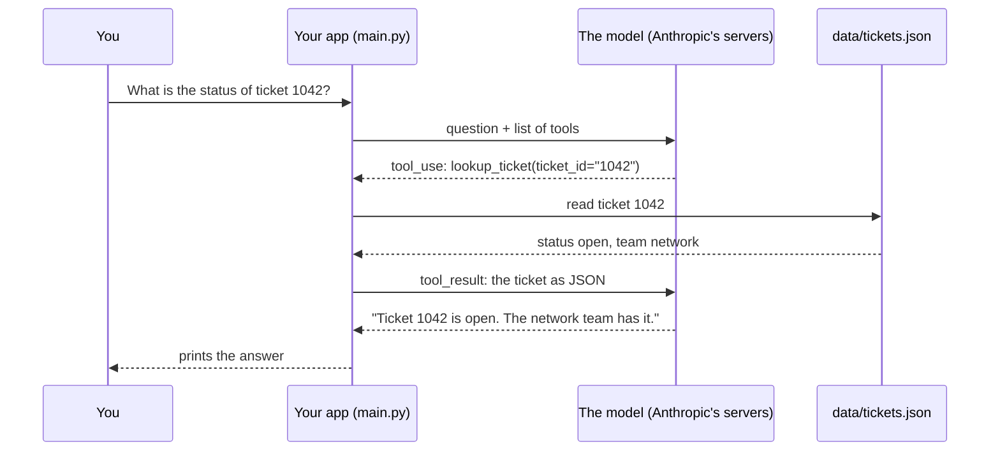

# Capstone guide 4 — Tool use with Claude

**Do it after:** Chapter 4, Tool use with Claude (lessons 20–31) &nbsp;·&nbsp; **Capstone index:** [Capstone plan](../README.md)

| Previous | Capstone | Next |
|:---|:---:|---:|
| [← Guide 3: Prompt engineering techniques](03-prompt-engineering-techniques.md) | [Capstone index](../README.md) | [Guide 5: RAG and agentic search →](05-rag-and-agentic-search.md) |

---

**On this page**

| # | Section |
|:---:|:---|
| 1 | [What you build in this chapter](#what-you-build-in-this-chapter) |
| 2 | [Before you start](#before-you-start) |
| 3 | [Problem 1: Plan the tools and create the ticket data](#problem-1-plan-the-tools-and-create-the-ticket-data) |
| 4 | [Problem 2: Write the lookup function](#problem-2-write-the-lookup-function) |
| 5 | [Problem 3: Describe the tool to the model](#problem-3-describe-the-tool-to-the-model) |
| 6 | [Problem 4: Handle one tool call by hand](#problem-4-handle-one-tool-call-by-hand) |
| 7 | [Problem 5: Loop until the model is done](#problem-5-loop-until-the-model-is-done) |
| 8 | [Problem 6: Add more tools and an approval gate](#problem-6-add-more-tools-and-an-approval-gate) |
| 9 | [Problem 7: Test the tools automatically](#problem-7-test-the-tools-automatically) |
| 10 | [Problem 8: Watch a tool call stream in](#problem-8-watch-a-tool-call-stream-in) |
| 11 | [Problem 9: Let the model edit a notes file safely](#problem-9-let-the-model-edit-a-notes-file-safely) |
| 12 | [Problem 10: Let technicians search the web](#problem-10-let-technicians-search-the-web) |
| 13 | [Architect scenario: refunds as a tool](#architect-scenario-refunds-as-a-tool) |
| 14 | [Commit your work](#commit-your-work) |

---

### What you build in this chapter

So far the assistant can only talk. In this guide it learns to *do* things: look up a ticket, check for an outage, and create a ticket. A **tool** is a function in your code that the model can ask your app to run. The model never runs anything itself. It sends a request, your code decides whether to run the function, and your code sends back the result.



| File | What it does | Problem |
|---|---|---|
| `data/tickets.json`, `data/outages.json` | Made-up tickets and outages | 1, 6 |
| `app/tools.py` | The tool functions, their descriptions for the model, and `run_tool()` | 2, 3, 6 |
| `app/agent_loop.py` | `run_turn()`: the loop that runs tools until the model is done | 5 |
| `app/main.py` | The chat, now with tools and a signed-in user | 5 |
| `tests/test_tools.py` | Automatic tests for the tools | 7 |
| `app/notes_editor.py` | A safe handler for the text editor tool | 9 |
| `experiments/` | `one_tool_call.py`, `stream_tool.py`, `edit_notes.py`, `web_search.py` | 4, 8, 9, 10 |

**Chapter done when:** in the chat, a customer can look up their own ticket but not someone else's, and creating a ticket asks you to type `yes` first. `uv run pytest` passes.

---

### Before you start

1. Run `git pull`, and finish [guide 3](03-prompt-engineering-techniques.md).
2. Read your notes for chapter 4 when they exist (see the [course index](../../README.md)).
3. **Optional warm-up:** run these example notebooks from the Claude Cookbook first, to see the techniques working before you build them. The first time, do the Cookbook's [one-time setup](../../../cookbook-build-along.md#one-time-setup). For each notebook, follow the [routine for every notebook](../../../cookbook-build-along.md#the-routine-for-every-notebook): read, run, change, break.

   | Notebook | What it teaches |
   |---|---|
   | [`calculator_tool`](https://github.com/anthropics/claude-cookbooks/blob/main/tool_use/calculator_tool.ipynb) | The smallest complete tool loop: define, call, return the result |
   | [`customer_service_agent`](https://github.com/anthropics/claude-cookbooks/blob/main/tool_use/customer_service_agent.ipynb) | Several tools for a support agent; very close to this guide |
   | [`tool_choice`](https://github.com/anthropics/claude-cookbooks/blob/main/tool_use/tool_choice.ipynb) | Letting, forcing, or stopping tool use with the `tool_choice` setting |
   | [`parallel_tools`](https://github.com/anthropics/claude-cookbooks/blob/main/tool_use/parallel_tools.ipynb) | Several tool calls in one reply, to save time |

   **Try this:** make a tool function raise an error, send the error back as the tool result, and watch how the model responds.

---

### Problem 1: Plan the tools and create the ticket data

**Lessons:** 20, Introducing tool use, and 21, Project overview

**The problem:** Before writing code, decide which tools the assistant needs and who may use each one. Then create `data/tickets.json` with 6 made-up tickets for two customers.

- **Check:** you have a table of tools, and the JSON file loads without errors.

<details>
<summary>Show the step-by-step answer</summary>

**Step 1. Plan the tools.** For each tool, ask two questions: does it only *read* data, or does it *change* data? And who may use it?

| Tool | Reads or changes? | Who may use it | Extra protection |
|---|---|---|---|
| `lookup_ticket` | Reads | A customer, for their own tickets only. A technician, for any ticket. | The code checks who owns the ticket. |
| `check_outage` | Reads | Everyone | None needed |
| `create_ticket` | Changes | Everyone | A person must type `yes` first. |

**Step 2. Create `data/tickets.json`.**

```text
[
  {"id": "1040", "customer_id": "C-1001", "title": "Slow speed in the evening", "status": "closed", "priority": "medium", "team": "network"},
  {"id": "1041", "customer_id": "C-1002", "title": "Charged twice in October", "status": "open", "priority": "medium", "team": "billing"},
  {"id": "1042", "customer_id": "C-1001", "title": "Router keeps restarting", "status": "open", "priority": "high", "team": "network"},
  {"id": "1043", "customer_id": "C-1002", "title": "Wants a second router", "status": "open", "priority": "low", "team": "equipment"},
  {"id": "1044", "customer_id": "C-1001", "title": "Wi-Fi password reset", "status": "closed", "priority": "low", "team": "support"},
  {"id": "1045", "customer_id": "C-1002", "title": "No internet after storm", "status": "open", "priority": "high", "team": "network"}
]
```

**Step 3. Understand why the plan comes first.** The model decides *when* to ask for a tool, but your code decides *what is allowed*. Writing down who may use each tool now means the rules end up in code, not just in a prompt.

</details>

**Why this matters:** an architect sorts tools into read and write, and puts the permission check in code (Tool Design & MCP Integration).

---

### Problem 2: Write the lookup function

**Lesson:** 22, Tool functions

**The problem:** In `app/tools.py`, write `lookup_ticket(ticket_id, user)`. The `user` is a dictionary such as `{"role": "customer", "customer_id": "C-1001"}`. Return the ticket. If the ticket doesn't exist, or belongs to another customer, raise an error that says the ticket was not found.

- **Check:** customer `C-1001` gets ticket 1042. Customer `C-1002` asking for 1042 gets "not found". A technician gets any ticket.

<details>
<summary>Show the step-by-step answer</summary>

**Step 1. Write the start of `app/tools.py`.**

```python
import json
from pathlib import Path

TICKETS_FILE = Path("data/tickets.json")


class ToolError(Exception):
    """A problem the model should be told about, so it can explain it or try again."""


def load_tickets() -> list[dict]:
    return json.loads(TICKETS_FILE.read_text(encoding="utf-8"))


def save_tickets(tickets: list[dict]) -> None:
    TICKETS_FILE.write_text(json.dumps(tickets, indent=2), encoding="utf-8")


def lookup_ticket(ticket_id: str, user: dict) -> dict:
    for ticket in load_tickets():
        if ticket["id"] == ticket_id:
            if user["role"] == "customer" and ticket["customer_id"] != user["customer_id"]:
                break  # pretend it doesn't exist, so customers can't probe other people's tickets
            return ticket
    raise ToolError(f"Ticket {ticket_id} was not found.")
```

| Line | What it does |
|---|---|
| `class ToolError(Exception)` | A custom error type. Your code will send its message to the model instead of crashing. |
| `if user["role"] == "customer" and ...` | The access check, done in code. A customer only sees tickets with their own `customer_id`. |
| `break` | Leaves the loop and falls through to "not found". Saying "this ticket belongs to someone else" would leak that it exists. |

**Step 2. Try it.** Start `uv run python` and type:

```python
from app.tools import lookup_ticket
lookup_ticket("1042", {"role": "customer", "customer_id": "C-1001"})["title"]
lookup_ticket("1042", {"role": "technician"})["team"]
lookup_ticket("1042", {"role": "customer", "customer_id": "C-1002"})
```

The last line raises `ToolError: Ticket 1042 was not found.`

</details>

**Why this matters:** permission checks belong in the tool's code, where a clever prompt can't talk its way around them (Governance, Safety & Risk).

---

### Problem 3: Describe the tool to the model

**Lesson:** 23, Tool schemas

**The problem:** The model can't see your Python code. It only sees a description of each tool: a name, a sentence about when to use it, and a *schema* that lists its inputs. Write that description for `lookup_ticket` in a list called `TOOLS` in `app/tools.py`.

- **Check:** the description says when to use the tool and what the input looks like, and it uses `strict: true`.

<details>
<summary>Show the step-by-step answer</summary>

**Step 1. Add `TOOLS` to `app/tools.py`.** The schema uses *JSON Schema*, a standard way to describe the shape of JSON data.

```python
TOOLS = [
    {
        "name": "lookup_ticket",
        "description": (
            "Look up one Northwind support ticket by its number. Use this whenever the person "
            "mentions a ticket number or asks about the status of a ticket. Returns the title, "
            "status, priority, and team. Returns an error if the ticket is not found."
        ),
        "strict": True,
        "input_schema": {
            "type": "object",
            "properties": {
                "ticket_id": {"type": "string", "description": "The ticket number, digits only, such as 1042."}
            },
            "required": ["ticket_id"],
            "additionalProperties": False,
        },
    },
]
```

| Field | What it does |
|---|---|
| `name` | The name the model uses when it asks for the tool. |
| `description` | The model reads this to decide *when* to use the tool. A vague description gives wrong or missing tool calls. |
| `strict: True` | The API guarantees that the model's input matches the schema exactly. |
| `input_schema` | The inputs: here one text field, `ticket_id`, which is required. |
| `additionalProperties: False` | No other fields are allowed. `strict` needs this. |

**Step 2. Know what makes a good description.** Say what the tool does, when to use it, what it returns, and what happens on failure. This is the tool's only "documentation" for the model.

</details>

**Why this matters:** most tool problems on the exam are fixed by a clearer tool description, not a bigger model (Tool Design & MCP Integration).

---

### Problem 4: Handle one tool call by hand

**Lessons:** 24, Handling message blocks, and 25, Sending tool results

**The problem:** Write `experiments/one_tool_call.py`. It asks `What is the status of ticket 1042?` with the tools attached, prints every block of the reply, runs the tool, sends the result back, and prints the final answer.

- **Check:** you see a `tool_use` block with `ticket_id` `1042`, and then a final text answer that mentions the network team.

<details>
<summary>Show the step-by-step answer</summary>

**Step 1. Write `experiments/one_tool_call.py`.**

```python
import json

from app.client import MODEL, client, get_text
from app.tools import TOOLS, lookup_ticket

user = {"role": "technician"}
messages = [{"role": "user", "content": "What is the status of ticket 1042?"}]

first = client.messages.create(model=MODEL, max_tokens=4000, tools=TOOLS, messages=messages)
print("stop_reason:", first.stop_reason)
for block in first.content:
    print(" block:", block.type, getattr(block, "input", ""))

tool_use = next(block for block in first.content if block.type == "tool_use")
ticket = lookup_ticket(tool_use.input["ticket_id"], user)

messages.append({"role": "assistant", "content": first.content})
messages.append({"role": "user", "content": [
    {"type": "tool_result", "tool_use_id": tool_use.id, "content": json.dumps(ticket)}
]})

second = client.messages.create(model=MODEL, max_tokens=4000, tools=TOOLS, messages=messages)
print("Final answer:", get_text(second))
```

**Step 2. Run it.**

```bash
uv run python -m experiments.one_tool_call
```

You see `stop_reason: tool_use`, then blocks such as `thinking`, maybe `text`, and `tool_use {'ticket_id': '1042'}`, and finally the answer.

**Step 3. Read the rules this code follows.**

1. `stop_reason == "tool_use"` means the model is waiting for a tool result.
2. You send back the model's whole reply first, as an `assistant` message, so the next request contains the `tool_use` block.
3. The result goes in a `user` message, as a `tool_result` block whose `tool_use_id` matches the `id` of the `tool_use` block.
4. The `tools` list must be sent again on the second request.

</details>

**Why this matters:** the request, tool use, tool result, and answer cycle is the core of every agent (Agentic Architecture & Orchestration).

---

### Problem 5: Loop until the model is done

**Lessons:** 26, Multi-turn conversations with tools, and 27, Implementing multiple turns

**The problem:** One tool call per question isn't enough; sometimes the model needs several. Write `run_turn(messages, system, user)` in `app/agent_loop.py`. It keeps sending requests and running tools until the model stops asking for tools, and then returns the final reply. Then use it in `app/main.py`, and start the chat as a signed-in user.

- **Check:** `uv run python -m app.main --role customer --customer C-1001` answers `What's the status of ticket 1042?` correctly, and says ticket 1041 was not found.

<details>
<summary>Show the step-by-step answer</summary>

**Step 1. Add `run_tool()` to `app/tools.py`.** It runs the right function and turns errors into a message for the model, instead of crashing the app.

```python
def run_tool(name: str, tool_input: dict, user: dict) -> tuple[str, bool]:
    """Run one tool. Return the result as text, and whether it is an error."""
    try:
        if name == "lookup_ticket":
            result = lookup_ticket(tool_input["ticket_id"], user)
        else:
            raise ToolError(f"Unknown tool: {name}")
        return json.dumps(result), False
    except ToolError as error:
        return str(error), True
```

**Step 2. Write `app/agent_loop.py`.**

```python
from app.client import MODEL, client
from app.tools import TOOLS, run_tool

MAX_ROUNDS = 10


def run_turn(messages: list, system: str, user: dict, tools: list = TOOLS, model: str = MODEL):
    for _ in range(MAX_ROUNDS):
        response = client.messages.create(
            model=model, max_tokens=4000, system=system, tools=tools, messages=messages
        )
        messages.append({"role": "assistant", "content": response.content})
        if response.stop_reason == "pause_turn":
            continue  # a server tool paused; send the conversation again to let it finish
        if response.stop_reason != "tool_use":
            return response
        results = []
        for block in response.content:
            if block.type == "tool_use":
                content, is_error = run_tool(block.name, block.input, user)
                results.append({
                    "type": "tool_result",
                    "tool_use_id": block.id,
                    "content": content,
                    "is_error": is_error,
                })
        messages.append({"role": "user", "content": results})
    raise RuntimeError(f"Stopped after {MAX_ROUNDS} tool rounds.")
```

| Line | What it does |
|---|---|
| `for _ in range(MAX_ROUNDS)` | A safety limit, so a confused model can't loop forever and run up costs. |
| `messages.append(... response.content)` | Keeps every reply in the history, including tool requests. |
| `stop_reason != "tool_use"` | The model has finished, so return the reply. |
| `results` in **one** `user` message | If the model asked for several tools at once, all results go back together. |
| `"is_error": is_error` | Tells the model the tool failed, so it can explain or try something else. |

**Step 3. Update `app/main.py`.** Add a `--customer` option and replace the request with `run_turn`. Streaming is put aside here to keep the loop simple; problem 8 shows streaming with tools.

```python
import argparse

from app.agent_loop import run_turn
from app.client import get_text
from app.prompts import ROLES, system_prompt_for


def main() -> None:
    parser = argparse.ArgumentParser()
    parser.add_argument("--role", choices=ROLES, default="customer")
    parser.add_argument("--customer", default="C-1001", help="customer ID, used when the role is customer")
    args = parser.parse_args()
    user = {"role": args.role, "customer_id": args.customer if args.role == "customer" else None}
    system = system_prompt_for(args.role)
    messages = []
    print(f"Northwind support ({args.role}). Type a question, or 'quit' to stop.")
    while True:
        question = input("You:  ").strip()
        if question.lower() in {"quit", "exit"}:
            break
        if not question:
            continue
        messages.append({"role": "user", "content": question})
        response = run_turn(messages, system, user)
        print("App: ", get_text(response))


if __name__ == "__main__":
    main()
```

**Step 4. Run it and test both checks.**

```bash
uv run python -m app.main --role customer --customer C-1001
```

</details>

**Why this matters:** the loop, its stop condition, and its round limit are what turn single calls into an agent (Agentic Architecture & Orchestration).

---

### Problem 6: Add more tools and an approval gate

**Lesson:** 28, Using multiple tools

**The problem:** Add two tools.

1. `check_outage(area)` reads `data/outages.json` and says whether an area has a known outage.
2. `create_ticket(title, priority, description)` adds a ticket to `data/tickets.json`, but only after a person types `yes`.

Then test a question that needs two tools at once: `Is there an outage in Riverside, and what's the status of ticket 1042?`.

- **Check:** the model asks for both tools in one reply, and both results go back in one message.
- **Check:** `Please open a ticket, my internet is down` shows the planned ticket and waits for `yes`. Typing `no` creates nothing.

<details>
<summary>Show the step-by-step answer</summary>

**Step 1. Create `data/outages.json`.**

```text
[
  {"area": "Riverside", "status": "active", "since": "08:15", "note": "Fiber cut. Repair crew on site."},
  {"area": "Hillview", "status": "resolved", "since": "yesterday", "note": "Power failure at the exchange."}
]
```

**Step 2. Add the two functions to `app/tools.py`.** The `approve` argument lets tests replace the keyboard question with a fake answer (problem 7).

```python
OUTAGES_FILE = Path("data/outages.json")


def check_outage(area: str) -> dict:
    for outage in json.loads(OUTAGES_FILE.read_text(encoding="utf-8")):
        if outage["area"].lower() == area.lower():
            return outage
    return {"area": area, "status": "none", "note": "No known outage in this area."}


def ask_person(ticket: dict) -> bool:
    print("App:  I am about to create this ticket:")
    print(f"        Title: {ticket['title']}   Priority: {ticket['priority']}")
    answer = input("      Type yes to create it, or anything else to cancel: ")
    return answer.strip().lower() == "yes"


def create_ticket(title: str, priority: str, description: str, user: dict, approve=ask_person) -> dict:
    tickets = load_tickets()
    ticket = {
        "id": str(max(int(t["id"]) for t in tickets) + 1),
        "customer_id": user.get("customer_id") or "staff",
        "title": title,
        "status": "open",
        "priority": priority,
        "team": "support",
        "description": description,
    }
    if not approve(ticket):
        raise ToolError("The person declined, so the ticket was not created.")
    tickets.append(ticket)
    save_tickets(tickets)
    return ticket
```

**Step 3. Add their descriptions to `TOOLS`.**

```python
    {
        "name": "check_outage",
        "description": "Check whether a town or area has a known Northwind outage. Use this when someone reports no internet or very slow internet and mentions where they are.",
        "strict": True,
        "input_schema": {
            "type": "object",
            "properties": {"area": {"type": "string", "description": "Town or area name, such as Riverside."}},
            "required": ["area"],
            "additionalProperties": False,
        },
    },
    {
        "name": "create_ticket",
        "description": "Create a new support ticket. Use this only when the person asks for a ticket, or agrees to one. A person must approve it before it is saved.",
        "strict": True,
        "input_schema": {
            "type": "object",
            "properties": {
                "title": {"type": "string", "description": "Short title, at most 8 words."},
                "priority": {"type": "string", "enum": ["low", "medium", "high"]},
                "description": {"type": "string", "description": "What is wrong, in 1 to 3 sentences."},
            },
            "required": ["title", "priority", "description"],
            "additionalProperties": False,
        },
    },
```

**Step 4. Add them to `run_tool()`.**

```python
        elif name == "check_outage":
            result = check_outage(tool_input["area"])
        elif name == "create_ticket":
            result = create_ticket(**tool_input, user=user)
```

**Step 5. Test both checks in the chat.** To see the two tool calls arrive together, add `print([b.name for b in response.content if b.type == "tool_use"])` inside the loop in `run_turn` for a moment.

**Step 6. Understand the approval gate.** Reading a ticket changes nothing, so it runs at once. Creating one reaches a real team, and a prompt-injected or confused model might ask for it. So your code, not the model, asks a person first. When the person says no, the model gets an error result and tells the user.

</details>

**Why this matters:** "a person approves every action that changes data" is one of the most tested safety patterns (Governance, Safety & Risk).

---

### Problem 7: Test the tools automatically

**Lesson:** 28, Using multiple tools (testing is an extra)

**The problem:** Write `tests/test_tools.py` with automatic tests. They must not call the API, cost nothing, and run in seconds.

- **Check:** `uv run pytest` passes 4 tests: found, not found, another customer's ticket hidden, and a declined ticket not saved.

<details>
<summary>Show the step-by-step answer</summary>

**Step 1. Write `tests/test_tools.py`.** **pytest** finds functions whose names start with `test_` and runs them. `tmp_path` is a temporary folder pytest gives each test, so tests never touch your real data.

```python
import json

import pytest

from app import tools

CUSTOMER = {"role": "customer", "customer_id": "C-1001"}


@pytest.fixture(autouse=True)
def fake_tickets(tmp_path, monkeypatch):
    path = tmp_path / "tickets.json"
    path.write_text(json.dumps([
        {"id": "1042", "customer_id": "C-1001", "title": "Router keeps restarting", "status": "open", "priority": "high", "team": "network"},
        {"id": "1043", "customer_id": "C-1002", "title": "Wants a second router", "status": "open", "priority": "low", "team": "equipment"},
    ]))
    monkeypatch.setattr(tools, "TICKETS_FILE", path)


def test_lookup_finds_own_ticket():
    assert tools.lookup_ticket("1042", CUSTOMER)["team"] == "network"


def test_lookup_missing_ticket():
    with pytest.raises(tools.ToolError):
        tools.lookup_ticket("9999", CUSTOMER)


def test_customer_cannot_see_other_customers_ticket():
    with pytest.raises(tools.ToolError):
        tools.lookup_ticket("1043", CUSTOMER)


def test_declined_ticket_is_not_saved():
    with pytest.raises(tools.ToolError):
        tools.create_ticket("Test", "low", "Test", CUSTOMER, approve=lambda ticket: False)
    assert len(tools.load_tickets()) == 2
```

| Line | What it does |
|---|---|
| `@pytest.fixture(autouse=True)` | Runs `fake_tickets` before every test. |
| `monkeypatch.setattr(tools, "TICKETS_FILE", path)` | Points the tools at the temporary file for this test only. |
| `pytest.raises(tools.ToolError)` | The test passes only if this error is raised. |
| `approve=lambda ticket: False` | A fake person who always says no. |

**Step 2. Run the tests.**

```bash
uv run pytest
```

</details>

**Why this matters:** the code around the model must be tested like any other code; only the model's answers need evals (Context Management & Reliability).

---

### Problem 8: Watch a tool call stream in

**Lesson:** 29, Fine grained tool calling

**The problem:** When a tool input is long, such as a ticket description, the whole input normally arrives in one piece at the end. Write `experiments/stream_tool.py`. It streams a request that makes the model call `create_ticket`, with `eager_input_streaming` turned on, and prints each piece of the tool input as it arrives. It does not create the ticket.

- **Check:** you see the JSON input appear in many small pieces.

<details>
<summary>Show the step-by-step answer</summary>

**Step 1. Write `experiments/stream_tool.py`.**

```python
from app.client import MODEL, client
from app.tools import TOOLS

tools = [dict(tool, eager_input_streaming=True) for tool in TOOLS]
question = ("Please open a ticket: since Monday my internet drops every evening around 8pm, "
            "the router lights turn orange, and restarting only helps for ten minutes.")

with client.messages.stream(
    model=MODEL,
    max_tokens=4000,
    tools=tools,
    messages=[{"role": "user", "content": question}],
) as stream:
    for event in stream:
        if event.type == "content_block_delta" and event.delta.type == "input_json_delta":
            print(repr(event.delta.partial_json))
    final = stream.get_final_message()

for block in final.content:
    if block.type == "tool_use":
        print("Complete input:", block.input)
```

| Line | What it does |
|---|---|
| `dict(tool, eager_input_streaming=True)` | Copies each tool description and switches on eager streaming for it. |
| `input_json_delta` | An event that carries the next piece of a tool's input. |
| `event.delta.partial_json` | That piece, as raw text. It is not valid JSON on its own. |

**Step 2. Run it.**

```bash
uv run python -m experiments.stream_tool
```

**Step 3. Know the trade-off.** With eager streaming, the API no longer checks the input before sending it, so the finished input can be incomplete. Real code checks the complete input against the schema before running the tool. Use it when inputs are long and the person is watching; leave it off otherwise.

</details>

**Why this matters:** streaming tool input improves perceived speed, but moves the job of checking the input to your code (Tool Design & MCP Integration).

---

### Problem 9: Let the model edit a notes file safely

**Lesson:** 30, The text edit tool

**The problem:** Technicians keep a notes file, `docs/notes/known-issues.md`. Let the model read and edit it with Anthropic's built-in text editor tool. Your code does the actual file work, and it must refuse any path outside `docs/notes/`.

- **Check:** `Add a note that Riverside has a fiber cut` adds a line to the file.
- **Check:** a request to view `../../.env` is refused.

<details>
<summary>Show the step-by-step answer</summary>

**Step 1. Create the notes file.** Create `docs/notes/known-issues.md` with one line: `# Known issues`.

**Step 2. Write `app/notes_editor.py`.** The text editor tool is defined by Anthropic, so you don't write its schema. The model sends commands such as `view`, `create`, `str_replace`, and `insert`, and your code carries them out.

```python
from pathlib import Path

NOTES_ROOT = Path("docs/notes").resolve()
EDITOR_TOOL = {"type": "text_editor_20250728", "name": "str_replace_based_edit_tool"}


def safe_path(raw: str) -> Path:
    path = (NOTES_ROOT / raw).resolve() if not Path(raw).is_absolute() else Path(raw).resolve()
    if not path.is_relative_to(NOTES_ROOT):
        raise PermissionError(f"Only files inside docs/notes may be used, not {raw}.")
    return path


def run_editor(tool_input: dict) -> tuple[str, bool]:
    try:
        path = safe_path(tool_input["path"])
        command = tool_input["command"]
        if command == "view":
            return path.read_text(encoding="utf-8"), False
        if command == "create":
            path.write_text(tool_input["file_text"], encoding="utf-8")
            return "File created.", False
        if command == "str_replace":
            text = path.read_text(encoding="utf-8")
            if text.count(tool_input["old_str"]) != 1:
                return "old_str must appear exactly once.", True
            path.write_text(text.replace(tool_input["old_str"], tool_input["new_str"]), encoding="utf-8")
            return "Replaced.", False
        if command == "insert":
            lines = path.read_text(encoding="utf-8").splitlines(keepends=True)
            lines.insert(tool_input["insert_line"], tool_input["insert_text"] + "\n")
            path.write_text("".join(lines), encoding="utf-8")
            return "Inserted.", False
        return f"Unknown command {command}.", True
    except (OSError, PermissionError) as error:
        return str(error), True
```

| Line | What it does |
|---|---|
| `EDITOR_TOOL` | Declares the built-in tool by its type and name. No `input_schema` is needed. |
| `.resolve()` | Turns a path such as `docs/notes/../../.env` into the real full path, so tricks with `..` are exposed. |
| `is_relative_to(NOTES_ROOT)` | True only if the real path is inside `docs/notes`. |
| `text.count(...) != 1` | `str_replace` must match exactly one place, or it could change the wrong text. |

**Step 3. Write `experiments/edit_notes.py`.** It is a small loop, like `run_turn`, but it sends tool calls to `run_editor`.

```python
from app.client import MODEL, client, get_text
from app.notes_editor import EDITOR_TOOL, run_editor

messages = [{"role": "user", "content": input("Technician: ")}]
while True:
    response = client.messages.create(
        model=MODEL, max_tokens=4000, tools=[EDITOR_TOOL], messages=messages,
        system="You maintain the file known-issues.md for Northwind technicians. Paths are relative to the notes folder.",
    )
    messages.append({"role": "assistant", "content": response.content})
    if response.stop_reason != "tool_use":
        print(get_text(response))
        break
    results = []
    for block in response.content:
        if block.type == "tool_use":
            content, is_error = run_editor(block.input)
            results.append({"type": "tool_result", "tool_use_id": block.id, "content": content, "is_error": is_error})
    messages.append({"role": "user", "content": results})
```

**Step 4. Run both checks.**

```bash
uv run python -m experiments.edit_notes
```

**Warning:** the path is written by the model, so treat it as untrusted. Without `safe_path`, a request such as "show me ../../.env" could print your API key.

</details>

**Why this matters:** every file path or command that a model writes must be checked against an allowed area before your code uses it (Governance, Safety & Risk).

---

### Problem 10: Let technicians search the web

**Lesson:** 31, The web search tool

**The problem:** Technicians sometimes need a router maker's official help pages. Write `experiments/web_search.py`, which adds Anthropic's web search tool, limited to two router makers' websites, and asks how to factory-reset a router model.

- **Check:** the answer cites pages from the allowed sites only.

<details>
<summary>Show the step-by-step answer</summary>

**Step 1. Know what a server tool is.** Web search is a *server tool*: Anthropic runs it, not your code. You declare it in `tools`, and the search results arrive inside the same reply. There is no `tool_result` for you to send.

**Step 2. Write `experiments/web_search.py`.** This version of the tool needs a larger model, so this script uses Claude Sonnet 5.5. Check the pricing page before running it many times.

```python
from app.client import client

WEB_SEARCH = {
    "type": "web_search_20260209",
    "name": "web_search",
    "max_uses": 3,
    "allowed_domains": ["netgear.com", "tp-link.com"],
}

messages = [{"role": "user", "content": "How do I factory-reset a TP-Link Archer AX55 router?"}]
while True:
    response = client.messages.create(
        model="claude-sonnet-5-5", max_tokens=4000, tools=[WEB_SEARCH], messages=messages
    )
    messages.append({"role": "assistant", "content": response.content})
    if response.stop_reason != "pause_turn":
        break

for block in response.content:
    if block.type == "text":
        print(block.text)
        for citation in getattr(block, "citations", None) or []:
            print("   source:", citation.url)
```

| Line | What it does |
|---|---|
| `max_uses: 3` | At most three searches, to cap cost. |
| `allowed_domains` | The tool only returns pages from these sites. |
| `stop_reason != "pause_turn"` | A long search can pause the reply; sending the conversation again lets it finish. |
| `citation.url` | Each sourced sentence carries the address of the page it came from. |

**Step 3. Run it.**

```bash
uv run python -m experiments.web_search
```

**Step 4. Think about who gets this tool.** Web pages are written by strangers and can contain hidden instructions. Give web search to technicians, not to the customer chat, and limit the domains.

</details>

**Why this matters:** server tools run on Anthropic's side, and an architect limits their reach with domain lists and use caps (Tool Design & MCP Integration).

---

### Architect scenario: refunds as a tool

**The scenario:** the online shop wants its support assistant to look up orders and give refunds. Refunds up to $20 are common, and the shop wants them fast. Larger refunds have been used for fraud. Design the tools: name them, say which ones change data, and decide where a person must approve.

- **Check:** your design shows which rules live in the tool's code, which live in the prompt, and why.

<details>
<summary>Show the step-by-step answer</summary>

**Step 1. List the tools and sort them into read and write.**

| Tool | Reads or changes? | Protection |
|---|---|---|
| `lookup_order(order_id)` | Reads | The code checks that the order belongs to the signed-in customer. |
| `refund_order(order_id, amount, reason)` | Changes | The rules in code below |

**Step 2. Put the money rules in the tool's code, not in the prompt.** This sketch uses the same `ToolError` and `approve` pattern as problem 6. `lookup_order` and `issue_refund` stand for the shop's own order and payment systems.

```python
def refund_order(order_id: str, amount: float, reason: str, user: dict, approve) -> dict:
    order = lookup_order(order_id, user)  # raises ToolError if the order is not theirs
    if amount > order["total"]:
        raise ToolError("The refund is larger than the order total.")
    if order.get("refunded"):
        raise ToolError("This order was already refunded.")
    if amount > 20 and not approve({"order": order_id, "amount": amount, "reason": reason}):
        raise ToolError("A staff member must approve refunds over $20. The request was sent for review.")
    return issue_refund(order_id, amount)
```

**Step 3. Explain the split.**

| Rule | Where it lives | Why |
|---|---|---|
| Refund only your own order | Code | A prompt can be talked around; code can't. |
| Never more than the order total, never twice | Code | These are hard money limits. |
| Over $20 needs a person | Code, as an approval gate | Small refunds stay fast; large ones stay safe. |
| Be polite and explain the refund policy | Prompt | This is about how the assistant talks. |

**Step 4. Write the tool description carefully.** For example: "Refund all or part of one order. Use only after the customer has confirmed the amount. Refunds over $20 are sent to staff for approval." This tells the model *when* to call it, so it doesn't refund on the first complaint.

**Step 5. Plan the evidence.** Log every refund call: who asked, which order, the amount, and whether a person approved it. Auditors will ask for this log.

</details>

**Why this matters:** for any tool that moves money or changes records, the exam expects hard limits in code, a person for high-risk actions, and an audit log (Tool Design & MCP Integration, Governance, Safety & Risk).

---

### Commit your work

Run the eval from guide 2 once more to check that nothing got worse, then commit.

```bash
uv run pytest
uv run python -m evaluations.run_evals
git add .
git status
git commit -m "Capstone guide 4: ticket tools, tool loop, approval gate, tests, editor and web search"
git push
```

**Warning:** check that `.env` is not in the `git status` list before you commit.

Then mark guide 4 as done in the [capstone index](../README.md#the-chapter-guides).

---

| Previous | Capstone | Next |
|:---|:---:|---:|
| [← Guide 3: Prompt engineering techniques](03-prompt-engineering-techniques.md) | [Capstone index](../README.md) | [Guide 5: RAG and agentic search →](05-rag-and-agentic-search.md) |
