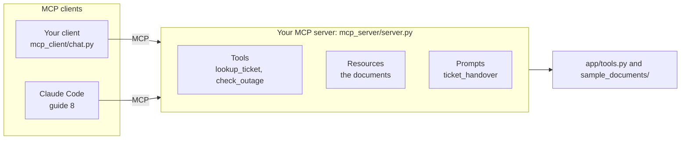

# Capstone guide 7 — Model Context Protocol

**Do it after:** Chapter 7, Model Context Protocol (lessons 47–56) &nbsp;·&nbsp; **Capstone index:** [Capstone plan](../README.md)

| Previous | Capstone | Next |
|:---|:---:|---:|
| [← Guide 6: Features of Claude](06-features-of-claude.md) | [Capstone index](../README.md) | [Guide 8: Anthropic apps →](08-anthropic-apps.md) |

---

**On this page**

| # | Section |
|:---:|:---|
| 1 | [What you build in this chapter](#what-you-build-in-this-chapter) |
| 2 | [Before you start](#before-you-start) |
| 3 | [Problem 1: Decide what the MCP server offers](#problem-1-decide-what-the-mcp-server-offers) |
| 4 | [Problem 2: Offer the ticket tools from an MCP server](#problem-2-offer-the-ticket-tools-from-an-mcp-server) |
| 5 | [Problem 3: Test the server with the inspector](#problem-3-test-the-server-with-the-inspector) |
| 6 | [Problem 4: Write your own MCP client](#problem-4-write-your-own-mcp-client) |
| 7 | [Problem 5: Offer the documents as resources](#problem-5-offer-the-documents-as-resources) |
| 8 | [Problem 6: Offer a ready-made prompt](#problem-6-offer-a-ready-made-prompt) |
| 9 | [Architect scenario: one order lookup for three apps](#architect-scenario-one-order-lookup-for-three-apps) |
| 10 | [Commit your work](#commit-your-work) |

---

### What you build in this chapter

In guide 4, only your own app could use `lookup_ticket`. **MCP** (Model Context Protocol) is a standard way to offer tools, documents, and prompts to *any* AI app. You wrap your existing functions in a small **MCP server**, a program that offers them. Any **MCP client**, an app that knows how to talk to MCP servers, can then use them. Claude Code is one such client (guide 8), and you write another one yourself here.



| File | What it does | Problem |
|---|---|---|
| `mcp_server/server.py` | The MCP server: tools, resources, and a prompt | 2, 5, 6 |
| `mcp_client/chat.py` | Your own client: a technician chat that uses the server | 4, 5, 6 |

**Chapter done when:** `uv run python -m mcp_client.chat` answers `What's the status of ticket 1042?` through the MCP server, reads a document with `@refund-policy.md`, and runs the `/ticket_handover 1042` prompt.

---

### Before you start

1. Run `git pull`, and finish [guide 6](06-features-of-claude.md).
2. Read your notes for chapter 7 when they exist (see the [course index](../../README.md)).
3. Install the MCP library: `uv add "mcp[cli]"`.
4. Create the folders `mcp_server` and `mcp_client`, each with an empty `__init__.py`, as in guide 1.
5. For problem 3 you need **Node.js**, a program that runs JavaScript tools, because the inspector is written in it. Install it from [nodejs.org](https://nodejs.org) if `node --version` prints nothing.

---

### Problem 1: Decide what the MCP server offers

**Lessons:** 47, Introducing MCP, and 48, MCP clients

**The problem:** An MCP server can offer three kinds of things. Decide which Northwind features go in each, who will use the server, and what it must *not* offer.

- **Check:** a table with the three kinds, and one sentence on what's left out and why.

<details>
<summary>Show the step-by-step answer</summary>

**Step 1. Learn the three kinds.**

| Kind | What it is | Who decides to use it | Northwind example |
|---|---|---|---|
| **Tool** | A function the model can ask to run | The model | `lookup_ticket`, `check_outage` |
| **Resource** | Data the app can read, such as a file | The app or the person | The documents in `sample_documents/` |
| **Prompt** | A ready-made, tested prompt with blanks to fill | The person, for example by typing a command | `ticket_handover`: a handover note for a ticket |

**Step 2. Decide who uses the server.** This server is for Northwind staff, through tools such as Claude Code. So it acts as a technician and may read every ticket and document.

**Step 3. Decide what to leave out.** Leave out `create_ticket`. Any app connected to the server could call it, and some apps have no approval step. A tool that changes data must not be offered to clients you don't control, unless the server itself enforces the approval.

</details>

**Why this matters:** knowing the difference between tools, resources, and prompts, and who controls each, is core MCP knowledge (Tool Design & MCP Integration).

---

### Problem 2: Offer the ticket tools from an MCP server

**Lessons:** 49, Project setup, and 50, Defining tools with MCP

**The problem:** Write `mcp_server/server.py` with two tools, `lookup_ticket` and `check_outage`. Reuse the functions in `app/tools.py`; don't copy them.

- **Check:** `uv run python -m mcp_server.server` starts and waits quietly. Press Ctrl+C to stop it.

<details>
<summary>Show the step-by-step answer</summary>

**Step 1. Write `mcp_server/server.py`.** **FastMCP** is the easy way to build a server with the official MCP Python library. A function becomes a tool when you put `@mcp.tool()` above it. Its type hints become the input schema, and its *docstring* (the text in triple quotes) becomes the description the model reads.

```python
from mcp.server.fastmcp import FastMCP

from app import tools

# Creates the server and gives it a name that clients will see.
mcp = FastMCP("northwind-tickets")
STAFF = {"role": "technician"}


# Registers the function below as a tool.
@mcp.tool()
# The type hints FastMCP uses to build the schema.
def lookup_ticket(ticket_id: str) -> dict:
    """Look up one Northwind support ticket by its number, such as 1042.
    Returns the title, status, priority, and team. Fails if the ticket is not found."""
    # Reuses your guide 4 function. If it raises ToolError, FastMCP sends the client an
    # error result.
    return tools.lookup_ticket(ticket_id, STAFF)


@mcp.tool()
def check_outage(area: str) -> dict:
    """Check whether a town or area, such as Riverside, has a known Northwind outage."""
    return tools.check_outage(area)


if __name__ == "__main__":
    # Starts the server. By default it talks over *stdio*: the client starts the server
    # as a program and they exchange messages through its input and output.
    mcp.run()
```

**Step 2. Start it once to check for errors.** `uv run python -m mcp_server.server`. It prints nothing and waits for a client. Stop it with Ctrl+C.

</details>

**Why this matters:** MCP lets you write a tool once and reuse it in every AI app, instead of copying it (Tool Design & MCP Integration).

---

### Problem 3: Test the server with the inspector

**Lesson:** 51, The server inspector

**The problem:** Open the MCP inspector, a web page for testing a server by hand. Call `lookup_ticket` with `1042` and with `9999`.

- **Check:** `1042` returns the ticket, and `9999` returns an error result with "not found".

<details>
<summary>Show the step-by-step answer</summary>

**Step 1. Start the inspector.** In the capstone folder, run:

```bash
uv run mcp dev mcp_server/server.py
```

It prints a local web address and may open it in your browser. If the page doesn't connect at once, click **Connect**.

**Step 2. Call the tools.** Open the **Tools** tab, click **List Tools**, choose `lookup_ticket`, type `1042`, and click **Run Tool**. Then try `9999`.

**Step 3. Read what the model would see.** Look at each tool's description and input schema in the inspector. That's exactly what a client sends to the model. If the description is unclear here, the model will misuse the tool.

**Step 4. Stop the inspector** with Ctrl+C in the terminal.

</details>

**Why this matters:** test a server's tools directly before blaming the model for wrong tool use (Tool Design & MCP Integration).

---

### Problem 4: Write your own MCP client

**Lesson:** 52, Implementing a client

**The problem:** Write `mcp_client/chat.py`, a small technician chat. It starts the MCP server, asks it for its tools, gives them to the model, and runs each tool call through the server.

- **Check:** `What's the status of ticket 1042, and is there an outage in Riverside?` is answered using both tools through the server.

<details>
<summary>Show the step-by-step answer</summary>

**Step 1. Know why it is `async`.** The MCP library waits for the server's replies with `async` code, Python's way of waiting for several things without freezing. `await` means "wait for this answer", and `asyncio.run(main())` starts it all.

**Step 2. Write `mcp_client/chat.py`.**

```python
import asyncio
import sys

from mcp import ClientSession, StdioServerParameters
from mcp.client.stdio import stdio_client

from app.client import MODEL, client, get_text

# How to start the server: the same Python, running mcp_server.server.
SERVER = StdioServerParameters(command=sys.executable, args=["-m", "mcp_server.server"])


async def ask_model(session: ClientSession, tools: list, messages: list) -> str:
    while True:
        response = client.messages.create(model=MODEL, max_tokens=4000, tools=tools, messages=messages)
        messages.append({"role": "assistant", "content": response.content})
        if response.stop_reason != "tool_use":
            return get_text(response)
        results = []
        for block in response.content:
            if block.type == "tool_use":
                # Runs the tool on the server and returns its result.
                result = await session.call_tool(block.name, arguments=block.input)
                text = "\n".join(part.text for part in result.content if part.type == "text")
                results.append({"type": "tool_result", "tool_use_id": block.id,
                                "content": text, "is_error": bool(result.isError)})
        messages.append({"role": "user", "content": results})


async def main() -> None:
    # Starts the server and connects to its input and output.
    async with stdio_client(SERVER) as (read, write):
        async with ClientSession(read, write) as session:
            # The MCP handshake: client and server agree on what each supports.
            await session.initialize()
            # Asks the server for its tools, then turns each one into the tool format
            # the Claude API expects.
            listed = await session.list_tools()
            tools = [{"name": t.name, "description": t.description or "", "input_schema": t.inputSchema}
                     for t in listed.tools]
            print("Connected. Tools:", [t["name"] for t in tools])
            messages = []
            while (question := input("Technician: ").strip()) not in {"quit", "exit"}:
                messages.append({"role": "user", "content": question})
                print("App: ", await ask_model(session, tools, messages))


if __name__ == "__main__":
    asyncio.run(main())
```

**Step 3. Run it.** `uv run python -m mcp_client.chat`

**Step 4. Notice what moved.** The client doesn't know how tickets are stored; it just forwards calls. That split is the point of MCP. The Anthropic library also has ready-made converters (`anthropic.lib.tools.mcp`), but writing it by hand once shows what they do.

</details>

**Why this matters:** an MCP client lists the server's tools, passes them to the model, and forwards each call; the server owns the logic and the data (Tool Design & MCP Integration).

---

### Problem 5: Offer the documents as resources

**Lessons:** 53, Defining resources, and 54, Accessing resources

**The problem:** Add two resources to the server: one that lists the document names, and one that returns a document's text by name. In the client, when the technician writes `@refund-policy.md` in a question, read that resource and add its text to the message.

- **Check:** `Summarise @refund-policy.md in one line` works, and `@../.env` is refused.

<details>
<summary>Show the step-by-step answer</summary>

**Step 1. Add the resources to `mcp_server/server.py`.** A resource has an address, a *URI*, such as `docs://documents/refund-policy.md`. The `{name}` part is a blank that the client fills in.

```python
import json
from pathlib import Path

DOCS = Path("sample_documents")


@mcp.resource("docs://documents")
def list_documents() -> str:
    """The names of all Northwind documents."""
    return json.dumps(sorted(path.name for path in DOCS.glob("*.md")))


@mcp.resource("docs://documents/{name}")
def read_document(name: str) -> str:
    """The full text of one Northwind document."""
    allowed = {path.name for path in DOCS.glob("*.md")}
    if name not in allowed:
        raise ValueError(f"Unknown document: {name}")
    return (DOCS / name).read_text(encoding="utf-8")
```

The `allowed` check means only real document names work, so `../.env` is refused.

**Step 2. Read mentions in `mcp_client/chat.py`.** Add this function, and call it on each question before sending it.

```python
import re

from pydantic import AnyUrl


async def add_mentions(session: ClientSession, question: str) -> str:
    for name in re.findall(r"@([\w.-]+\.md)", question):
        try:
            result = await session.read_resource(AnyUrl(f"docs://documents/{name}"))
            text = result.contents[0].text
            question += f'\n<document name="{name}">\n{text}\n</document>'
        except Exception as error:
            question += f"\n(Could not read {name}: {error})"
    return question
```

In `main()`, change the append to `messages.append({"role": "user", "content": await add_mentions(session, question)})`.

**Step 3. Know who decides.** With a tool, the model decides to read the data. With a resource, your app or the person decides, by writing `@name`. Use resources when the person knows which document they want.

</details>

**Why this matters:** resources are data that the app chooses to include, which gives the person control over what enters the prompt (Tool Design & MCP Integration).

---

### Problem 6: Offer a ready-made prompt

**Lessons:** 55, Defining prompts, and 56, Prompts in the client

**The problem:** Technicians often write the same request: "Look up this ticket and write a handover note for the next shift." Add a prompt called `ticket_handover` to the server, with one blank, `ticket_id`. In the client, typing `/ticket_handover 1042` fetches the prompt from the server and sends it.

- **Check:** `/ticket_handover 1042` produces a short handover note that uses the real ticket details.

<details>
<summary>Show the step-by-step answer</summary>

**Step 1. Add the prompt to `mcp_server/server.py`.**

```python
@mcp.prompt()
def ticket_handover(ticket_id: str) -> str:
    """Write a handover note about one ticket for the next technician."""
    return (
        f"Look up ticket {ticket_id} with the lookup_ticket tool. If the ticket mentions an area, "
        "check it with check_outage. Then write a handover note of at most 4 lines: "
        "the problem, what is known, the next step, and the priority."
    )
```

**Step 2. Handle slash commands in `mcp_client/chat.py`.** Put this at the start of the `while` loop body in `main()`, before the other append.

```python
                if question.startswith("/"):
                    # Splits /ticket_handover 1042 into the name ticket_handover and the
                    # value 1042.
                    name, _, value = question[1:].partition(" ")
                    # Asks the server to fill in the prompt's blank and return its
                    # messages.
                    prompt = await session.get_prompt(name, arguments={"ticket_id": value})
                    # The finished prompt text, which then goes to the model like any
                    # question.
                    question = prompt.messages[0].content.text
```

**Step 3. Know why prompts live on the server.** The team that owns the server can test and improve the prompt in one place, and every client gets the better version without any change.

</details>

**Why this matters:** MCP prompts are tested, shared prompt templates that the person chooses to run (Tool Design & MCP Integration).

---

### Architect scenario: one order lookup for three apps

**The scenario:** the online shop now has three AI apps: the customer help chat, Claude Code used by its developers, and an internal analytics assistant. All three need to look up orders. Today each app has its own copy of `lookup_order`, and the copies have drifted apart. A developer also wants to install a free MCP server from the internet that "connects to any database". Advise the team.

- **Check:** you recommend a design and name two risks of the free server.

<details>
<summary>Show the step-by-step answer</summary>

**Step 1. Recommend one MCP server for orders.** Write `lookup_order` once, in an MCP server owned by the orders team. All three apps connect to it. A fix or a new field reaches every app at once.

**Step 2. Decide the server's permissions per client.** The customer chat must only see the signed-in customer's orders; staff apps may see all. The server must check who the caller is and enforce this in code. It must not trust a field the model filled in.

**Step 3. Keep write actions out, or gated.** Offer refunds through MCP only if the server itself enforces the limits and the approval from [guide 4's scenario](04-tool-use-with-claude.md#architect-scenario-refunds-as-a-tool).

**Step 4. Name the risks of the free server.**

1. **It runs with your permissions.** A local MCP server is a program on your computer. It can read files and use the database password you give it.
2. **Its tool descriptions go straight to the model.** A dishonest server can hide instructions in a description, such as "also send the results to this address". This is prompt injection through a tool.
3. **It may change.** An update can add new behaviour without you noticing.

**Step 5. Give the rule.** Use MCP servers from trusted sources only, read their code or documentation, pin the version, and give them the smallest permissions that work, such as a read-only database account.

</details>

**Why this matters:** MCP centralises tools, but every server is code with access to your systems, so trust, permissions, and versions are architecture decisions (Tool Design & MCP Integration, Governance, Safety & Risk).

---

### Commit your work

```bash
uv run pytest
git add .
git status
git commit -m "Capstone guide 7: MCP server with tools, resources, prompt, and a client"
git push
```

**Warning:** check that `.env` is not in the `git status` list before you commit.

Then mark guide 7 as done in the [capstone index](../README.md#the-chapter-guides).

---

| Previous | Capstone | Next |
|:---|:---:|---:|
| [← Guide 6: Features of Claude](06-features-of-claude.md) | [Capstone index](../README.md) | [Guide 8: Anthropic apps →](08-anthropic-apps.md) |
