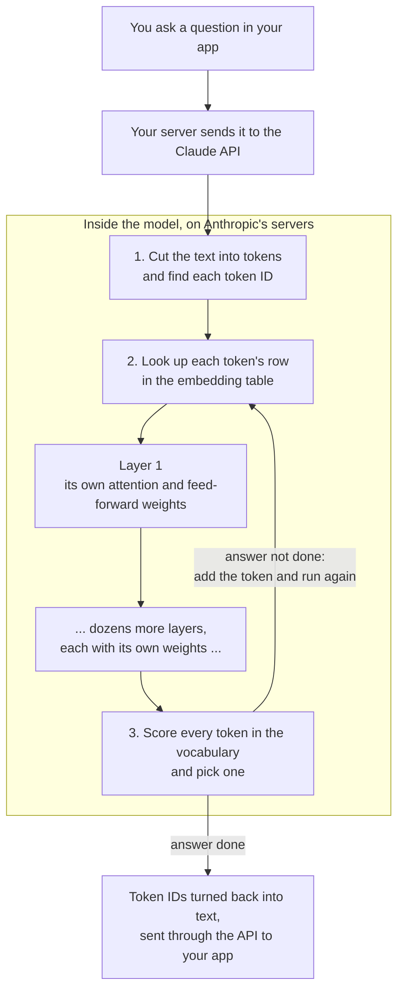
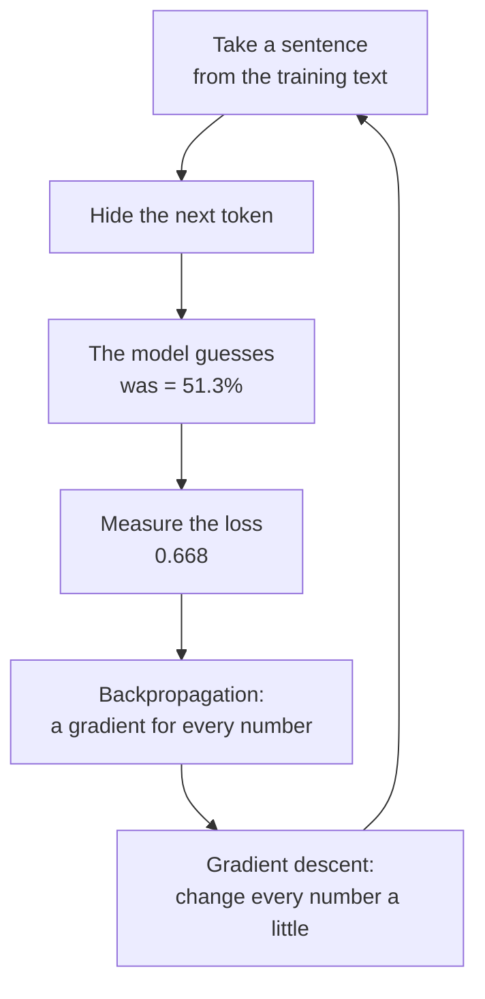

# Deep dive — How does Claude know what to say next?

**Course:** [Building with the Claude API](https://academy.claude.com/courses/building-with-the-claude-api) &nbsp;·&nbsp; **Lesson page:** [Accessing the API](https://academy.claude.com/courses/building-with-the-claude-api/accessing-the-api) &nbsp;·&nbsp; **Extra reading for Lesson 1** &nbsp;·&nbsp; **Written:** November 7, 2026

| Previous | Course | Next |
|:---|:---:|---:|
| [← Accessing the API](01-accessing-the-api.md) | [📚 Chapter index](README.md) | [Getting an API key →](02-getting-an-api-key.md) |

---

Give a model these words and ask it to continue:

```text
The cat sat on the mat because it ...
```

It writes "was". It doesn't look that word up, and no `if/else` rule tells it to. It does math on billions of saved numbers and gives every word it knows a chance. In the small example on this page, the chances are:

| Next word | was | is | sat | cat | mat |
|---|:---:|:---:|:---:|:---:|:---:|
| Chance | **51.3%** | 18.2% | 14.9% | 8.2% | 7.5% |

---

**On this page**

| # | Section |
|:---:|:---|
| 1 | [Revision summary](#revision-summary) |
| 2 | [The big picture](#the-big-picture) |
| 3 | [Part 1. What is saved inside the model](#part-1-what-is-saved-inside-the-model) |
| 4 | [Part 2. How the model answers your message](#part-2-how-the-model-answers-your-message) |
| 5 | [Part 3. How the model learned its numbers (training)](#part-3-how-the-model-learned-its-numbers-training) |
| 6 | [Common mix-ups](#common-mix-ups) |
| 7 | [Test yourself](#test-yourself) |
| 8 | [Architect notes: what this means for your work](#architect-notes-what-this-means-for-your-work) |
| 9 | [Recap](#recap) |
| 10 | [My notes / practice](#my-notes--practice) |
| 11 | [FAQ](#faq) |

---

### Revision summary

- **Model:** a huge saved set of numbers plus fixed math. It runs only on Anthropic's servers, and your app reaches it through the API.
- **Token:** a small piece of text, such as a word, part of a word, or "?". The model reads, writes, and bills in tokens.
- **Embedding:** a saved row of numbers for each token. The row describes what the token usually means.
- **Weights and layers:** the other learned numbers, split across dozens of layers. Each layer adds a little more meaning to every token's row.
- **Attention:** the step where each token borrows meaning from earlier tokens. For example, "it" picks up meaning from "mat".
- **Next token:** the model gives every token a chance, picks one, adds it, and repeats until the answer is done.
- **Training:** sets every number once, before release, by guessing hidden words billions of times. Normal use only reads the numbers.

#### What is saved inside the model

Training saves three things. Every request reads them, and no request changes them.

1. **Vocabulary:** every token the model knows, each with a fixed **token ID**, such as `cat` = 2207. The ID is only a label, like a primary key.
2. **Embedding table:** one row of numbers per token ID, such as 2207 → `[0.30, 0.70, 0.50]`. Every row has the same number of columns, and no single column has a meaning.
3. **Weights:** every other learned number, stored in grids called **matrices**. Each layer has its own set. A **parameter** is any learned number, including the embedding rows.

Each result of a weight matrix adds up all its input numbers, each times its own weight. The model does not store your chats, a copy of the internet, or anything after its training cutoff date. Each request makes only a temporary working copy of each token's row, and throws it away afterwards.

#### How the model answers your message

The model runs these steps once for every token it writes.

1. **Tokenization:** cut the text into tokens and find each token ID.
2. **Embedding:** look up each token's row, and add its position so word order isn't lost.
3. **Attention, part 1:** each token makes a **Query** (what it looks for), a **Key** (what it offers), and a **Value** (what it hands over). It uses the matrices Wq, Wk, and Wv, which all tokens in a layer share.
4. **Attention, part 2:** a **dot product** (multiply number by number, then add) scores each Query against each earlier Key. **Softmax** turns the scores into percentages that add up to 100%. The token adds that blend of Values to its own row (*residual connection*).
5. **Rest of the layer:** many attentions run side by side (*multi-head attention*). Then the **feed-forward** step works on each row alone. This repeats in dozens of layers.
6. **Pick:** the last row becomes a score (**logit**) for every token in the vocabulary. Softmax turns the scores into chances, and the model picks one.
7. **Repeat or stop:** the model stops at an end token, at `max_tokens`, or at a stop sequence. Then the token IDs become text again.

A token sees only itself and earlier tokens, never later ones (*causal masking*). **Temperature** divides the scores before softmax. A low temperature makes answers more consistent, but even temperature 0 doesn't guarantee identical answers. While writing, the model reuses the Keys and Values it already made for earlier tokens (the *KV cache*). Prompt caching builds on the same idea across requests.

#### How the model learned its numbers

Every number starts random. Training repeats this loop billions of times.

1. Hide the next token of a real sentence and let the model guess. The sentence is the answer key, so nobody labels data (*self-supervised learning*).
2. Measure the error: **loss** = −ln(chance given to the right token). A 51.3% guess gives a loss of 0.668.
3. **Backpropagation** calculates a **gradient** for every number, which says which way to move it. It changes nothing.
4. **Gradient descent** moves every number a little: `new = old − (learning rate × gradient)`. A negative gradient makes the number bigger.

**Pre-training** on huge amounts of text comes first. **Later training** (examples, feedback from people, and Constitutional AI) then teaches the model to follow instructions and stay safe. Training runs once per model version, on thousands of special chips for weeks or months. Embedding rows are trained in the same loop. One wrong sentence changes almost nothing, but wrong text repeated many times can be learned. Normal use (*inference*) only reads the numbers. The model is stateless, so your app must resend earlier messages.

#### When to use which model size

A model's size is its number of parameters. The builders set it before training by choosing the columns per row, the number of layers, and the width of each layer.

| | Haiku (smallest) | Sonnet (middle) | Opus (largest) |
|---|---|---|---|
| Speed and cost | Fastest, cheapest | Balanced | Slowest, most expensive |
| Use it when | A simple task runs many times, such as sorting 10,000 support emails | Most everyday work | A hard task where mistakes are costly |

Test the smallest model first, and move up only if it fails your test questions.

#### Exam takeaways

- **A customer asks if their chats will change the model for other users.** No. Answering only reads the model's numbers. Whether Anthropic keeps or trains on data is set by its terms, so point the customer to those terms. (Governance, Safety & Risk Management)
- **A team gets different answers to the same prompt and wants consistent output.** The model picks each token from a set of chances, so some variety is normal. Lower the temperature, give clear examples, and check the output in code. Even at temperature 0, answers are not guaranteed identical. (Claude Models, Prompting & Context Engineering)
- **A product manager asks why long prompts cost more and run slower.** Every input token goes through every layer, and attention looks back at every earlier token. Send only the text needed, and put fixed text at the start so prompt caching can reuse it. (Solution Design & Architecture)

---

### The big picture

#### What a model does

A model is a big file of numbers, often billions, plus a fixed set of calculations that use them. Claude models run only on Anthropic's servers. You can't download them. A model does one thing in a loop: score every possible next token, pick one, add it, and repeat. Answering, writing code, and summarizing are all this one loop. An answer is simply the text most likely to come after your question.

```csharp
// A sketch of the idea, not real model code
var tokens = Tokenize("The cat sat on the mat because it");
while (tokens.Count < maxTokens)
{
    double[] chances = model.ScoreNextToken(tokens);  // a chance for every token in the vocabulary
    int next = Pick(chances, temperature);            // pick one at random, using the chances
    if (next == EndToken) break;                      // the model decided the answer is done
    tokens.Add(next);
}
```



Things to notice:

- The loop runs once for every token in the answer. A 300-token answer means 300 trips through all the layers.
- Everything inside the box only reads the saved numbers. Your question never changes the model.

#### The running example and who's who

The whole page uses one sentence: "The cat sat on the mat because it was comfortable." In Part 2, the model has read up to "it" and must guess "was". In Part 3, training uses the same sentence to improve that guess. Real models use thousands of numbers per token, but this example uses three. The numbers are made up, but each result follows from the ones before, so you can check any step on a calculator.

| Who | Where | What they do |
|---|---|---|
| The builders (people at Anthropic) | Before training | Choose the sizes, such as columns per row and number of layers |
| The training process | Anthropic's computers, before release | Hides the next token, checks the guess, and adjusts the numbers |
| The model | Anthropic's servers | The saved numbers, plus the calculations that use them |
| You and your app | Your computer and server | Send text and get the answer. You never change the model. |

#### Why some models are larger than others

A model's **size** is its number of **parameters** (learned numbers). Before training, the builders choose how many columns each token's row has, how many layers there are, and how wide each layer is inside. More of each means more numbers. A larger model is usually smarter on hard tasks, because it has room for more patterns. It is also slower and costs more per token, because every token passes through all its numbers. It also costs much more to train, because there are more numbers to adjust.

Anthropic doesn't publish its model sizes. It describes Haiku as fastest and cheapest, Opus as smartest, and Sonnet as the balance. The revision summary's table says when to use each. Models also differ in training text and cutoff date (what they know, and how recent it is), in later training (how well they follow instructions, and when they refuse), and in context window size (how much text one request can hold).

---

### Part 1. What is saved inside the model

A computer can only do math on numbers, so the model needs a way to turn "cat" into numbers. Training saves three things for this: the vocabulary, the embedding table, and the weights.

#### The vocabulary: from text to a token ID

The **vocabulary** is a fixed list of every token the model knows, each with its own token ID. The IDs below are made up.

| Token | The | cat | sat | on | the | mat | because | it | was |
|---|:---:|:---:|:---:|:---:|:---:|:---:|:---:|:---:|:---:|
| Token ID | 101 | 2207 | 310 | 415 | 102 | 520 | 845 | 340 | 371 |

- Think of it as a huge `enum`, or a table where the token ID is the primary key.
- "The" and "the" are different tokens, because one has a capital letter.
- The vocabulary is built once, before training, from the most common pieces of text.

**Warning:** A token ID is only a label. ID 2207 doesn't mean "animal", and 2207 and 2208 aren't similar words.

#### The embedding table: from a token ID to a row of numbers

Picture a movie app that scores each movie on three traits you pick:

| Movie | Action | Comedy | Animation |
|---|:---:|:---:|:---:|
| Batman | 9 | 2 | 0 |
| Toy Story | 2 | 8 | 10 |

Similar movies get similar rows, so the app can find "movies like Batman" by comparing rows. The **embedding table** works the same way, with two differences: nobody names the columns, and nobody types the numbers. Training finds them (Part 3). A token's row is called its **embedding**.

| Token ID | Token | Number 1 | Number 2 | Number 3 |
|---|---|:---:|:---:|:---:|
| 101 | The | 0.20 | 0.40 | 0.10 |
| 2207 | cat | 0.30 | 0.70 | 0.50 |
| 310 | sat | 0.60 | 0.20 | 0.80 |
| 415 | on | 0.10 | 0.50 | 0.30 |
| 102 | the | 0.25 | 0.35 | 0.15 |
| 520 | mat | 0.80 | 0.10 | 0.40 |
| 845 | because | 0.15 | 0.60 | 0.30 |
| 340 | it | 0.40 | 0.30 | 0.70 |

- Finding a row is a direct lookup by token ID, like `embedding[2207]` on a `Dictionary<int, double[]>`.
- Every token's row has the same number of columns. The builders choose that number before training.
- Real rows have hundreds or thousands of columns. The public model GPT-2 has 50,257 tokens with 768 columns each, about 38.6 million numbers in its embedding table alone. Anthropic doesn't publish Claude's sizes.
- No single column means "animal". A meaning is spread over many columns, so you compare whole rows.
- One row of numbers is a **vector**. A whole grid of numbers is a **matrix**.

**Warning:** The numbers in a row are **not** the IDs of other tokens. They describe this token only.

#### The weights: everything else the model learned

If the embedding table is the data, the **weights** are the business logic that works on it. They are many matrices, and each layer has its own set. [Lesson 1](01-accessing-the-api.md) showed a simpler version, with one weight per number. A real model doesn't work that way, because then the numbers would never affect each other. **Each result adds up all the input numbers**, each times its own weight:

```text
result 1 = (number 1 × weight A) + (number 2 × weight B) + (number 3 × weight C)
result 2 = (number 1 × weight D) + (number 2 × weight E) + (number 3 × weight F)
```

A big weight makes its input count more, and a negative weight makes it count against the result. No weight "picks" a number, so every result mixes information from every column.

| Weight matrix | Its job | Where you see it |
|---|---|---|
| Wq, Wk, Wv, in every layer | Make each token's Query, Key, and Value | Part 2, step 3 |
| Wo and the feed-forward matrices, in every layer | Join the attention results, then work on each row | Part 2, step 4 |
| The output matrix, once at the end | Give every token in the vocabulary a score | Part 2, step 5 |

A **parameter** is any number that training can change, including the embedding rows. A "70-billion-parameter model" has 70 billion learned numbers. The model holds only these three things. It has no store of your chats, and no database to look facts up in.

> **Remember this:** The vocabulary gives the token ID. The embedding table gives that token's row. The weights mix the numbers until the model can score the next token.

---

### Part 2. How the model answers your message

This part follows the model as it reads "The cat sat on the mat because it" and works out the next token. Every step only reads the saved numbers from Part 1.

#### Step 1: cut the text into tokens (tokenization)

```text
In:   "The cat sat on the mat because it"
Out:  { 101, 2207, 310, 415, 102, 520, 845, 340 }   // 8 token IDs
```

The API bills by token, not by word. A long or rare word often becomes several tokens.

#### Step 2: look up each token's row (embedding)

The model copies each token's saved row, such as "it" → `[0.40, 0.30, 0.70]`. It also adds each token's position into its numbers. Without position, "dog bites man" and "man bites dog" would look identical.

The saved row for "it" is the same in every sentence. That is a problem, because "it" means something different each time. Step 3 fixes this. The same step lets "bank" mean a river bank in one sentence and a money bank in another.

#### Step 3: borrow meaning from earlier words (attention)

Each token makes three new rows from its own row:

| New row | Plain meaning | The same idea in SQL |
|---|---|---|
| **Query** | What this token is looking for | The search you type |
| **Key** | What this token offers to others | The column the search is matched against |
| **Value** | The information this token hands over | The data you get back |

Unlike SQL, attention doesn't return only matches. It gives **every** earlier token a percentage, then adds up a little of each Value.

**3a. Make the Query for "it".** Multiply the row of "it" by Wq. Wq has one row per embedding number (3) and one column per Query number (2). Each Query number adds up every row number times its weight (this is *matrix multiplication*):

| Wq | Query number 1 | Query number 2 |
|---|:---:|:---:|
| From number 1 | 1.0 | 0.0 |
| From number 2 | 0.0 | 1.0 |
| From number 3 | 1.0 | 0.5 |

```text
Query number 1 = 0.40 × 1.0 + 0.30 × 0.0 + 0.70 × 1.0 = 1.10
Query number 2 = 0.40 × 0.0 + 0.30 × 1.0 + 0.70 × 0.5 = 0.65
```

**3b. Make a Key for every earlier token.** Each row is multiplied by the same Wk. For example, "mat" `[0.80, 0.10, 0.40]` becomes the Key `[1.55, 0.25]`.

<details>
<summary>Show Wk and the math for "mat"</summary>

| Wk | Key number 1 | Key number 2 |
|---|:---:|:---:|
| From number 1 | 2.0 | 0.5 |
| From number 2 | −0.5 | 0.5 |
| From number 3 | 0.0 | −0.5 |

```text
Key number 1 = 0.80 × 2.0 + 0.10 × −0.5 + 0.40 × 0.0  = 1.55
Key number 2 = 0.80 × 0.5 + 0.10 × 0.5  + 0.40 × −0.5 = 0.25
```

</details>

All tokens in one layer share Wq, Wk, and Wv, like one C# method called on every row. Each token still gets its own Query, Key, and Value, because it starts from its own row. Each layer has its own three matrices.

**3c. Score each match with a dot product.** Multiply number by number, then add. Bigger means a better match.

```text
"it" with "mat":  1.10 × 1.55 + 0.65 × 0.25 = 1.868
"it" with "cat":  1.10 × 0.25 + 0.65 × 0.25 = 0.438
```

The model then divides each score by the square root of the Key length (here √2, about 1.414). This stops scores from getting too big when Keys have thousands of numbers.

**3d. Turn scores into percentages with softmax.** **Softmax** raises *e* (about 2.718) to the power of each score, then divides each result by the total. Every result becomes positive, and bigger scores pull further ahead. The model uses softmax twice: here, and again in step 5 to turn scores into chances.

```text
mat 26.8%   sat 16.8%   it 11.8%   the 10.2%   cat 9.7%   The 9.4%   because 7.9%   on 7.4%   (total 100%)
```

<details>
<summary>Show the full softmax table</summary>

| Earlier token | Key | Dot product | ÷ 1.414 | e to that power | ÷ total |
|---|:---:|:---:|:---:|:---:|:---:|
| The | [0.20, 0.25] | 0.383 | 0.270 | 1.311 | 9.4% |
| cat | [0.25, 0.25] | 0.438 | 0.309 | 1.363 | 9.7% |
| sat | [1.10, 0.00] | 1.210 | 0.856 | 2.353 | 16.8% |
| on | [−0.05, 0.15] | 0.043 | 0.030 | 1.031 | 7.4% |
| the | [0.33, 0.23] | 0.504 | 0.356 | 1.428 | 10.2% |
| **mat** | [1.55, 0.25] | 1.868 | 1.321 | 3.745 | **26.8%** |
| because | [0.00, 0.23] | 0.146 | 0.103 | 1.109 | 7.9% |
| it | [0.65, 0.00] | 0.715 | 0.506 | 1.658 | 11.8% |
| **Total** | | | | **13.997** | **100%** |

</details>

How did the model know "mat" should score highest? It didn't. Nobody wrote a rule that "it" means "mat". Training tuned Wq, Wk, and the embedding rows so the scores help guess the next token. In this sentence, "it" could also mean the cat. Attention doesn't have to decide. It only collects what helps the next guess.

**3e. Blend the Values into "it".** Multiply each Value by its percentage and add them up. To keep the example short, each Value here equals the token's embedding row. A real Wv mixes the numbers like Wq does.

| | Number 1 | Number 2 | Number 3 |
|---|:---:|:---:|:---:|
| Saved row of "it" | 0.40 | 0.30 | 0.70 |
| + Blend from attention | 0.455 | 0.322 | 0.444 |
| = Row of "it" in this sentence | **0.855** | **0.622** | **1.144** |

<details>
<summary>Show the blend math</summary>

```text
blend number 1 = 9.4% × 0.20 (The) + 9.7% × 0.30 (cat) + … + 26.8% × 0.80 (mat) + … = 0.455
blend          = [0.455, 0.322, 0.444]
```

</details>

The blend is **added**, not swapped in, so "it" keeps its own meaning and gains context (*residual connection*). Only this request's working copy changes. The saved row stays the same.

**Warning:** "It" can see "The cat sat on the mat because it", including itself. It can't see "was comfortable", because those words don't exist yet. Hiding later words is called *causal masking*.

> **Remember this:** The Query asks. Each Key answers. Softmax turns the matches into percentages. The Values are what gets handed over.

#### Step 4: the rest of each layer

A **layer** is one round of work that every token's row goes through. Attention is only one part of it.

| Part | What happens | Why it is there |
|---|---|---|
| **Many heads** (*multi-head attention*) | Many attentions run side by side, each with its own Wq, Wk, and Wv. One more matrix, **Wo**, joins their results into one row per token. | Different heads can track different links, such as what "it" refers to |
| **Feed-forward** | Each row is made about four times wider, negative numbers are turned to zero or near zero, and the row is made narrow again | Attention moves information between tokens. This step works on what each token now holds. Much of the model's knowledge is stored here. |
| **Normalization** | Each row is rescaled so its numbers stay in a steady range | Without it, numbers could grow or shrink too much over many layers |

The layers run one after another, like ASP.NET Core middleware. A simplified picture of what the row for "it" holds:

| After… | The row of "it" holds (simplified) |
|---|---|
| The embedding lookup | Only the usual meaning: a word that stands for a thing |
| Early layers | Facts about nearby words, such as "a reason is starting after 'because'" |
| Middle layers | Links to earlier words: "it" probably means the mat or the cat |
| Late layers | What should come next: a verb like "was" or "is" |

Nobody gives each layer a job. Training decides that. The builders choose the number of layers before training. GPT-2, a small public model from 2019, has 12 layers with 12 heads each, and about 124 million weights. More layers usually make a model smarter, but every token goes through every layer, so each one adds cost and time.

#### Step 5: score every word and pick one

The output matrix turns the final row of "it" `[0.855, 0.622, 1.144]` into one score per vocabulary token, called a **logit**. For example, "was" uses the weights 1.5, 0.5, and 1.2:

```text
logit for "was" = 0.855 × 1.5 + 0.622 × 0.5 + 1.144 × 1.2 = 2.966
```

<details>
<summary>Show the full output matrix</summary>

This example's vocabulary has only five tokens.

| Output matrix | was | is | sat | cat | mat |
|---|:---:|:---:|:---:|:---:|:---:|
| From number 1 | **1.5** | 0.8 | 0.6 | 0.2 | 0.4 |
| From number 2 | 0.5 | 0.9 | 0.3 | 1.0 | 0.2 |
| From number 3 | 1.2 | 0.6 | 0.9 | 0.3 | 0.5 |

</details>

Part 3 uses that weight of **1.5** to show how training works. Softmax then turns the logits into chances:

| Token | was | is | sat | cat | mat |
|---|:---:|:---:|:---:|:---:|:---:|
| Logit | 2.966 | 1.930 | 1.729 | 1.136 | 1.038 |
| Chance | **51.3%** | 18.2% | 14.9% | 8.2% | 7.5% |

The model picks one token at random, using these chances. Before softmax, it divides every logit by the **temperature**:

| Temperature | was | is | sat | cat | mat | Use it when |
|:---:|:---:|:---:|:---:|:---:|:---:|---|
| 0.5 | 79.5% | 10.0% | 6.7% | 2.0% | 1.7% | You want predictable output, such as sorting or JSON |
| 1.0 | 51.3% | 18.2% | 14.9% | 8.2% | 7.5% | You want the chances as calculated |
| 1.5 | 39.8% | 20.0% | 17.5% | 11.8% | 11.0% | You want varied, creative output |

Other picking methods you may see: **greedy** always takes the top token, which can make text dull. **Top-k** picks from the k most likely tokens, such as 40. **Top-p** picks from the top tokens whose chances add up to p, such as 90%.

**Warning:** Even at temperature 0, Anthropic doesn't promise identical answers. For output your code must parse, such as JSON, also validate it in code. [Lesson 6](06-temperature.md) covers the temperature setting.

#### Step 6: repeat, then send the text back

One pass gives one token. The model adds it and runs again, until it stops:

```text
Round 1:  "...because it"           → picks "was"
Round 2:  "...because it was"       → picks "comfortable"
Round 3:  "...it was comfortable"   → picks "."
Round 4:  "...comfortable."         → picks the end token, so it stops
```

The model saves the Keys and Values it already made, so each round it only makes them for the new token. This saved work is the *KV cache*. Prompt caching uses the same idea across requests. When it stops, the model turns the token IDs back into text with the same vocabulary.

| Your app receives | What it is |
|---|---|
| The text | Sent piece by piece if you use streaming ([lesson 7](07-response-streaming.md)) |
| `stop_reason` | Why it stopped: the end token, `max_tokens` (your answer length limit, so the answer may be cut off), or a stop sequence (text you chose) ([lesson 1](01-accessing-the-api.md#5-when-the-model-stops-and-what-comes-back)) |
| `usage` | How many input and output tokens were used, which is what you pay for |

---

### Part 3. How the model learned its numbers (training)

Part 2 used numbers like Wq and the output weight 1.5 as if they were just there. This part shows where they came from.

#### What training is

Before training, the shape is set (vocabulary, columns per row, number of layers), but every number is small and random, and can be negative. Ask an untrained model to continue the cat sentence, and it might say "refrigerator". **Training** is a long run of practice that adjusts every number a little at a time. Anthropic trains each model on thousands of special chips for weeks or months, once per model version. A newer model comes from a new training run.

| Stage | What the model practises | What it learns |
|---|---|---|
| 1. **Pre-training** | Guessing the next word on huge amounts of text from books, websites, and more | Language and facts. It can only continue text, not answer like an assistant. |
| 2. **Later training** | Examples of good answers, feedback from people, and a written set of rules (*Constitutional AI*) | To follow instructions, be helpful, and refuse harmful requests |



#### Step 1: practise with a hidden word

The training process shows the model the start of a sentence and keeps the next token as the answer key. One sentence gives one practice question per token: "The" → cat, "The cat" → sat, and so on, up to "The cat sat on the mat because it" → **was**.

- The answer comes from the sentence itself, so nobody labels anything (*self-supervised learning*).
- The model never searches the internet to check. The training process already has the answer.
- The model learns what is common, not what is true. If "mat" often follows "sat on the", training raises the chance of "mat" there.

#### Step 2: measure how wrong the guess was (loss)

**Loss** is one number for how wrong a guess was: −ln(chance given to the right token). "ln" is the natural log button on a calculator. "Was" got 51.3%, so the loss is −ln(0.513) = 0.668.

| Chance given to the right token | 10% | 51.3% | 90% | 99% |
|---|:---:|:---:|:---:|:---:|
| Loss | 2.30 (very wrong) | 0.668 (unsure) | 0.11 (mostly right) | 0.01 (almost perfect) |

The goal of training is the lowest average loss over all the training text.

#### Step 3: find which way to move each number (gradient and backpropagation)

Take the 1.5 weight from Part 2, step 5. Make it 0.01 bigger and run the guess again. The loss drops from 0.6684 to 0.6642. The loss falls about 0.42 for every 1 the weight grows, so its **gradient** is about −0.42.

| Gradient | What it means | So the number should |
|:---:|---|---|
| Positive | Bigger makes the loss worse | Get smaller |
| Negative | Bigger makes the loss better | Get bigger |
| Zero | This number didn't affect the guess | Stay the same |

Testing one number at a time would take billions of reruns. **Backpropagation** works backward once through every step of Part 2 and gets every gradient in one pass. For the 1.5 weight: `0.855 × (0.513 − 1) = −0.417`, which matches the test. Backpropagation only calculates. It changes nothing.

#### Step 4: change every number a little (gradient descent)

**Gradient descent** makes the change: `new value = old value − (learning rate × gradient)`.

```text
new value = 1.5 − (0.1 × −0.417) = 1.5 + 0.0417 = 1.5417
```

The **learning rate** (here 0.1) is a small number that keeps each change small. After this one update, the chance of "was" rises from 51.3% to 52.1%, and the loss falls from 0.668 to 0.651. Training changes every number this way, not just this one.

#### What else to know about training

- **Embedding rows are trained the same way.** Rows of tokens in the sentence change a little. Rows of other tokens, like "refrigerator", stay the same in that step. "Cat" and "kitten" appear in similar sentences, so their rows end up close. Wq, Wk, Wv, Wo, the feed-forward matrices, and the output matrix are all trained in this same loop.
- **Real training uses batches.** The model reads many sentences at once (a *batch*), averages their gradients, then updates. Improved versions of gradient descent, such as *Adam*, choose a step size for each number. One full pass over all the text is an *epoch*, and most text is read only once or a few times.
- **One wrong sentence changes almost nothing.** It is averaged with many other sentences. But wrong text repeated many times can be learned, so training-text quality matters.

---

### Common mix-ups

| ❌ Wrong idea | ✅ What really happens |
|---|---|
| The numbers in a token's row are IDs of related words. | They describe the token itself. Token IDs only label tokens. |
| Each weight multiplies one number, and a big weight picks that number. | Each result adds up all the inputs, each times its own weight. |
| Backpropagation changes the numbers. | Backpropagation only calculates. Gradient descent makes the changes. |
| Only the weights are trained. The embedding table stays fixed. | The embedding rows are trained in the same loop. |
| Every token has its own Wq, Wk, and Wv. | All tokens in a layer share the same three. Each layer has its own set. |
| The model learns from my chats. | Answering only reads the numbers. Nothing from your chat is saved inside the model. |

---

### Test yourself

<details>
<summary>1. A weight is 2.0, its gradient is +0.8, and the learning rate is 0.1. What is the new weight?</summary>

The new weight is 1.92, because `2.0 − (0.1 × 0.8) = 1.92`. A positive gradient means bigger is worse, so the weight gets smaller.
</details>

<details>
<summary>2. The Query of "it" is [1.10, 0.65]. The Key of "sat" is [1.10, 0.00]. What is their dot product?</summary>

The dot product is 1.21, because `1.10 × 1.10 + 0.65 × 0.00 = 1.21`.
</details>

<details>
<summary>3. Why can't "it" look at "comfortable" in "The cat sat on the mat because it was comfortable"?</summary>

"Comfortable" comes after "it", and the model writes left to right, so it doesn't exist yet. This is causal masking.
</details>

<details>
<summary>4. Your app asked for JSON twice with the same prompt and got different JSON. Why, and what do you do?</summary>

The model picks each token at random using its chances, so a different token can win. Lower the temperature, but don't rely on it alone. Validate the JSON in code, and retry or repair it when it fails your schema.
</details>

---

### Architect notes: what this means for your work

The short version: **more tokens mean more work for the model, and more cost.**

| Concern | Why it happens inside the model | What you do |
|---|---|---|
| **Cost of input** | Every input token goes through every layer, even when the answer is short | Send only the passages that match the question (retrieval, lessons 32–38) |
| **Cost of output** | Each output token needs a full trip through the model, one reason output costs more than input | Ask for only the length you need. Check current prices on Anthropic's pricing page. |
| **Speed** | Each token looks back at every earlier token, so attention work grows with the square of the prompt length. Twice as many tokens means about four times the work. | Keep prompts lean, especially when a user waits for the first word |
| **Repeated prompts** | Work on an unchanged start of a prompt can be saved and reused | Use prompt caching (lessons 43–45). Put fixed instructions and documents at the start. |
| **Context window** | One request can hold only so many tokens, counting input and answer | Look up each model's limit, and trim or summarize long histories |
| **Out-of-date knowledge** | The model only knows its training text, up to a cutoff date | Put new facts in the prompt, or give the model a search tool. Check important answers, because the model has no built-in way to check facts. |
| **No memory** | Answering never changes the numbers, so the model is stateless | Your app stores the chat history securely and resends all of it every time |
| **Varied answers** | Each token is picked at random from a set of chances | Lower the temperature, give examples, and check output in code. Don't promise identical answers. |
| **Model choice** | Smaller models have fewer weights, so each token needs less math | Test the smallest model that passes your test questions first |
| **Data terms** | Requests never change the model. Keeping or training on data is a policy question. | Check Anthropic's current terms and data-retention options for each customer |

**Warning:** Attention treats all text in the prompt the same way, so there is no wall between your instructions and a document's text. This is *prompt injection*. It is like building a SQL query by pasting user input into the string. Tag untrusted text, limit which tools the model can use, and check its output.

---

### Recap

- **Saved inside:** the vocabulary gives token IDs, the embedding table gives each token a row, and the weights mix those rows.
- **Weights mix:** each result adds up all the inputs, each times its own weight.
- **Layers:** every row passes through dozens of layers, each with its own fixed weights.
- **Attention:** Query, Key, and Value from shared matrices. A dot product scores matches, softmax makes percentages, and Values are blended in.
- **Picking:** softmax turns scores into chances, and temperature controls how spread out they are.
- **Training:** guess a hidden token, measure the loss, get gradients with backpropagation, and update with gradient descent.
- **Normal use:** only reads the numbers. The model is stateless and never learns from your chat.

---

## My notes / practice

- [ ] Work out the Query of "it" by hand: `[0.40, 0.30, 0.70]` times Wq should give `[1.10, 0.65]`.
- [ ] Work out the Key of "cat" with Wk. You should get `[0.25, 0.25]`.
- [ ] Do softmax by hand for two scores, 2.966 and 1.930, and check that the chances add up to 100%.
- [ ] Write a C# `Softmax` method in a console app and reproduce the attention percentages for all eight tokens.
- [ ] Explain backpropagation and gradient descent out loud in under a minute, using the change from 1.5 to 1.5417.

---

## FAQ

**Q1. What does "token ID" mean, and are the numbers in an embedding row token IDs?**
A token ID is the fixed label the vocabulary gives each token, such as 2207 for "cat". It works like a primary key, so close IDs are not similar words. The numbers in an embedding row are not IDs. They describe the token itself.

**Q2. What do the columns of the embedding table mean?**
No column has a name or one clear meaning. Training spreads each meaning over many columns, so you compare tokens by their whole rows.

**Q3. Why are some models larger than others, and when should I use a smaller one?**
A larger model has more learned numbers, so it handles harder tasks. Every token passes through all those numbers, so it is slower and costs more. Use Haiku for simple work you run many times, and Opus for hard work where mistakes are costly.

**Q4. Does every token have its own Wq, Wk, and Wv?**
No. All tokens in a layer share the same three matrices, and each layer has its own set. Each token still gets its own Query, Key, and Value, because it starts from its own row.

**Q5. Why can't a token look at the words after it?**
The model writes left to right, so later words don't exist yet. This is called causal masking.

**Q6. Where do the embedding numbers come from?**
They start random. Training changes the rows of the tokens in each practice sentence a little, billions of times. In the end, words used in similar sentences have similar rows.

**Q7. What does "loss" mean?**
Loss is one number for how wrong a guess was: −ln(the chance given to the right token). A 90% chance gives 0.11, and a 10% chance gives 2.30.

**Q8. What is the difference between backpropagation and gradient descent?**
Backpropagation works out which way each number should move to lower the loss. Gradient descent then moves each number: `new = old − (learning rate × gradient)`.

**Q9. (Exam angle) A customer asks whether their employees' chats will change how the model answers other customers. How do you answer?**
No. Answering only reads the model's numbers, and the model keeps no memory between requests. Whether Anthropic keeps or trains on data is set by its terms, so point the customer to Anthropic's current terms and data-retention options. (Governance, Safety & Risk Management)

**Q10. (Exam angle) A team gets different answers to the same prompt in a sorting task and needs consistent output. What do you recommend?**
Explain that the model picks each token from a set of chances, so some variety is normal. Lower the temperature, give clear examples, and check the output in code. Answers get more consistent, but not identical, even at temperature 0. (Claude Models, Prompting & Context Engineering)

**Q11. (Exam angle) A product manager asks why requests with long documents cost more and run slower. What do you say, and what do you change?**
Every input token goes through every layer, and attention looks back at every earlier token. So cost and time grow with the prompt. Send only the passages needed, and put fixed text at the start so prompt caching can reuse it. (Solution Design & Architecture)

---

| Previous | Course | Next |
|:---|:---:|---:|
| [← Accessing the API](01-accessing-the-api.md) | [📚 Chapter index](README.md) | [Getting an API key →](02-getting-an-api-key.md) |
