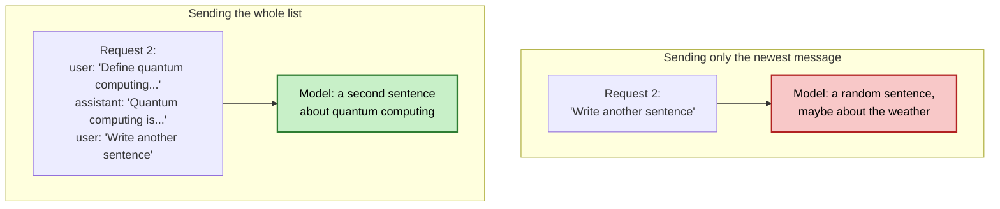
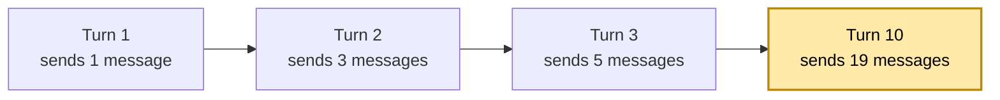
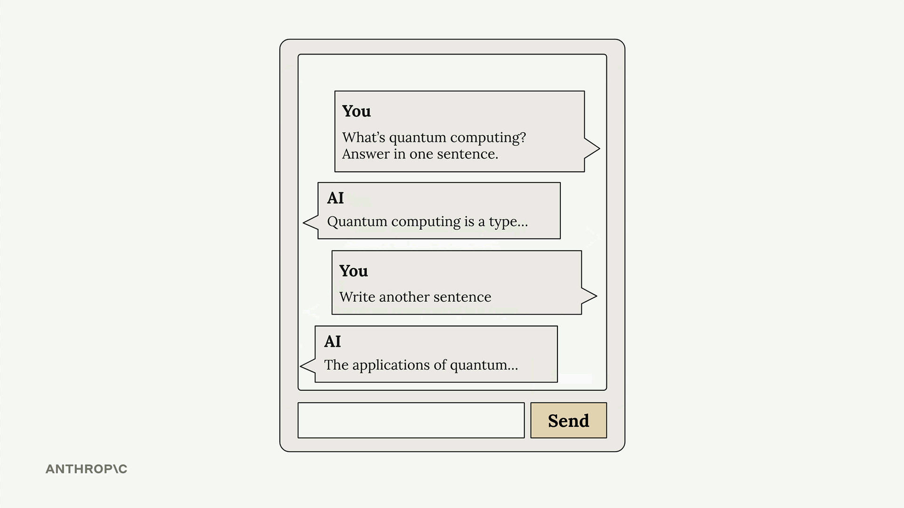
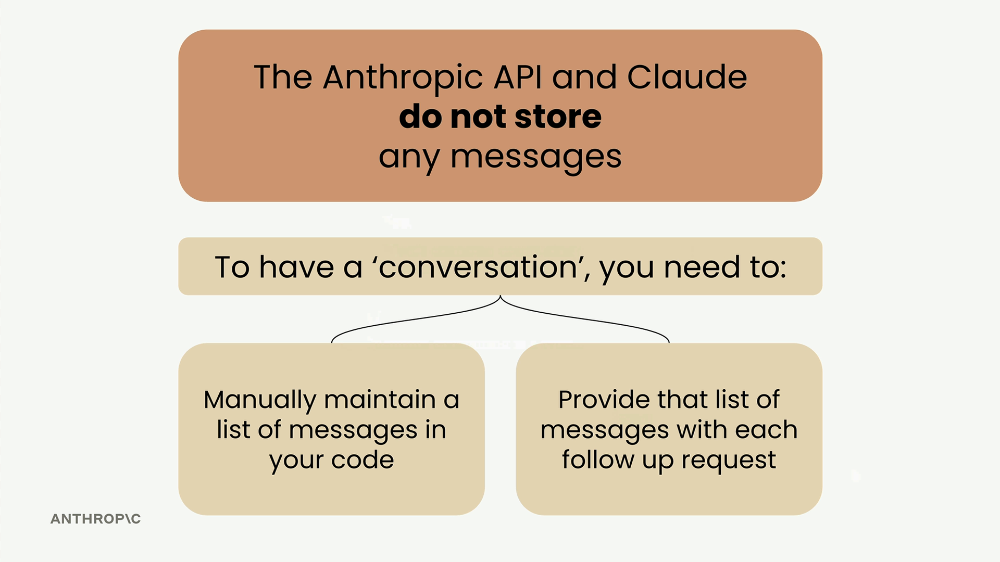
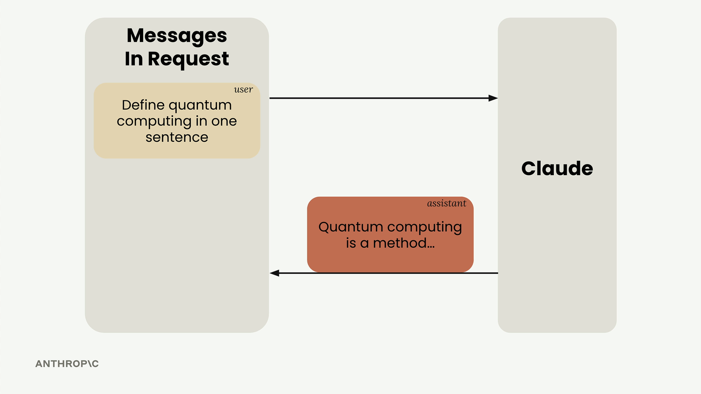
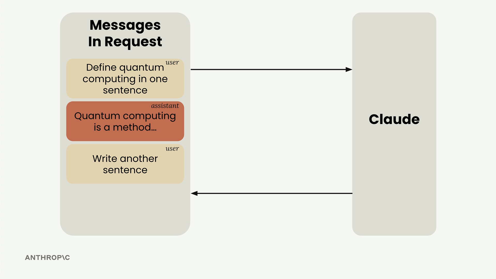
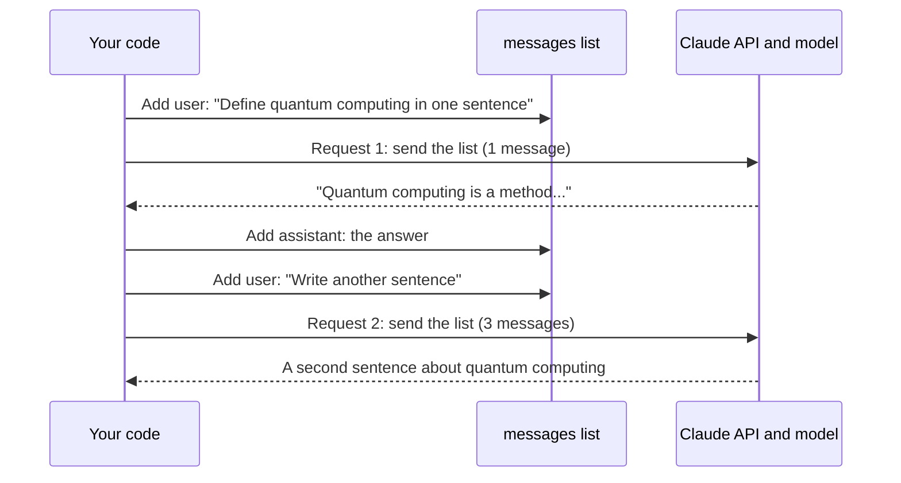

# Lesson 4 — Multi-Turn conversations

**Course:** [Building with the Claude API](https://academy.claude.com/courses/building-with-the-claude-api) &nbsp;·&nbsp; **Lesson page:** [Multi-Turn conversations](https://academy.claude.com/courses/building-with-the-claude-api/multi-turn-conversations) &nbsp;·&nbsp; **Chapter 1:** Accessing Claude with the API &nbsp;·&nbsp; **Completed:** November 15, 2026

| Previous | Course | Next |
|:---|:---:|---:|
| [← Making a request](03-making-a-request.md) | [📚 Chapter index](README.md) | [System prompts →](05-system-prompts.md) |

**Practice this lesson:** in [capstone guide 1](../00_Capstone_Plan/guide/01-accessing-claude-with-the-api.md), solve:

- [Problem 2: A chat that remembers the conversation](../00_Capstone_Plan/guide/01-accessing-claude-with-the-api.md#problem-2-a-chat-that-remembers-the-conversation)

Do the guide's problems in order, after you finish the chapter, because each one builds on the one before.


---

**On this page**

| # | Section |
|:---:|:---|
| 1 | [Revision summary](#revision-summary) |
| 2 | [The big picture](#the-big-picture) |
| 3 | [1. The problem: the API remembers nothing](#1-the-problem-the-api-remembers-nothing) |
| 4 | [2. The fix: keep the list yourself and send all of it](#2-the-fix-keep-the-list-yourself-and-send-all-of-it) |
| 5 | [3. Three helper functions](#3-three-helper-functions) |
| 6 | [4. Putting it all together](#4-putting-it-all-together) |
| 7 | [Architect notes](#architect-notes) |
| 8 | [Recap](#recap) |
| 9 | [My notes / practice](#my-notes--practice) |
| 10 | [FAQ](#faq) |

---

### Revision summary

**Purpose of this lesson:**

1. In [lesson 3](03-making-a-request.md), your notebook sent one question, "What is quantum computing? Answer in one sentence", and printed one answer.
2. A real chat has follow-ups, such as "Write another sentence."
3. The API forgets everything between requests, so a follow-up sent alone makes no sense to the model.
4. This lesson shows how your code keeps the whole chat and resends it, so the model can follow along.



- **Stateless:** the Claude API and the model store none of your messages. Every request stands alone, with no memory of earlier requests.
- **The problem:** if you send only "Write another sentence", the model has no idea you were talking about quantum computing. It writes a sentence about anything.
- **The fix:** your code keeps a list of every message, and sends the whole list with every request.

#### How a multi-turn conversation works

A *multi-turn conversation* is a chat with more than one question and answer. Your code runs these steps:

1. Start with an empty list called `messages`.
2. Add the user's first question as a message with the role `user`.
3. Send the whole list to the API and get the answer.
4. Add the model's answer to the list as a message with the role `assistant`.
5. Add the user's follow-up question as another `user` message.
6. Send the whole list again. The model now sees the earlier question and answer, so "Write another sentence" makes sense.

#### The three helper functions

The course writes three small Python functions so you don't repeat the same code:

| Function | What it does |
|---|---|
| `add_user_message(messages, text)` | Adds `{"role": "user", "content": text}` to the end of the list |
| `add_assistant_message(messages, text)` | Adds `{"role": "assistant", "content": text}` to the end of the list |
| `chat(messages)` | Sends the whole list with `client.messages.create()` and returns the answer text, `message.content[0].text` |

The helpers change the list itself, so the same `messages` list grows with every turn. `chat()` does not add the answer to the list. You must call `add_assistant_message()` yourself.

#### What resending the history means for you



Every turn resends everything before it, so each request has more input tokens than the last.

- **Cost:** you pay for input tokens on every request, and the whole history is input. So every turn costs more than the one before.
- **Limits:** the history must fit in the model's context window (the most tokens one request can hold), such as 200,000 tokens for Claude Haiku 4.5.
- **Storage:** your app, not Anthropic, holds the conversation. Store it safely, because it may hold personal data.

#### Exam takeaways

- **A user says the chatbot "forgets" what they said one message ago.** The app sends only the newest message. Keep the full list of user and assistant messages in your app, and send all of it with every request. (Claude Models, Prompting & Context Engineering)
- **Finance sees the cost of long chats grow faster than the number of messages.** Every request resends the whole history as input tokens. Use prompt caching for the repeated start of the conversation, and trim or summarize old turns. (Solution Design & Architecture)
- **A security team asks where chat history is stored when the app uses the Claude API.** In the app's own storage, because the API needs the history sent each time. Protect it like any personal data: encrypt it, control access, and delete it on schedule. (Governance, Safety & Risk Management)

---

### The big picture

| Part | In plain words | Everyday comparison |
|---|---|---|
| The problem | The API forgets everything between requests | Calling a help line where a new person answers every call and has no notes |
| The fix | Your code keeps the whole chat and sends it every time | Before each call, you read out the whole history of your case |
| The helpers | Three small functions that add messages and send the list | A notebook where you write each question and each answer as you go |

**The running example:** a user asks "Define quantum computing in one sentence". Then they ask "Write another sentence". The second question only makes sense if the model can see the first one.



#### Who's who

| Player | Where it lives | What it does in the example |
|---|---|---|
| **The user** | In front of your app | Types the two questions |
| **Your code** | Your notebook or server | Keeps the `messages` list, adds each message, and sends the list |
| **The `messages` list** | A Python list in your code's memory | Holds every question and answer so far, in order |
| **The Claude API and the model** | Anthropic's servers | Reads the list it receives, writes one answer, then forgets everything |

---

### 1. The problem: the API remembers nothing

The Claude API is *stateless*: it keeps nothing between requests. Each request is handled as if it were the very first one. This is the same fact from the deep dive: answering only reads the model's saved numbers and never changes them ([deep dive](01-deep-dive-inside-the-model.md)).



Here is what goes wrong if your code sends only the newest message:

| Request | What your code sends | What the model sees | What happens |
|:---:|---|---|---|
| 1 | "Define quantum computing in one sentence" | That one question | A good one-sentence definition |
| 2 | "Write another sentence" | Only "Write another sentence" | A random sentence, maybe about the weather. The model never saw request 1. |

The chat window in your app looks like a conversation. But that is only because your app shows the earlier messages on screen. The model sees only what is in the request.

> **Remember this:** The model knows only what is in the current request. If it isn't in the list, it didn't happen.

---

### 2. The fix: keep the list yourself and send all of it

To have a conversation, your code must do two things:

1. **Keep a list of every message** in your code, in order.
2. **Send the complete list** with every request, not just the newest message.

Each message in the list is a small dictionary (a Python set of name-value pairs) with a `role` and some `content`. The role says who wrote it: `user` for the person, `assistant` for the model ([lesson 3](03-making-a-request.md)).

**Request 1** holds one message. The model's answer comes back, and your code adds it to the list as an `assistant` message:



**Request 2** holds all three messages: the first question, the model's first answer, and the follow-up:



This is the exact `messages` list your code sends in request 2:

```python
[
    {"role": "user", "content": "Define quantum computing in one sentence"},
    {"role": "assistant", "content": "Quantum computing is a method of computation that uses qubits..."},
    {"role": "user", "content": "Write another sentence"},
]
```

The model reads all three messages, top to bottom. Now "another sentence" clearly means another sentence about quantum computing.



Things to notice:

- The list lives only on your side. The API sees it only while it handles one request.
- Request 2 sends request 1's question and answer again. That is how the model "remembers."

---

### 3. Three helper functions

Building the list by hand every time is repetitive and easy to get wrong. The course writes three helper functions. A *helper function* is a small, reusable piece of code for one job.

```python
def add_user_message(messages, text):
    user_message = {"role": "user", "content": text}
    messages.append(user_message)

def add_assistant_message(messages, text):
    assistant_message = {"role": "assistant", "content": text}
    messages.append(assistant_message)

def chat(messages):
    message = client.messages.create(
        model=model,
        max_tokens=1000,
        messages=messages,
    )
    return message.content[0].text
```

What each line does:

- `def add_user_message(messages, text):` defines a function that takes the list and the user's text.
- `{"role": "user", "content": text}` builds one message as a dictionary.
- `messages.append(...)` adds that message to the end of the list. `append` changes the list itself. It doesn't make a copy, so the caller's list grows too.
- `add_assistant_message` does the same, with the role `assistant`.
- `chat(messages)` sends the whole list in one request, using the `client` and `model` variables from [lesson 3](03-making-a-request.md) (`model = "claude-haiku-4-5"`).
- `return message.content[0].text` hands back only the answer text, not the whole response.

**Warning:** `chat()` does not add the answer to the list. If you forget to call `add_assistant_message()`, the next request has two `user` messages in a row and no answer between them. The model then never sees what it said before.

---

### 4. Putting it all together

```python
# Start with an empty message list
messages = []

# Add the initial user question
add_user_message(messages, "Define quantum computing in one sentence")

# Get Claude's response
answer = chat(messages)

# Add Claude's response to the conversation history
add_assistant_message(messages, answer)

# Add a follow-up question
add_user_message(messages, "Write another sentence")

# Get the follow-up response with full context
final_answer = chat(messages)
```

What the `messages` list holds after each line:

| After this line | Messages in the list |
|---|:---:|
| `messages = []` | 0 |
| `add_user_message(..., "Define quantum computing...")` | 1: user |
| `answer = chat(messages)` | 1 (the answer is only in the variable `answer`) |
| `add_assistant_message(messages, answer)` | 2: user, assistant |
| `add_user_message(..., "Write another sentence")` | 3: user, assistant, user |
| `final_answer = chat(messages)` | 3 (sent in full; the new answer is in `final_answer`) |

To keep chatting, repeat the last three steps: add `final_answer` as an assistant message, add the next user message, and call `chat()` again.

---

### Architect notes

#### Cost

- Every request resends the whole history as input tokens. A 20-turn chat sends turn 1's text 20 times. So the cost of the whole chat grows much faster than the number of turns.
- Prompt caching lets the API reuse the unchanged start of the conversation at a lower price ([lessons 43–45](../README.md)). Keep earlier messages exactly as they were, because any change to an early message stops the reuse.
- Log `usage.input_tokens` on each turn to watch the growth. Prices change, so check the current pricing page.

#### Limits

- The whole history must fit in the context window. It is 200,000 tokens for Claude Haiku 4.5, and 1 million for the newest models. Check the current value for your model.
- For long chats, trim the oldest turns, or replace them with a short summary. **Not in the course, from the official Claude API documentation:** a beta feature called *compaction* can summarize old turns for you when the history gets long.

#### Storage and security

- The history lives in your system, so you own its security. Store it encrypted, limit who can read it, and delete it on a schedule.
- Never let users send their own `assistant` messages into the list. Someone could fake an earlier answer to steer the model.
- **Not in the course, from the official Claude API documentation:** a beta feature called *message threads* lets the API keep a conversation for a short time, so later requests send only new messages. It is best-effort, so your app must still keep its own copy.

#### Design trade-offs

- In a web app, the list must survive between page loads. Save it in a database or session store, keyed by conversation, not in a variable that disappears.
- In later lessons, answers can hold more than text, such as tool calls. Then you add the whole `content` from the response, not just `content[0].text` ([lesson 26](../README.md)).

---

### Recap

- The Claude API and the model store no messages. Every request stands alone.
- To hold a conversation, keep a list of every `user` and `assistant` message, and send all of it each time.
- `add_user_message()` and `add_assistant_message()` append to the list. `chat()` sends it and returns the text.
- `chat()` doesn't save the answer, so call `add_assistant_message()` after every reply.
- The history grows every turn, so cost rises and the context window can fill up.

---

## My notes / practice

- [ ] Send only "Write another sentence" with an empty history, and see what the model writes.
- [ ] Run the full example and print `messages` after each step. Check it matches the table in section 4.
- [ ] Skip the `add_assistant_message()` call on purpose, and see how the second answer changes.
- [ ] Print `usage.input_tokens` for turns 1, 2, and 3, and watch it grow.

---

## FAQ

**Q1. What does "stateless" mean for the Claude API?**
It means the API keeps nothing between requests. Each request is handled on its own, as if it were the first, so the model can't see earlier questions unless you send them again.

**Q2. Why does the model write something random when I only send "Write another sentence"?**
The model sees only that one message. It has no idea your earlier question was about quantum computing, so it guesses what you want.

**Q3. What two things must my code do to hold a conversation?**
Keep a list of every message in order, and send the complete list with every request.

**Q4. What does "multi-turn conversation" mean?**
A chat with more than one question and answer, where later questions depend on earlier ones. "Write another sentence" is a later question that depends on the first.

**Q5. Why does the model's own answer go into the list?**
The model doesn't remember what it said. If its earlier answer isn't in the list, the next request can't refer to it. You add it with the role `assistant`.

**Q6. Does the "chat" helper function save the answer to the list?**
No. `chat()` only sends the list and returns the answer text. You must call `add_assistant_message()` yourself after each reply.

**Q7. Why does the list change when a helper function appends to it?**
In Python, the function gets the same list, not a copy. So `messages.append(...)` inside the function adds to the caller's list.

**Q8. Does sending the whole history cost more?**
Yes. You pay for every input token, and the history is input. Each turn sends everything before it again, so long chats get more expensive per turn.

**Q9. What happens when the history gets too long?**
The request fails if the history and answer don't fit in the model's context window. Trim old turns, summarize them, or start a new chat.

**Q10. (Exam angle) A user says the chatbot "forgets" what they said one message ago. What is the likely cause, and what is the fix?**
The app sends only the newest message, and the API keeps no history. Keep the full list of user and assistant messages in the app, and send all of it with every request. (Claude Models, Prompting & Context Engineering)

**Q11. (Exam angle) Finance sees the cost of long chats grow faster than the number of messages. How do you explain it, and what do you change?**
Every request resends the whole history as input tokens, so each turn costs more than the last. Use prompt caching for the unchanged start of the conversation, and trim or summarize old turns. (Solution Design & Architecture)

**Q12. (Exam angle) A security team asks where chat history is stored when the app uses the Claude API. How do you answer?**
In the app's own storage, because the API needs the history sent with each request. Treat it as personal data: encrypt it, limit access, and delete it on a schedule. (Governance, Safety & Risk Management)

---

| Previous | Course | Next |
|:---|:---:|---:|
| [← Making a request](03-making-a-request.md) | [📚 Chapter index](README.md) | [System prompts →](05-system-prompts.md) |
