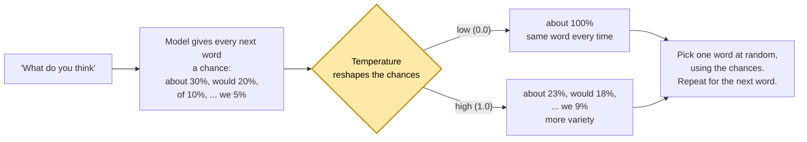
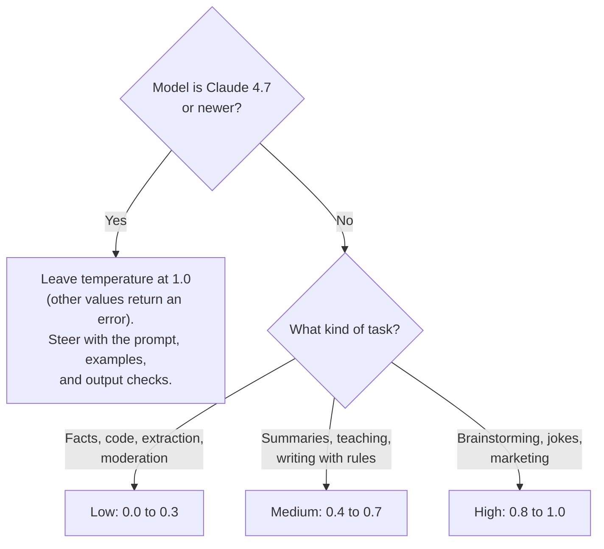
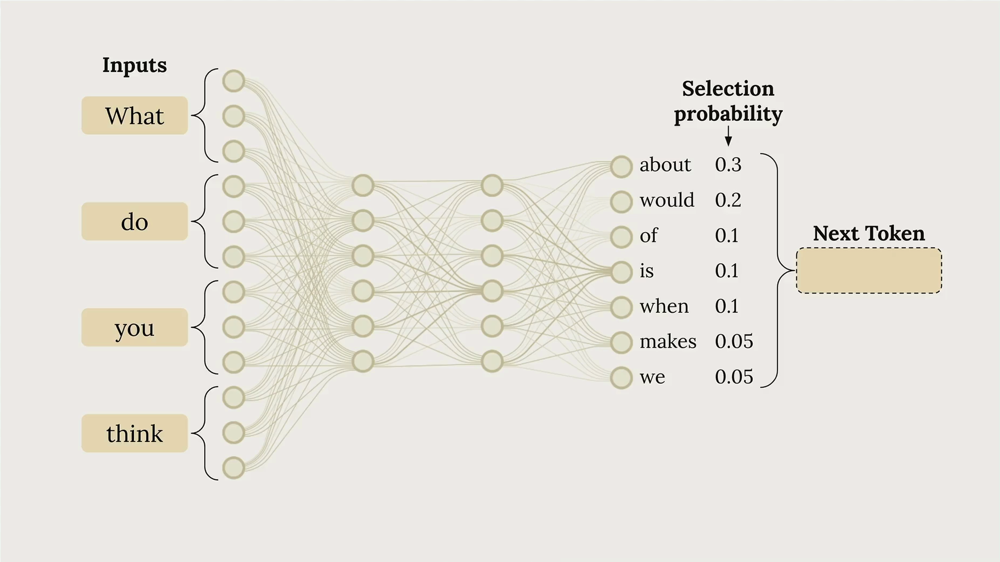
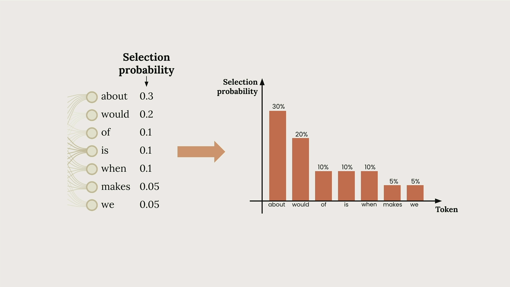
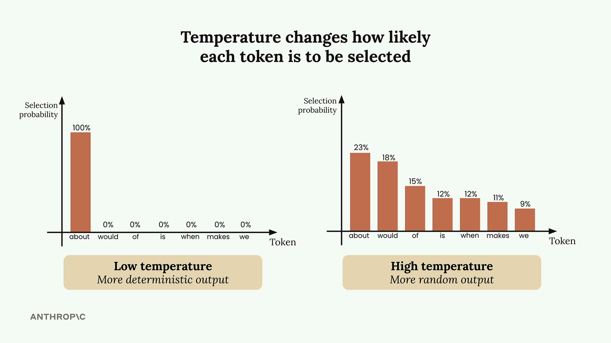
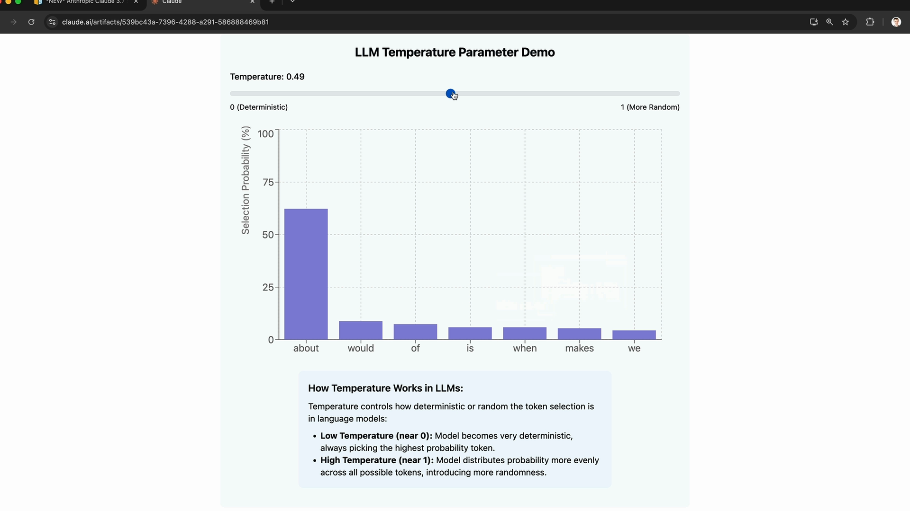

# Lesson 6 — Temperature

**Course:** [Building with the Claude API](https://academy.claude.com/courses/building-with-the-claude-api) &nbsp;·&nbsp; **Lesson page:** [Temperature](https://academy.claude.com/courses/building-with-the-claude-api/temperature) &nbsp;·&nbsp; **Chapter 1:** Accessing Claude with the API &nbsp;·&nbsp; **Completed:** November 15, 2026

| Previous | Course | Next |
|:---|:---:|---:|
| [← System prompts](05-system-prompts.md) | [📚 Chapter index](README.md) | [Response streaming →](07-response-streaming.md) |

**Practice this lesson:** in [capstone guide 1](../00_Capstone_Plan/guide/01-accessing-claude-with-the-api.md), solve:

- [Problem 5: See how much the answers vary](../00_Capstone_Plan/guide/01-accessing-claude-with-the-api.md#problem-5-see-how-much-the-answers-vary)

Do the guide's problems in order, after you finish the chapter, because each one builds on the one before.

---

**On this page**

| # | Section |
|:---:|:---|
| 1 | [Revision summary](#revision-summary) |
| 2 | [The big picture](#the-big-picture) |
| 3 | [1. How the model picks each word](#1-how-the-model-picks-each-word) |
| 4 | [2. What temperature does](#2-what-temperature-does) |
| 5 | [3. Which temperature to choose](#3-which-temperature-to-choose) |
| 6 | [4. Adding temperature to the chat function](#4-adding-temperature-to-the-chat-function) |
| 7 | [5. Which models accept temperature](#5-which-models-accept-temperature) |
| 8 | [Architect notes](#architect-notes) |
| 9 | [Recap](#recap) |
| 10 | [My notes / practice](#my-notes--practice) |
| 11 | [FAQ](#faq) |

---

### Revision summary

**Purpose of this lesson:**

1. In [lesson 1](01-accessing-the-api.md), you saw that the model writes one token at a time, picking each from a list of chances. That is why the same question can get different answers.
2. Some apps need the same answer every time, such as pulling fields out of an invoice. Others want variety, such as brainstorming movie ideas.
3. **Temperature** is the setting that controls how much the picks vary. This lesson shows how it works and when to use each value.



- **Temperature:** a setting from 0.0 to 1.0 that controls how predictable or creative the model's answers are. The default is 1.0. The name comes from physics: cold molecules stay locked in one place, like ice, and hot ones jump around, like steam. In the same way, 0.0 is cold (the model sticks to one word) and 1.0 is hot (it jumps between many).
- **Low temperature (near 0):** the model almost always picks the most likely next word. Answers are consistent.
- **High temperature (near 1):** the chances spread more evenly across words, so less likely words get picked more often. Answers vary more.
- **Newer models:** Claude models from 4.7 onward return an error for any temperature except the default 1.0. On those models, steer the answer with your prompt instead.

#### How the model picks each word

The model writes one token (a small piece of text) at a time, in three steps:

1. **Tokenization:** cut your input, such as "What do you think", into tokens.
2. **Prediction:** give every possible next token a **probability**, its chance of being picked. The course writes it as a number from 0 to 1, such as 0.3, which means 30%. For "What do you think", "about" gets 0.3 (30%), "would" 0.2 (20%), and "of" 0.1 (10%). All the probabilities add up to 1 (100%).
3. **Sampling:** pick one token at random, using those chances. Then repeat for the next token.

Temperature reshapes these probabilities before the pick in step 3:

| Next word | about | would | of | is | when | makes | we |
|---|:---:|:---:|:---:|:---:|:---:|:---:|:---:|
| The model's probabilities | 30% | 20% | 10% | 10% | 10% | 5% | 5% |
| Low temperature | 100% | 0% | 0% | 0% | 0% | 0% | 0% |
| High temperature | 23% | 18% | 15% | 12% | 12% | 11% | 9% |

#### When to use which temperature



| Range | Use it for |
|---|---|
| **Low (0.0 to 0.3)** | Factual answers, coding help, data extraction, content moderation |
| **Medium (0.4 to 0.7)** | Summaries, educational content, problem-solving, creative writing with rules |
| **High (0.8 to 1.0)** | Brainstorming, creative writing, marketing content, jokes |

Temperature changes only the *chances* of different answers. A high temperature can still give similar answers twice, and even temperature 0 doesn't guarantee identical answers.

#### How to set it in Python

- Add `temperature=1.0` as an optional setting of your `chat()` function, and put `"temperature": temperature` in the `params` dictionary.
- Call `chat(messages, temperature=0.0)` for predictable answers, or `chat(messages, temperature=1.0)` for varied ones.
- This works with Claude Haiku 4.5 and the `anthropic` package below version 1, as set up in [lesson 3](03-making-a-request.md). Later package versions have no `temperature` setting.

#### Exam takeaways

- **A data-extraction pipeline returns slightly different fields for the same document.** Use a low temperature, give clear examples of the output, and validate the output in code, because even temperature 0 doesn't guarantee identical answers. (Claude Models, Prompting & Context Engineering)
- **A team moves to a newer Claude model, and requests that set temperature 0.2 start failing.** Claude models from 4.7 onward accept only the default temperature. Remove the setting, and control consistency through the prompt, examples, and output checks. (Integration)
- **A brainstorming tool keeps suggesting the same few ideas.** On a model that accepts temperature, raise it toward 1.0. On any model, ask for several different ideas in one request and say how they should differ. (Claude Models, Prompting & Context Engineering)

---

### The big picture

| Part | In plain words | Everyday comparison |
|---|---|---|
| The chances | The model gives every possible next word a chance | A restaurant menu, where some dishes are far more popular |
| Low temperature | Nearly always pick the top word | Ordering your usual dish every time |
| High temperature | Give less likely words a real chance | Trying something different from the menu each visit |

**The running example:** the model has read "What do you think" and must pick the next word. Later, you ask it for movie ideas at temperature 0.0 and 1.0.

---

### 1. How the model picks each word

When you send "What do you think", the model goes through three steps for every token it writes. The full math is in the [deep dive](01-deep-dive-inside-the-model.md#step-5-score-every-word-and-pick-one).



1. **Tokenization:** the model cuts "What do you think" into tokens.
2. **Prediction:** it gives every possible next token a chance (a *probability*).
3. **Sampling:** it picks one token at random, using those chances. "About" is picked about 30% of the time, and "we" about 5%.

Then it adds the picked token and repeats the three steps for the next one.



---

### 2. What temperature does

**Temperature** is a number from 0.0 to 1.0 that reshapes the chances before the model picks. Think of it as a creativity dial.

**Why is it called "temperature"?** The name and the math come from physics. Think of water molecules. In ice (cold), every molecule stays locked in its one most stable spot. In steam (hot), molecules jump around into all kinds of positions. The model's word choices behave the same way:

- **Cold = 0.0 (low temperature):** the choice "freezes" onto the single most likely word.
- **Hot = 1.0 (high temperature):** the choice "boils" and jumps around among many words.

Scientists use the same formula for molecules and for word chances, so AI researchers kept the physics name.



| Next word | about | would | of | is | when | makes | we |
|---|:---:|:---:|:---:|:---:|:---:|:---:|:---:|
| The model's chances | 30% | 20% | 10% | 10% | 10% | 5% | 5% |
| Low temperature | 100% | 0% | 0% | 0% | 0% | 0% | 0% |
| High temperature | 23% | 18% | 15% | 12% | 12% | 11% | 9% |

Things to notice:

- At low temperature, the top word wins every time. The answer is *deterministic*: the same input gives the same output.
- At high temperature, the top word still leads, but other words often win. The answer varies from run to run.
- Temperature never changes the *order* of the words. "About" stays the favourite. Only the gap between words changes.

The course shows an interactive demo with a slider. At 0.49, "about" has about 60%, and every other word is under 10%:



**Warning:** The course says temperature 0.0 is "completely deterministic." In practice, even at 0.0, Anthropic doesn't promise identical answers for identical requests. Treat low temperature as "much more consistent," not "always the same."

---

### 3. Which temperature to choose

Match the temperature to the job. Tasks with one right answer need low temperature. Tasks where variety is the point need high temperature.


| Range | Use it when | Examples |
|---|---|---|
| **Low (0.0 to 0.3)** | There is one right answer, and you want the same answer each time | Factual answers, coding help, pulling fields out of an invoice, flagging harmful posts |
| **Medium (0.4 to 0.7)** | You want accuracy, with some freedom in wording | Summaries, lessons, problem-solving, a story with fixed rules |
| **High (0.8 to 1.0)** | Variety and surprise are the point | Brainstorming, stories, ad slogans, jokes |

> **Remember this:** One right answer, turn it down. Many good answers, turn it up.

---

### 4. Adding temperature to the chat function

The course adds one more optional setting to the `chat()` function from [lesson 5](05-system-prompts.md):

```python
def chat(messages, system=None, temperature=1.0):
    params = {
        "model": model,
        "max_tokens": 1000,
        "messages": messages,
        "temperature": temperature
    }

    if system:
        params["system"] = system

    message = client.messages.create(**params)
    return message.content[0].text
```

What changed:

- `temperature=1.0` adds an optional setting. If you don't pass one, it uses 1.0, the API's own default.
- `"temperature": temperature` puts it in the settings sent with every request.
- Unlike `system`, temperature always has a value, so it doesn't need an `if` check.

Test it with a request for movie ideas:

```python
# Low temperature: more predictable
answer = chat(messages, temperature=0.0)

# High temperature: more creative
answer = chat(messages, temperature=1.0)
```

| Temperature | What you get across several runs |
|---|---|
| 0.0 | Nearly the same idea each time, such as "A time-traveling archaeologist must prevent ancient artifacts from being stolen." |
| 1.0 | Different themes, characters, and plots each time |

Temperature changes only the chances. Even at 1.0, two runs can sometimes give similar ideas.

---

### 5. Which models accept temperature

The course notes that this lesson works with Claude Haiku 4.5 and the `anthropic` package below version 1, as set up in [lesson 3](03-making-a-request.md).

| Setup | Temperature |
|---|---|
| Claude Haiku 4.5 with `anthropic` below version 1 | Works as this lesson shows |
| Claude models from 4.7 onward | Any value except the default 1.0 returns an error |
| `anthropic` package version 1 and later | Has no `temperature` setting at all |

On those newer setups, guide the output with your prompt: give clear rules, show examples, and say whether you want one answer or several varied ones.

The course also mentions **effort**. Effort is a different setting. It controls how much work the model puts into an answer, such as how long it thinks. It does not control randomness.

**Not in the course, from the official Claude API documentation:** on the newest API version, a request that sets `temperature`, `top_p`, or `top_k` returns an error on every model. `top_p` and `top_k` are other ways to limit which words can be picked ([deep dive](01-deep-dive-inside-the-model.md#step-5-score-every-word-and-pick-one)).

---

### Architect notes

#### Reliability

- Never rely on temperature alone for consistent output. Validate output in code, such as checking that JSON matches your format, and retry when it doesn't.
- To compare prompts fairly, test each one on many inputs, not one run. Random picking can make one lucky run look better than it is ([lesson 9](../02-prompt-evaluation/09-prompt-evaluation.md)).

#### Migration

- Find every place your code sets `temperature`, `top_p`, or `top_k` before moving to a newer model or package version. Those requests will fail.
- Replace temperature with prompt instructions and examples. For variety, ask for "five ideas that differ in setting and tone." For consistency, give an exact output format.

#### Cost and speed

- Temperature doesn't change the price or speed of a request. You pay for tokens, whatever the temperature.
- A higher temperature can make answers longer or wander more, which can raise output tokens. Keep `max_tokens` and length instructions in place.

---

### Recap

- The model picks each token at random from a set of chances.
- Temperature (0.0 to 1.0, default 1.0) reshapes those chances: low is predictable, high is varied.
- Use low for factual work and extraction, medium for summaries and teaching, high for brainstorming and creative work.
- Add `temperature` to `chat()` as an optional setting that defaults to 1.0.
- Even temperature 0 doesn't guarantee identical answers.
- Claude models from 4.7 onward accept only the default, so steer them with the prompt.

---

## My notes / practice

- [ ] Ask for a movie idea five times at temperature 0.0, then five times at 1.0. Compare the variety.
- [ ] Send the same extraction request three times at 0.0, and check whether the output is identical.
- [ ] Try `temperature=0.5` on a summary, and compare it with 0.0 and 1.0.
- [ ] Write a prompt that asks for five varied ideas in one request, without using temperature.

---

## FAQ

**Q1. What does "temperature" mean for the Claude API?**
It is a setting from 0.0 to 1.0 that controls how predictable the answers are. Low values make the model stick to the most likely words. High values let less likely words be picked more often.

**Q2. Why is the setting called "temperature", and is 1 hot or cold?**
The name comes from physics. Cold molecules stay locked in one spot, like ice, and hot ones jump around, like steam. **0.0 is the coldest setting**: the model freezes onto the most likely word. **1.0 is the hottest**: the model jumps between many words.

**Q3. What is the default temperature?**
1.0. If you don't set temperature, the model uses the chances exactly as it calculated them.

**Q4. What does "sampling" mean?**
It is the last step of picking a word: the model chooses one token at random, using the chances it worked out. Temperature changes those chances before the pick.

**Q5. Does temperature 0 always give the same answer?**
No. It makes answers much more consistent, but Anthropic doesn't promise identical output. Check important output in code.

**Q6. Which temperature should I use for extracting data from documents?**
A low one, 0.0 to 0.3, because there is one right answer and you want the same result each time.

**Q7. Which temperature should I use for brainstorming?**
A high one, 0.8 to 1.0, because you want many different ideas.

**Q8. Does a higher temperature cost more?**
No. Price depends on tokens, not temperature. A higher temperature can sometimes produce longer answers, which use more output tokens.

**Q9. Why does my request fail when I set temperature on a newer model?**
Claude models from 4.7 onward accept only the default of 1.0. Remove the setting, and guide the answer with your prompt instead.

**Q10. What is the difference between temperature and effort?**
Temperature controls how random the word choices are. Effort controls how much work the model puts into an answer, such as how much it thinks first.

**Q11. (Exam angle) A data-extraction pipeline returns slightly different fields for the same document. What do you recommend?**
Use a low temperature on models that accept it, and give clear examples of the output format. Validate every result in code, because even temperature 0 doesn't guarantee identical answers. (Claude Models, Prompting & Context Engineering)

**Q12. (Exam angle) After moving to a newer Claude model, requests that set temperature 0.2 start failing. How do you fix them?**
Claude models from 4.7 onward accept only the default temperature. Remove the setting, and get consistency from the prompt, examples, and output checks. (Integration)

**Q13. (Exam angle) A brainstorming tool keeps suggesting the same few ideas. What do you change?**
On a model that accepts temperature, raise it toward 1.0. On any model, ask for several ideas in one request, and say how they should differ. (Claude Models, Prompting & Context Engineering)

---

| Previous | Course | Next |
|:---|:---:|---:|
| [← System prompts](05-system-prompts.md) | [📚 Chapter index](README.md) | [Response streaming →](07-response-streaming.md) |
