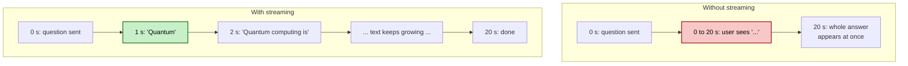
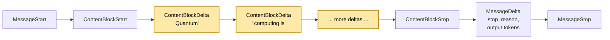
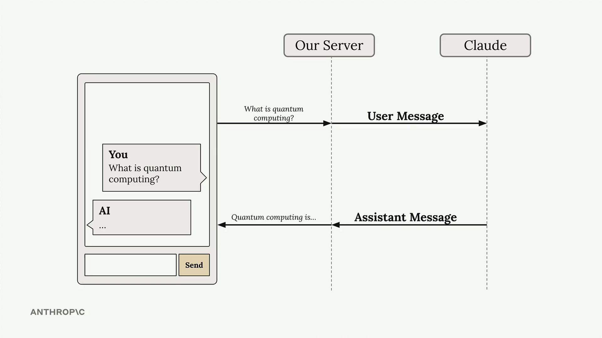
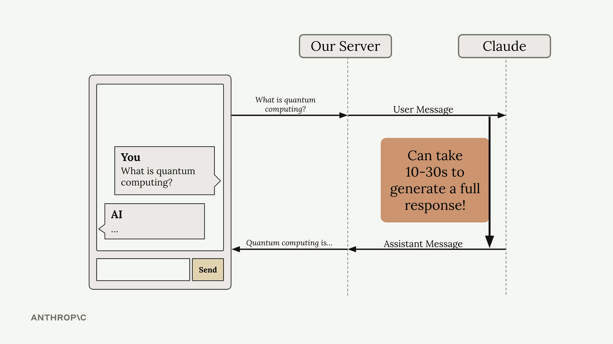
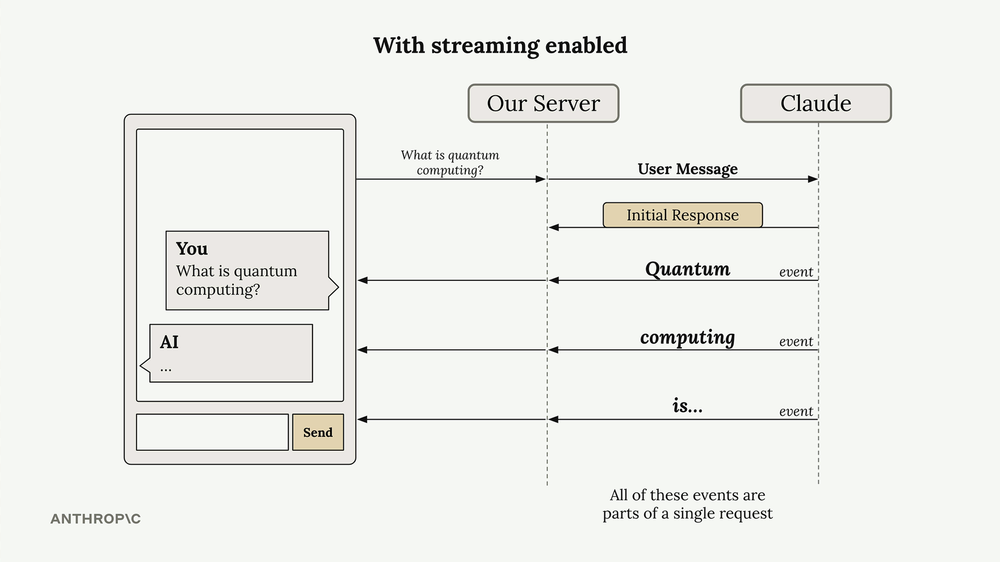
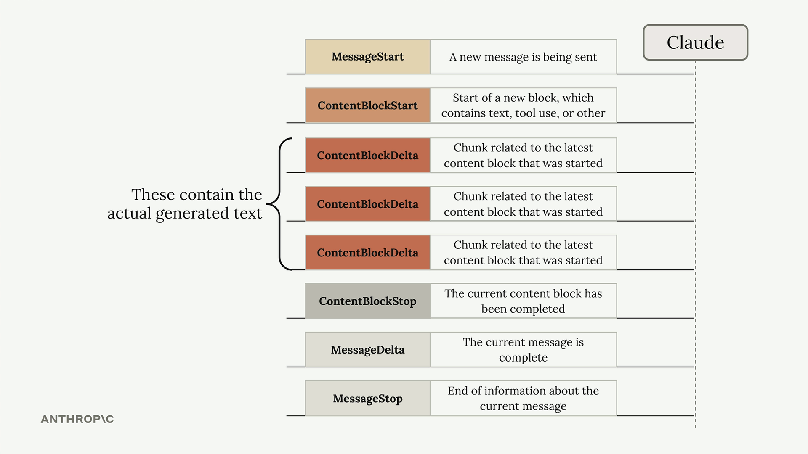
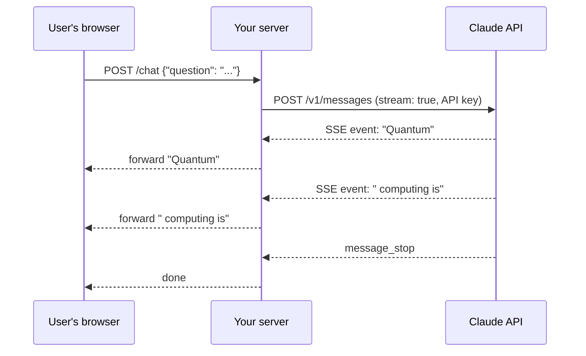
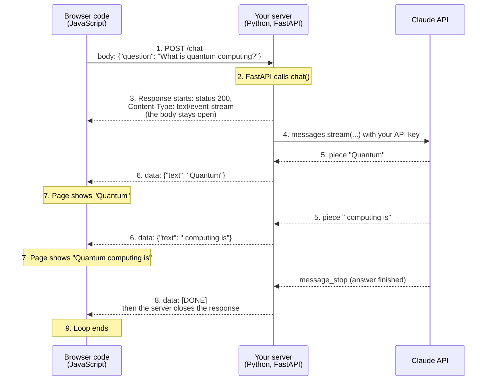

# Lesson 7 — Response streaming

**Course:** [Building with the Claude API](https://academy.claude.com/courses/building-with-the-claude-api) &nbsp;·&nbsp; **Lesson page:** [Response streaming](https://academy.claude.com/courses/building-with-the-claude-api/response-streaming) &nbsp;·&nbsp; **Chapter 1:** Accessing Claude with the API &nbsp;·&nbsp; **Completed:** November 15, 2026

| Previous | Course | Next |
|:---|:---:|---:|
| [← Temperature](06-temperature.md) | [📚 Chapter index](README.md) | [Structured data →](08-structured-data.md) |

**Practice this lesson:** in [capstone guide 1](../00_Capstone_Plan/guide/01-accessing-claude-with-the-api.md), solve:

- [Problem 6: Show the answer as it is written](../00_Capstone_Plan/guide/01-accessing-claude-with-the-api.md#problem-6-show-the-answer-as-it-is-written)

Do the guide's problems in order, after you finish the chapter, because each one builds on the one before.


---

**On this page**

| # | Section |
|:---:|:---|
| 1 | [Revision summary](#revision-summary) |
| 2 | [The big picture](#the-big-picture) |
| 3 | [1. The problem: users wait with nothing to read](#1-the-problem-users-wait-with-nothing-to-read) |
| 4 | [2. How streaming works](#2-how-streaming-works) |
| 5 | [3. The six kinds of stream event](#3-the-six-kinds-of-stream-event) |
| 6 | [4. Three ways to stream in Python](#4-three-ways-to-stream-in-python) |
| 7 | [5. How the stream travels: Server-Sent Events](#5-how-the-stream-travels-server-sent-events) |
| 8 | [Architect notes](#architect-notes) |
| 9 | [Recap](#recap) |
| 10 | [My notes / practice](#my-notes--practice) |
| 11 | [FAQ](#faq) |

---

### Revision summary

**Purpose of this lesson:**

1. Your chat app sends "What is quantum computing?" through your server to Claude, as in [lesson 1](01-accessing-the-api.md).
2. A long answer can take 10 to 30 seconds to write. Until it is finished, the user sees only "...".
3. **Streaming** sends the answer in small pieces as the model writes it, so the first words appear within a second or two.



- **The problem:** a full answer can take 10 to 30 seconds. Without streaming, your server waits for the whole answer, and the user stares at a loading spinner.
- **Streaming:** the API sends the answer in small pieces as the model writes it. Your server passes each piece on, so the user sees the text appear word by word.
- **One request:** all the pieces belong to a single request. Streaming doesn't send more requests or cost more.

#### The stream events, in order

With streaming on, the API sends a series of *events* (small messages, each with a type and some data):



The highlighted deltas carry the text to show the user.

1. **MessageStart:** a new message is starting.
2. **ContentBlockStart:** a new block of content is starting. A block can hold text, a tool call, or other content.
3. **ContentBlockDelta:** a chunk of the generated text. Many of these arrive, and they are the ones to show the user.
4. **ContentBlockStop:** the current block is finished.
5. **MessageDelta:** final details about the whole message, such as why it stopped and the output token count.
6. **MessageStop:** the message is complete.

#### When to use each way of streaming in Python

- **Use `client.messages.create(..., stream=True)`** when you need every raw event, such as to handle tool calls yourself. You loop over `stream` and check each event's type.
- **Use `client.messages.stream(...)` with `stream.text_stream`** when you only want the text to show users. It filters out every event except the text chunks.
- **Use `stream.get_final_message()`** after the loop when you also need the complete message, such as to save it in a database or add it to the chat history.

#### How the stream travels

The Claude API streams with *Server-Sent Events* (SSE). SSE is plain HTTP: one request, and one long reply that arrives in pieces.

- **Your server to the Claude API:** always SSE. The API replies with the header `Content-Type: text/event-stream` and keeps the connection open. Each event is an `event:` line plus a `data:` line holding JSON. The SDK reads these lines for you.
- **The browser to your server:** your choice. Your server reads the chunks from Claude and forwards each one to the browser at once.
- **Use SSE** to forward chunks to the browser for a normal chat. The answer only flows one way, and SSE is the simplest option.
- **Use WebSockets** (a two-way connection) when the browser must also send messages during an answer, such as a live "stop" button.
- **Use SignalR** if your app is already built on ASP.NET Core. SignalR is a .NET library that picks WebSockets or SSE underneath.
- **Never let the browser call the Claude API directly.** The browser would need your API key, and anyone could copy it.

#### Exam takeaways

- **Users of a chat app complain that answers take 20 seconds to appear.** Turn on streaming and pass each text chunk to the app as it arrives. The full answer takes the same time, but the first words appear within a second or two. (Solution Design & Architecture)
- **A team streams answers but must also save every full answer and its token usage.** Stream with `client.messages.stream()`, send `text_stream` chunks to users, then call `get_final_message()` and save that. (Integration)
- **Long answers with a large `max_tokens` keep failing with timeout errors.** Use streaming. Data then keeps flowing during generation, so the connection doesn't sit idle until a timeout ends it. (Integration)

---

### The big picture

| Part | In plain words | Everyday comparison |
|---|---|---|
| Without streaming | Wait for the whole answer, then show it at once | Waiting for a printed letter to arrive by post |
| With streaming | Show each piece of the answer as it is written | Watching someone type a message to you live |
| Events | The labelled pieces the API sends during one answer | Parcels in one delivery, each with a label: "starting", "contents", "finished" |

**The running example:** a user types "What is quantum computing?" into your chat app. Later, your code asks the model for "a 1 sentence description of a fake database" and streams the answer.

#### Who's who

| Player | Where it lives | What it does |
|---|---|---|
| **The user** | In front of your chat app | Asks the question and watches the answer appear |
| **Your chat app** (the client) | The user's phone or browser | Shows each text chunk the moment your server forwards it |
| **Your server** | A computer you run | Calls the Claude API with streaming on, and forwards each chunk to the app |
| **The Claude API and the model** | Anthropic's servers | Writes the answer and sends it as a series of events |

---

### 1. The problem: users wait with nothing to read

In a normal request ([lesson 1](01-accessing-the-api.md)), your server sends the user's message to the API and waits for the complete answer. Only then does it send anything back to the app.



The model writes one token at a time, so a long answer takes a while. During that time, the user sees only "...".



---

### 2. How streaming works

With streaming on, the API doesn't wait for the full answer:

1. The API sends an initial response right away, saying it got the request and has started.
2. As the model writes, the API sends a series of events. Each one holds a small piece of the answer, such as "Quantum", then "computing", then "is".
3. Your server forwards each piece to the app as it arrives.
4. The app adds each piece to the screen, so the answer builds up word by word.



Things to notice:

- All the events belong to **one** request. Streaming is not many small requests.
- The total time to write the whole answer is about the same. What changes is when the user sees the first words.

> **Remember this:** Streaming doesn't make the model faster. It lets the user start reading sooner.

---

### 3. The six kinds of stream event

Each event has a type that tells your code what it holds:



| Event | What it means | What your code usually does |
|---|---|---|
| **MessageStart** | A new message is starting | Gets ready, for example by clearing an "AI is typing" area |
| **ContentBlockStart** | A new block is starting. It may hold text, a tool call, or other content. | Notes what kind of block it is |
| **ContentBlockDelta** | A chunk of the generated content. "Delta" means "the change since last time." | Shows the text chunk to the user |
| **ContentBlockStop** | The current block is finished | Marks that block as done |
| **MessageDelta** | Final details about the message, such as the stop reason and output tokens | Reads the stop reason and usage |
| **MessageStop** | The whole message is finished | Closes the stream |

**Warning:** The course says MessageDelta means "the current message is complete." It actually carries the last details of the message, such as `stop_reason` and the output token count. The message is fully finished only at MessageStop.

**Not in the course, from the official Claude API documentation:** in the raw API, the event names are written in lowercase with underscores, such as `message_start` and `content_block_delta`. The stream can also include `ping` events, which keep the connection alive and can be ignored, and `error` events, such as when Anthropic's servers are overloaded mid-answer.

---

### 4. Three ways to stream in Python

#### Way 1: every raw event, with `stream=True`

```python
messages = []
add_user_message(messages, "Write a 1 sentence description of a fake database")

stream = client.messages.create(
    model=model,
    max_tokens=1000,
    messages=messages,
    stream=True
)

for event in stream:
    print(event)
```

- `add_user_message()` is the helper from [lesson 4](04-multi-turn-conversations.md).
- `stream=True` turns streaming on. Instead of one finished message, `create()` returns a stream of events.
- `for event in stream:` handles each event as it arrives, in order.
- `print(event)` shows the raw event. The output starts with a `RawMessageStartEvent`, then a `RawContentBlockStartEvent`, then many delta events.

Things to notice in the output: the first event already shows `input_tokens=18`, but `stop_reason` is still `None` and the text is empty, because the model has not written anything yet. The text arrives in the delta events that follow.

#### Way 2: only the text, with `messages.stream()`

Picking the text out of raw events by hand is tedious. The SDK has a simpler way:

```python
with client.messages.stream(
    model=model,
    max_tokens=1000,
    messages=messages
) as stream:
    for text in stream.text_stream:
        print(text, end="")
```

- `client.messages.stream(...)` is the SDK's streaming helper. It needs no `stream=True`.
- `with ... as stream:` opens the stream and closes the connection cleanly when the block ends, even if an error happens.
- `stream.text_stream` gives only the text chunks, such as "A", " fake", " database". Every other event is filtered out.
- `print(text, end="")` prints each chunk with no line break, so the chunks join into one sentence on screen.

#### Way 3: text for the user, plus the full message for your code

You usually also need the complete answer, for example to save it or add it to the chat history:

```python
with client.messages.stream(
    model=model,
    max_tokens=1000,
    messages=messages
) as stream:
    for text in stream.text_stream:
        # Send each chunk to your client
        pass

    # Get the complete message for database storage
    final_message = stream.get_final_message()
```

- `pass` is a placeholder. In a real app, you would send `text` to the user's app here.
- `stream.get_final_message()` returns the whole message, built from all the chunks. It looks the same as a normal, non-streamed response: the full text, `stop_reason`, and `usage`.

This gives you both: live text for the user, and a complete message for your code.

| Way | Use it when |
|---|---|
| `create(..., stream=True)` | You need every raw event, such as for tool calls |
| `stream()` with `text_stream` | You only need the text to show users |
| `stream()`, then `get_final_message()` | You show the text live and also save or reuse the full message |

---

### 5. How the stream travels: Server-Sent Events

**Not in the course, from the official Claude API documentation:** the Claude API streams with **Server-Sent Events** (SSE). SSE is a web standard built on plain HTTP. The server keeps one reply open and writes small pieces of text into it over time. It is not SignalR, and it is not WebSockets.

#### What happens on the wire

1. Your server sends a normal HTTPS `POST` to `https://api.anthropic.com/v1/messages`, with `"stream": true` in the body.
2. The API replies with the header `Content-Type: text/event-stream`. A *header* is a label at the top of an HTTP reply. This one says "events will follow." The API keeps the connection open.
3. Each time the model writes a few tokens, the API adds another event to the same reply.
4. After `message_stop`, the API closes the connection.

Each event is an `event:` line, a `data:` line holding JSON, and a blank line:

```text
event: message_start
data: {"type":"message_start","message":{"id":"msg_01...","role":"assistant","content":[],...}}

event: content_block_start
data: {"type":"content_block_start","index":0,"content_block":{"type":"text","text":""}}

event: content_block_delta
data: {"type":"content_block_delta","index":0,"delta":{"type":"text_delta","text":"Quantum"}}

event: content_block_delta
data: {"type":"content_block_delta","index":0,"delta":{"type":"text_delta","text":" computing is"}}

event: content_block_stop
data: {"type":"content_block_stop","index":0}

event: message_delta
data: {"type":"message_delta","delta":{"stop_reason":"end_turn"},"usage":{"output_tokens":42}}

event: message_stop
data: {"type":"message_stop"}
```

These are the six events from section 3. `stream.text_stream` is SDK code that reads these lines and keeps only the `text_delta` pieces.

| Technology | What it is | Why the Claude API does or doesn't use it |
|---|---|---|
| **SSE** | Plain HTTP. The server pushes text one way, to the caller. | Used. You ask once and the answer flows back one way. Any HTTP client in any language can read it. |
| **WebSockets** | A two-way connection that stays open | Not needed for one-way answers, and harder to run behind proxies and load balancers |
| **SignalR** | A .NET library that runs over WebSockets, SSE, or long polling | Tied to .NET and its own protocol, so it doesn't suit a public API that Python, Go, and curl all call |

So streaming works fine "API to API." Your server is just an HTTP client reading a reply that arrives slowly.

#### Passing the stream on to your users

There are two streams. The first is fixed. You choose the second.



Things to notice:

- Only your server holds the API key. The browser never talks to the Claude API.
- Your server forwards each chunk the moment it arrives. It doesn't wait for the full answer.

#### Example: forwarding with SSE in Python

This example has two pieces of code that talk to each other over one HTTP request:

| Who | Where the code runs | What it does |
|---|---|---|
| **The browser code** (JavaScript) | On the user's computer, inside the web page | Sends the question to your server, then adds each piece of the answer to the page as it arrives. |
| **Your server** (Python, using FastAPI, a Python web framework) | On your machine or in your cloud | Receives the question, asks Claude for a streamed answer, and passes each piece on to the browser. |
| **The Claude API** | Anthropic's servers | Writes the answer and streams it to your server in pieces. |

The key idea: the browser sends **one request**, and your server keeps that **one response open**. It writes a little more into the response each time Claude sends a piece. The response ends only when the answer is finished. Think of a phone call where the other person reads you a letter line by line, instead of mailing you the whole letter at the end.

#### The whole trip, step by step

The numbers in this diagram match the numbered comments in the code below.



Things to notice:

- Steps 5, 6, and 7 repeat once for every piece of the answer. The diagram shows only two pieces.
- The browser never waits for the full answer. Each piece appears on the page about as soon as Claude writes it.

#### The server code, with comments

```python
import json
import anthropic
from fastapi import FastAPI
from fastapi.responses import StreamingResponse

app = FastAPI()
client = anthropic.AsyncAnthropic()   # reads your API key from ANTHROPIC_API_KEY

# 1-2. The browser sends POST /chat with {"question": "..."}.
#      FastAPI turns that JSON into the Python dict `body` and calls chat().
@app.post("/chat")
async def chat(body: dict):

    # relay() does not run yet. It is a recipe that produces the response body
    # one piece at a time. FastAPI runs it in step 3.
    async def relay():
        # 4. Your server asks Claude for a streamed answer.
        async with client.messages.stream(
            model="claude-haiku-4-5",
            max_tokens=1000,
            messages=[{"role": "user", "content": body["question"]}],
        ) as stream:
            # 5. Wait for each piece of text from Claude, e.g. "Quantum".
            async for text in stream.text_stream:
                # 6. Write one SSE event into the open response:
                #    data: {"text": "Quantum"}   followed by a blank line
                yield f"data: {json.dumps({'text': text})}\n\n"
        # 8. Claude has finished. Tell the browser the answer is complete.
        yield "data: [DONE]\n\n"
        # When relay() returns, FastAPI closes the response.

    # 3. Send the response headers now and keep the body open.
    #    Everything relay() yields is sent to the browser as soon as it is yielded.
    return StreamingResponse(relay(), media_type="text/event-stream")
```

- `AsyncAnthropic()` is the SDK client for `async` code, so one server can handle many users at once.
- `relay()` is a *generator*: a function that hands out values one at a time. Each `yield` sends one piece to the browser at once. A normal `return` would send everything at the end and lose the benefit of streaming.
- `json.dumps` wraps each chunk in JSON. Line breaks inside the text then can't break the SSE format, which uses a blank line to mark the end of each event.
- `[DONE]` is a marker you invent, so the browser knows the answer is finished.

#### What actually travels between the browser and your server

This is the request the browser sends in step 1:

```text
POST /chat HTTP/1.1
Content-Type: application/json

{"question": "What is quantum computing?"}
```

This is the response your server sends back. The headers go out in step 3. The body lines arrive one at a time, seconds apart, over the same open connection:

```text
HTTP/1.1 200 OK
Content-Type: text/event-stream

data: {"text": "Quantum"}

data: {"text": " computing is"}

data: {"text": " a way of computing that..."}

data: [DONE]

```

Each `data:` line followed by a blank line is one SSE event. Your server wrote each one with a single `yield`.

#### The browser code, with comments

The browser reads the reply piece by piece with `fetch`. The browser's built-in `EventSource` object only supports `GET` requests, and you need `POST` to send the question.

```javascript
// 1. Send the question to your server. `await` returns as soon as the
//    headers arrive (step 3). The body is still coming.
const res = await fetch("/chat", {
  method: "POST",
  headers: { "Content-Type": "application/json" },
  body: JSON.stringify({ question: "What is quantum computing?" }),
});

// Get a reader that hands over the body as text, a bit at a time.
const reader = res.body.pipeThrough(new TextDecoderStream()).getReader();
let buffer = "";   // holds text that has arrived but is not a full event yet

while (true) {
  // Wait for the next bit of the body, e.g. 'data: {"text": "Quantum"}\n\n'
  const { value, done } = await reader.read();
  if (done) break;                       // 9. The server closed the response.
  buffer += value;

  // A blank line ("\n\n") ends each event, so split on it.
  const events = buffer.split("\n\n");
  buffer = events.pop();                 // keep any half-received event for next time

  for (const e of events) {
    const data = e.replace(/^data: /, "");   // 'data: {"text":"Quantum"}' -> '{"text":"Quantum"}'
    if (data === "[DONE]") continue;         // 8. The end marker. Nothing to show.
    output.textContent += JSON.parse(data).text;  // 7. Add "Quantum" to the page
  }
}
```

- `reader.read()` waits for the next piece of the reply.
- `buffer` matters because the network can split one event across two reads. For example, one read may bring `data: {"te` and the next `xt": "Quantum"}\n\n`. The code keeps the unfinished part until the rest arrives.
- `output` is the page element that shows the answer, for example `<div id="output"></div>`.

**Other options:** in an ASP.NET Core app, a SignalR hub method can return `IAsyncEnumerable<string>` and `yield return` each chunk from Claude. The JavaScript client then reads it with `connection.stream(...)`. Use WebSockets only if the browser must also send messages mid-answer. The Claude side stays the same in every case.

---

### Architect notes

#### Speed

- Streaming improves *time to first token*: how long until the first word appears. It does not shorten the total time. Measure both.
- Your server must forward chunks as they arrive. If it collects them and sends everything at the end, the user gets no benefit.

#### Reliability

- Long requests without streaming can hit timeouts, because no data flows until the end. The SDKs recommend streaming for long answers and require it for very large `max_tokens` values.
- A stream can fail partway, after some text was already shown. Plan for it: show an error, keep or discard the partial text, and let the user retry.
- Check the stop reason from the final message. A `max_tokens` stop means the streamed answer was cut off ([lesson 3](03-making-a-request.md)).

#### Cost

- Streaming costs the same as a normal request. You pay for the same input and output tokens.
- Read `usage` from `get_final_message()` to log the cost of each streamed request.

#### Design

- Your server needs a way to push chunks to the app: SSE for one-way answers, WebSockets or SignalR when the browser also sends messages mid-answer (section 5).
- Save the chat history from `get_final_message()`, not from chunks you joined yourself. Then you also get the stop reason and token counts.

#### Production pitfalls

- **Proxies that buffer.** A *proxy* (such as Nginx or a load balancer) sits between your server and the browser. Some collect the whole reply before passing it on, which silently undoes streaming. In Nginx, turn this off with `proxy_buffering off;` or the `X-Accel-Buffering: no` header. Don't compress `text/event-stream` replies either.
- **The user leaves mid-answer.** Close the Claude stream when the browser disconnects. Otherwise the model keeps writing, and you pay for output tokens nobody reads.
- **Idle timeouts.** The Claude API sends `ping` events to keep its connection alive. On your own stream to the browser, send a comment line such as `: keep-alive` every 15 to 30 seconds during long pauses.

---

### Recap

- Full answers can take 10 to 30 seconds, so without streaming users wait with nothing to read.
- Streaming sends the answer as a series of events in one request, so text appears word by word.
- The events are MessageStart, ContentBlockStart, ContentBlockDelta (the text), ContentBlockStop, MessageDelta, and MessageStop.
- `stream=True` gives raw events. `messages.stream()` with `text_stream` gives only the text.
- `get_final_message()` gives the complete message after the stream ends.
- The Claude API streams with Server-Sent Events over plain HTTP. Your server forwards each chunk to the browser with SSE, WebSockets, or SignalR, and keeps the API key to itself.

---

## My notes / practice

- [ ] Run the `stream=True` example and list each event type you see, in order.
- [ ] Run the `text_stream` example on a long answer, and watch the text appear piece by piece.
- [ ] Call `get_final_message()` and print its `stop_reason` and `usage`.
- [ ] Time a long request with and without streaming. Compare when the first word appears.
- [ ] Run the FastAPI relay and the browser code from section 5, and watch the answer appear on a web page.
- [ ] Call the API with `curl -N` and `"stream": true`, and read the raw `event:` and `data:` lines.

---

## FAQ

**Q1. What does "response streaming" mean?**
It means the API sends the answer in small pieces while the model writes it, instead of all at once at the end. Your app can show each piece right away.

**Q2. Does streaming make the model write faster?**
No. The whole answer takes about the same time. The user just starts reading the first words much sooner.

**Q3. Is each streamed chunk a separate request?**
No. All the events belong to one request. You send one request and receive many events back.

**Q4. What does "event" mean in streaming, and which event holds the text?**
An event is one small message in the stream, with a type and some data. The ContentBlockDelta events hold the text, such as "Quantum". Many of them arrive during one answer.

**Q5. What technology does the Claude API use to stream?**
Server-Sent Events (SSE), a web standard on plain HTTP. The API keeps one reply open and writes each event into it as an `event:` line and a `data:` line. It doesn't use SignalR or WebSockets.

**Q6. How do I pass the stream on to the users of my web app?**
Your server reads the chunks from Claude and forwards each one to the browser at once, using SSE, WebSockets, or SignalR. The browser talks only to your server, so your API key stays secret.

**Q7. What is the difference between "stream=True" and "client.messages.stream()"?**
`stream=True` on `create()` gives you every raw event to handle yourself. `client.messages.stream()` is an SDK helper with shortcuts, such as `text_stream` for only the text and `get_final_message()` for the full message.

**Q8. How do I get the full answer when I stream?**
Call `stream.get_final_message()` after the loop. It returns the complete message, with the text, stop reason, and token usage.

**Q9. Does streaming cost more?**
No. You pay for the same input and output tokens as a normal request.

**Q10. What happens if the stream breaks halfway?**
The user may have seen part of the answer already. Your app should show an error and offer a retry, and not save the partial answer as if it were complete.

**Q11. (Exam angle) Users of a chat app complain that answers take 20 seconds to appear. What do you change?**
Turn on streaming and forward each text chunk to the app as it arrives. The full answer takes the same time, but the first words appear within a second or two. (Solution Design & Architecture)

**Q12. (Exam angle) A team streams answers but must also save every full answer and its token usage. How do they do both?**
Use `client.messages.stream()`, send `text_stream` chunks to users, then call `get_final_message()` and save that message and its `usage`. (Integration)

**Q13. (Exam angle) Long answers with a large "max_tokens" keep failing with timeout errors. What do you recommend?**
Use streaming. Data then flows during generation, so the connection doesn't sit idle until a timeout ends it. The SDKs require streaming for very large `max_tokens` values. (Integration)

---

| Previous | Course | Next |
|:---|:---:|---:|
| [← Temperature](06-temperature.md) | [📚 Chapter index](README.md) | [Structured data →](08-structured-data.md) |
