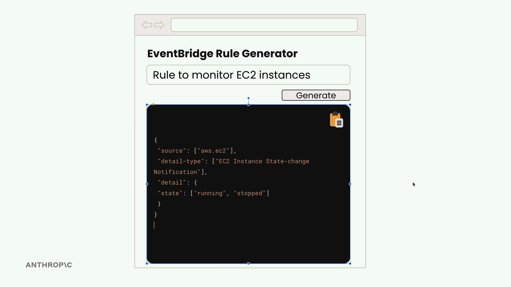

# Lesson 8 — Structured data

**Course:** [Building with the Claude API](https://academy.claude.com/courses/building-with-the-claude-api) &nbsp;·&nbsp; **Lesson page:** [Structured data](https://academy.claude.com/courses/building-with-the-claude-api/structured-data) &nbsp;·&nbsp; **Chapter 1:** Accessing Claude with the API &nbsp;·&nbsp; **Completed:** November 15, 2026

| Previous | Course | Next |
|:---|:---:|---:|
| [← Response streaming](07-response-streaming.md) | [📚 Chapter index](README.md) | [Prompt evaluation →](../02-prompt-evaluation/09-prompt-evaluation.md) |

**Practice this lesson:** in [capstone guide 1](../00_Capstone_Plan/guide/01-accessing-claude-with-the-api.md), solve:

- [Problem 7: Turn a customer message into clean JSON](../00_Capstone_Plan/guide/01-accessing-claude-with-the-api.md#problem-7-turn-a-customer-message-into-clean-json)
- [Problem 8: Try again when a request fails](../00_Capstone_Plan/guide/01-accessing-claude-with-the-api.md#problem-8-try-again-when-a-request-fails)
- [Architect scenario: sorting 1,000 shop emails a day](../00_Capstone_Plan/guide/01-accessing-claude-with-the-api.md#architect-scenario-sorting-1000-shop-emails-a-day)

Do the guide's problems in order, after you finish the chapter, because each one builds on the one before.


---

**On this page**

| # | Section |
|:---:|:---|
| 1 | [Revision summary](#revision-summary) |
| 2 | [The big picture](#the-big-picture) |
| 3 | [1. Without a schema: what comes back](#1-without-a-schema-what-comes-back) |
| 4 | [2. With a schema: structured outputs](#2-with-a-schema-structured-outputs) |
| 5 | [3. Nested data, two parts, and other shapes](#3-nested-data-two-parts-and-other-shapes) |
| 6 | [4. The course's way: prefill and stop sequences (older models only)](#4-the-courses-way-prefill-and-stop-sequences-older-models-only) |
| 7 | [Architect notes](#architect-notes) |
| 8 | [Recap](#recap) |
| 9 | [My notes / practice](#my-notes--practice) |
| 10 | [FAQ](#faq) |

---

### Revision summary

- **The problem:** asked for JSON, the model adds a friendly sentence, wraps the JSON in Markdown fences, and picks its own field names. Your code can't use that reliably.
- **Structured outputs (the current way):** you give the API the exact shape you want, called a *JSON schema*. The API returns plain JSON that always matches it.
- **Prefill and stop sequences (the course's way):** an older trick that works only on older models such as `claude-haiku-4-5`. Newer models reject it with a 400 error.

#### How structured outputs work

1. Your code describes the shape, for example as a Python class with the fields `name`, `email`, `order_id`, `issue`, and `wants_refund`.
2. `client.messages.parse(..., output_format=YourClass)` turns the class into a JSON schema and sends it in the `output_config.format` setting.
3. While the model writes, the API only lets it write text that fits the schema. Fences, extra sentences, and missing fields can't happen.
4. `response.parsed_output` holds a ready Python object, such as `ticket.issue == "damaged"`.

#### What is guaranteed, and what isn't

- **Guaranteed:** valid JSON, every required field, the right type for each field, and no extra fields.
- **Not guaranteed:** that the values are true. The model can still pick the wrong category, so check values that matter.
- **Check `stop_reason` first.** `"max_tokens"` (cut off) or `"refusal"` (the model declined) means the answer may not match the schema.

#### When to use what

| Situation | What to use |
|---|---|
| Your code reads the answer, on a current model such as `claude-opus-5-5` | Structured outputs |
| Your code reads the answer, on an older model such as `claude-haiku-4-5` | Prefill ` ```json ` and stop on ` ``` `, then check the JSON yourself |
| A person reads the answer, and you only want to skip the opening sentence | A system prompt instruction, such as "Answer with no introduction" |

#### Exam takeaways

- **A web app shows generated JSON with a copy button, but users keep copying Markdown fences and an explanation.** Use structured outputs. The answer is then plain JSON with nothing around it. (Integration)
- **A team moves prefill code from Haiku 4.5 to a newer model, and every request now fails with a 400 error.** Newer models reject a prefilled last assistant message. Remove the prefill and the ` ``` ` stop sequence, and use structured outputs instead. (Claude Models, Prompting & Context Engineering)
- **A pipeline parses model JSON and sometimes crashes on a missing field.** Use structured outputs, so every required field is always present. Also check `stop_reason` and validate the values that matter. (Solution Design & Architecture)

---

### The big picture

**Warning:** The course teaches the prefill trick (section 4). It is outdated: newer models reject it with a 400 error. This page teaches the current way, structured outputs, first.

**The running example:** an online shop's support inbox. Each customer email should become a support ticket automatically. This email arrives:

> Hi, I ordered a blue kettle (order #A-1042) last Tuesday and it arrived with a cracked lid. I'd like a refund please. — Priya Shah, priya@example.com

The shop's code asks the model to pull out the details. Then it saves them in the ticket system, which needs exact fields.

#### Who's who

| Player | Where it lives | What it does |
|---|---|---|
| **Your code** (Python) | The shop's server | Sends the email to the API, then saves the ticket |
| **The Claude API** | Anthropic's servers | Holds the model to your schema while it writes |
| **The model** | Anthropic's servers | Reads the email and fills in the fields |

---

### 1. Without a schema: what comes back

Your code puts the whole email, the full message the customer wrote, in a variable. Then it just asks for JSON:

```python
# The full text of the customer's email, not only their email address
email_text = """Hi, I ordered a blue kettle (order #A-1042) last Tuesday and it arrived
with a cracked lid. I'd like a refund please. - Priya Shah, priya@example.com"""

response = client.messages.create(
    model="claude-opus-5-5",
    max_tokens=1000,
    messages=[{"role": "user", "content": f"Pull the customer details out of this support email as JSON:\n\n{email_text}"}],
)
print(response.content[0].text)
```

- `email_text` holds the whole email: the order, the problem, the refund request, the name, and the address.
- The `f` before the prompt makes it an *f-string*: Python replaces `{email_text}` with the whole email before sending. `\n\n` adds a blank line between the instruction and the email.

So the model receives this exact user message:

```text
Pull the customer details out of this support email as JSON:

Hi, I ordered a blue kettle (order #A-1042) last Tuesday and it arrived
with a cracked lid. I'd like a refund please. - Priya Shah, priya@example.com
```

The model reads that text the way you would. It looks nothing up: it can't see your inbox or order system. From training on huge amounts of emails and JSON, it recognises `priya@example.com` as an email address, the name at the end as the sender, and `#A-1042` as an order number. Your prompt never names the fields, so the model invents them.

A typical answer looks like this:

````text
Here are the details from the support email:

```json
{
  "customer_name": "Priya Shah",
  "email": "priya@example.com",
  "order_number": "#A-1042",
  "product": "blue kettle",
  "problem": "Kettle arrived with a cracked lid",
  "requested_action": "refund"
}
```

Let me know if you'd like me to draft a reply to the customer!
````

The data is right, but your code can't use it as it is:

- **Extra text:** `json.loads()` fails on the opening sentence and the closing offer.
- **Its own field names:** your ticket system expects `order_id`, but the model wrote `order_number`. Next time it may write `orderId`.
- **Free text instead of categories:** your system sorts tickets into `damaged`, `late`, `wrong_item`, or `other`. The model wrote a sentence.

---

### 2. With a schema: structured outputs

**Not in the course, from the official Claude API documentation.**

#### The full example

You describe the ticket as a Python class with *Pydantic*, a library where a class lists fields and their types. The SDK turns the class into a JSON schema for you.

```python
from typing import Literal

import anthropic
from pydantic import BaseModel

client = anthropic.Anthropic()

class SupportTicket(BaseModel):
    name: str
    email: str
    order_id: str
    issue: Literal["damaged", "late", "wrong_item", "other"]
    wants_refund: bool

# The full text of the customer's email, not only their email address
email_text = """Hi, I ordered a blue kettle (order #A-1042) last Tuesday and it arrived
with a cracked lid. I'd like a refund please. - Priya Shah, priya@example.com"""

response = client.messages.parse(
    model="claude-opus-5-5",
    max_tokens=1000,
    messages=[{"role": "user", "content": f"Pull the support ticket details out of this email:\n\n{email_text}"}],
    output_format=SupportTicket,
)

if response.stop_reason in ("max_tokens", "refusal"):
    raise RuntimeError(f"No ticket created: {response.stop_reason}")

ticket = response.parsed_output
print(ticket.issue)         # damaged
print(ticket.wants_refund)  # True
```

- `class SupportTicket(BaseModel)` lists the fields the ticket system needs. Every field is required.
- `str` means text, and `bool` means `True` or `False`. The class's `email` field is only the address, such as `priya@example.com`. The `email_text` variable is the whole message.
- `Literal["damaged", "late", "wrong_item", "other"]` means `issue` must be exactly one of those four words.
- `client.messages.parse()` works like `messages.create()`, but `output_format=SupportTicket` adds the schema. It is sent in the `output_config.format` setting.
- The `if` line stops early when the answer was cut off or refused, because then it may not match the schema.
- `response.parsed_output` is a ready `SupportTicket` object, so you skip `json.loads()`.

#### What comes back

The raw text from the API, in `response.content[0].text`, is plain JSON with your exact field names:

```json
{"name": "Priya Shah", "email": "priya@example.com", "order_id": "A-1042", "issue": "damaged", "wants_refund": true}
```

`response.parsed_output` holds the same data as a Python object:

```text
SupportTicket(name='Priya Shah', email='priya@example.com', order_id='A-1042', issue='damaged', wants_refund=True)
```

| | Without a schema | With a schema |
|---|---|---|
| Opening sentence and closing offer | Yes | No |
| Markdown fences | Yes | No |
| Field names | Chosen by the model, such as `order_number` | Yours, always `order_id` |
| The problem | A free-text sentence | One of your four categories: `damaged` |
| `json.loads()` works on the answer | No | Yes, or use `parsed_output` directly |

#### The same idea without a class

Without Pydantic, you write the schema yourself as a dictionary and pass it in `output_config`. Here it asks only for the customer's first and last name:

```python
import json

response = client.messages.create(
    model="claude-opus-5-5",
    max_tokens=1000,
    messages=[{"role": "user", "content": f"Get the customer's name from this email:\n\n{email_text}"}],
    output_config={
        "format": {
            "type": "json_schema",
            "schema": {
                "type": "object",
                "properties": {
                    "first_name": {"type": "string"},
                    "last_name": {"type": "string"}
                },
                "required": ["first_name", "last_name"],
                "additionalProperties": False
            }
        }
    },
)

customer = json.loads(response.content[0].text)
print(customer)   # {'first_name': 'Priya', 'last_name': 'Shah'}
```

- `"type": "object"` means the answer is a JSON object, the `{ ... }` kind. `"properties"` lists its fields, and `"string"` means text.
- `"required"` lists the fields that must appear. `"additionalProperties": False` forbids any other field.
- Here you get plain JSON text, so `json.loads()` turns it into a Python dictionary yourself.

| | Pydantic class with `parse()` | Dictionary with `create()` |
|---|---|---|
| You write | A short class | The schema by hand |
| You get back | A ready object in `parsed_output` | JSON text to read with `json.loads()` |
| Use it when | You write Python, which is most of the time | Your language has no class helper, or the schema comes from a file |

#### How the API enforces the schema

While the model writes, the API only lets it choose tokens that keep the answer valid for the schema (this is called *constrained decoding*). An opening sentence, a fence, or a fifth category would break the schema, so the model can't write them.

Think of a paper form with fixed boxes. You can write anything inside a box, but nothing outside the boxes.

> **Remember this:** Describe the shape, and the API holds the model to it.

---

### 3. Nested data, two parts, and other shapes

**Not in the course; my answers to follow-up questions.**

- **Nested data works.** A field can itself be a class, or a list of classes. For example, `orders: list[Order]` gives a list where every item has the `Order` fields.
- **Two parts, such as customer data and order data:** put both in one class, with a `customer` field and an `orders` field. One request then returns both, and you read `ticket.customer` and `ticket.orders`.
- **Code or CSV that your code reads:** add a text field, such as `code: str`, and read that field.
- **Plain text that a person reads:** skip the schema, and use a system prompt instruction such as "Answer with the CSV only, with no introduction."

---

### 4. The course's way: prefill and stop sequences (older models only)

The course solves the problem with two settings. This works only on older models such as `claude-haiku-4-5`. Its running example is an app that generates AWS EventBridge rules: small JSON files that say which server events to watch.



- A **stop sequence** is text you list in `stop_sequences`. The moment the model writes it, the API ends the answer, and `stop_reason` becomes `"stop_sequence"`. The stop text is not included.
- **Prefilling** means you add an assistant message as the last message. The model continues your text instead of starting fresh. The answer doesn't include your prefill, and the prefill can't end with a space or line break.

```python
add_user_message(messages, "Generate a very short event bridge rule as json")
add_assistant_message(messages, "```json")     # the prefill
text = chat(messages, stop_sequences=["```"])  # stop at the closing fence
rule = json.loads(text.strip())                # remove leftover line breaks, then parse
```

The prefill makes the model think it already opened a JSON block, so it writes only JSON. When it tries to close the block with ` ``` `, the stop sequence ends the answer. The course's `chat()` helper passes `stop_sequences` on to the API.


**Warning:** On Claude Opus 4.6, Sonnet 4.6, and every newer model, a prefilled last assistant message fails with a 400 error. Stop sequences still work there, but you no longer need them for JSON. The trick also never guaranteed valid JSON. And two JSON blocks in one answer lose the second one, because the stop sequence fires when the first block closes.

---

### Architect notes

#### Reliability

- Check `stop_reason` before you use the answer. Only a normal stop guarantees that the JSON matches the schema.
- The schema guarantees the shape, not the facts. For example, check that `order_id` exists in your order database before you issue a refund.

#### Limits

- Not every JSON Schema feature is supported. For example, recursive schemas (a shape that contains itself) and number limits such as `minimum` are not. Check the current list in the structured outputs documentation.
- Structured outputs can't be combined with citations, a feature covered later in this course. That combination returns a 400 error.

#### Cost and speed

- The first request with a new schema takes a little longer, while the API prepares it. Later requests with the same schema reuse that work. Look up the current behaviour, because it can change.
- The answer has no fences or chat, so you pay for fewer output tokens.
- Keep schemas small. Each extra field is more for the model to fill in and more for you to maintain.

---

### Recap

- Without a schema, the model adds chat and fences and picks its own field names.
- Structured outputs send a JSON schema in `output_config.format`, and the API holds the answer to it.
- `client.messages.parse()` builds the schema from a Pydantic class and returns a ready object in `parsed_output`.
- The shape is guaranteed, but the values are not. Check `stop_reason` and the values that matter.
- The course's prefill and stop sequence trick works only on older models.

---

## My notes / practice

- [ ] Send the support email without a schema, and note the field names the model picks.
- [ ] Run the full `SupportTicket` example and print `parsed_output`.
- [ ] Change the email so the kettle arrives late, and check that `issue` becomes `late`.
- [ ] Send a prefill request to a newer model, read the 400 error, then fix it with structured outputs.
- [ ] End of chapter 1: work through [capstone guide 1](../00_Capstone_Plan/guide/01-accessing-claude-with-the-api.md).

---

## FAQ

**Q1. Why does the model add text around the JSON I asked for?**
It is trained to be helpful in a chat, so it adds a friendly sentence and puts code in Markdown blocks. That suits a person, but not code that needs to read the data.

**Q2. How does the model pull the customer details out of the email?**
Your code puts the whole email text into the prompt, so the model reads it like you would. From training on huge amounts of text, it recognises the name, the address, and the order number. It looks nothing up, and without a schema it invents its own field names.

**Q3. What does "structured outputs" mean?**
It is an API feature where you send a JSON schema with the request, in the `output_config.format` setting. The API then returns plain JSON that always matches the schema.

**Q4. What does "JSON schema" mean?**
It is a description of a JSON shape: which fields exist, the type of each one, and which ones are required. For example, "`issue` must be one of `damaged`, `late`, `wrong_item`, or `other`."

**Q5. Why use a Pydantic class instead of writing the schema by hand?**
A class is shorter and easier to read. `client.messages.parse()` turns it into the JSON schema for you and returns a ready Python object in `response.parsed_output`.

**Q6. How does the API make the model follow the schema?**
While the model writes, the API only lets it choose tokens that keep the answer valid for the schema. So an opening sentence, a fence, or a missing field can't happen.

**Q7. Do structured outputs guarantee that the data is correct?**
They guarantee the shape: valid JSON, every required field, and the right types. They don't guarantee the values are true, and a `"max_tokens"` or `"refusal"` stop can leave the answer unfinished. Check `stop_reason` and the values that matter.

**Q8. Can one answer return two kinds of data, such as customer data and order data?**
Yes. Put both in one class, for example with a `customer` field and an `orders: list[Order]` field. One request then returns both, already in the right shape.

**Q9. Do I still need prefill and stop sequences on newer Claude models?**
No. Claude Opus 4.6, Sonnet 4.6, and every newer model reject a prefilled last assistant message with a 400 error. Structured outputs replace the whole trick for JSON.

**Q10. (Exam angle) A web app shows generated JSON with a copy button, but users keep copying Markdown fences and an explanation. How do you fix the output?**
Use structured outputs with a JSON schema in `output_config.format`, for example through `client.messages.parse()`. The answer is then plain JSON with nothing around it, ready to copy. (Integration)

**Q11. (Exam angle) A team moves prefill code from Haiku 4.5 to a newer model, and every request now fails with a 400 error. What do you tell them?**
Newer models don't accept a prefilled last assistant message, and they don't need it. Remove the prefill and the ` ``` ` stop sequence, and use structured outputs. For plain-text answers, use a system prompt instruction instead. (Claude Models, Prompting & Context Engineering)

**Q12. (Exam angle) A data pipeline parses model JSON and sometimes crashes on a missing field. What do you recommend?**
Use structured outputs, so every required field is always present. Also check `stop_reason` for `"max_tokens"`, which means the answer was cut off, and validate the values the pipeline depends on. (Solution Design & Architecture)

---

| Previous | Course | Next |
|:---|:---:|---:|
| [← Response streaming](07-response-streaming.md) | [📚 Chapter index](README.md) | [Prompt evaluation →](../02-prompt-evaluation/09-prompt-evaluation.md) |
