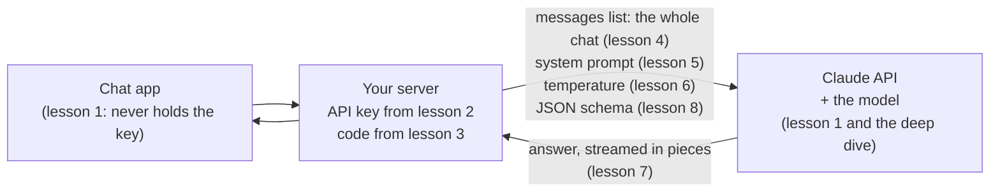

# Chapter 1 — Accessing Claude with the API

**Course:** [Building with the Claude API](https://academy.claude.com/courses/building-with-the-claude-api) &nbsp;·&nbsp; **Chapter 1:** Accessing Claude with the API (lessons 1–8) &nbsp;·&nbsp; **Completed:** November 15, 2026

| Previous | Course | Next |
|:---|:---:|---:|
| Start of course | [📚 Course index](../README.md) | [Chapter 2: Prompt evaluation →](../02-prompt-evaluation/README.md) |

---

**After this chapter, practise it:**

1. Read the lesson notes on this page, then take the chapter quiz.
2. Open **[capstone guide 1](../00_Capstone_Plan/guide/01-accessing-claude-with-the-api.md)** and solve its problems. Everything you need is on that one page: an optional warm-up with example notebooks, the problems, and the hidden step-by-step answers.
3. When you finish, mark guide 1 as done in the [capstone index](../00_Capstone_Plan/README.md#the-chapter-guides).

This page sums up the whole chapter for revision. Each lesson summary ends with a link to the full lesson notes. Where the course teaches a way that newer models reject, the summary gives the current way first.

**On this page**

| # | Section |
|:---:|:---|
| 1 | [Lessons in this chapter](#lessons-in-this-chapter) |
| 2 | [Lesson summaries](#lesson-summaries) |
| 3 | [Exam takeaways](#exam-takeaways) |
| 4 | [Quiz review](#quiz-review) |

---

## How the pieces fit together

This chapter follows one question, "What is quantum computing?", from a chat app to Claude and back. Each lesson adds one piece to that trip.



| Lesson | Which piece it adds |
|---|---|
| [1. Accessing the API](01-accessing-the-api.md) | The round trip, and what happens inside the model |
| [2. Getting an API key](02-getting-an-api-key.md) | The secret key your server sends |
| [3. Making a request](03-making-a-request.md) | The Python code that sends one question |
| [4. Multi-turn conversations](04-multi-turn-conversations.md) | Resending the whole chat, because the API forgets |
| [5. System prompts](05-system-prompts.md) | Standing instructions, such as "You are a patient math tutor" |
| [6. Temperature](06-temperature.md) | How predictable or varied the answers are |
| [7. Response streaming](07-response-streaming.md) | Showing the answer as it is written |
| [8. Structured data](08-structured-data.md) | Getting clean JSON in an exact shape |

## Lessons in this chapter

| # | Lesson | What it teaches | Notes |
|:---:|:---|:---|:---|
| 1 | Accessing the API | How a request travels from your app to the model and back | [01-accessing-the-api.md](01-accessing-the-api.md) |
| — | Deep dive: how does Claude know what to say next? (extra reading) | What happens inside the model, from tokens to the next word | [01-deep-dive-inside-the-model.md](01-deep-dive-inside-the-model.md) |
| 2 | Getting an API key | Creating a key in the Claude Console and keeping it safe | [02-getting-an-api-key.md](02-getting-an-api-key.md) |
| 3 | Making a request | Your first Python request with `client.messages.create()` | [03-making-a-request.md](03-making-a-request.md) |
| 4 | Multi-Turn conversations | Sending the whole chat history, because the API remembers nothing | [04-multi-turn-conversations.md](04-multi-turn-conversations.md) |
| 5 | System prompts | Telling the model how to behave for a whole conversation | [05-system-prompts.md](05-system-prompts.md) |
| 6 | Temperature | How predictable or varied the answers are | [06-temperature.md](06-temperature.md) |
| 7 | Response streaming | Showing the answer word by word as the model writes it | [07-response-streaming.md](07-response-streaming.md) |
| 8 | Structured data | Getting clean JSON that your code can read | [08-structured-data.md](08-structured-data.md) |
| — | Quiz on accessing Claude with the API | The chapter quiz, with the reasons for each answer | [Quiz review](#quiz-review) |

---

## Lesson summaries

### 1. Accessing the API

- **The round trip:** your app sends the user's question to your own server. Your server adds the secret API key and calls Anthropic at `api.anthropic.com`. The answer comes back the same way.
- **The API key lives only on your server.** Anything inside a web page or phone app can be read and copied.
- **Every request needs four things:** the API key, a `model` (such as `claude-haiku-4-5`), a `messages` list, and `max_tokens`.
- **Inside the model:** it cuts the text into tokens, looks up numbers for each token, adjusts them for the sentence, and writes the answer one token at a time.
- **The response** holds the answer, the token counts (`usage`), and why the model stopped (`stop_reason`): `end_turn` (finished), `max_tokens` (cut off), or `stop_sequence` (hit a stop text you listed).

[Full lesson →](01-accessing-the-api.md)

### Deep dive: how does Claude know what to say next?

- **The model** is a huge saved set of numbers plus fixed math. Training sets the numbers once. Using the model only reads them, so your chats don't change it.
- **Tokens and embeddings:** each token has a fixed ID and a saved row of numbers that describes what it usually means.
- **Attention:** each token borrows meaning from earlier tokens, so "bank" in "river bank" gets the riverside meaning.
- **Next token:** the model gives every token a chance, picks one, adds it, and repeats until it stops.
- **Model sizes:** Haiku is the fastest and cheapest, Sonnet is balanced, and Opus is the most capable. Test the smallest one first.

[Full lesson →](01-deep-dive-inside-the-model.md)

### 2. Getting an API key

- **Create the key** in the Claude Console at `platform.claude.com`: **Get API Key**, then **Create Key**, then choose a workspace and a name.
- **Copy it at once.** The full key is shown only once. If you lose it, delete it and create a new one.
- **Keep it out of your code.** Store it in the `ANTHROPIC_API_KEY` environment variable or a `.env` file that Git ignores.
- **A workspace** groups keys, people, and limits. Give a side project its own workspace and spend limit.
- **For production,** use a service account key or Workload Identity Federation, not a person's own key.

[Full lesson →](02-getting-an-api-key.md)

### 3. Making a request

- **Setup:** `%pip install "anthropic<1" python-dotenv`, put the key in `.env`, call `load_dotenv()`, then `client = Anthropic()`.
- **The call:** `client.messages.create(model=..., max_tokens=1000, messages=[{"role": "user", "content": "..."}])`.
- **`max_tokens` is a ceiling, not a target.** To get a short answer, ask for one in the message. A low limit just cuts the answer off.
- **Read the answer** from `message.content[0].text`, and check `message.stop_reason`.

[Full lesson →](03-making-a-request.md)

### 4. Multi-Turn conversations

- **The API is stateless:** it remembers nothing between requests.
- **The fix:** your code keeps a list of every user and assistant message, and sends the whole list with every request.
- **Helpers:** `add_user_message()`, `add_assistant_message()`, and `chat()`. `chat()` doesn't save the answer, so call `add_assistant_message()` yourself.
- **The cost grows each turn,** because the whole history is input tokens every time. Prompt caching and trimming old turns help.

[Full lesson →](04-multi-turn-conversations.md)

### 5. System prompts

- **A system prompt** is instructions you write once to set the model's role and rules, such as "You are a patient math tutor. Give hints, never the final answer."
- **Where it goes:** the separate `system` setting of `client.messages.create()`, not the `messages` list.
- **Use it** for rules that apply to the whole conversation. Use a user message for what the person asks right now.
- **Never put secrets in it.** A user can ask the model to repeat its instructions.

[Full lesson →](05-system-prompts.md)

### 6. Temperature

- **How the model picks words:** it gives every possible next token a chance, then picks one at random using those chances. That is why the same question can get different answers.
- **On current models, leave temperature out.** Claude Opus 4.7 and every newer Opus reject any temperature value, even 1.0. Sonnet 5, Sonnet 5.5, and Haiku 5.5 reject any value except the default. The newest API version, `2026-10-21`, rejects it on every model.
- **Get consistent answers on current models** with a precise prompt, example answers, structured outputs, and checks in your code.
- **The course's way (older models only):** `temperature` runs from 0.0 to 1.0. Use low values for facts and data extraction, and high values for brainstorming. Even 0.0 doesn't promise identical answers.

**Warning:** The course's `chat()` helper sends `temperature` on every request, so with that helper, every request to Claude Opus 4.7 or newer fails.

[Full lesson →](06-temperature.md)

### 7. Response streaming

- **The problem:** a full answer can take 10 to 30 seconds, and the user sees only a spinner.
- **Streaming** sends the answer in small pieces, called events, in one request, so text appears word by word. It costs the same, and the total time stays about the same.
- **The six events:** MessageStart, ContentBlockStart, ContentBlockDelta (the text), ContentBlockStop, MessageDelta (stop reason and token count), and MessageStop.
- **In Python:** `client.messages.stream()` with `text_stream` for the text, then `get_final_message()` for the full message to save.
- **How it travels:** the API uses Server-Sent Events over plain HTTP. Your server forwards each chunk to the browser and keeps the API key to itself.

[Full lesson →](07-response-streaming.md)

### 8. Structured data

- **The problem:** asked for JSON, the model wraps it in Markdown fences and adds an explanation.
- **The current way: structured outputs.** Send a JSON schema in `output_config.format`. The API returns plain JSON that always matches it. `client.messages.parse()` builds the schema from a Pydantic class.
- **Guaranteed:** valid JSON, every required field, and the right types. **Not guaranteed:** that the values are true. Check `stop_reason` for `"max_tokens"` or `"refusal"`.
- **Two JSONs, such as customer and order data:** put both in one object, `{"customer": {...}, "orders": [...]}`.
- **The course's way (older models only):** prefill ` ```json ` and stop on ` ``` `. Newer models reject the prefill with a 400 error.

[Full lesson →](08-structured-data.md)

---

## Exam takeaways

- **A mobile app keeps the API key in its code.** Move the key to your own server. The app calls your server, and only the server calls the Claude API. (Governance, Safety & Risk Management)
- **A production service stops working the day a developer leaves.** It used that developer's personal key. Use a service account key or Workload Identity Federation for production. (Governance, Safety & Risk Management)
- **A developer pushes an API key to a public GitHub repository.** Disable or delete the key at once, create a new one, and check usage for misuse. (Governance, Safety & Risk Management)
- **A team sets `max_tokens` to 50 for short answers, and sentences get cut off.** `max_tokens` is a hard cutoff. Ask for the length in the prompt instead. (Claude Models, Prompting & Context Engineering)
- **A chatbot "forgets" what the user said one message ago.** The app sends only the newest message. Send the full history with every request. (Claude Models, Prompting & Context Engineering)
- **The cost of long chats grows faster than the number of messages.** Every request resends the whole history. Use prompt caching and trim or summarize old turns. (Solution Design & Architecture)
- **A tutoring app gives full answers, and the team wants hints first.** Put the tutor role and rules in a system prompt, and test it on real questions. (Claude Models, Prompting & Context Engineering)
- **Requests that set temperature start failing after a move to a newer model.** Remove the setting. Get consistency from the prompt, examples, and output checks. (Integration)
- **Users wait 20 seconds staring at a spinner.** Turn on streaming and forward each chunk as it arrives. (Solution Design & Architecture)
- **A team must stream answers and also save each full answer and its token usage.** Stream with `client.messages.stream()`, then save `get_final_message()`. (Integration)
- **A web app's JSON includes Markdown fences and an explanation.** Use structured outputs with a JSON schema. (Integration)
- **Prefill code fails with a 400 error after a move to a newer model.** Remove the prefill and the stop sequence, and add `output_config.format` with a JSON schema. (Claude Models, Prompting & Context Engineering)

---

## Quiz review

The chapter quiz questions, restated in my own words, with the right answer and why each wrong option is wrong. Where the topic has changed since the course was made, the question appears twice: once for older models (the course's answer) and once for current models.


### Q1. Clean JSON on an older model (the course's version)

Your app runs on an older model, such as `claude-haiku-4-5`. It needs raw JSON with no Markdown fences and no explanation. How do you get it?

| Option | Right or wrong | Why |
|---|---|---|
| Prefill the assistant message with ` ```json ` and add ` ``` ` as a stop sequence | ✅ Right | The prefill makes the model start straight inside a JSON block. The stop sequence ends the answer when the model tries to close the block, so the explanation is never written. |
| Send the request several times and pick the best answer | ❌ Wrong | Every answer still has the fences and the explanation. It also costs several times as much. |
| Ask the model very nicely to return only JSON | ❌ Wrong | The instruction helps, but nothing enforces it. The model can still add fences or a sentence. |
| Use a very high temperature | ❌ Wrong | High temperature makes answers more varied, not cleaner. |

**Domain:** Integration. **My notes:** [Lesson 8, section 4](08-structured-data.md#4-the-courses-way-prefill-and-stop-sequences-older-models-only).

### Q2. Clean JSON on a current model

Your app runs on a current model, such as `claude-opus-5-5`. It needs raw JSON with no Markdown fences and no explanation. How do you get it?

| Option | Right or wrong | Why |
|---|---|---|
| Use structured outputs: send a JSON schema in `output_config.format` | ✅ Right | The API only lets the model write JSON that matches the schema. The answer is plain JSON, and every required field is there. |
| Prefill the assistant message with ` ```json ` and add ` ``` ` as a stop sequence | ❌ Wrong | Claude Opus 4.6, Sonnet 4.6, and every newer model reject a prefilled last assistant message with a 400 error. |
| Ask the model very nicely to return only JSON | ❌ Wrong | Nothing enforces it, so fences or a sentence can still appear. |
| Use a very high temperature | ❌ Wrong | It makes answers more varied, not cleaner. Current models also reject a temperature setting. |

**Domain:** Integration. **My notes:** [Lesson 8, section 2](08-structured-data.md#2-with-a-schema-structured-outputs).

### Q3. Consistent factual answers on an older model (the course's version)

Your factual question-and-answer app runs on an older model, such as `claude-haiku-4-5`. You want answers that are predictable and consistent. What temperature do you set?

| Option | Right or wrong | Why |
|---|---|---|
| Low, near 0.0 | ✅ Right | The model then almost always picks the most likely next word, so the same question gets nearly the same answer. Even at 0.0, identical answers are not promised. |
| Medium, around 0.5 | ❌ Wrong | Answers still vary noticeably. |
| Temperature doesn't matter for facts | ❌ Wrong | Temperature affects every answer, including factual ones. Higher values make less likely words, and so different wording or errors, more common. |
| High, near 1.0 | ❌ Wrong | This gives the most varied answers, the opposite of what you want. |

**Domain:** Claude Models, Prompting & Context Engineering. **My notes:** [Lesson 6](06-temperature.md).

### Q4. Consistent factual answers on a current model

Your factual question-and-answer app runs on a current model, such as `claude-opus-5-5`. You want answers that are predictable and consistent. What do you do?

| Option | Right or wrong | Why |
|---|---|---|
| Leave temperature out. Make answers consistent with a precise system prompt, example answers, and the facts supplied in the prompt. | ✅ Right | Current models don't accept a temperature setting, so the prompt is your control. Clear rules and supplied facts keep answers steady and correct. |
| Set temperature to 0.0 | ❌ Wrong | Claude Opus 4.7 and every newer Opus reject any temperature value with a 400 error. Some other current models, such as Sonnet 5.5, reject any value except the default. |
| Set temperature to 1.0 to be safe | ❌ Wrong | On Claude Opus 4.7 and newer Opus models, even the default value causes a 400 error. Leave the setting out. |
| Temperature doesn't matter for facts | ❌ Wrong | The reason to skip temperature here is that current models don't accept it, not that facts are unaffected. |

**Domain:** Claude Models, Prompting & Context Engineering. **My notes:** [Lesson 6](06-temperature.md).

### Q5. A math tutor that gives hints, not answers

You're building a math tutor bot. It should give students hints instead of the final answer. What do you use?

| Option | Right or wrong | Why |
|---|---|---|
| A system prompt that explains the tutor's role and rules | ✅ Right | The system prompt sets how the model behaves in every turn, for example: "You are a patient math tutor. Give hints, never the final answer." |
| A very low word limit | ❌ Wrong | A low `max_tokens` just cuts the answer off. The model may still give away the answer, only shorter. |
| Ask users to be more specific | ❌ Wrong | It puts the work on the students and doesn't change how the model behaves. |
| Write your messages in all capital letters | ❌ Wrong | Shouting isn't a reliable way to set behaviour. A clear system prompt is. |

**Domain:** Claude Models, Prompting & Context Engineering. **My notes:** [Lesson 5](05-system-prompts.md).

### Q6. The minimum a request to the Claude API must include

You want to send a request to the Claude API. What must every request include?

| Option | Right or wrong | Why |
|---|---|---|
| An API key, a model name, the messages, and `max_tokens` | ✅ Right | The API key proves who you are, the model name says which model answers, `messages` holds the conversation, and `max_tokens` caps the answer length. The API rejects a request without any of them. |
| Your name, email address, and message | ❌ Wrong | The API identifies you by your API key, not your name or email. The model and `max_tokens` are also missing. |
| Only the API key and your question | ❌ Wrong | Without a model name and `max_tokens`, the request fails. |
| Just your message text | ❌ Wrong | With no API key, the API returns an authentication error before it reads anything else. |

**Domain:** Integration. **My notes:** [Lesson 3](03-making-a-request.md).

### Q7. The model forgets the earlier question

You ask "What is pizza?" and get an answer. Then you ask "What toppings are popular?", and the model doesn't know what you mean. What is wrong?

| Option | Right or wrong | Why |
|---|---|---|
| The API doesn't remember earlier messages | ✅ Right | The Claude API keeps no conversation between requests. Your code must send the whole history every time: the first question, the first answer, then the new question. Otherwise "toppings" has nothing to refer to. |
| Your internet connection is slow | ❌ Wrong | A slow connection delays the answer. It doesn't change what the model knows. |
| You asked too quickly | ❌ Wrong | Timing doesn't matter. Each request stands alone, however long you wait. |
| The model is broken | ❌ Wrong | The model works fine. It simply never received the earlier messages. |

Not in the course: a newer beta feature, *message threads*, lets the API keep a conversation for a short time. By default, though, you still send the full history yourself.

**Domain:** Claude Models, Prompting & Context Engineering. **My notes:** [Lesson 4](04-multi-turn-conversations.md).

### Q8. Users wait 20 seconds, then all the text appears at once

Users of your chat app stare at a loading spinner for 20 seconds, then the whole answer appears at once. What fixes this?

| Option | Right or wrong | Why |
|---|---|---|
| Turn on response streaming | ✅ Right | The API then sends the answer in small pieces while the model writes it. Your server forwards each piece, so the first words appear within a second or two. The total time stays about the same. |
| Use a faster internet connection | ❌ Wrong | The wait comes from the model writing the answer, not from the network. |
| Ask shorter questions | ❌ Wrong | The length of the answer drives the wait, not the question. It also pushes the problem onto users. |
| Use a different web browser | ❌ Wrong | The browser isn't the cause. Without streaming, your server has nothing to show until the full answer is ready. |

**Domain:** Solution Design & Architecture. **My notes:** [Lesson 7](07-response-streaming.md).

### Q9. The first thing the model does with your text

When the model processes your text, what does it do first?

| Option | Right or wrong | Why |
|---|---|---|
| Breaks the text into small pieces called tokens | ✅ Right | The model works with numbers, not letters. So it first splits the text into tokens, such as "pizza" or " top" and "pings", and turns each token into a number. This step is called *tokenization*. |
| Translates the text into another language | ❌ Wrong | The model reads your language directly. There is no translation step. |
| Writes a response straight away | ❌ Wrong | It can't write anything until it has turned your text into tokens and processed them. |
| Checks whether the content is appropriate | ❌ Wrong | Safety checks exist, but they are not the first step of how the model reads text. Tokenization comes first. |

**Domain:** Claude Models, Prompting & Context Engineering. **My notes:** [Deep dive: how does Claude know what to say next?](01-deep-dive-inside-the-model.md).

### Q10. Where to keep the API key for a web app

You're building a web app that calls the Claude API. Where do you keep the API key?

| Option | Right or wrong | Why |
|---|---|---|
| On your server, where users can't reach it | ✅ Right | The browser sends requests to your server, and only your server calls the Claude API with the key. Users never see the key. |
| In the mobile app that users install | ❌ Wrong | Anyone can unpack an installed app and read the key out of it. |
| In a text file on the user's computer | ❌ Wrong | The user, or any program on that computer, can open the file and copy the key. |
| In the JavaScript code that users download | ❌ Wrong | Everything sent to a browser is public. Even shrunk or scrambled code still contains the key. |

A leaked key lets anyone run requests on your account and bill you for them. If a key leaks, delete it in the Console and create a new one.

**Domain:** Integration. **My notes:** [Lesson 1](01-accessing-the-api.md) and [Lesson 2](02-getting-an-api-key.md).

---

| Previous | Course | Next |
|:---|:---:|---:|
| Start of course | [📚 Course index](../README.md) | [Chapter 2: Prompt evaluation →](../02-prompt-evaluation/README.md) |
