# Lesson 1 — Accessing the API

**Course:** [Building with the Claude API](https://academy.claude.com/courses/building-with-the-claude-api) &nbsp;·&nbsp; **Chapter 1:** Accessing Claude with the API &nbsp;·&nbsp; **Completed:** November 1, 2026

| Previous | Course | Next |
|:---|:---:|---:|
| Start of course | [📚 Course index](README.md) | [Getting an API key →](02-getting-an-api-key.md) |

---

**On this page**

| # | Section |
|:---:|:---|
| 1 | [Revision summary](#revision-summary) |
| 2 | [The big picture](#the-big-picture) |
| 3 | [Who's who](#whos-who) |
| 4 | [1. The five steps of a request](#1-the-five-steps-of-a-request) |
| 5 | [2. Why your app needs a server](#2-why-your-app-needs-a-server) |
| 6 | [3. What a request contains](#3-what-a-request-contains) |
| 7 | [4. What happens inside the model](#4-what-happens-inside-the-model) |
| 8 | [5. When the model stops, and what comes back](#5-when-the-model-stops-and-what-comes-back) |
| 9 | [Architect notes](#architect-notes) |
| 10 | [Recap](#recap) |
| 11 | [My notes / practice](#my-notes--practice) |
| 12 | [FAQ](#faq) |

---

### Revision summary

#### In one sentence

When a person types a question such as "What is quantum computing?" into your chat app, the app sends it to your own server, your server adds a secret API key and sends it to Anthropic's servers, the model (Claude) writes an answer one word-piece at a time until it reaches a stopping point, and the answer travels back the same way to the person's screen.

#### The five steps of every request

Every message to Claude makes the same round trip, in five steps:

1. **Request to server:** your web or mobile app (the *client*) sends the user's text to your own server.
2. **Request to Anthropic API:** your server sends a request to Anthropic's servers, with your secret API key attached.
3. **Model processing:** the model reads the text and writes an answer.
4. **Response to server:** Anthropic's servers send the answer back to your server.
5. **Response to client:** your server passes the answer on to the app, which shows it to the user.

#### Why your app must go through a server

- The Claude API (the service at `api.anthropic.com` that your code sends requests to) needs a secret **API key** with every request. The key proves the request comes from your account, and your account pays for it.
- Code that runs in a browser or a phone app can be read by anyone who has the app. If the key is in that code, someone can copy it and run up charges on your account.
- So the key lives only on your server. The app talks to your server, and only your server talks to Anthropic.

#### What every request must contain

Your server can call the API through an official **SDK** (a ready-made code library) or with plain HTTP requests. Official SDKs exist for Python, TypeScript and JavaScript, Java, Go, Ruby, C#, and PHP. Every request needs four things:

| Field | What it is | Example |
|---|---|---|
| API key | Proves who is asking. Sent in the `Authorization: Bearer` header, or the older `x-api-key` header, which still works. | `sk-ant-...` |
| `model` | Which Claude model should answer. | `claude-haiku-4-5` |
| `messages` | The conversation so far, as a list. The user's text sits in a message with the role `user`. | `[{"role": "user", "content": "What is quantum computing?"}]` |
| `max_tokens` | The most tokens the model may write in its answer. It is a hard limit. | `1000` |

#### What happens inside the model

The model can only work with numbers. It uses three fixed things that were built in advance, during training, and then runs four stages on every request.

The three things built in advance never change while you use the model:

- **Vocabulary:** a list of every token the model knows. Each token has its own fixed number, called its **token ID**. For example, the token `bank` might have token ID 5120.
- **Embedding table:** a table with one row of numbers for each token ID, where each row describes what that token means. It is not a database that the model searches. The model goes straight to the row with the token ID it needs, so the token `bank` (token ID 5120) gets the same row in every request.
- **Weights:** all the other numbers the model learned in training, used in stages 3 and 4.

The four stages run every time you send a request:

1. **Cutting the text into pieces (Tokenization):** the model chops your text into small pieces called **tokens**, then looks up each token in the vocabulary and swaps it for its token ID. A token can be a word, part of a word, or a symbol such as "?".
2. **Turning each piece into numbers (Embedding):** for each token ID from stage 1, the model goes to the row of the embedding table with that token ID and copies out its numbers. For example, for `bank` it copies the row for token ID 5120. That row of numbers is the token's **embedding**. Every row gives a number for the same traits (kinds of meaning), so the model can compare them: similar words such as "cat" and "kitten" have similar rows. A word with several meanings, such as "bank" or "quantum," has a row that mixes all of them.
3. **Checking the neighbours (Contextualization):** each token looks back at all the tokens before it and adjusts its numbers to fit this sentence. In "river bank," "bank" takes the riverside meaning. In "quantum computing," "computing" looks back at "quantum," so the pair means the technology. The embedding table itself does not change.
4. **Writing the answer one piece at a time (Generation):** the model works out a chance for every token in its vocabulary, picks a likely one, and adds it to the answer. The new token goes through stages 2 and 3, and the model picks the next one, until a stop check says stop. It doesn't always pick the single most likely token, so the same question can get slightly different answers.

#### How the model decides to stop

After each new token, the model checks three things. It stops if any one of them is true:

- It has written `max_tokens` tokens. The answer is cut off, even mid-sentence.
- It has written a special **end-of-sequence token**, which means "my answer is complete."
- It has written one of your **stop sequences**, which are phrases you listed in the request that mean "stop here."

#### What the API sends back

The response has three main parts:

- **The message:** the answer text, with the role `assistant`.
- **Usage:** how many input tokens (your request) and output tokens (the answer) were used. You pay for both.
- **Stop reason:** why the model stopped: `end_turn` (finished naturally), `max_tokens` (hit your limit), or `stop_sequence` (hit one of your stop phrases).

#### When to use an SDK or plain HTTP

- **Use an official SDK** when your server is written in a language that has one. For example, a Python server uses the `anthropic` package. The SDK adds the headers, retries failed requests, and gives you typed results.
- **Use plain HTTP** (for example, `curl`) when your language has no official SDK, or for a quick test from the terminal.

#### When to act on each stop reason

- **Use the answer as it is** when the stop reason is `end_turn`.
- **Treat the answer as incomplete** when the stop reason is `max_tokens`. Raise `max_tokens`, or ask for a shorter answer. Don't show a cut-off answer as if it were complete.
- **Expect the answer to end early on purpose** when the stop reason is `stop_sequence`, because one of your stop phrases appeared.

#### Exam takeaways

- **A mobile team wants the app to call the Claude API directly to save one network hop.** Refuse: an API key in app code can be extracted. Route requests through your own server, which keeps the key in a secrets store and adds user login and rate limits. The only exception is an iOS or macOS app using App Attest, which gets short-lived tokens instead of a key. (Governance, Safety & Risk Management)
- **Users report answers that stop mid-sentence.** Check the response's `stop_reason`. If it says `max_tokens`, raise the limit or ask for shorter answers, and make the app detect cut-off answers instead of showing them as complete. (Integration)
- **Finance asks how to estimate and track cost per conversation.** Log the `usage` field from every response, then multiply input and output tokens by the model's prices. Output tokens cost more than input tokens, so long answers drive cost. (Solution Design & Architecture)

---

### The big picture

| Part | In plain words | Everyday comparison |
|---|---|---|
| The round trip | The question goes app → your server → Anthropic → back. | Ordering at a restaurant: you tell the waiter, the waiter tells the kitchen. |
| The server and the key | Only your server holds the secret key. | Only the waiter has the key to the kitchen door. Customers don't get a copy. |
| The request | Key, model, messages, and a length limit. | The order slip: table number, which chef, the dish, the portion size. |
| Inside the model | Split, turn into numbers, fix meaning by context, then write word by word. | The chef reads the order, works out what you meant, and plates one item at a time. |
| The response | Answer, token counts, and why it stopped. | The plate, plus the bill, plus a note: "finished" or "ran out." |

**The running example:** a user types **"What is quantum computing?"** into your chat app and presses Send. We follow that one question all the way through.

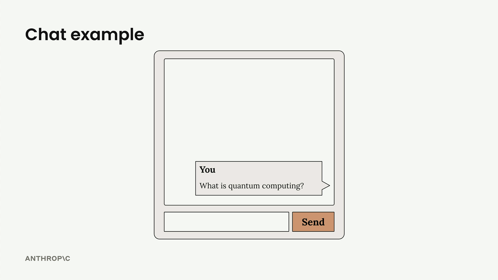

---

### Who's who

| Player | Where it lives | What it does in the example |
|---|---|---|
| **The user** | In front of a phone or browser | Types "What is quantum computing?" and presses Send. |
| **Your app** (the *client*) | On the user's phone or in their browser | Sends the question to your server, then shows the answer. Holds **no** API key. |
| **Your server** | A computer you run, such as a cloud server | Receives the question, adds the API key, calls Anthropic, and passes the answer back. |
| **The Anthropic SDK** | A code library installed on your server | Builds the request and reads the response for your server code. |
| **The Claude API** | Anthropic's servers at `api.anthropic.com` | Checks the key, hands the request to the model, and returns the result. |
| **The model** (Claude) | On Anthropic's servers | Reads the question and writes the answer. |

---

### 1. The five steps of a request

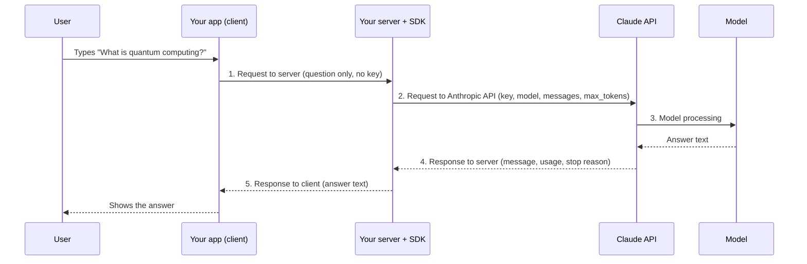

Things to notice:

- The API key appears only on the line from your server to the Claude API. The app never sees it.
- Your server is in the middle of both directions, so it is the right place to log usage, check errors, and decide what the app should show.

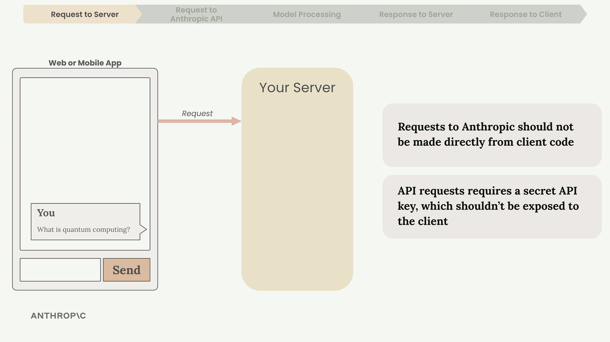

---

### 2. Why your app needs a server

An **API key** is a long secret string, such as `sk-ant-api03-...`, that you create in the Claude Console (Anthropic's website for developers, covered in [lesson 2](02-getting-an-api-key.md)). Anthropic uses it to know which account sends each request and which account to bill.

Here is what goes wrong if you put the key in your app:

1. You ship a web page whose JavaScript includes the key.
2. Anyone opens the browser's developer tools and reads the key in plain text. For a phone app, they unpack the app file and search for `sk-ant`.
3. They use your key for their own projects. You pay for every request, and they may hit your rate limits so your real users get errors.

> **Warning:** Anything shipped inside a browser page or a phone app is public, even if the code is minified or hidden. A key in client code is a leaked key.

> **Remember this:** The app talks to your server. Only your server talks to Anthropic.

---

### 3. What a request contains

Your server receives the text "What is quantum computing?". It puts that text inside a message with the role `user`, and puts that message inside a list called `messages`. The list exists because later requests carry the whole conversation ([lesson 4](04-multi-turn-conversations.md)).

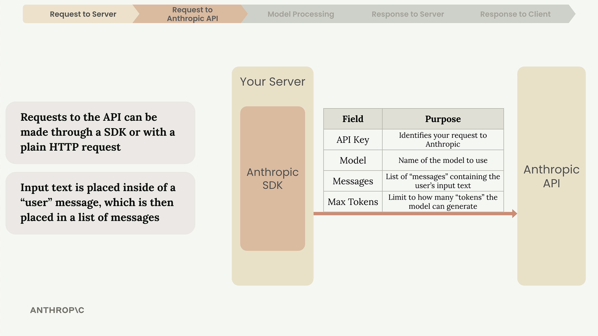

#### With the Python SDK

```python
# server.py — runs on your server, never in the app
import anthropic

client = anthropic.Anthropic()          # reads the key from ANTHROPIC_API_KEY

def ask_claude(question):
    response = client.messages.create(
        model="claude-haiku-4-5",
        max_tokens=1000,
        messages=[{"role": "user", "content": question}],
    )
    return response.content[0].text
```

What each line does:

- `import anthropic` loads the official Python SDK. You install it once with `pip install anthropic`.
- `anthropic.Anthropic()` creates a **client**, an object that sends requests for you. With no arguments, it reads the key from the **environment variable** `ANTHROPIC_API_KEY`. An environment variable is a named setting stored on the server, outside your code, so the key never appears in your source files.
- `client.messages.create(...)` sends one request to the Messages API, the part of the Claude API that handles conversations.
- `model`, `max_tokens`, and `messages` are three of the four required fields. The SDK adds the fourth, the key, for you.
- `response.content[0].text` reads the answer text. `content` is a list of blocks; for a plain question, the first block is the text answer.

#### The same request as plain HTTP

```bash
curl https://api.anthropic.com/v1/messages \
  -H "x-api-key: $ANTHROPIC_API_KEY" \
  -H "anthropic-version: 2026-10-21" \
  -H "content-type: application/json" \
  -d '{
    "model": "claude-haiku-4-5",
    "max_tokens": 1000,
    "messages": [{"role": "user", "content": "What is quantum computing?"}]
  }'
```

Not in the course, from the official Claude API documentation: a plain HTTP request also needs the `anthropic-version` header, which names the version of the API you expect. The SDK sends it for you. The course lists SDKs for Python, TypeScript, JavaScript, Go, and Ruby; the official list also includes Java, C#, and PHP, and JavaScript uses the TypeScript SDK.

---

### 4. What happens inside the model

A computer can't understand words. It can only do math on numbers. So the model turns "What is quantum computing?" into numbers, works out what the question means, and then writes an answer.

To follow how, you need two things: what the model already has **before** you send anything, and the four stages it runs **every time** you send a request.

#### What the model already has before your request

The model is made in a long process called **training**, in which it reads huge amounts of text from books and websites. Training happens once, long before you use the model. It leaves behind three fixed things, saved inside the model on Anthropic's servers:

| Built in advance | What it is | Used in stage |
|---|---|:---:|
| **Vocabulary** | A list of every token the model knows. Each token has its own fixed number, called its **token ID**. For example, the token `bank` might have token ID 5120. The vocabulary is made from a large sample of text just before training starts. | 1 |
| **Embedding table** | A big table with one row for each token ID. Each row is a list of numbers that describes what that token means. The model learns these numbers during training. | 2 |
| **Weights** | All the other numbers the model learns during training. They hold what it knows about how words affect each other and which word tends to come next. | 3 and 4 |

The embedding table is not a database that the model searches. Nothing is searched, and nothing is looked up on the internet. The model goes straight to the row with the token ID it needs, the way you turn straight to a page number in a book. The table also never changes while you use the model: the token `bank` (token ID 5120) gets the exact same row in every request, from every user. Only a new round of training can change it.

#### 1. Cutting the text into pieces (Tokenization)

The model can't read a whole sentence at once, so it chops it into small pieces called **tokens**. Then it looks up each token in the vocabulary and swaps the token for its token ID. From here on, the model works with token IDs, not with letters.

"What is quantum computing?" becomes five tokens and five token IDs. The token IDs here are made up:

| Token | `What` | `is` | `quantum` | `computing` | `?` |
|---|:---:|:---:|:---:|:---:|:---:|
| Token ID | 2061 | 374 | 4211 | 9876 | 30 |

The course treats each word as one token to keep it simple. In reality, a long or rare word is often chopped into several tokens.

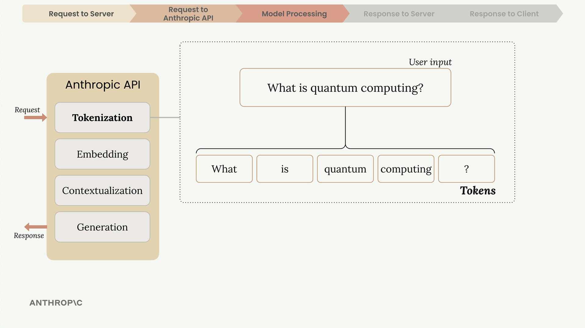

#### 2. Turning each piece into numbers (Embedding)

Each row of the embedding table is labelled with a token ID. For each token ID from stage 1, the model goes to the row with that token ID and copies out the list of numbers stored there. For example, for the token `quantum` (token ID 4211), it copies row 4211. That list of numbers is the token's **embedding**. It describes what the token means.

Every row has the same columns. Each column stands for one **trait**, meaning one kind of meaning, such as "has to do with money." So every token gets a number for the same traits, and the model can compare any two tokens number by number.

Here is a made-up, simplified embedding table with five rows and three traits. Each number runs from 0 (not related) to 1 (strongly related).

| Token ID | Token | Money | Water | Animals |
|---|---|:---:|:---:|:---:|
| 1042 | cash | 0.9 | 0.0 | 0.0 |
| 3891 | river | 0.0 | 0.9 | 0.1 |
| 2207 | cat | 0.0 | 0.0 | 0.9 |
| 6634 | kitten | 0.0 | 0.0 | 0.9 |
| 5120 | **bank** | **0.5** | **0.5** | **0.0** |

How to read the table:

- **Similar words have similar rows.** "Cat" and "kitten" have the same numbers, so the model treats them as close in meaning. "Cash" and "cat" share no high number, so they are far apart.
- **A word with two meanings has a row that mixes them.** "Bank" has 0.5 for money and 0.5 for water. Its row is the same in every sentence, so it can't yet say which bank you mean.

A real embedding table works the same way, with two differences:

1. **It has thousands of columns, not three.** Each row is a list such as `[-0.34, 0.87, 0.12, …]` with thousands of numbers.
2. **Nobody names the columns.** No person wrote "Money" or "Water" at the top. The model set all the numbers itself during training, by noticing which words appear in similar sentences. Words used in similar ways end up with similar rows.

"Quantum" is like "bank." Its row mixes several meanings: something in physics, something very small, and a kind of computing.

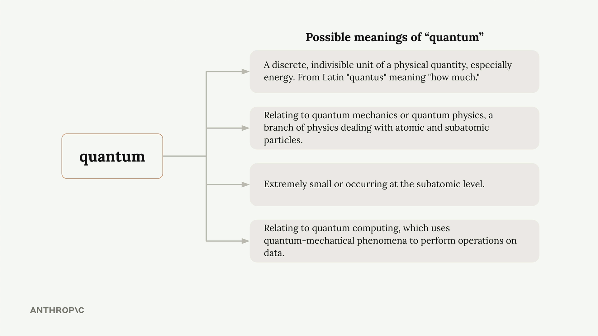

#### 3. Checking the neighbours (Contextualization)

The rows from stage 2 are the same in every sentence, so they can't tell a money "bank" from a river "bank." This stage fixes that. Each token looks at the other tokens in your text and adjusts its own numbers to fit the sentence. Here are the made-up "bank" numbers again:

| Sentence | Money | Water |
|---|:---:|:---:|
| "bank" on its own (the row from the table) | 0.5 | 0.5 |
| "I sat on the river **bank**" | 0.1 | 0.9 |
| "I paid money into the **bank**" | 0.9 | 0.1 |

These adjusted numbers are new copies made only for your sentence. The embedding table itself does not change.

Not in the course, from how models like Claude work: a token looks at **all** the tokens before it, not only the one next to it. It can't look at tokens that come after it, because the model reads and writes from left to right. So in "What is quantum computing?", it is "computing" that looks back, sees "quantum", and takes on the technology meaning of the pair. The course says it the other way round ("quantum" sees "computing"), but the result is the same: the model now knows you mean quantum computing. The model also repeats this checking many times in a row (each round is called a *layer*), and each round makes the meaning sharper.

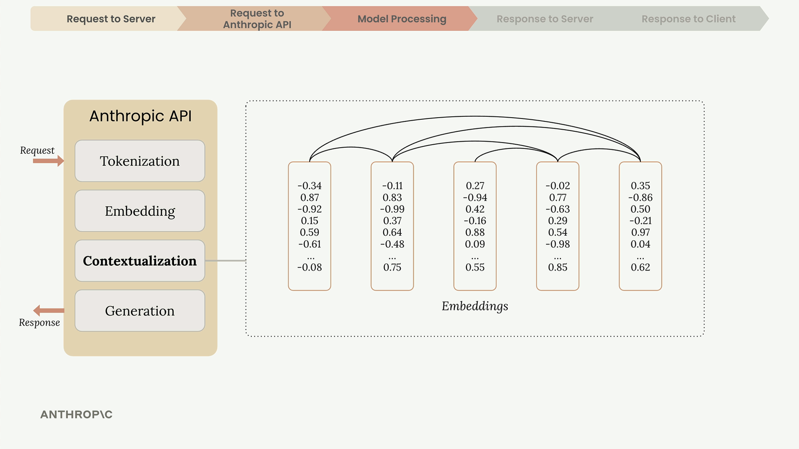

#### 4. Writing the answer one piece at a time (Generation)

Now the model knows what you asked. It writes the answer one token at a time, like the word suggestions on your phone keyboard. The course says "one word at a time" to keep it simple.

For each new token, it asks: "Which token most likely comes next?" It works out a chance for every token in its vocabulary. For the first token of the answer:

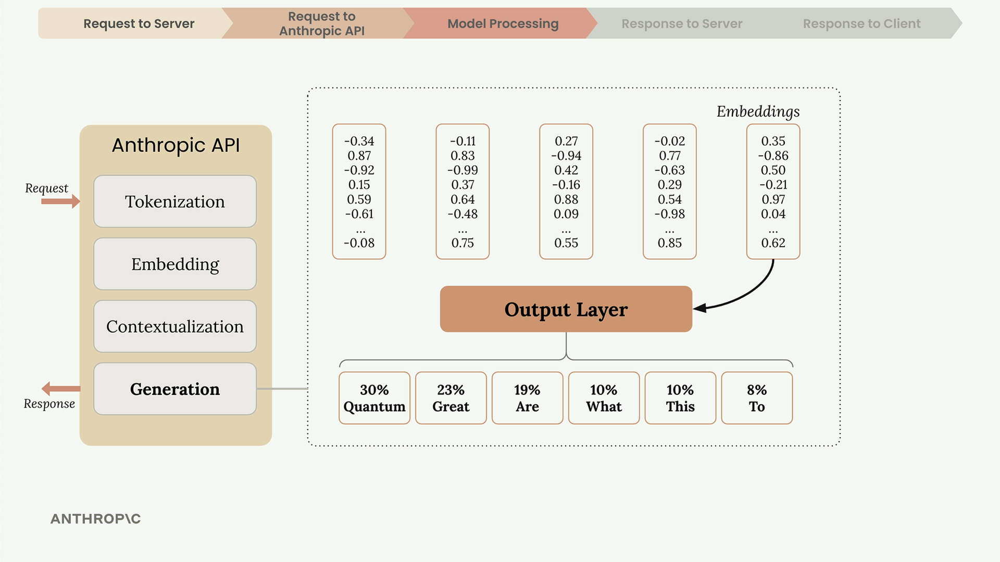

It usually picks a likely token, but not always the most likely one. Here "Quantum" is picked most often, but sometimes "Great" is picked instead. That is why the same question can get slightly different answers. A setting called *temperature* controls how often it picks a less likely token ([lesson 6](06-temperature.md)).

The picked token is added to the text. It then goes through stages 2 and 3 like every other token: the model copies the row for its token ID from the embedding table and looks back at everything before it, including your question. Then the model asks the same question again for the next token:

| Round | Text written so far | Token the model picks next |
|:---:|---|---|
| 1 | *(nothing yet)* | Quantum |
| 2 | Quantum | computing |
| 3 | Quantum computing | is |
| 4 | Quantum computing is | a |
| … | … | … until a stop check says "stop" (section 5) |

> **Remember this:** The vocabulary and the embedding table are built in advance and never change. On every request, the model cuts your text into pieces, swaps each piece for its row of numbers, adjusts the numbers using the words before it, and writes one piece at a time.

---

### 5. When the model stops, and what comes back

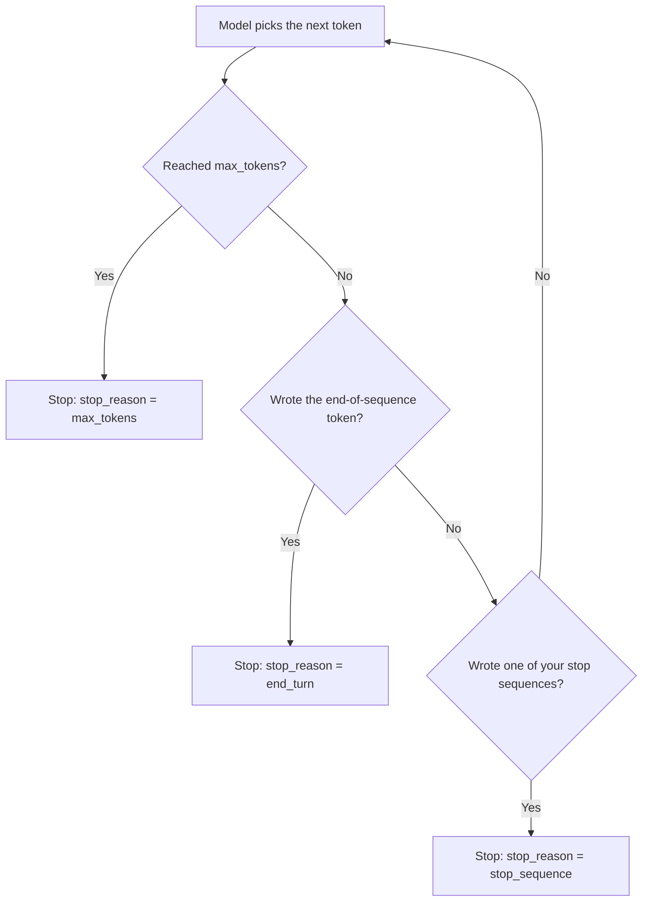

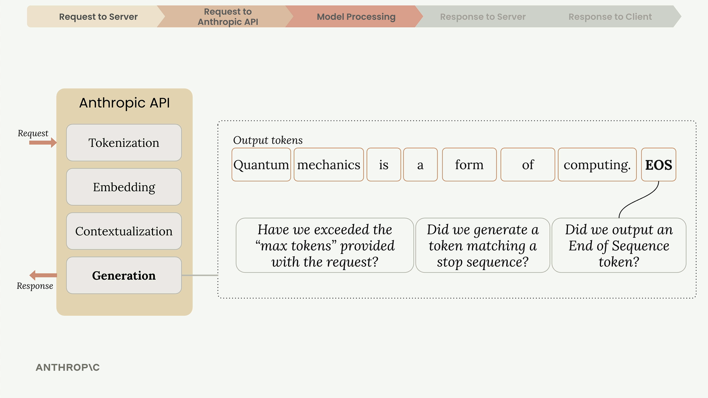

#### The response your server receives

```json
{
  "id": "msg_01AbC...",
  "type": "message",
  "role": "assistant",
  "model": "claude-haiku-4-5",
  "content": [
    { "type": "text", "text": "Quantum computing is a way of processing information that uses..." }
  ],
  "stop_reason": "end_turn",
  "stop_sequence": null,
  "usage": { "input_tokens": 13, "output_tokens": 212 }
}
```

- `content` holds the answer, in a message with the role `assistant` (the model's side of the conversation).
- `stop_reason` says why it stopped. Here, `end_turn` means the answer is complete.
- `usage` shows the token counts. The numbers above are examples; you are billed for both.

Your server takes the text from `content` and sends it to the app, which shows it under the user's question.

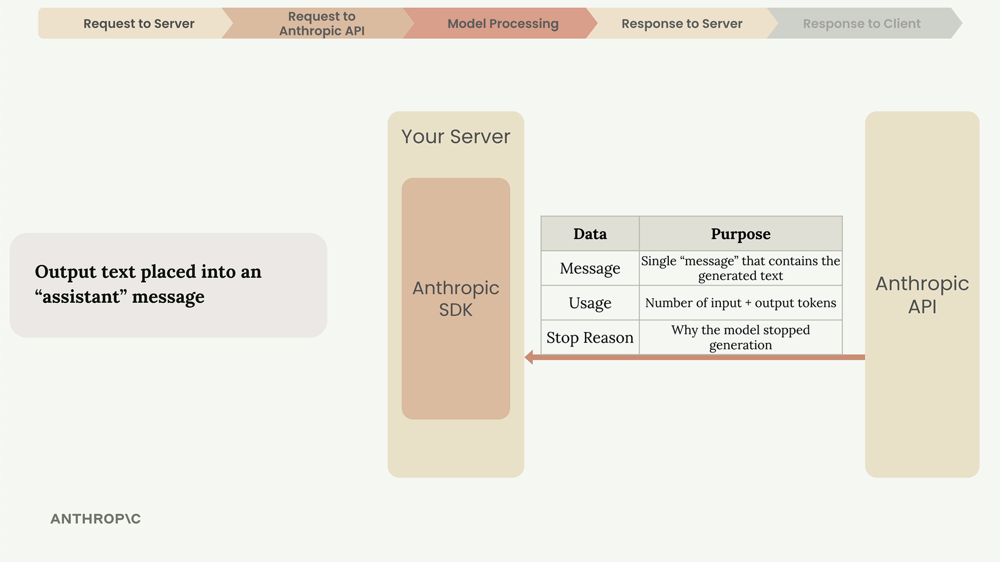

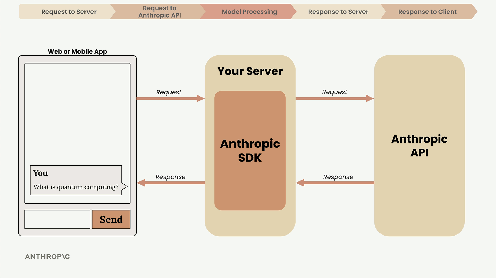

#### Common mix-ups

| ❌ Wrong idea | ✅ What really happens |
|---|---|
| "My app can call the API directly if I hide the key well." | Any key in client code can be found. Only your server holds it. |
| "`max_tokens` makes the model write a shorter answer." | The model doesn't plan around it. It writes until it hits the limit and is cut off. |
| "One word is always one token." | That is the course's simplification. Long or rare words are often split into several tokens. |
| "The same question always gets the same answer." | Generation includes controlled randomness, so answers can differ. |
| "The model searches a database to find what each word means." | The embedding table is a fixed table inside the model, built during training. The model goes straight to the row with each token's token ID. Nothing is searched, and nothing changes during your request. |
| "I only pay for the answer." | You pay for input tokens (your request) and output tokens (the answer). |

#### Test yourself

<details>
<summary>1. Which player holds the API key: the app, your server, or the model?</summary>

Your server. The app holds no key, and the model is on Anthropic's side.
</details>

<details>
<summary>2. What four things must every request include?</summary>

The API key, the `model`, the `messages` list, and `max_tokens`.
</details>

<details>
<summary>3. In "What is quantum computing?", how does the model know "quantum" is about computers and not physics?</summary>

In the contextualization stage. "Computing" looks back at "quantum", and the numbers for the pair shift toward the technology meaning, the same way "bank" takes the riverside meaning in "river bank." The row for "quantum" in the embedding table stays the same.
</details>

<details>
<summary>4. A response has <code>stop_reason: "max_tokens"</code>. What does that tell you?</summary>

The answer was cut off because it hit your length limit. It may be incomplete.
</details>

---

### Architect notes

#### Security

- Keep the key in an environment variable or a secrets store (such as AWS Secrets Manager), never in source code or Git. A key pushed to a public repository can be found by scanners within minutes.
- Your server endpoint is now a door to your Anthropic account. Require users to log in, and limit how many requests each user can make, or strangers can use your server as a free Claude proxy.
- Use a separate key for each app and environment (development, production). Then you can revoke one leaked key without breaking everything else.
- One exception to "always use a server": **App Attest** lets a genuine, registered iOS or macOS app call the API directly with a short-lived token instead of a key ([lesson 2](02-getting-an-api-key.md)). Every other client app still needs a server.

#### Cost

- You pay per token, and output tokens cost more than input tokens. For Claude Haiku 4.5, input is $1 and output is $5 per million tokens. Prices change, so check the current pricing page.
- Log `usage.input_tokens` and `usage.output_tokens` from every response. That is the only exact record of what each request cost.
- To estimate cost before sending, the API has a token-counting endpoint (`POST /v1/messages/count_tokens`) that returns the input token count without running the model.

#### Limits and reliability

- `max_tokens` is a backstop, not a style setting. The model is not told the limit, so a low value cuts answers off instead of shortening them. Ask for brevity in the prompt instead.
- Every model has a **context window**, which is the most tokens it can read and write in one request. For example, it is 200,000 tokens for Claude Haiku 4.5 and 1 million for the newest models.
- Common errors are 401 (bad or missing key), 429 (too many requests, a *rate limit*), 500 (Anthropic-side error), and 529 (Anthropic is overloaded). The SDKs retry 429 and 5xx errors twice by default, and wait up to 10 minutes per request. For long answers, use *streaming* ([lesson 7](07-response-streaming.md)) so the user sees text as it is written.

#### Design trade-offs

- Model names change. The course uses `claude-haiku-4-5`; newer models such as `claude-haiku-5-5` exist. Keep the model name in a setting, not hard-coded in many places, so upgrading is a one-line change.
- Because answers vary, don't build code that expects the exact same text twice. Check answers with tests on many inputs (evaluations, from [lesson 9](09-prompt-evaluation.md)).

---

### Recap

- Every request makes a five-step round trip: app → your server → Claude API → model → back.
- The API key lives only on your server, because client code is public.
- A request needs a key, a model, a messages list, and `max_tokens`.
- The vocabulary and the embedding table are built during training and never change. On each request, the model cuts the text into tokens, copies each token's row of numbers, adjusts the numbers using the words before it, then writes the answer one token at a time.
- It stops at `max_tokens`, at its natural end (`end_turn`), or at a stop sequence.
- The response gives the answer, token usage, and the stop reason.

---

## My notes / practice

- [ ] Draw the five-step round trip from memory, and mark where the API key lives.
- [ ] After [lesson 2](02-getting-an-api-key.md), send the `curl` request above with your own key, and read the `usage` and `stop_reason` fields.
- [ ] Send the same request with `max_tokens` set to `20`, and check that `stop_reason` becomes `max_tokens`.
- [ ] Ask the same question three times, and compare the answers.

---

## FAQ

**Q1. What does "API" mean here?**
An API is a way for one program to ask another program to do something. Here, your server sends a request to Anthropic's servers at `api.anthropic.com`, and they send back the model's answer.

**Q2. Why can't my web or mobile app call the Claude API directly?**
Every request needs your secret API key, and anything inside an app can be read by its users. Your app sends the question to your own server, which holds the key and calls Anthropic.

**Q3. What is an SDK, and do I have to use one?**
An SDK is a ready-made code library that builds requests and reads responses for you, such as the `anthropic` package for Python. You don't have to use one; plain HTTP works too, but the SDK adds headers and retries for you.

**Q4. Which four things must every request include?**
The API key, the `model` name, the `messages` list with the user's text, and `max_tokens`, which caps how long the answer can be.

**Q5. What does "token" mean?**
A token is a small piece of text the model reads and writes, such as a word, part of a word, a space, or a symbol. You are billed by tokens, and limits are measured in tokens.

**Q6. What does "embedding" mean?**
An embedding is the list of numbers that describes what a token means. The model copies it from a fixed table built during training, going straight to the row labelled with the token's token ID (its fixed number in the vocabulary); it does not search a database. Similar words such as "cat" and "kitten" have similar rows, and a word with two meanings, such as "bank," has a row that mixes them: half money, half water.

**Q7. What does "contextualization" mean?**
It is the stage where each token looks back at the tokens before it and adjusts its numbers to fit the sentence. In "river bank," "bank" shifts to the riverside meaning, and in "quantum computing," the pair takes on the technology meaning.

**Q8. How does the model choose the words of its answer?**
One token at a time (the course says "one word" to keep it simple). For each token, it asks "which token most likely comes next?", picks a likely one, adds it to the answer, and asks again. It doesn't always pick the single most likely token, so the same question can get slightly different answers.

**Q9. What does "max_tokens" do?**
It sets the most tokens the model may write in its answer. The model doesn't plan around the limit; if it reaches it, the answer is cut off and the stop reason is `max_tokens`.

**Q10. How does the model decide to stop writing?**
After each token it checks three things: whether it has reached `max_tokens`, whether it wrote its end-of-sequence token (a natural ending), and whether it wrote one of your stop sequences. The response's `stop_reason` tells you which one happened.

**Q11. (Exam angle) A security team asks why the mobile app can't call the Claude API directly to save time. How do you answer?**
A key inside the app can be extracted and misused, and you pay for every request made with it. Route all calls through your server, store the key in a secrets store, and add user login and per-user rate limits on that server. The one exception is an iOS or macOS app using App Attest, which gets short-lived tokens instead of a key. (Governance, Safety & Risk Management)

**Q12. (Exam angle) Users say some answers stop mid-sentence. How do you find and fix the cause?**
Check the `stop_reason` of those responses. If it is `max_tokens`, the answer hit your length cap: raise `max_tokens` or ask for shorter answers in the prompt, and make the app treat cut-off answers as incomplete. (Integration)

**Q13. (Exam angle) Finance asks how to estimate and track what each conversation costs. What do you set up?**
Log the `usage` field (input and output tokens) from every response, and multiply each by the model's price per token. Output tokens cost more than input tokens, so limit long answers where you can, and use the token-counting endpoint to estimate before sending. (Solution Design & Architecture)

---

| Previous | Course | Next |
|:---|:---:|---:|
| Start of course | [📚 Course index](README.md) | [Getting an API key →](02-getting-an-api-key.md) |
