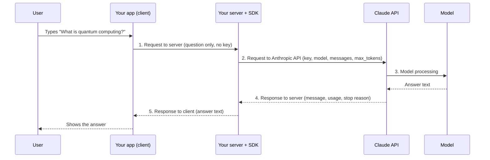
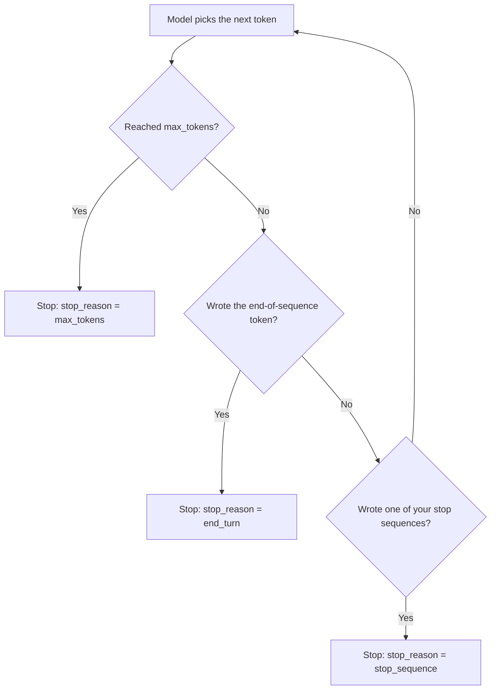

# Lesson 1 — Accessing the API

**Course:** [Building with the Claude API](https://academy.claude.com/courses/building-with-the-claude-api) &nbsp;·&nbsp; **Chapter 1:** Accessing Claude with the API &nbsp;·&nbsp; **Completed:** November 1, 2026

| Previous | Course | Next |
|:---|:---:|---:|
| Start of course | [📚 Course index](README.md) | [Getting an API key →](02-getting-an-api-key.md) |

---

**On this page**

| # | Section |
|:---:|:---|
| 1 | [Revision summary](#revision-summary) |
| 2 | [The big picture](#the-big-picture) |
| 3 | [Who's who](#whos-who) |
| 4 | [1. The five steps of a request](#1-the-five-steps-of-a-request) |
| 5 | [2. Why your app needs a server](#2-why-your-app-needs-a-server) |
| 6 | [3. What a request contains](#3-what-a-request-contains) |
| 7 | [4. What happens inside the model](#4-what-happens-inside-the-model) |
| 8 | [5. When the model stops, and what comes back](#5-when-the-model-stops-and-what-comes-back) |
| 9 | [Architect notes](#architect-notes) |
| 10 | [Recap](#recap) |
| 11 | [My notes / practice](#my-notes--practice) |
| 12 | [FAQ](#faq) |

---

### Revision summary

#### In one sentence

When a person types a question such as "What is quantum computing?" into your chat app, the app sends the question to your own server, your server adds your secret API key and sends it on to Anthropic's servers, the model there writes an answer one small piece of text (a *token*) at a time until it decides to stop, and the answer travels back the same way to the person's screen.

#### The five steps of every request

Every message to Claude makes the same round trip, in five steps:

1. **Request to server:** your web or mobile app (the *client*) sends the user's text to your own server.
2. **Request to Anthropic API:** your server sends the text to Anthropic's servers, with your secret API key attached.
3. **Model processing:** the model reads the text and writes an answer.
4. **Response to server:** Anthropic's servers send the answer back to your server.
5. **Response to client:** your server passes the answer to the app, and the app shows it to the user.

#### Why your app must go through a server

- The Claude API is the service at `api.anthropic.com` that your code sends requests to. It needs a secret **API key** with every request. The key proves the request comes from your account, and your account pays for it.
- Anyone who has your app can read the code inside it, whether it is a web page or a phone app. If the key is in that code, someone can copy it and run up charges on your account.
- So the key lives only on your server. The app talks to your server, and only your server talks to Anthropic.

#### What every request must contain

Your server can call the API through an official **SDK** (a ready-made code library) or with plain HTTP requests. Official SDKs exist for Python, TypeScript and JavaScript, Java, Go, Ruby, C#, and PHP. Every request needs four things:

| Field | What it is | Example |
|---|---|---|
| API key | Proves who is asking. It goes in the `Authorization: Bearer` header, or in the older `x-api-key` header, which still works. | `sk-ant-...` |
| `model` | Which Claude model should answer. | `claude-haiku-4-5` |
| `messages` | The conversation so far, as a list. The user's text sits in a message with the role `user`. | `[{"role": "user", "content": "What is quantum computing?"}]` |
| `max_tokens` | The most tokens the model may write in its answer. It is a hard limit. | `1000` |

#### What happens inside the model

The model can only do math on numbers. Long before your request, a process called **training** built three things and saved them inside the model. Your request never changes them:

- **Vocabulary:** the list of every token the model knows. A **token** is a small piece of text, such as a word, part of a word, or a symbol such as "?". Each token has a fixed number called its **token ID**. For example, the token `bank` might have token ID 5120.
- **Embedding table:** a table with one saved row of numbers for each token ID. Each row describes the usual meaning of its token.
- **Weights:** all the other numbers the model learned in training. Stages 3 and 4 below use them.

On every request, the model runs four stages:

1. **Cutting the text into pieces (Tokenization):** the model cuts your text into tokens. Then it looks up each token in the vocabulary and replaces it with its token ID.
2. **Turning each piece into numbers (Embedding):** the embedding table was built during training and saved in the model. The model simply uses each token ID to look up that token's pre-saved row of trait numbers. That row of numbers is the token's **embedding**. The model goes straight to the row, without searching, so the token `bank` gets the same row in every sentence.
3. **Checking the neighbours (Contextualization):** each token looks at the tokens before it and adjusts a copy of its numbers to fit your sentence. In "river bank," the numbers for "bank" move to the riverside meaning. The saved row in the embedding table stays the same.
4. **Writing the answer one piece at a time (Generation):** the model works out, for every token in its vocabulary, the chance that it comes next. It picks a likely token and adds it to the answer. The new token then goes through stages 2 and 3, and the model picks the next one, until it decides to stop. It doesn't always pick the single most likely token, so the same question can get slightly different answers.

#### What the numbers in the embedding table mean

Each number in a row scores the token on one **trait**, which is one kind of meaning, such as "has to do with money." These facts explain why the rows are useful:

- Every row has a number for the same traits, so any two rows can be compared.
- Similar words have similar rows. For example, "cat" and "kitten" have almost the same numbers.
- A word with several meanings, such as "bank" or "quantum," has a row that mixes all of them, because the same row is used in every sentence. Stage 3 settles which meaning you mean.
- A real row has thousands of numbers. Nobody names the traits. The model worked out all the numbers itself during training, by noticing which words appear in similar sentences.

#### How the model decides to stop

After each new token, the model checks three things. It stops if any one of them is true:

- It has written `max_tokens` tokens. The answer is cut off, even mid-sentence.
- It has written a special **end-of-sequence token**, which means "my answer is complete."
- It has written one of your **stop sequences**, which are phrases you listed in the request that mean "stop here."

#### What the API sends back

The response has three main parts:

- **The message:** the answer text, with the role `assistant`.
- **Usage:** how many input tokens (your request) and output tokens (the answer) were used. You pay for both.
- **Stop reason:** why the model stopped: `end_turn` (it finished naturally), `max_tokens` (it hit your limit), or `stop_sequence` (it wrote one of your stop phrases).

#### When to use an SDK or plain HTTP

- **Use an official SDK** when your server is written in a language that has one. For example, a Python server uses the `anthropic` package. The SDK adds the headers, retries failed requests, and gives you typed results.
- **Use plain HTTP** (for example, `curl`) when your language has no official SDK, or for a quick test from the terminal.

#### When to act on each stop reason

- **Use the answer as it is** when the stop reason is `end_turn`.
- **Treat the answer as incomplete** when the stop reason is `max_tokens`. Raise `max_tokens`, or ask for a shorter answer. Don't show a cut-off answer as if it were complete.
- **Expect the answer to end early on purpose** when the stop reason is `stop_sequence`, because one of your stop phrases appeared.

#### Exam takeaways

- **A mobile team wants the app to call the Claude API directly to save one network hop.** Refuse, because an API key in app code can be extracted. Route requests through your own server, which keeps the key in a secrets store and adds user login and rate limits. The only exception is an iOS or macOS app using App Attest, which gets short-lived tokens instead of a key. (Governance, Safety & Risk Management)
- **Users report answers that stop mid-sentence.** Check the response's `stop_reason`. If it says `max_tokens`, raise the limit or ask for shorter answers, and make the app detect cut-off answers instead of showing them as complete. (Integration)
- **Finance asks how to estimate and track cost per conversation.** Log the `usage` field from every response, then multiply input and output tokens by the model's prices. Output tokens cost more than input tokens, so long answers drive cost. (Solution Design & Architecture)

---

### The big picture

| Part | In plain words | Everyday comparison |
|---|---|---|
| The round trip | The question goes from the app to your server, then to Anthropic. The answer comes back the same way. | Ordering at a restaurant: you tell the waiter, and the waiter tells the kitchen. |
| The server and the key | Only your server holds the secret key. | Only the waiter has the key to the kitchen door. Customers don't get a copy. |
| The request | A key, a model, the messages, and a length limit. | The order slip: table number, which chef, the dish, and the portion size. |
| Inside the model | The model turns the words into numbers, works out the meaning, and writes the answer one piece at a time. | The chef reads the order, works out what you meant, and plates one item at a time. |
| The response | The answer, the token counts, and why the model stopped. | The plate, the bill, and a note saying "finished" or "ran out." |

**The running example:** a user types **"What is quantum computing?"** into your chat app and presses Send. This lesson follows that one question all the way through.


---

### Who's who

| Player | Where it lives | What it does in the example |
|---|---|---|
| **The user** | In front of a phone or browser | Types "What is quantum computing?" and presses Send. |
| **Your app** (the *client*) | On the user's phone or in their browser | Sends the question to your server, then shows the answer. Holds **no** API key. |
| **Your server** | A computer you run, such as a cloud server | Receives the question, adds the API key, calls Anthropic, and passes the answer back. |
| **The Anthropic SDK** | A code library installed on your server | Builds the request and reads the response for your server code. |
| **The Claude API** | Anthropic's servers at `api.anthropic.com` | Checks the key, hands the request to the model, and returns the result. |
| **The model** (Claude) | On Anthropic's servers | Reads the question and writes the answer. |

---

### 1. The five steps of a request



Things to notice:

- The API key appears only on the line from your server to the Claude API. The app never sees it.
- Your server sits in the middle of both directions. That makes it the right place to log usage, check errors, and decide what the app should show.


---

### 2. Why your app needs a server

An **API key** is a long secret string, such as `sk-ant-api03-...`, that you create in the Claude Console, Anthropic's website for developers ([lesson 2](02-getting-an-api-key.md)). Anthropic uses the key to know which account sent each request and which account to bill.

Here is what goes wrong if you put the key in your app:

1. You publish a web page whose JavaScript code includes the key.
2. Someone opens the browser's developer tools and reads the key in plain text. For a phone app, they unpack the app file and search it for `sk-ant`.
3. They use your key for their own projects. You pay for every request they make, and they may use up your rate limits, so your real users get errors.

> **Warning:** Anything shipped inside a browser page or a phone app is public, even if the code is shrunk or scrambled (*minified*). A key in client code is a leaked key.

> **Remember this:** The app talks to your server. Only your server talks to Anthropic.

---

### 3. What a request contains

Your server receives the text "What is quantum computing?". It puts the text inside a message with the role `user`, and puts that message inside a list called `messages`. It is a list because later requests carry the whole conversation, one message after another ([lesson 4](04-multi-turn-conversations.md)).


#### With the Python SDK

```python
# server.py — runs on your server, never in the app
import anthropic

client = anthropic.Anthropic()          # reads the key from ANTHROPIC_API_KEY

def ask_claude(question):
    response = client.messages.create(
        model="claude-haiku-4-5",
        max_tokens=1000,
        messages=[{"role": "user", "content": question}],
    )
    return response.content[0].text
```

What each line does:

- `import anthropic` loads the official Python SDK. You install it once with `pip install anthropic`.
- `anthropic.Anthropic()` creates a **client**, which is an object that sends requests for you. With no arguments, it reads the key from the **environment variable** `ANTHROPIC_API_KEY`. An environment variable is a named setting stored on the server, outside your code, so the key never appears in your source files.
- `client.messages.create(...)` sends one request to the Messages API, the part of the Claude API that handles conversations.
- `model`, `max_tokens`, and `messages` are three of the four required fields. The SDK adds the fourth, the key, for you.
- `response.content[0].text` reads the answer text. `content` is a list of blocks. For a plain question, the first block holds the text answer.

#### The same request as plain HTTP

```bash
curl https://api.anthropic.com/v1/messages \
  -H "x-api-key: $ANTHROPIC_API_KEY" \
  -H "anthropic-version: 2026-10-21" \
  -H "content-type: application/json" \
  -d '{
    "model": "claude-haiku-4-5",
    "max_tokens": 1000,
    "messages": [{"role": "user", "content": "What is quantum computing?"}]
  }'
```

Not in the course, from the official Claude API documentation: a plain HTTP request also needs the `anthropic-version` header, which names the version of the API you expect. The SDK sends this header for you. The course lists SDKs for Python, TypeScript, JavaScript, Go, and Ruby. The official list also includes Java, C#, and PHP, and JavaScript code uses the TypeScript SDK.

---

### 4. What happens inside the model

A computer can't understand words. It can only do math on numbers. So the model turns "What is quantum computing?" into numbers, works out what the question means, and then writes an answer.

This happens in two parts:

- **Before your request:** training has already built some lookup tables and saved them inside the model.
- **During your request:** the model runs four stages that use those saved tables.

#### Before your request: what training built

**Training** is the long process that makes the model. During training, the model reads huge amounts of text from books and websites. Training happens once, long before you use the model. It leaves three things saved inside the model on Anthropic's servers:

| Saved in the model | What it is | Used in |
|---|---|---|
| **Vocabulary** | The list of every token the model knows. Each token has a fixed number called its **token ID**. For example, the token `bank` might have token ID 5120. The vocabulary is made just before training starts. | Stage 1 |
| **Embedding table** | A table with one saved row of numbers for each token ID. Each row describes the usual meaning of its token. | Stage 2 |
| **Weights** | All the other numbers the model learned in training. They hold what the model knows about how words affect each other and which word tends to come next. | Stages 3 and 4 |

Your request never changes these three things. Only a new round of training can change them.

#### 1. Cutting the text into pieces (Tokenization)

**What happens:** the model cuts your text into small pieces called **tokens**. Then it looks up each token in the vocabulary and replaces it with its token ID. From here on, the model works only with token IDs, not with letters.

**Example:** "What is quantum computing?" becomes five tokens and five token IDs. The numbers are made up:

| Token | `What` | `is` | `quantum` | `computing` | `?` |
|---|:---:|:---:|:---:|:---:|:---:|
| Token ID | 2061 | 374 | 4211 | 9876 | 30 |

The course treats each word as one token to keep things simple. In reality, a long or rare word is often cut into several tokens.


#### 2. Turning each piece into numbers (Embedding)

**What happens:** the embedding table was built during training and saved in the model. The model simply uses each token ID from stage 1 to look up that token's pre-saved row of trait numbers. That row of numbers is the token's **embedding**.

**Example:** for the token `quantum`, which has token ID 4211, the model reads row 4211 of the embedding table.

The model doesn't search for the row, and it doesn't change it. It goes straight to the row with that token ID, the way you turn straight to a page number in a book. So the token `bank` gets the same row in every sentence, in every request, from every user.

**What the saved numbers mean:** each column of the table is one **trait**, which is one kind of meaning, such as "has to do with money." Each number in a row scores the token on that trait. Here is a made-up table with five rows and three traits, where 0 means "not related" and 1 means "strongly related":

| Token ID | Token | Money | Water | Animals |
|---|---|:---:|:---:|:---:|
| 1042 | cash | 0.9 | 0.0 | 0.0 |
| 3891 | river | 0.0 | 0.9 | 0.1 |
| 2207 | cat | 0.0 | 0.0 | 0.9 |
| 6634 | kitten | 0.0 | 0.0 | 0.9 |
| 5120 | **bank** | **0.5** | **0.5** | **0.0** |

How to read the table:

- **Every row has a number for the same traits.** That is what lets the model compare any two tokens later.
- **Similar words have similar rows.** "Cat" and "kitten" have the same numbers. "Cash" and "cat" have no high number in common.
- **A word with several meanings has a row that mixes them.** "Bank" scores 0.5 for money and 0.5 for water, because the same row must work in every sentence. Stage 3 settles which bank you mean.

A real embedding table is different in two ways:

1. **It has thousands of columns, not three.** Each row is a list of thousands of numbers, such as `[-0.34, 0.87, 0.12, …]`.
2. **Nobody names the columns.** No person wrote "Money" or "Water" at the top. The model worked out all the numbers itself during training, by noticing which words appear in similar sentences. Words used in similar ways end up with similar rows.

"Quantum" is like "bank." Its saved row mixes several meanings: something in physics, something very small, and a kind of computing.


#### 3. Checking the neighbours (Contextualization)

**What happens:** each token looks at the tokens before it in your text and adjusts a copy of its numbers to fit your sentence. The saved row in the embedding table stays the same.

**Example:** here are the made-up numbers for "bank" in two different sentences:

| Where "bank" appears | Money | Water |
|---|:---:|:---:|
| Its saved row in the embedding table | 0.5 | 0.5 |
| "I sat on the river **bank**" | 0.1 | 0.9 |
| "I paid money into the **bank**" | 0.9 | 0.1 |

In "What is quantum computing?", the same thing happens: the pair "quantum computing" now points only to the technology meaning.

Not in the course:

- A token looks at **all** the tokens before it, not only the one next to it. It can't look at the tokens after it, because the model reads and writes from left to right. So it is "computing" that looks back at "quantum" and takes on the meaning of the pair. The course says "quantum" looks at "computing," but the result is the same.
- The model repeats this checking many times in a row. Each round is called a *layer*, and each round makes the meaning sharper.


#### 4. Writing the answer one piece at a time (Generation)

**What happens:** the model works out, for every token in its vocabulary, the chance that it comes next. It picks one token, adds it to the answer, and then does the same for the next token.

**Example:** here are the chances for the first token of the answer:


The model usually picks a likely token, but not always the most likely one. Here it picks "Quantum" most often, but sometimes it picks "Great." That is why the same question can get slightly different answers. A setting called *temperature* controls how often it picks a less likely token ([lesson 6](06-temperature.md)).

After each pick, the new token goes through stages 2 and 3 like every other token. The model reads its saved row, and the new token looks back at everything before it, including your question. Then the model picks the next token:

| Round | Answer written so far | Token the model picks next |
|:---:|---|---|
| 1 | *(nothing yet)* | Quantum |
| 2 | Quantum | computing |
| 3 | Quantum computing | is |
| 4 | Quantum computing is | a |
| … | … | … until a stop check says "stop" (section 5) |

The course says the model writes "one word at a time" to keep things simple. In reality, it writes one token at a time.

> **Remember this:** Training saved the vocabulary and the embedding table inside the model. On every request, the model cuts your text into tokens, looks up each token's saved row, adjusts a copy of the numbers to fit your sentence, and writes the answer one token at a time.

---

### 5. When the model stops, and what comes back




#### The response your server receives

```json
{
  "id": "msg_01AbC...",
  "type": "message",
  "role": "assistant",
  "model": "claude-haiku-4-5",
  "content": [
    { "type": "text", "text": "Quantum computing is a way of processing information that uses..." }
  ],
  "stop_reason": "end_turn",
  "stop_sequence": null,
  "usage": { "input_tokens": 13, "output_tokens": 212 }
}
```

- `content` holds the answer, in a message with the role `assistant`, which is the model's side of the conversation.
- `stop_reason` says why the model stopped. Here, `end_turn` means the answer is complete.
- `usage` shows the token counts. The numbers above are examples. You are billed for both.

Your server takes the text from `content` and sends it to the app, and the app shows it under the user's question.


#### Common mix-ups

| ❌ Wrong idea | ✅ What really happens |
|---|---|
| "My app can call the API directly if I hide the key well." | Any key in client code can be found. Only your server should hold it. |
| "`max_tokens` makes the model write a shorter answer." | The model doesn't plan around the limit. It writes until it hits the limit, and the answer is cut off. |
| "One word is always one token." | That is the course's simplification. Long or rare words are often cut into several tokens. |
| "The model searches a database to find what each word means." | The model uses the token ID to go straight to the token's saved row in the embedding table. Nothing is searched, and the row never changes during your request. |
| "The same question always gets the same answer." | The model doesn't always pick the most likely token, so answers can differ. |
| "I only pay for the answer." | You pay for input tokens (your request) and output tokens (the answer). |

#### Test yourself

<details>
<summary>1. Which player holds the API key: the app, your server, or the model?</summary>

Your server. The app holds no key, and the model is on Anthropic's side.
</details>

<details>
<summary>2. What four things must every request include?</summary>

The API key, the `model`, the `messages` list, and `max_tokens`.
</details>

<details>
<summary>3. In "What is quantum computing?", how does the model know "quantum" is about computers and not physics?</summary>

In stage 3 (contextualization), "computing" looks back at "quantum," and the numbers for the pair move to the technology meaning. It is the same way "bank" takes the riverside meaning in "river bank." The saved row for "quantum" in the embedding table stays the same.
</details>

<details>
<summary>4. A response has <code>stop_reason: "max_tokens"</code>. What does that tell you?</summary>

The answer was cut off because it hit your length limit. It may be incomplete.
</details>

---

### Architect notes

#### Security

- Keep the key in an environment variable or a secrets store (such as AWS Secrets Manager), never in source code or Git. Automated scanners can find a key pushed to a public repository within minutes.
- Your server now acts as a door to your Anthropic account. Require users to log in, and limit how many requests each user can make. Otherwise, strangers can use your server to call Claude for free.
- Use a separate key for each app and each environment (development, production). Then you can cancel one leaked key without breaking everything else.
- There is one exception to "always use a server": **App Attest** lets a genuine, registered iOS or macOS app call the API directly with a short-lived token instead of a key ([lesson 2](02-getting-an-api-key.md)). Every other client app still needs a server.

#### Cost

- You pay per token, and output tokens cost more than input tokens. For Claude Haiku 4.5, input costs $1 and output costs $5 per million tokens. Prices change, so check the current pricing page.
- Log `usage.input_tokens` and `usage.output_tokens` from every response. They are the only exact record of what each request cost.
- To estimate cost before sending, use the token-counting endpoint (`POST /v1/messages/count_tokens`). It returns the input token count without running the model.

#### Limits and reliability

- `max_tokens` is a safety limit, not a style setting. The model isn't told the limit, so a low value cuts answers off instead of making them shorter. To get shorter answers, ask for them in the prompt.
- Every model has a **context window**, which is the most tokens it can read and write in one request. For example, it is 200,000 tokens for Claude Haiku 4.5 and 1 million for the newest models.
- Common errors are 401 (bad or missing key), 429 (too many requests, called a *rate limit*), 500 (an error on Anthropic's side), and 529 (Anthropic is overloaded). The SDKs retry 429 and 5xx errors twice by default, and wait up to 10 minutes for each request. For long answers, use *streaming* ([lesson 7](07-response-streaming.md)) so the user sees the text as it is written.

#### Design trade-offs

- Model names change. The course uses `claude-haiku-4-5`, and newer models such as `claude-haiku-5-5` exist. Keep the model name in one setting instead of typing it in many places, so upgrading is a one-line change.
- Because answers vary, don't write code that expects the exact same text twice. Check answers with tests on many inputs, called *evaluations* ([lesson 9](09-prompt-evaluation.md)).

---

### Recap

- Every request makes a five-step round trip: from the app to your server, then to the Claude API and the model, and back the same way.
- The API key lives only on your server, because anyone can read the code inside an app.
- A request needs a key, a model, a messages list, and `max_tokens`.
- Training saved the vocabulary and the embedding table inside the model. On each request, the model cuts the text into tokens, looks up each token's saved row, adjusts a copy of the numbers to fit the sentence, and writes the answer one token at a time.
- The model stops at `max_tokens`, at its natural end (`end_turn`), or at one of your stop sequences.
- The response gives the answer, the token usage, and the stop reason.

---

## My notes / practice

- [ ] Draw the five-step round trip from memory, and mark where the API key lives.
- [ ] After [lesson 2](02-getting-an-api-key.md), send the `curl` request above with your own key, and read the `usage` and `stop_reason` fields.
- [ ] Send the same request with `max_tokens` set to `20`, and check that `stop_reason` becomes `max_tokens`.
- [ ] Ask the same question three times, and compare the answers.

---

## FAQ

**Q1. What does "API" mean here?**
An API is a way for one program to ask another program to do something. Here, your server sends a request to Anthropic's servers at `api.anthropic.com`, and they send back the model's answer.

**Q2. Why can't my web or mobile app call the Claude API directly?**
Every request needs your secret API key, and anyone who has the app can read the code inside it. So the app sends the question to your own server, and your server holds the key and calls Anthropic.

**Q3. What is an SDK, and do I have to use one?**
An SDK is a ready-made code library that builds requests and reads responses for you, such as the `anthropic` package for Python. You don't have to use one. Plain HTTP works too, but the SDK adds the headers and retries for you.

**Q4. Which four things must every request include?**
The API key, the `model` name, the `messages` list with the user's text, and `max_tokens`, which sets the longest the answer can be.

**Q5. What do "token" and "token ID" mean?**
A token is a small piece of text that the model reads and writes, such as a word, part of a word, or a symbol. A token ID is the fixed number that the model's vocabulary gives each token, such as 5120 for `bank`. You are billed by tokens, and limits are measured in tokens.

**Q6. What does "embedding" mean?**
An embedding is a token's saved row of numbers in the embedding table, and it describes the token's usual meaning. Training built the table and saved it inside the model. The model uses the token ID to go straight to the right row, and similar words such as "cat" and "kitten" have similar rows.

**Q7. What does "contextualization" mean?**
It is the stage where each token looks at the tokens before it and adjusts a copy of its numbers to fit the sentence. In "river bank," the numbers for "bank" move to the riverside meaning, and in "quantum computing," the pair takes on the technology meaning.

**Q8. How does the model choose the words of its answer?**
It writes one token at a time. For each token, it works out the chance of every possible next token, picks a likely one, adds it to the answer, and repeats. It doesn't always pick the most likely token, so the same question can get slightly different answers.

**Q9. What does "max_tokens" do?**
It sets the most tokens the model may write in its answer. The model doesn't plan around the limit. If it reaches the limit, the answer is cut off and the stop reason is `max_tokens`.

**Q10. How does the model decide to stop writing?**
After each token, it checks three things: whether it has reached `max_tokens`, whether it wrote its end-of-sequence token (a natural ending), and whether it wrote one of your stop sequences. The response's `stop_reason` tells you which one happened.

**Q11. (Exam angle) A security team asks why the mobile app can't call the Claude API directly to save time. How do you answer?**
Someone can extract a key from inside the app and misuse it, and you pay for every request made with it. Route all calls through your server, store the key in a secrets store, and add user login and per-user rate limits on that server. The one exception is an iOS or macOS app using App Attest, which gets short-lived tokens instead of a key. (Governance, Safety & Risk Management)

**Q12. (Exam angle) Users say some answers stop mid-sentence. How do you find and fix the cause?**
Check the `stop_reason` of those responses. If it is `max_tokens`, the answer hit your length limit. Raise `max_tokens` or ask for shorter answers in the prompt, and make the app treat cut-off answers as incomplete. (Integration)

**Q13. (Exam angle) Finance asks how to estimate and track what each conversation costs. What do you set up?**
Log the `usage` field (input and output tokens) from every response, and multiply each count by the model's price per token. Output tokens cost more than input tokens, so limit long answers where you can. Use the token-counting endpoint to estimate the cost before sending. (Solution Design & Architecture)

---

| Previous | Course | Next |
|:---|:---:|---:|
| Start of course | [📚 Course index](README.md) | [Getting an API key →](02-getting-an-api-key.md) |
