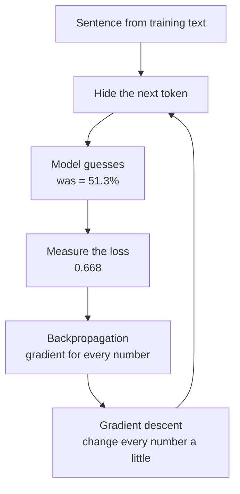
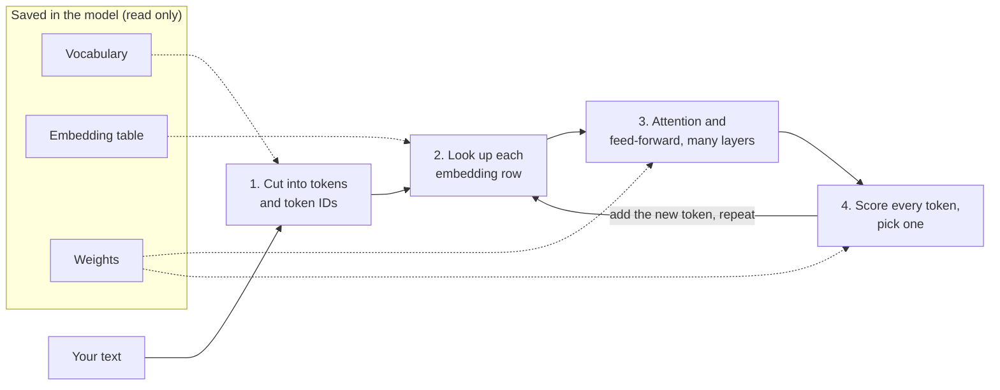

# Deep dive — How a language model learns and thinks

**Course:** [Building with the Claude API](https://academy.claude.com/courses/building-with-the-claude-api) &nbsp;·&nbsp; **Extra reading for Lesson 1** &nbsp;·&nbsp; **Written:** November 7, 2026

| Previous | Course | Next |
|:---|:---:|---:|
| [← Accessing the API](01-accessing-the-api.md) | [📚 Course index](README.md) | [Getting an API key →](02-getting-an-api-key.md) |

---

**On this page**

| # | Section |
|:---:|:---|
| 1 | [Revision summary](#revision-summary) |
| 2 | [The example sentence](#the-example-sentence) |
| 3 | [1. What is saved inside the model](#1-what-is-saved-inside-the-model) |
| 4 | [2. Where the embedding numbers come from](#2-where-the-embedding-numbers-come-from) |
| 5 | [3. Practising with a hidden word (training)](#3-practising-with-a-hidden-word-training) |
| 6 | [4. Fixing the numbers after each guess](#4-fixing-the-numbers-after-each-guess) |
| 7 | [5. Borrowing meaning from earlier words (attention)](#5-borrowing-meaning-from-earlier-words-attention) |
| 8 | [6. The rest of each layer](#6-the-rest-of-each-layer) |
| 9 | [7. Picking the next word](#7-picking-the-next-word) |
| 10 | [8. Training compared with normal use](#8-training-compared-with-normal-use) |
| 11 | [Common mix-ups](#common-mix-ups) |
| 12 | [Test yourself](#test-yourself) |
| 13 | [Architect notes](#architect-notes) |
| 14 | [Recap](#recap) |
| 15 | [My notes / practice](#my-notes--practice) |
| 16 | [FAQ](#faq) |

---

### Revision summary

The model is a huge set of numbers that training tuned by hiding the next word in billions of sentences and correcting the model's guesses; when you send a message, the model only reads those numbers to guess your answer one word at a time.

#### What is saved inside the model

- **Vocabulary:** the list of every token the model knows. A **token** is a small piece of text, such as a word or part of a word. Each token has a number called its **token ID**. For example, `cat` = 2207.
- A token ID is only a label. It has no meaning, like a primary key in a database.
- **Embedding table:** one row of numbers for each token ID. The row describes the token's meaning. One row is called the token's **embedding**.
- **Weights:** all the other numbers the model learned. They are stored as many tables of numbers. Each table is called a **matrix**.
- A weight matrix does not multiply one number by one weight. Each result adds up **all** the input numbers, each times its own weight.

#### Where the embedding numbers come from

- Before training, every row holds small random numbers. They can be negative.
- Every row has the same number of columns. The designers choose that number. Real models use hundreds or thousands.
- Nobody names the columns. Training fills them in.
- After training, words used in similar sentences have similar rows. You compare two words by their whole rows, never by one column.

#### How training works

- Training shows the model the start of a sentence and hides the next token. The model guesses the hidden token.
- The right answer comes from the sentence itself. Nobody labels anything. The model never searches the internet.
- **Loss** is a number that says how wrong the guess was. Loss = −ln(chance given to the right token). A 90% chance gives 0.11. A 10% chance gives 2.30.

#### How training fixes the numbers

- A **gradient** says, for one number: if this number gets bigger, does the loss go up or down, and how fast?
- **Backpropagation** calculates the gradient for every number in the model. It changes nothing.
- **Gradient descent** changes every number: `new = old − (learning rate × gradient)`.
- The **learning rate** is a small number, such as 0.1, that keeps each change small.
- A negative gradient makes the number bigger. A positive gradient makes it smaller.
- Embedding rows are fixed the same way as the weights.
- One wrong sentence changes almost nothing. Many wrong sentences can teach a wrong pattern.

#### How attention works

- A token's saved row is the same in every sentence. **Attention** lets each token borrow meaning from earlier tokens.
- Each token gets three new rows: a **Query** (what it looks for), a **Key** (what it offers), and a **Value** (what it hands over).
- They are made with three weight matrices: Wq, Wk, and Wv. All tokens in one layer share the same three. Each layer has its own three.
- The model multiplies a token's Query with each earlier token's Key and adds the results. This is a **dot product**. It gives a match score.
- **Softmax** turns the match scores into percentages that add up to 100%.
- The token adds up each earlier token's Value times its percentage. It adds that to its own row.
- A token can only look at itself and earlier tokens, never later ones (*causal masking*).

#### The rest of each layer

- Each layer runs many attentions side by side (*multi-head attention*).
- Then a **feed-forward network** processes each token's row on its own.
- Real models have dozens of layers. Each layer has its own weights.
- The model also adds each token's position. Without it, word order would be lost.

#### How the model picks the next word

- The model turns the last token's row into one score for every token in the vocabulary. These scores are called **logits**.
- Softmax turns the logits into chances. The model picks one token based on those chances.
- **Temperature** changes how spread out the chances are. Low temperature makes answers more predictable.
- The model adds the picked token and repeats. It stops at an end token, at `max_tokens`, or at a stop sequence.

#### Training compared with normal use

- During training, the numbers change after every batch of sentences.
- During normal use (*inference*), the numbers are only read. Your message never changes them.
- The model doesn't remember you. Your app must send earlier messages again.

#### Exam takeaways

- **A customer asks if their chats will change the model for other users.** No. Answering only reads the model's numbers. Data retention and training on customer data are covered by the provider's terms, so check those. (Governance, Safety & Risk Management)
- **A team gets different answers to the same prompt.** The model picks each token from a set of chances. Lower the temperature, give examples, and check the output in code. Answers get more consistent, but not identical. (Claude Models, Prompting & Context Engineering)
- **A product manager asks why long prompts cost more and run slower.** Every input token goes through every layer, and attention looks back at all earlier tokens. Send only what is needed, and use prompt caching for a fixed start of the prompt. (Solution Design & Architecture)

---

### The example sentence

The whole page uses one sentence:

```text
The cat sat on the mat because it was comfortable.
```

The model has read "The cat sat on the mat because it". Its job is to guess the next token. The right answer is "was".

All numbers are made up, but each one is calculated from the ones before it. You can redo the math and get the same results.

| Who | Where | What they do |
|---|---|---|
| The training process | Anthropic's computers, before the model is released | Hides the next token, checks the guess, changes the numbers |
| The model | Anthropic's servers | Saved numbers, plus the math that uses them |
| You and your app | Your computer and server | Send text and read the answer. You never change the model. |

---

### 1. What is saved inside the model

A computer can only do math on numbers. So the model needs a way to turn words into numbers. Training saves three things for this.

#### The vocabulary (text to token ID)

**What it is:** a list of every token the model knows, each with a token ID.

**Example:**

| Token | The | cat | sat | on | the | mat | because | it | was |
|---|:---:|:---:|:---:|:---:|:---:|:---:|:---:|:---:|:---:|
| Token ID | 101 | 2207 | 310 | 415 | 102 | 520 | 845 | 340 | 371 |

**Good to know:**
- "The" and "the" are different tokens.
- Token ID 2207 doesn't mean "animal". It is only a label, like an `int` primary key.
- The vocabulary is built before training and never changes.

#### The embedding table (token ID to numbers)

**What it is:** a table with one row of numbers for each token ID. The row describes the token.

**Example:** our table has 3 numbers per row. Real models have thousands.

| Token ID | Token | Number 1 | Number 2 | Number 3 |
|---|---|:---:|:---:|:---:|
| 101 | The | 0.20 | 0.40 | 0.10 |
| 2207 | cat | 0.30 | 0.70 | 0.50 |
| 310 | sat | 0.60 | 0.20 | 0.80 |
| 415 | on | 0.10 | 0.50 | 0.30 |
| 102 | the | 0.25 | 0.35 | 0.15 |
| 520 | mat | 0.80 | 0.10 | 0.40 |
| 845 | because | 0.15 | 0.60 | 0.30 |
| 340 | it | 0.40 | 0.30 | 0.70 |

Looking up a row works like this SQL:

```sql
SELECT Number1, Number2, Number3
FROM Embedding
WHERE TokenID = 2207;   -- cat
-- returns 0.30, 0.70, 0.50
```

**Good to know:**
- The numbers in a row are **not** other token IDs. They describe the token itself.
- One row is called a **vector**. The whole table is called a **matrix**.

#### The weights (everything else)

**What they are:** all the other numbers the model learned. They are stored as many matrices. Each layer has its own.

| Weight matrix | Job | Section |
|---|---|:---:|
| Wq, Wk, Wv | Make each token's Query, Key, and Value | 5 |
| Feed-forward matrices | Process each token's row further | 6 |
| Output matrix | Give every token in the vocabulary a score | 7 |

**Good to know:** a "70-billion-parameter model" has 70 billion learned numbers. A **parameter** is any number that training can change, embeddings included.

#### How the weights use the embedding numbers

Lesson 1 showed one weight per number:

|  | Number 1 | Number 2 | Number 3 |
|---|:---:|:---:|:---:|
| Embedding numbers | 0.25 | 0.81 | 0.42 |
| Example weights | 0.50 | 0.20 | 0.80 |
| Multiplication result | 0.125 | 0.162 | 0.336 |

That is too simple. In a real model, **each result uses all the input numbers**:

```text
result 1 = (number 1 × weight A) + (number 2 × weight B) + (number 3 × weight C)
result 2 = (number 1 × weight D) + (number 2 × weight E) + (number 3 × weight F)
```

- A big weight makes that input count more. It does not "pick" the input.
- A negative weight makes that input count against the result.
- Section 5, step 1 shows this with real numbers.

> **Remember this:** The vocabulary gives the ID. The embedding table gives the numbers. The weights mix the numbers.

---

### 2. Where the embedding numbers come from

#### A table you fill in yourself

Say you build a movie app in .NET. You score each movie on three traits yourself:

| Movie | Action | Comedy | Animation |
|---|:---:|:---:|:---:|
| Batman | 9 | 2 | 0 |
| Superman | 8 | 3 | 0 |
| Finding Nemo | 1 | 7 | 10 |
| Toy Story | 2 | 8 | 10 |

Similar movies have similar rows. You named the columns. You typed the numbers.

An embedding table is the same idea, with two differences:

1. Nobody names the columns.
2. Nobody types the numbers. Training finds them.

#### Step 1: the numbers start random

**What happens:** before training, every row gets small random numbers.

**Example:**

| Token | Number 1 | Number 2 | Number 3 |
|---|:---:|:---:|:---:|
| cat (before training) | 0.25 | −0.31 | 0.42 |
| mat (before training) | −0.15 | 0.75 | −0.21 |

**Good to know:** the numbers can be negative. They don't have to be between 0 and 1. At this point the rows mean nothing.

#### Step 2: training slowly changes them

**What happens:** each time a token is in a practice sentence, its row changes a little. The change makes the model's guess better.

**Example:** "cat" and "kitten" both appear in sentences like "I fed the ___". So their rows change in similar ways. After billions of changes, their rows end up close.

**Good to know:**

| Question | Answer |
|---|---|
| How many columns does a real model have? | Hundreds or thousands. The public model GPT-2 has 768. Anthropic doesn't publish Claude's number. |
| Does every row have the same columns? | Yes, like every row in a database table. |
| Does one column mean "animal"? | No. A meaning is spread over many columns. |
| Can one column show that two words are alike? | No. Compare the whole rows. |

---

### 3. Practising with a hidden word (training)

#### Step 1: hide the next token

**What happens:** the training process takes a sentence. It shows the model the start. It hides the next token and keeps it as the answer.

**Example:**

| Model sees | Hidden answer |
|---|---|
| The | cat |
| The cat | sat |
| The cat sat | on |
| … | … |
| The cat sat on the mat because it | **was** |

**Good to know:**
- The model never sees the hidden token. That is why practising works.
- The answer comes from the sentence. Nobody labels it. This is called *self-supervised learning*.
- The model doesn't search Wikipedia to check. The training process already has the answer.

#### Step 2: the model guesses

**What happens:** the model gives every token a chance of coming next.

**Example:** our model's chances (sections 5 and 7 show where they come from):

| Next token | was | is | sat | cat | mat |
|---|:---:|:---:|:---:|:---:|:---:|
| Chance | **51.3%** | 18.2% | 14.9% | 8.2% | 7.5% |

**Good to know:** a real vocabulary has many thousands of tokens. Ours has five.

#### Step 3: measure how wrong the guess was (loss)

**What happens:** the training process turns the chance of the right token into one number, called the **loss**.

**Formula:** `loss = −ln(chance of the right token)`. `ln` is the natural log, a button on any scientific calculator.

**Example:**

| Chance of the right token | Loss | Meaning |
|:---:|:---:|---|
| 10% | 2.30 | Very wrong |
| 50% | 0.69 | Unsure |
| **51.3%** ("was") | **0.668** | Unsure |
| 90% | 0.11 | Mostly right |
| 99% | 0.01 | Almost perfect |

**Good to know:** the goal of training is the lowest average loss over all the training text.

> **Your question:** How does the model "know" that "the cat sat on the mat" is likelier than "the dog sat on the mat"? It doesn't know what is true. It learned what was common in the training text. If "mat" often came after "sat on the", training made "mat" likely there.

---

### 4. Fixing the numbers after each guess

Training must now change the numbers so the next guess is better. We follow one real weight. In section 7, it helps make the score for "was". Its value is **1.5**.

#### Step 1: find which way to move each number (the gradient)

**What happens:** the model checks how the loss changes if this weight gets a little bigger.

**Example:** make the weight 0.01 bigger and run the guess again.

| | Weight | Loss |
|---|:---:|:---:|
| Before | 1.50 | 0.6684 |
| 0.01 bigger | 1.51 | 0.6642 |

- The loss went down by 0.0042.
- 0.0042 ÷ 0.01 = 0.42. The loss falls 0.42 for every 1 the weight grows.
- So the **gradient** is **−0.42**.

**Good to know:**

| Gradient | Meaning | So the number should |
|:---:|---|---|
| Positive | Bigger makes the loss worse | Get smaller |
| Negative | Bigger makes the loss better | Get bigger |
| Zero | This number didn't affect the guess | Stay the same |

#### Step 2: get every gradient at once (backpropagation)

**What happens:** testing one number at a time would take billions of reruns. **Backpropagation** gets every gradient in one pass. It starts at the loss and works backward through each calculation.

**Example:** for our weight, the math gives:

```text
gradient = (the input this weight multiplies) × (chance of "was" − 1)
         = 0.855 × (0.513 − 1)
         = −0.417
```

That matches the −0.42 we measured.

**Good to know:** backpropagation only calculates. It doesn't change anything.

#### Step 3: change every number a little (gradient descent)

**What happens:** **gradient descent** changes every number with one rule:

```text
new value = old value − (learning rate × gradient)
```

**Example:** with a learning rate of 0.1:

```text
new value = 1.5 − (0.1 × −0.417)
          = 1.5 + 0.0417
          = 1.5417
```

Run the guess again with the new weight:

| | Weight | Chance of "was" | Loss |
|---|:---:|:---:|:---:|
| Before | 1.5000 | 51.3% | 0.668 |
| After one update | 1.5417 | 52.1% | 0.651 |

**Good to know:**
- Subtracting a negative gradient makes the number bigger.
- The learning rate keeps each change small.
- Training changes every number this way, not just this one.

> **Your question:** What does gradient descent do with a gradient of −0.5? It makes the number bigger: `old − (0.1 × −0.5) = old + 0.05`.



#### The embedding rows change too

**What happens:** backpropagation keeps going back to the embedding rows. The rows of the tokens in the sentence get changed too.

**Example:** "it", "mat", and "cat" were in the sentence, so their rows change a little. "Refrigerator" wasn't, so its row stays the same.

**Good to know:** Wq, Wk, Wv, and every other weight are trained in this same loop.

#### How real training is different

- **Batches:** real training guesses for many sentences, averages the gradients, then changes the numbers.
- **Better rules:** real training uses improved versions of gradient descent. A common one is called *Adam*.
- **How long:** the numbers change over a very long run of steps. Most text is read once or a few times. One full pass over the text is an *epoch*.
- **Later training:** this practice gives a model that continues text. More training teaches it to follow instructions and be safe. Anthropic uses human feedback and written principles (*Constitutional AI*) for this.

#### Can one wrong sentence spoil what the model learned?

No, not usually. Say the model read "cats are animals" thousands of times. Then it reads "The cat is a refrigerator" once. That one change is tiny and gets averaged with many others. But if wrong text appears often, the model learns it. That is why training text quality matters.

---

### 5. Borrowing meaning from earlier words (attention)

The row for "it" is always `[0.40, 0.30, 0.70]`. But "it" means different things in different sentences. To guess "was", "it" needs information from earlier words. **Attention** does this.

#### The three new rows: Query, Key, Value

| Row | Plain meaning | Like in SQL |
|---|---|---|
| **Query** | What this token is looking for | The search you type |
| **Key** | What this token offers | The column the search matches |
| **Value** | What this token hands over | The data you get back |

**One difference from SQL:** SQL returns only the rows that match. Attention gives **every** earlier token a percentage. Then it adds up a little of each token's Value.

```sql
-- Not real SQL. This is the idea:
SELECT SUM(MatchPercent * Value)
FROM EarlierTokens;
```

#### Step 1: make the Query for "it" (matrix multiplication)

**What happens:** the model multiplies the row of "it" by the matrix Wq. Training learned Wq.

**Example:** Wq has 3 rows (one per embedding number) and 2 columns (one per Query number).

| Wq | Query number 1 | Query number 2 |
|---|:---:|:---:|
| Embedding number 1 | 1.0 | 0.0 |
| Embedding number 2 | 0.0 | 1.0 |
| Embedding number 3 | 1.0 | 0.5 |

Each Query number uses all three numbers of "it" `[0.40, 0.30, 0.70]`:

```text
Query number 1 = 0.40 × 1.0 + 0.30 × 0.0 + 0.70 × 1.0 = 1.10
Query number 2 = 0.40 × 0.0 + 0.30 × 1.0 + 0.70 × 0.5 = 0.65

Query of "it" = [1.10, 0.65]
```

The same thing in C#:

```csharp
double[] Multiply(double[] row, double[,] W)
{
    var result = new double[W.GetLength(1)];
    for (int col = 0; col < W.GetLength(1); col++)   // each result number
        for (int i = 0; i < row.Length; i++)         // each input number
            result[col] += row[i] * W[i, col];       // input × its weight
    return result;
}
// Multiply(itRow, Wq) returns { 1.10, 0.65 }
```

**Good to know:** this is all "matrix multiplication" means. The designers chose 2 Query numbers here to keep the math small.

#### Step 2: make a Key for every earlier token

**What happens:** the model multiplies every token's row by the matrix Wk.

**Example:**

| Wk | Key number 1 | Key number 2 |
|---|:---:|:---:|
| Embedding number 1 | 2.0 | 0.5 |
| Embedding number 2 | −0.5 | 0.5 |
| Embedding number 3 | 0.0 | −0.5 |

For "mat" `[0.80, 0.10, 0.40]`:

```text
Key number 1 = 0.80 × 2.0 + 0.10 × −0.5 + 0.40 × 0.0  = 1.55
Key number 2 = 0.80 × 0.5 + 0.10 × 0.5  + 0.40 × −0.5 = 0.25
```

**Good to know:**
- Every token uses the **same** Wk, like calling one C# method on every row.
- Every token gets its own Key, but there is only one Wk per layer. The same goes for Wq and Wv.
- "It" can see "The cat sat on the mat because it". It can't see "was comfortable", because those words don't exist yet while the model writes. This is called *causal masking*.

#### Step 3: score each match (dot product)

**What happens:** multiply the Query and a Key number by number, then add. This is a **dot product**. A bigger result means a better match.

**Example:**

```text
"it" with "mat": 1.10 × 1.55 + 0.65 × 0.25 = 1.868
"it" with "cat": 1.10 × 0.25 + 0.65 × 0.25 = 0.438
```

**Good to know:** the model then divides each score by the square root of the Key length. Here that is √2 = 1.414. This keeps scores from getting too big.

#### Step 4: turn scores into percentages (softmax)

**What happens:** **softmax** raises *e* (about 2.718) to the power of each score. Then it divides each result by the total. The results add up to 100%.

**Example:**

| Earlier token | Key | Dot product | ÷ 1.414 | e to that power | ÷ total |
|---|:---:|:---:|:---:|:---:|:---:|
| The | [0.20, 0.25] | 0.383 | 0.270 | 1.311 | 9.4% |
| cat | [0.25, 0.25] | 0.438 | 0.309 | 1.363 | 9.7% |
| sat | [1.10, 0.00] | 1.210 | 0.856 | 2.353 | 16.8% |
| on | [−0.05, 0.15] | 0.043 | 0.030 | 1.031 | 7.4% |
| the | [0.33, 0.23] | 0.504 | 0.356 | 1.428 | 10.2% |
| **mat** | [1.55, 0.25] | 1.868 | 1.321 | 3.745 | **26.8%** |
| because | [0.00, 0.23] | 0.146 | 0.103 | 1.109 | 7.9% |
| it | [0.65, 0.00] | 0.715 | 0.506 | 1.658 | 11.8% |
| **Total** | | | | **13.997** | **100%** |

"Mat" gets the most attention: 26.8%.

**Good to know:** nobody wrote a rule that "it" means "mat". The percentages come only from the learned numbers.

> **Your question:** How does the model know "mat" should score highest? It doesn't know. Training tuned Wq, Wk, and the rows so the scores help guess the next token. In this sentence, "it" could also mean the cat. Attention doesn't have to decide. It only gathers what helps the next guess.

#### Step 5: blend the Values into "it"

**What happens:** the model adds up each token's Value times its percentage. Then it adds that blend to the row of "it".

**Example:** to keep it short, our Wv just copies each row, so each Value equals the token's row.

```text
blend number 1 = 9.4% × 0.20 (The) + 9.7% × 0.30 (cat) + ... + 26.8% × 0.80 (mat) + ...
               = 0.455
blend = [0.455, 0.322, 0.444]
```

| | Number 1 | Number 2 | Number 3 |
|---|:---:|:---:|:---:|
| Saved row of "it" | 0.40 | 0.30 | 0.70 |
| + Blend from attention | 0.455 | 0.322 | 0.444 |
| = Row of "it" in this sentence | **0.855** | **0.622** | **1.144** |

**Good to know:**
- The saved row in the embedding table doesn't change. Only this working copy changes.
- The blend is **added**, not swapped in. This keeps the original meaning of "it". This is called a *residual connection*.
- A real Wv mixes the numbers, the same way Wq does.

> **Remember this:** Query asks. Key answers. Softmax turns matches into percentages. Value is what gets handed over.

---

### 6. The rest of each layer

Section 5 showed one attention in one layer. A real model does more.

| Part | What happens | Why |
|---|---|---|
| **Many heads** (*multi-head attention*) | Each layer runs many attentions side by side. Each has its own Wq, Wk, Wv. | One head might track what "it" refers to. Another might track the verb. Training decides this. |
| **Feed-forward network** | Each token's row goes through two more matrix multiplications. | Attention moves information between tokens. This step works on each token alone. Much stored knowledge lives here. |
| **Normalization** | Each row is rescaled so its numbers stay in a steady range. | Without it, numbers grow or shrink too much over many layers. |
| **Many layers** | The whole block repeats dozens of times. Each layer has its own weights. | Each layer sharpens the meaning a little more. |
| **Position** | The model adds each token's position into the math. | Without it, "dog bites man" and "man bites dog" would look the same. |

**Size example:** GPT-2, a small public model, has 12 layers, 12 heads per layer, and about 124 million weights. Large models today have billions.

---

### 7. Picking the next word

#### Step 1: score every token (logits)

**What happens:** the model multiplies the final row of "it" by the **output matrix**. The output matrix has one column per vocabulary token. The result is one score per token, called a **logit**.

**Example:**

| Output matrix | was | is | sat | cat | mat |
|---|:---:|:---:|:---:|:---:|:---:|
| Number 1 | **1.5** | 0.8 | 0.6 | 0.2 | 0.4 |
| Number 2 | 0.5 | 0.9 | 0.3 | 1.0 | 0.2 |
| Number 3 | 1.2 | 0.6 | 0.9 | 0.3 | 0.5 |

```text
score for "was" = 0.855 × 1.5 + 0.622 × 0.5 + 1.144 × 1.2 = 2.966
```

**Good to know:** the **1.5** in bold is the weight that section 4 changed.

#### Step 2: turn scores into chances (softmax)

**What happens:** softmax turns the logits into chances, the same way as in section 5.

**Example:**

| Token | was | is | sat | cat | mat |
|---|:---:|:---:|:---:|:---:|:---:|
| Logit | 2.966 | 1.930 | 1.729 | 1.136 | 1.038 |
| Chance | **51.3%** | 18.2% | 14.9% | 8.2% | 7.5% |

#### Step 3: pick one token (temperature)

**What happens:** the model picks a token at random, using the chances. "Was" gets picked about half the time. **Temperature** divides the logits before softmax.

**Example:**

| Temperature | was | is | sat | cat | mat | Effect |
|:---:|:---:|:---:|:---:|:---:|:---:|---|
| 0.5 | 79.5% | 10.0% | 6.7% | 2.0% | 1.7% | More predictable |
| 1.0 | 51.3% | 18.2% | 14.9% | 8.2% | 7.5% | As trained |
| 1.5 | 39.8% | 20.0% | 17.5% | 11.8% | 11.0% | More varied |

**Good to know:** other ways to pick, which you'll see in documentation:
- **Greedy:** always pick the top token. Same input gives the same answer.
- **Top-k:** keep only the k most likely tokens, such as 40, and pick from those.
- **Top-p:** keep the top tokens whose chances add up to p, such as 90%, and pick from those.

[Lesson 6](06-temperature.md) covers the Claude API's temperature setting.

#### Step 4: repeat until done

**What happens:** the model adds "was" to the text. "Was" goes through every layer, and the model scores the next token. This repeats.

**Good to know:**
- The model stops at a special end token, at your `max_tokens` limit, or at a stop sequence ([lesson 1](01-accessing-the-api.md#5-when-the-model-stops-and-what-comes-back)).
- The model saves the Keys and Values it already made, so it doesn't redo them each round. This is called the *KV cache*.

---

### 8. Training compared with normal use

| | Training | Normal use (inference) |
|---|---|---|
| When | Once, before release | Every request |
| Text comes from | Books, websites, other text | Your message |
| The next token is | Hidden, then checked | Unknown. The model picks it. |
| Loss and gradients | Yes | No |
| Numbers change? | Yes, every step | **No.** Only read. |
| Remembers you next time? | — | No. Your app must resend earlier messages. |



These are the same four stages as lesson 1. The dotted arrows mean the request only reads the saved numbers.

---

### Common mix-ups

| ❌ Wrong idea | ✅ What really happens |
|---|---|
| The numbers in a row are IDs of related words. | They describe the token. Token IDs only label it. |
| Each weight multiplies one number, and a high weight picks it. | Each result adds up all the inputs, each times its weight. Nothing is picked. |
| Backpropagation changes the numbers. | Backpropagation calculates. Gradient descent changes. |
| Only weights are trained. The embedding table is fixed. | Embedding rows are trained in the same loop. |
| Every token has its own Wq, Wk, Wv. | All tokens share them within a layer. Each layer has its own. |
| The model learns from my chats. | Answering only reads the numbers. Nothing is saved. |

---

### Test yourself

<details>
<summary>1. A weight is 2.0. Its gradient is +0.8. The learning rate is 0.1. What is the new weight?</summary>

1.92. The rule gives `2.0 − (0.1 × 0.8) = 1.92`. A positive gradient makes the weight smaller.
</details>

<details>
<summary>2. The Query of "it" is [1.10, 0.65]. The Key of "sat" is [1.10, 0.00]. What is their dot product?</summary>

1.21. `1.10 × 1.10 + 0.65 × 0.00 = 1.21`.
</details>

<details>
<summary>3. Why can't "it" look at "comfortable"?</summary>

"Comfortable" comes after "it". The model writes left to right, so later words don't exist yet. This is causal masking.
</details>

<details>
<summary>4. The model gives the right token a 90% chance. What is the loss?</summary>

About 0.11, because −ln(0.9) = 0.105. That is good. A perfect guess has a loss of 0.
</details>

---

### Architect notes

#### Cost

- You pay per token. Every input token goes through every layer. Send only the text the model needs, for example with retrieval (lessons 32–38).
- Each output token is a full pass through the model. Output tokens cost more than input tokens. Ask for only the length you need. Check current prices on Anthropic's pricing page.

#### Speed

- Attention looks back at every earlier token. Long prompts take longer, especially before the first answer token.
- Prompt caching (lessons 43–45) saves the work done on an unchanged start of a prompt. Put fixed text, such as instructions, at the start.

#### Limits

- The **context window** is the most tokens one request can hold, input plus answer. The model can only use what you send in that request. Look up each model's limit.
- The model only knows its training text, up to a cutoff date. For newer facts, put them in the prompt or give it a search tool.

#### Security and data

- The model has no memory between requests. Your app must store and resend history. Store that history securely.
- Attention treats all text in the prompt alike. A document can contain text that steers the model (*prompt injection*). Tag untrusted text, limit tools, and check outputs.
- Whether a provider keeps or trains on your data is set by its terms, not by your requests. Check Anthropic's current terms.

#### Design trade-offs

- Answers vary because tokens are picked from chances. For tasks that need the same answer, such as classification, lower the temperature, give examples, and check the output in code.
- Smaller models have fewer weights. They are faster and cheaper but usually less capable. Test the smallest model that passes your evaluation first.

---

### Recap

- **Saved things:** vocabulary (text to ID), embedding table (ID to numbers), weights (mix the numbers).
- **Weights mix:** each result adds up all the inputs, each times a weight.
- **Random start:** every number starts random. Training fills it in.
- **Training:** hide the next token, guess, measure the loss.
- **Fixing:** backpropagation finds every gradient. Gradient descent changes every number a little.
- **Attention:** Query, Key, Value. Dot product, softmax, blend.
- **Layers:** many heads, feed-forward, normalization, position, repeated dozens of times.
- **Picking:** score every token, softmax, pick one, repeat.
- **Normal use:** the numbers are only read. The model never learns from your chat.

---

## My notes / practice

- [ ] Work out the Query of "it" by hand. `[0.40, 0.30, 0.70]` × Wq should give `[1.10, 0.65]`.
- [ ] Work out the Key of "cat" with Wk. You should get `[0.25, 0.25]`.
- [ ] Put the C# `Multiply` function in a console app. Use it to make the Keys for all eight tokens.
- [ ] Do softmax by hand for just two scores: 2.966 and 1.930. Check that the chances add up to 100%.
- [ ] Explain backpropagation and gradient descent out loud with the 1.5 → 1.5417 example.

---

## FAQ

**Q1. What does "token ID" mean?**
It is the number the vocabulary gives each token, such as 2207 for "cat". It is only a label. Close IDs are not similar words.

**Q2. Are the numbers in an embedding row other token IDs?**
No. They describe the token itself. `[0.30, 0.70, 0.50]` describes "cat" and points to nothing else.

**Q3. What do the columns of the embedding table mean?**
No column has a name. Training fills them in. A meaning is spread over many columns, so compare whole rows.

**Q4. Where do the embedding numbers come from?**
They start random. Training changes them a little, billions of times. Words used in similar sentences end up with similar rows.

**Q5. Why does training make the model guess a word the sentence already has?**
The model only sees the words before it. The training process keeps the hidden word as the answer. Practising this way teaches the model to guess new text.

**Q6. What does "loss" mean?**
It is one number for how wrong a guess was: −ln(chance of the right token). A 90% chance gives 0.11. A 10% chance gives 2.30.

**Q7. What is the difference between backpropagation and gradient descent?**
Backpropagation calculates which way each number should move. Gradient descent moves it: `new = old − (learning rate × gradient)`.

**Q8. Can one wrong sentence spoil what the model learned?**
Usually not. Each change is tiny and averaged with many others. But wrong text that appears often can be learned.

**Q9. Does every token have its own Wq, Wk, and Wv?**
No. All tokens share the same three within a layer. Each token still gets its own Query, Key, and Value.

**Q10. Why can't a token look at words that come after it?**
The model writes left to right. Later words don't exist yet. This is called causal masking.

**Q11. (Exam angle) A customer asks if their employees' chats will change how the model answers other customers. How do you answer?**
No. Answering only reads the model's numbers, and the model keeps no memory between requests. Data retention and training on customer data are covered by Anthropic's terms, so point the customer to those. (Governance, Safety & Risk Management)

**Q12. (Exam angle) A team gets different answers to the same prompt in a classification task. What do you recommend?**
The model picks each token from a set of chances, so some variety is normal. Lower the temperature, give clear examples, and check the output in code. Answers become more consistent but not identical. (Claude Models, Prompting & Context Engineering)

**Q13. (Exam angle) A product manager asks why long documents make requests cost more and run slower. What do you say and change?**
Every input token goes through every layer, and attention looks back at all earlier tokens. Send only the passages needed, and put fixed text at the start so prompt caching can reuse it. (Solution Design & Architecture)

---

| Previous | Course | Next |
|:---|:---:|---:|
| [← Accessing the API](01-accessing-the-api.md) | [📚 Course index](README.md) | [Getting an API key →](02-getting-an-api-key.md) |
