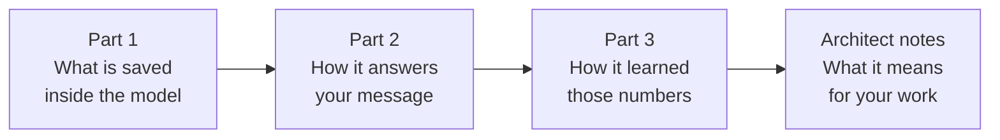
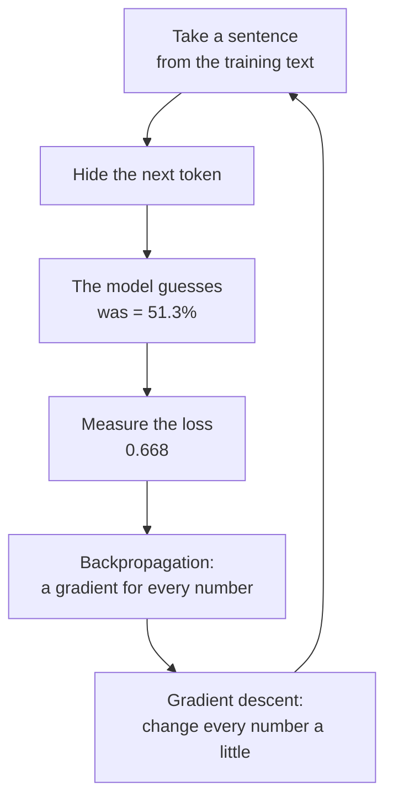

# Deep dive — How a language model learns and thinks

**Course:** [Building with the Claude API](https://academy.claude.com/courses/building-with-the-claude-api) &nbsp;·&nbsp; **Extra reading for Lesson 1** &nbsp;·&nbsp; **Written:** November 7, 2026

| Previous | Course | Next |
|:---|:---:|---:|
| [← Accessing the API](01-accessing-the-api.md) | [📚 Course index](README.md) | [Getting an API key →](02-getting-an-api-key.md) |

---

**On this page**

| # | Section |
|:---:|:---|
| 1 | [Revision summary](#revision-summary) |
| 2 | [The big picture](#the-big-picture) |
| 3 | [Part 1. What is saved inside the model](#part-1-what-is-saved-inside-the-model) |
| 4 | [Part 2. How the model answers your message](#part-2-how-the-model-answers-your-message) |
| 5 | [Part 3. How the model learned its numbers (training)](#part-3-how-the-model-learned-its-numbers-training) |
| 6 | [Common mix-ups](#common-mix-ups) |
| 7 | [Test yourself](#test-yourself) |
| 8 | [Architect notes: what this means for your work](#architect-notes-what-this-means-for-your-work) |
| 9 | [Recap](#recap) |
| 10 | [My notes / practice](#my-notes--practice) |
| 11 | [FAQ](#faq) |

---

### Revision summary

The model is a huge set of numbers that training tuned by hiding the next word in billions of sentences and correcting the model's guesses; when you send a message, the model only reads those numbers to guess your answer one word at a time.

#### What is saved inside the model

Training leaves three things saved inside the model, and every request reads them without ever changing them.

- The **vocabulary** is the list of every token the model knows. A **token** is a small piece of text, such as a word, part of a word, or a symbol such as "?", and each token has a fixed number called its **token ID** (for example, `cat` might be 2207). A token ID is only a label, like a primary key in a database table, so it carries no meaning by itself.
- The **embedding table** has one row for each token ID, and each row is a list of numbers that describes what that token usually means. The row is called the token's **embedding**. Every row has exactly the same number of columns, because the people who build the model choose that number before training starts and it never changes afterward. Real models use hundreds or thousands of columns.
- The **weights** are all the other numbers the model learned. They are stored as many grids of numbers called **matrices**, and each layer of the model has its own set.
- A weight matrix does not multiply each number by one weight. Each number it produces is a sum that uses **all** the input numbers, each multiplied by its own weight, and that mixing is how the model combines information.

#### How the model answers your message

When you send a message, the model runs the same steps for every token it writes.

1. It cuts your text into tokens and looks up each token ID in the vocabulary.
2. It looks up each token's row in the embedding table. The saved row is the same in every sentence, so the model works on a copy.
3. Each token borrows meaning from the tokens before it (this is called **attention**). Each token makes three new rows from its own row, using three shared weight matrices called Wq, Wk, and Wv: a **Query** (what this token is looking for), a **Key** (what this token offers), and a **Value** (the information it hands over).
4. The model scores how well a token's Query matches each earlier token's Key by multiplying them number by number and adding the results (a **dot product**). **Softmax** then turns those scores into percentages that add up to 100%, and the token adds each earlier token's Value, weighted by its percentage, to its own row.
5. A token can only look at itself and the tokens before it, never the ones after it, because the later words don't exist yet while the model is writing (this is called *causal masking*).
6. Each layer runs many attentions side by side (*multi-head attention*) and then a **feed-forward network** that processes each token on its own. Real models repeat this in dozens of layers, each with its own weights, and they also add each token's position so word order isn't lost.
7. After the last layer, the model turns the last token's row into one score for every token in the vocabulary (a **logit**). Softmax turns the logits into chances, and the model picks one token based on those chances.
8. **Temperature** changes how spread out the chances are before the model picks: a low temperature makes the likely token even more likely, and a high temperature gives unlikely tokens more of a chance.
9. The model adds the picked token to the text and repeats all the steps. It stops when it picks a special end token, reaches the `max_tokens` limit, or writes a stop sequence.

#### How the model learned its numbers

Every number started as a small random value, and training slowly adjusted them all by having the model practise guessing hidden words.

- The training process takes a sentence from its training text, shows the model only the beginning, and hides the next token. The model guesses, and the training process compares the guess with the hidden token. The answer comes from the text itself, so nobody has to label anything (*self-supervised learning*), and the model never searches the internet to check.
- **Loss** is one number that measures how wrong a guess was. It is calculated as −ln(the chance the model gave the right token), so a 90% chance gives a loss of 0.11 and a 10% chance gives a loss of 2.30.
- A **gradient** tells the training process, for one number in the model, whether making that number slightly bigger would raise or lower the loss, and by how much. A negative gradient means "bigger is better", and a positive gradient means "smaller is better".
- **Backpropagation** calculates the gradient for every number in the model in one backward pass, starting from the loss. It only calculates, and it changes nothing.
- **Gradient descent** then changes every number with the rule `new value = old value − (learning rate × gradient)`. The **learning rate** is a small number, such as 0.1, that keeps each change small so no single sentence can push the model too far.
- The embedding rows are adjusted in the same way as every other weight, but only the rows of tokens that appeared in the sentence change in that step.
- One wrong sentence in the training text changes almost nothing, because each change is tiny and is averaged with many other sentences. Wrong text that appears many times can still be learned, which is why the quality of training text matters.

#### Training compared with normal use

- During training, the model's numbers change after every batch of sentences. Training happens once, on Anthropic's computers, before the model is released.
- During normal use (*inference*), the model only reads its numbers, so your message never changes them and nothing you say is saved inside the model.
- The model does not remember you between requests, so your app must send earlier messages again if the model needs them.

#### Exam takeaways

- **A customer asks whether their conversations will change the model's behaviour for other users.** No, because answering a request only reads the model's numbers and never changes them. Whether the provider keeps data or may use it for future training is a separate matter set by its terms, so point the customer to Anthropic's data-retention and training terms. (Governance, Safety & Risk Management)
- **A team sees different answers to the same prompt and wants consistent output.** The model picks each token from a set of chances, so some variety is normal. Lower the temperature, give clear instructions and examples, and check the output in code; this makes answers more consistent, but it does not guarantee identical answers. (Claude Models, Prompting & Context Engineering)
- **A product manager asks why long prompts cost more and run slower.** Every input token goes through every layer, and each token's attention looks back at all the tokens before it, so the work grows as the prompt grows. Send only the text the model needs, and put fixed text such as instructions at the start so prompt caching can reuse the work. (Solution Design & Architecture)

---

### The big picture

#### The question this page answers

When you type "What is quantum computing?" and Claude replies, what actually happens inside the model, and why should an architect care?

You need this for the exam and for real projects, because many decisions you will make come straight from how the model works inside. You pay per token because every token is processed separately. Long prompts are slow because each token looks back at every earlier token. Answers vary because the model picks each word from a set of chances. And you can tell a customer that chatting with the model doesn't change it, because answering only reads its numbers.

#### The whole story, before any details

1. The model is mostly a very large set of numbers, saved on Anthropic's servers.
2. When your message arrives, the model cuts it into small pieces (tokens) and turns each piece into a row of numbers.
3. Each piece then borrows meaning from the pieces before it, so a word like "bank" can mean a river bank in one sentence and a money bank in another.
4. The model then gives every word it knows a chance of coming next, picks one, adds it to the answer, and repeats until the answer is complete.
5. None of this changes the numbers. The numbers were set earlier, during training.
6. Training set them by showing the model billions of sentences with the next word hidden, checking each guess, and nudging all the numbers slightly toward a better guess each time.

#### Why each part matters to you

| What happens inside | What it means for your work | More in |
|---|---|---|
| Text is cut into tokens, and each token is processed | You pay per token, so long prompts and long answers cost more | Part 2, Architect notes |
| Each token looks back at all earlier tokens | Long prompts are slower, and prompt caching can reuse work on a fixed start of a prompt | Part 2, step 3 |
| The next token is picked from a set of chances | Answers vary, and temperature controls how much | Part 2, step 5 |
| The numbers are only read, never changed, when answering | Chats don't change the model, and the model doesn't remember users between requests | Architect notes |
| Training learns whatever patterns are common in its text | The model can be wrong or out of date, so check facts and give it current information | Part 3 |

#### The route through this page



You first see what is stored, then watch the model use it on one sentence, then learn how training produced those exact numbers, and finally see what all of it means for the systems you design.

#### The example used throughout

The whole page follows one sentence:

```text
The cat sat on the mat because it was comfortable.
```

In Part 2, the model has read "The cat sat on the mat because it" and must guess the next token, which should be "was". In Part 3, training uses the same sentence to improve that guess.

Real models have thousands of numbers per token, which would be impossible to follow by hand, so the example uses only three. The numbers are invented, but every result is calculated from the numbers before it, so you can redo any step on a calculator and get the same answer.

#### Who's who

| Who | Where they are | What they do |
|---|---|---|
| The people who build the model (at Anthropic) | Before training starts | Choose the sizes, such as how many columns each row has and how many layers the model has |
| The training process | Anthropic's training computers, before the model is released | Hides the next token in each training sentence, checks the model's guess, and adjusts the numbers |
| The model | Anthropic's servers | The saved numbers, plus the fixed calculations that use them to guess the next token |
| You and your app | Your computer and your server | Send text and receive the answer, without ever changing the model's numbers |

---

### Part 1. What is saved inside the model

A computer can only do arithmetic on numbers, so before the model can work with the word "cat", it needs a way to turn that word into numbers. Training leaves three things saved inside the model for this, and every request uses all three.

#### The vocabulary: from text to a token ID

**What it is:** the vocabulary is a fixed list of every token the model knows, and each token in the list has its own token ID.

**Example:** the IDs below are invented.

| Token | The | cat | sat | on | the | mat | because | it | was |
|---|:---:|:---:|:---:|:---:|:---:|:---:|:---:|:---:|:---:|
| Token ID | 101 | 2207 | 310 | 415 | 102 | 520 | 845 | 340 | 371 |

**Good to know:**
- "The" with a capital letter and "the" in lower case are different tokens, because they are different pieces of text.
- A token ID is only a label, like an `int` primary key in a database table. ID 2207 doesn't mean "animal", and IDs 2207 and 2208 are not similar words just because the numbers are close.
- The vocabulary is built once, before training starts, by finding the most common pieces of text, and it never changes after that.

#### What a row of numbers can describe

Before looking at the embedding table, here is the same idea in a form you could build yourself. Say you build a movie app in .NET and you score each movie on three traits that you choose:

| Movie | Action | Comedy | Animation |
|---|:---:|:---:|:---:|
| Batman | 9 | 2 | 0 |
| Superman | 8 | 3 | 0 |
| Finding Nemo | 1 | 7 | 10 |
| Toy Story | 2 | 8 | 10 |

Each row of three numbers describes one movie, and similar movies end up with similar rows, so your app can find "movies like Batman" by comparing rows. An embedding table works the same way, with two differences: nobody names the columns, and nobody types the numbers, because training finds them (Part 3).

#### The embedding table: from a token ID to a row of numbers

**What it is:** the embedding table has one row for every token ID in the vocabulary, and each row is a list of numbers that describes what that token usually means.

**Example:** in this example, each row has three numbers.

| Token ID | Token | Number 1 | Number 2 | Number 3 |
|---|---|:---:|:---:|:---:|
| 101 | The | 0.20 | 0.40 | 0.10 |
| 2207 | cat | 0.30 | 0.70 | 0.50 |
| 310 | sat | 0.60 | 0.20 | 0.80 |
| 415 | on | 0.10 | 0.50 | 0.30 |
| 102 | the | 0.25 | 0.35 | 0.15 |
| 520 | mat | 0.80 | 0.10 | 0.40 |
| 845 | because | 0.15 | 0.60 | 0.30 |
| 340 | it | 0.40 | 0.30 | 0.70 |

Looking up a token's row is a direct lookup by its token ID, just like this SQL query:

```sql
SELECT Number1, Number2, Number3
FROM Embedding
WHERE TokenID = 2207;   -- cat
-- returns 0.30, 0.70, 0.50
```

**Good to know:**
- Each token has its own row, and every row has exactly the same number of columns. The people who build the model choose that number before training starts, and it never changes afterward. Real models use hundreds or thousands of columns; for example, the public model GPT-2 uses 768 columns for each of its 50,257 tokens, which is about 38.6 million numbers in the embedding table alone. Anthropic doesn't publish Claude's sizes.
- No single column has a meaning such as "animal" or "grammar". A meaning is spread across many columns at once, so you can only compare two tokens by comparing their whole rows, never by looking at one column.
- The numbers in a row are **not** the IDs of other tokens. They are measurements that describe this token, and they don't point anywhere else.
- One row of numbers is called a **vector**, and a whole grid of numbers is called a **matrix**.

#### The weights: everything else the model learned

**What they are:** the weights are all the other numbers the model learned. They are not one table: they are many matrices, each with its own job, and each layer of the model has its own set.

| Weight matrix | Its job | Where you see it |
|---|---|---|
| Wq, Wk, and Wv, in every layer | Turn each token's row into its Query, Key, and Value | Part 2, step 3 |
| Feed-forward matrices, in every layer | Process each token's row further after attention | Part 2, step 4 |
| The output matrix, once at the very end | Turn the final row into a score for every token in the vocabulary | Part 2, step 5 |

**Good to know:** a **parameter** is any number that training can change, and that includes the embedding rows. When people say "a 70-billion-parameter model", they mean the model has 70 billion learned numbers in total.

#### How the weights use the embedding numbers

Lesson 1 showed a simple version, where each embedding number is multiplied by one weight:

|  | Number 1 | Number 2 | Number 3 |
|---|:---:|:---:|:---:|
| Embedding numbers | 0.25 | 0.81 | 0.42 |
| Example weights | 0.50 | 0.20 | 0.80 |
| Multiplication result | 0.125 | 0.162 | 0.336 |

That version is too simple, because it never lets the numbers affect each other. In a real model, **each result number is a sum that uses all the input numbers**, and each input has its own weight for each result:

```text
result 1 = (number 1 × weight A) + (number 2 × weight B) + (number 3 × weight C)
result 2 = (number 1 × weight D) + (number 2 × weight E) + (number 3 × weight F)
```

A large weight makes its input count more toward that result, and a negative weight makes its input count against it, but no weight "picks" a number. Because every result mixes every input, the model can combine information from all the columns at once. Part 2, step 3 shows this with real numbers.

> **Remember this:** The vocabulary turns text into token IDs, the embedding table turns each token ID into a row of numbers, and the weights mix those numbers until the model can score the next token.

---

### Part 2. How the model answers your message

This part follows the model as it reads "The cat sat on the mat because it" and works out the next token. Every calculation uses the saved numbers from Part 1, and nothing in this part changes them.

#### Step 1: cut the text into tokens (tokenization)

The model can't work with letters, so it starts by turning your text into token IDs.

**What happens:** the model cuts the text into tokens and replaces each token with its token ID from the vocabulary.

**Example:** "The cat sat on the mat because it" becomes eight tokens: 101, 2207, 310, 415, 102, 520, 845, 340.

**Good to know:** this is why you pay per token. The API counts tokens, not words, and a long or rare word often becomes several tokens.

#### Step 2: look up each token's row (embedding)

The model now needs numbers that describe each token, and those numbers are already saved in the embedding table.

**What happens:** for each token ID, the model reads that token's row from the embedding table and makes a working copy for this request.

**Example:** token ID 340 ("it") gives the row `[0.40, 0.30, 0.70]`.

**Good to know:** the saved row for "it" is the same in every sentence, from every user. That is a problem, because "it" means something different in each sentence, and step 3 solves it.

#### Step 3: borrow meaning from earlier words (attention)

The row for "it" can't tell the model what "it" refers to, so "it" needs to collect information from the words before it. This is called **attention**, and it works in five small sub-steps.

Each token makes three new rows from its own row:

| New row | Plain meaning | The same idea in SQL |
|---|---|---|
| **Query** | What this token is looking for | The search you type |
| **Key** | What this token offers, so others can match against it | The column the search is matched against |
| **Value** | The information this token hands over if it matches | The data the query returns |

There is one big difference from SQL. A SQL query returns only the rows that match, but attention gives **every** earlier token a percentage and then adds up a little of each one's Value:

```sql
-- Not real SQL. This only shows the idea:
SELECT SUM(MatchPercent * Value)
FROM EarlierTokens;
```

##### 3a. Make the Query for "it" (matrix multiplication)

**What happens:** the model multiplies the row of "it" by a weight matrix called Wq, which training learned.

**Example:** Wq has one row for each of the 3 embedding numbers and one column for each Query number. In this example, the Query has 2 numbers to keep the arithmetic small.

| Wq | Query number 1 | Query number 2 |
|---|:---:|:---:|
| From embedding number 1 | 1.0 | 0.0 |
| From embedding number 2 | 0.0 | 1.0 |
| From embedding number 3 | 1.0 | 0.5 |

Each Query number uses all three numbers of "it", `[0.40, 0.30, 0.70]`, each multiplied by the weight in that column:

```text
Query number 1 = 0.40 × 1.0 + 0.30 × 0.0 + 0.70 × 1.0 = 1.10
Query number 2 = 0.40 × 0.0 + 0.30 × 1.0 + 0.70 × 0.5 = 0.65

Query of "it" = [1.10, 0.65]
```

The same calculation in C#:

```csharp
double[] Multiply(double[] row, double[,] W)
{
    var result = new double[W.GetLength(1)];
    for (int col = 0; col < W.GetLength(1); col++)   // for each result number
        for (int i = 0; i < row.Length; i++)         // use every input number
            result[col] += row[i] * W[i, col];       // times its own weight
    return result;
}
// Multiply(itRow, Wq) returns { 1.10, 0.65 }
```

**Good to know:** this is all "matrix multiplication" means: for each result number, multiply every input number by its weight and add them up.

##### 3b. Make a Key for every earlier token

**What happens:** the model multiplies the row of every token by a second weight matrix, Wk, to make that token's Key.

**Example:**

| Wk | Key number 1 | Key number 2 |
|---|:---:|:---:|
| From embedding number 1 | 2.0 | 0.5 |
| From embedding number 2 | −0.5 | 0.5 |
| From embedding number 3 | 0.0 | −0.5 |

For "mat", whose row is `[0.80, 0.10, 0.40]`:

```text
Key number 1 = 0.80 × 2.0 + 0.10 × −0.5 + 0.40 × 0.0  = 1.55
Key number 2 = 0.80 × 0.5 + 0.10 × 0.5  + 0.40 × −0.5 = 0.25
```

**Good to know:**
- Every token is run through the same Wk, the same way you would call one C# method on every row of a table. So every token gets its own Key, but there is only one Wk in each layer, and the same is true for Wq and Wv. Each layer has its own three matrices.
- "It" can see "The cat sat on the mat because it", including itself, but not "was comfortable", because those words don't exist yet while the model is writing. Hiding later tokens like this is called *causal masking*.

> **Your question:** Does every token have its own Wq, Wk, and Wv? No. Every token has its own embedding row, and so it gets its own Query, Key, and Value, but all tokens in one layer are run through the same three matrices. That is what makes their Queries and Keys comparable.

##### 3c. Score how well each Key matches (dot product)

**What happens:** to score how well the Query of "it" matches another token's Key, the model multiplies them number by number and adds the results. This is called a **dot product**, and a bigger result means a better match.

**Example:**

```text
"it" with "mat": 1.10 × 1.55 + 0.65 × 0.25 = 1.868
"it" with "cat": 1.10 × 0.25 + 0.65 × 0.25 = 0.438
```

**Good to know:** the model then divides every score by the square root of the Key's length, which here is √2, or about 1.414. This keeps the scores from growing too large when real rows have thousands of numbers.

##### 3d. Turn the scores into percentages (softmax)

**What happens:** **softmax** raises the number *e* (about 2.718) to the power of each score, which makes every result positive and pushes the bigger scores further ahead. Then it divides each result by the total of all of them, so the percentages add up to exactly 100%.

**Example:**

| Earlier token | Key | Dot product | ÷ 1.414 | e to that power | ÷ total |
|---|:---:|:---:|:---:|:---:|:---:|
| The | [0.20, 0.25] | 0.383 | 0.270 | 1.311 | 9.4% |
| cat | [0.25, 0.25] | 0.438 | 0.309 | 1.363 | 9.7% |
| sat | [1.10, 0.00] | 1.210 | 0.856 | 2.353 | 16.8% |
| on | [−0.05, 0.15] | 0.043 | 0.030 | 1.031 | 7.4% |
| the | [0.33, 0.23] | 0.504 | 0.356 | 1.428 | 10.2% |
| **mat** | [1.55, 0.25] | 1.868 | 1.321 | 3.745 | **26.8%** |
| because | [0.00, 0.23] | 0.146 | 0.103 | 1.109 | 7.9% |
| it | [0.65, 0.00] | 0.715 | 0.506 | 1.658 | 11.8% |
| **Total** | | | | **13.997** | **100%** |

"Mat" gets the largest share of attention, 26.8%.

**Good to know:** nobody wrote a rule saying that "it" refers to "mat". The percentages come only from multiplying the learned numbers in Wq, Wk, and the embedding table.

> **Your question:** How did the model know that "mat" should score highest? It didn't know. Training adjusted Wq, Wk, and the embedding rows so that the matches they produce help the model guess the next token well. In this sentence, "it" could also mean the cat, and attention doesn't have to decide; it only has to gather the information that helps the next guess.

##### 3e. Blend the Values into "it"

**What happens:** the model takes each earlier token's Value, multiplies it by that token's percentage, adds them all up into one blend, and then adds the blend to the row of "it".

**Example:** to keep this short, the Wv in this example simply copies each row, so each token's Value is the same as its row from Part 1. For the first number:

```text
blend number 1 = 9.4% × 0.20 (The) + 9.7% × 0.30 (cat) + … + 26.8% × 0.80 (mat) + … = 0.455
blend          = [0.455, 0.322, 0.444]
```

| | Number 1 | Number 2 | Number 3 |
|---|:---:|:---:|:---:|
| Saved row of "it" | 0.40 | 0.30 | 0.70 |
| + Blend from attention | 0.455 | 0.322 | 0.444 |
| = Working row of "it" in this sentence | **0.855** | **0.622** | **1.144** |

**Good to know:**
- The saved row of "it" in the embedding table doesn't change. Only the working copy for this request now carries the meaning of this sentence.
- The blend is **added** to the row instead of replacing it, so "it" keeps its own meaning and gains context on top. This is called a *residual connection*.
- A real Wv mixes the numbers, just as Wq does in 3a.

> **Remember this:** The Query asks, each Key answers, softmax turns the matches into percentages, and the Values are what gets handed over.

#### Step 4: the rest of each layer

One attention in one layer is only a small part of what a real model does, and the parts below run on the working rows from step 3.

| Part | What happens | Why it is there |
|---|---|---|
| **Many heads** (*multi-head attention*) | Each layer runs many attentions side by side, each with its own Wq, Wk, and Wv, and then combines their results. | Different heads can track different relationships, such as what "it" refers to or which word is the verb. Training decides what each head does; nobody assigns it. |
| **Feed-forward network** | After attention, each token's row goes through two more matrix multiplications, one after the other. | Attention moves information between tokens, and this step then processes what each token now holds. Much of the model's stored knowledge lives in these weights. |
| **Normalization** | The model rescales each row so its numbers stay within a steady range. | Without it, numbers could grow or shrink out of control as they pass through many layers. |
| **Many layers** | The whole block, attention and then feed-forward, repeats dozens of times, and each layer has its own weights. | Each layer sharpens the meaning a little more, using the output of the layer before it. |
| **Position** | The model mixes each token's position in the text into its calculations. | Attention by itself ignores word order, so without position "dog bites man" and "man bites dog" would look the same. |

For a sense of size, GPT-2, a small public model from 2019, has 12 layers with 12 heads each and about 124 million weights, while today's large models have billions.

#### Step 5: score every word and pick one

After the last layer, the model has a final working row for "it", and it needs to turn that row into a choice of next token.

##### 5a. Score every token in the vocabulary (logits)

**What happens:** the model multiplies the final row of "it" by the **output matrix**, which has one column for every token in the vocabulary. The result is one score for every token, called a **logit**.

**Example:** this example's vocabulary has only five tokens. Suppose the final row of "it" is the working row from step 3, `[0.855, 0.622, 1.144]`.

| Output matrix | was | is | sat | cat | mat |
|---|:---:|:---:|:---:|:---:|:---:|
| From number 1 | **1.5** | 0.8 | 0.6 | 0.2 | 0.4 |
| From number 2 | 0.5 | 0.9 | 0.3 | 1.0 | 0.2 |
| From number 3 | 1.2 | 0.6 | 0.9 | 0.3 | 0.5 |

```text
logit for "was" = 0.855 × 1.5 + 0.622 × 0.5 + 1.144 × 1.2 = 2.966
```

**Good to know:** keep an eye on the **1.5** in bold, because Part 3 uses that exact weight to show how training works.

##### 5b. Turn the scores into chances (softmax)

**What happens:** softmax turns the logits into chances that add up to 100%, exactly as it did for attention in 3d.

| Token | was | is | sat | cat | mat |
|---|:---:|:---:|:---:|:---:|:---:|
| Logit | 2.966 | 1.930 | 1.729 | 1.136 | 1.038 |
| Chance | **51.3%** | 18.2% | 14.9% | 8.2% | 7.5% |

##### 5c. Pick one token (temperature)

**What happens:** the model picks one token at random, using those chances, so "was" is picked about half the time. Before softmax, the model divides every logit by the **temperature**, which changes how spread out the chances are.

| Temperature | was | is | sat | cat | mat | Effect |
|:---:|:---:|:---:|:---:|:---:|:---:|---|
| 0.5 | 79.5% | 10.0% | 6.7% | 2.0% | 1.7% | The top token wins more often, so answers are more predictable |
| 1.0 | 51.3% | 18.2% | 14.9% | 8.2% | 7.5% | The chances as the model calculated them |
| 1.5 | 39.8% | 20.0% | 17.5% | 11.8% | 11.0% | Less likely tokens get more chances, so answers vary more |

**Good to know:** you will see three other picking methods named in documentation:
- **Greedy decoding** always picks the top token, so the same input always gives the same answer, but the text can become dull or repetitive.
- **Top-k** keeps only the k most likely tokens, for example 40, and picks among those.
- **Top-p** keeps the smallest group of top tokens whose chances add up to p, for example 90%, and picks among those.

[Lesson 6](06-temperature.md) covers the Claude API's temperature setting.

#### Step 6: repeat until the answer is finished

**What happens:** the model adds the picked token ("was") to the text, runs it through steps 2 to 5 while it looks back at everything before it, and picks the next token, over and over.

**Good to know:**
- The model stops when it picks a special end-of-answer token, reaches your `max_tokens` limit, or writes one of your stop sequences ([lesson 1](01-accessing-the-api.md#5-when-the-model-stops-and-what-comes-back)).
- The model saves the Keys and Values it has already calculated for earlier tokens, so it only calculates them for the new token each round. This saved work is called the *KV cache*.

---

### Part 3. How the model learned its numbers (training)

Part 2 used numbers such as Wq, Wk, and the output weight 1.5 as if they were simply there. This part shows where they came from: every one of them started as a random value, and training adjusted them all, one small step at a time.

#### Step 1: every number starts random

**What happens:** before training begins, the training process fills every row of the embedding table and every weight matrix with small random numbers.

**Example:**

| Token | Number 1 | Number 2 | Number 3 |
|---|:---:|:---:|:---:|
| cat, before training | 0.25 | −0.31 | 0.42 |
| mat, before training | −0.15 | 0.75 | −0.21 |

**Good to know:** the starting numbers can be negative, and they don't have to be between 0 and 1. At this point, "cat" is no more similar to "kitten" than to "refrigerator", because the rows don't mean anything yet.

#### Step 2: practise with a hidden word

**What happens:** the training process takes a sentence from its training text, shows the model only the beginning, and hides the next token so it can check the model's guess against it.

**Example:** from the sentence "The cat sat on the mat because it was comfortable", the training process makes one practice question for every token:

| The model is shown | The hidden answer |
|---|---|
| The | cat |
| The cat | sat |
| The cat sat | on |
| … | … |
| The cat sat on the mat because it | **was** |

**Good to know:**
- The answer comes from the training text itself, so nobody has to label anything. This is called *self-supervised learning*.
- The model never searches Wikipedia or the internet to check its guess, because the training process already has the right answer.

> **Your question:** Why ask the model to guess a word the sentence already contains? Because the model is shown only the words before the hidden one, while the training process keeps the hidden word as the answer key. Practising this way on billions of sentences teaches the model to guess well on text it has never seen.

#### Step 3: measure how wrong the guess was (loss)

**What happens:** the model makes its guess exactly as in Part 2, and the training process turns the chance it gave the right token into one number called the **loss**. The formula is `loss = −ln(chance of the right token)`, where `ln` is the natural logarithm found on any scientific calculator.

**Example:** in Part 2, step 5b, the model gave "was" a 51.3% chance, so the loss is −ln(0.513) = **0.668**.

| Chance given to the right token | Loss | What it means |
|:---:|:---:|---|
| 10% | 2.30 | Very wrong |
| 50% | 0.69 | Unsure |
| **51.3%** ("was") | **0.668** | Unsure |
| 90% | 0.11 | Mostly right |
| 99% | 0.01 | Almost perfect |

**Good to know:** the goal of training is to make the average loss across all the training text as small as possible.

> **Your question:** How does the model know that "the cat sat on the mat" is more likely than "the dog sat on the mat"? It doesn't know which one is true. It learned which patterns were common in its training text, so if "mat" often followed "sat on the", training pushed its numbers toward giving "mat" a high chance there.

#### Step 4: find which way to move each number (the gradient)

The training process now has to change the numbers so the next guess is better, but first it needs to know, for each number, which direction helps. We will follow the weight 1.5 in the output matrix, which is the one that helped produce the logit for "was" in Part 2, step 5a.

**What happens:** the training process works out how the loss changes if this one weight gets slightly bigger. That rate of change is the weight's **gradient**.

**Example:** make the weight 0.01 bigger and run the whole guess again:

| | Weight | Loss |
|---|:---:|:---:|
| Before | 1.50 | 0.6684 |
| 0.01 bigger | 1.51 | 0.6642 |

The loss went down by 0.0042 when the weight went up by 0.01, and 0.0042 ÷ 0.01 = 0.42, so the loss falls by about 0.42 for every 1 the weight grows. The gradient is therefore **−0.42**.

**Good to know:**

| Gradient | What it means | So the number should |
|:---:|---|---|
| Positive | Making the number bigger would make the loss worse | Get smaller |
| Negative | Making the number bigger would make the loss better | Get bigger |
| Zero | The number didn't affect this guess | Stay the same |

#### Step 5: get every gradient at once (backpropagation)

**What happens:** testing one number at a time would need billions of reruns for a single guess, so instead **backpropagation** calculates the gradient of every number in one pass. It starts at the loss and works backward through each calculation from Part 2, from the logits back through every layer and into the embedding rows.

**Example:** for the 1.5 weight, the calculation gives an exact formula:

```text
gradient = (the input number this weight multiplies) × (chance of "was" − 1)
         = 0.855 × (0.513 − 1)
         = −0.417
```

That matches the −0.42 measured in step 4, which shows that backpropagation calculates the same answer without any reruns.

**Good to know:** backpropagation only calculates gradients, and it doesn't change a single number.

#### Step 6: change every number a little (gradient descent)

**What happens:** **gradient descent** uses each number's gradient to change it with one rule:

```text
new value = old value − (learning rate × gradient)
```

The **learning rate** is a small number, here 0.1, that keeps each change small so no single sentence can push the model too far.

**Example:**

```text
new value = 1.5 − (0.1 × −0.417)
          = 1.5 + 0.0417
          = 1.5417
```

When the model makes the same guess again with the new weight, the guess is slightly better:

| | Weight | Chance of "was" | Loss |
|---|:---:|:---:|:---:|
| Before the update | 1.5000 | 51.3% | 0.668 |
| After one update | 1.5417 | 52.1% | 0.651 |

**Good to know:** subtracting a negative gradient makes the number bigger, which is exactly what the gradient table in step 4 said should happen. Training changes every number in the model this way after each guess, not just this one weight.

> **Your question:** What does gradient descent do with a gradient of −0.5? It makes the number bigger, because `old − (0.1 × −0.5) = old + 0.05`.

The whole training loop, repeated billions of times:



#### The embedding rows are trained the same way

**What happens:** backpropagation keeps working backward past the weights and into the embedding rows of the tokens that were in the sentence, so those rows get their own gradients and their own small changes.

**Example:** "it", "mat", and "cat" were in the sentence, so their rows change a little in this step, while the row for "refrigerator" was not used and stays exactly the same.

**Good to know:** this is how the random rows from step 1 slowly gain meaning. Words that appear in similar sentences, such as "cat" and "kitten" in "I fed the ___", get pushed in similar directions, so after billions of steps they end up with similar rows. Wq, Wk, Wv, the feed-forward matrices, and the output matrix are all trained in this same loop.

#### How real training is different from this example

- **Batches:** real training makes guesses for a large batch of text at once, averages all the gradients, and only then changes the numbers, which smooths out any single unusual sentence.
- **Better update rules:** real training uses improved versions of gradient descent, a common one being *Adam*, which adjust the step size separately for each number.
- **Length:** the numbers are changed over a very long run of steps, while most of the training text is read only once or a few times. One full pass over all the training text is called an *epoch*.
- **Later training:** this practice produces a model that can continue text, and more training afterward teaches it to follow instructions and to be helpful and safe. Anthropic uses human feedback and a written set of principles (*Constitutional AI*) for this stage.

#### Can one wrong sentence spoil what the model learned?

Usually it can't. If the model has read "cats are animals" thousands of times and then reads "The cat is a refrigerator" once, the change from that one sentence is tiny and is averaged with many other sentences in its batch. If wrong text appears many times, though, the model can learn it, which is why the quality of training text matters.

---

### Common mix-ups

| ❌ Wrong idea | ✅ What really happens |
|---|---|
| The numbers in an embedding row are the IDs of related words. | The numbers describe the token itself. Token IDs only label tokens. |
| Each weight multiplies one number, and a high weight picks that number. | Each result is a sum that uses all the input numbers, each times its own weight, and nothing is picked. |
| Backpropagation changes the numbers. | Backpropagation only calculates the gradients, and gradient descent then makes the changes. |
| Only the weights are trained, and the embedding table stays fixed. | The embedding rows are trained in the same loop, with their own gradients. |
| Every token has its own Wq, Wk, and Wv. | All tokens in a layer share the same three matrices, and each layer has its own set. |
| The model learns from my conversations. | Answering only reads the model's numbers, so nothing from your conversation is saved inside the model. |

---

### Test yourself

<details>
<summary>1. A weight is 2.0, its gradient is +0.8, and the learning rate is 0.1. What is the new weight?</summary>

The new weight is 1.92, because `2.0 − (0.1 × 0.8) = 1.92`. A positive gradient means making the weight bigger would make the loss worse, so gradient descent makes it smaller.
</details>

<details>
<summary>2. The Query of "it" is [1.10, 0.65] and the Key of "sat" is [1.10, 0.00]. What is their dot product?</summary>

The dot product is 1.21, because `1.10 × 1.10 + 0.65 × 0.00 = 1.21`.
</details>

<details>
<summary>3. Why can't "it" pay attention to "comfortable" in "The cat sat on the mat because it was comfortable"?</summary>

"Comfortable" comes after "it", and the model writes from left to right, so later words don't exist yet when the model processes "it". This rule is called causal masking.
</details>

<details>
<summary>4. The model gives the right token a 90% chance. What is the loss, and is that good?</summary>

The loss is about 0.11, because −ln(0.9) = 0.105. That is a good result, since a perfect guess has a loss of 0 and the loss grows quickly as the chance falls.
</details>

---

### Architect notes: what this means for your work

#### Training compared with normal use

| | Training | Normal use (inference) |
|---|---|---|
| When it happens | Once, before the model is released | On every request anyone sends |
| Where the text comes from | Large collections of books, websites, and other text | Your request |
| The next token is | Hidden, so the guess can be checked against it | Unknown, so the model picks it |
| Loss and gradients are calculated | Yes, for every batch | No |
| The numbers change | Yes, after every batch | **No, they are only read** |
| The model remembers you next time | Not applicable | No, so your app must send the earlier conversation again |

#### Cost

- You pay per token, and every input token is processed through every layer, so long documents in a prompt cost money even when the answer is short. Send only the passages the model needs, for example by retrieving relevant chunks (lessons 32–38) instead of whole files.
- Each output token needs a full pass through the model, which is one reason output tokens cost more than input tokens, so ask for only the length you need. Prices change, so check Anthropic's current pricing page.

#### Speed

- Each new token's attention looks back at every earlier token, so very long prompts take longer, especially before the first token of the answer appears.
- Prompt caching (lessons 43–45) saves the work the model already did on an unchanged start of a prompt, so later requests that begin the same way are faster and cheaper. Put the parts that never change, such as instructions and reference documents, at the start of the prompt.

#### Limits

- The **context window** is the largest number of tokens one request can hold, counting both your input and the answer. The model can only use what is inside that request, so look up each model's current limit.
- The model only knows what was in its training text up to a cutoff date, so for newer facts you must put them in the prompt or give the model a search tool.

#### Security and data

- The model keeps no memory between requests, because answering never changes its numbers, so any memory your app needs must be stored by your app and sent again. Store that history securely, because your app is now responsible for it.
- Attention treats every token in the prompt the same way, with no built-in wall between your instructions and text from a document or web page, which is why text hidden in a document can steer the model (*prompt injection*). Mark untrusted text with clear tags, limit which tools the model may use, and check its output.
- Whether Anthropic keeps or trains on your data is set by its terms and your contract, not by anything your requests do to the model, so check the current commercial terms and data-retention options for each customer.

#### Design trade-offs

- Answers vary because tokens are picked from a set of chances. For tasks that need the same answer each time, such as classification, lower the temperature, give examples, and check the output in code, and don't promise a customer identical answers.
- Smaller models have fewer weights, so each token needs less arithmetic, which makes them faster and cheaper but usually less capable. Test the smallest model that passes your evaluation set before choosing a larger one.

---

### Recap

- **Saved inside the model:** the vocabulary turns text into token IDs, the embedding table turns each token ID into a row of numbers, and the weights mix those numbers.
- **Weights mix:** each result of a weight matrix is a sum that uses all the input numbers, each with its own weight.
- **Answering:** the model cuts the text into tokens, looks up their rows, lets each token borrow meaning from earlier tokens through attention, repeats this over many layers, scores every token in the vocabulary, and picks one at a time.
- **Attention:** each token makes a Query, Key, and Value with shared matrices, scores earlier tokens with a dot product, turns the scores into percentages with softmax, and adds a blend of their Values to its own row.
- **Picking:** softmax turns the final scores into chances, and temperature controls how spread out they are.
- **Training:** every number starts random; the training process hides the next token, measures the loss, uses backpropagation to find every gradient, and uses gradient descent to move every number a small step.
- **Normal use:** answering only reads the numbers, so the model never learns from your conversation and doesn't remember you.

---

## My notes / practice

- [ ] Work out the Query of "it" by hand, and check that `[0.40, 0.30, 0.70]` multiplied by Wq gives `[1.10, 0.65]`.
- [ ] Work out the Key of "cat" with Wk, and check that you get `[0.25, 0.25]`.
- [ ] Put the C# `Multiply` function in a console app and use it to make the Keys for all eight tokens.
- [ ] Do softmax by hand for just two scores, 2.966 and 1.930, and check that the two chances add up to 100%.
- [ ] Explain backpropagation and gradient descent out loud in under a minute, using the change from 1.5 to 1.5417.

---

## FAQ

**Q1. What does "token ID" mean?**
A token ID is the fixed number the vocabulary gives each token, such as 2207 for "cat". It is only a label, like a primary key in a database, so two close IDs are not similar words.

**Q2. Are the numbers in an embedding row the IDs of other tokens?**
No. The numbers describe the token itself; for example, `[0.30, 0.70, 0.50]` describes "cat" and doesn't point to any other row.

**Q3. What do the columns of the embedding table mean?**
No single column has a name or one clear meaning, because training fills the columns in and spreads each meaning across many of them. That is why you compare two tokens by their whole rows, never by one column.

**Q4. Does a large weight mean the model picks that number?**
No. Each result of a weight matrix is a sum that uses all the input numbers, and a large weight only makes its input count more toward that sum.

**Q5. Does every token have its own Wq, Wk, and Wv?**
No. All tokens in one layer share the same three matrices, and each layer has its own set, but each token still gets its own Query, Key, and Value because it starts from its own row.

**Q6. Why can't a token pay attention to the words after it?**
The model writes from left to right, so the later words don't exist yet when it processes a token. Attention therefore looks only at the token itself and the tokens before it, which is called causal masking.

**Q7. Where do the embedding numbers come from?**
They start as small random numbers, and training changes the rows of the tokens in each practice sentence a little, billions of times. In the end, words used in similar sentences have similar rows.

**Q8. Why does training ask the model to guess a word that the sentence already contains?**
The model is shown only the words before the hidden word, while the training process keeps that word as the answer key. Practising this way on billions of sentences teaches the model to guess well on text it has never seen.

**Q9. What does "loss" mean?**
Loss is one number that says how wrong a guess was, calculated as −ln(the chance the model gave the right token). A 90% chance gives a loss of 0.11, and a 10% chance gives 2.30.

**Q10. What is the difference between backpropagation and gradient descent?**
Backpropagation calculates, for every number in the model, which way it should move to lower the loss. Gradient descent then moves each number with `new = old − (learning rate × gradient)`.

**Q11. (Exam angle) A customer asks whether their employees' conversations will change how the model answers other customers. How do you answer?**
No, because answering a request only reads the model's numbers, and the model keeps no memory between requests. Whether a provider keeps data or may use it for future training is a separate matter set by its terms, so point the customer to Anthropic's current commercial terms and data-retention options. (Governance, Safety & Risk Management)

**Q12. (Exam angle) A team gets different answers to the same prompt in a classification task and needs consistent output. What do you recommend?**
Explain that the model picks each token from a set of chances, so some variety is normal. Lower the temperature, give clear instructions and examples, and check the output in code; answers become more consistent, but not guaranteed to be identical. (Claude Models, Prompting & Context Engineering)

**Q13. (Exam angle) A product manager asks why requests with long documents cost more and respond more slowly. What do you tell them, and what do you change?**
Every input token goes through every layer, and each token's attention looks back at all earlier tokens, so cost and time grow with the length of the prompt. Send only the passages that are needed, and put fixed text such as instructions at the start so prompt caching can reuse the work. (Solution Design & Architecture)

---

| Previous | Course | Next |
|:---|:---:|---:|
| [← Accessing the API](01-accessing-the-api.md) | [📚 Course index](README.md) | [Getting an API key →](02-getting-an-api-key.md) |
