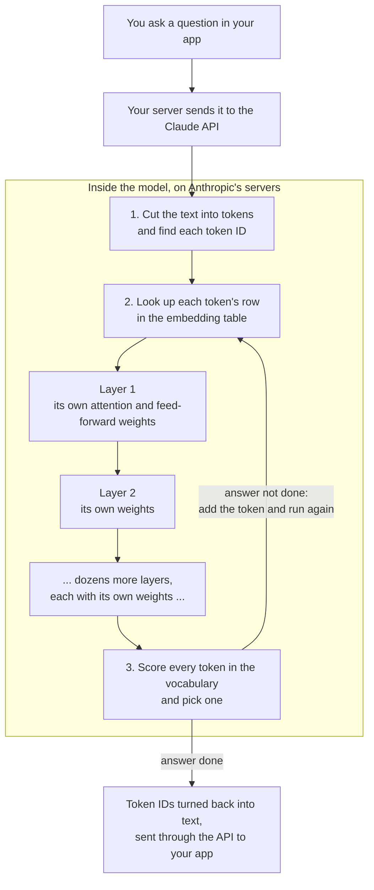
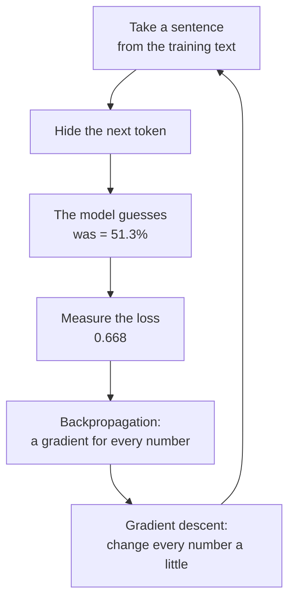

# Deep dive — How does Claude know what to say next?

**Course:** [Building with the Claude API](https://academy.claude.com/courses/building-with-the-claude-api) &nbsp;·&nbsp; **Extra reading for Lesson 1** &nbsp;·&nbsp; **Written:** November 7, 2026

| Previous | Course | Next |
|:---|:---:|---:|
| [← Accessing the API](01-accessing-the-api.md) | [📚 Course index](README.md) | [Getting an API key →](02-getting-an-api-key.md) |

---

Give a model these words and ask it to continue:

```text
The cat sat on the mat because it ...
```

It writes "was". It doesn't look that word up in a database, and no `if/else` rule tells it to. It does math on billions of saved numbers and works out a chance for every word it knows. In the small example on this page, the chances look like this:

| Next word | was | is | sat | cat | mat |
|---|:---:|:---:|:---:|:---:|:---:|
| Chance | **51.3%** | 18.2% | 14.9% | 8.2% | 7.5% |

This page walks through that math with numbers small enough to check by hand. Then it shows how training found those numbers.

---

**On this page**

| # | Section |
|:---:|:---|
| 1 | [Revision summary](#revision-summary) |
| 2 | [What a model is](#what-a-model-is) |
| 3 | [The big picture](#the-big-picture) |
| 4 | [Part 1. What is saved inside the model](#part-1-what-is-saved-inside-the-model) |
| 5 | [Part 2. How the model answers your message](#part-2-how-the-model-answers-your-message) |
| 6 | [Part 3. How the model learned its numbers (training)](#part-3-how-the-model-learned-its-numbers-training) |
| 7 | [Common mix-ups](#common-mix-ups) |
| 8 | [Test yourself](#test-yourself) |
| 9 | [Architect notes: what this means for your work](#architect-notes-what-this-means-for-your-work) |
| 10 | [Recap](#recap) |
| 11 | [My notes / practice](#my-notes--practice) |
| 12 | [FAQ](#faq) |

---

### Revision summary

<details>
<summary><b>Click to open the revision summary</b></summary>

The model is a huge set of numbers that training tuned by playing millions of fill-in-the-blank games, and correcting the model's guesses; when you send a message, the model only reads those numbers to guess your answer one word at a time.

#### What a model is

A model is a big file of numbers plus a fixed set of calculations. It runs only on Anthropic's servers, and your app reaches it through the API. Full explanation: [What a model is](#what-a-model-is).

It does one thing, in a loop:

1. Take the text so far.
2. Give every possible next token a chance.
3. Pick one token, using those chances.
4. Add it to the text, and repeat.

Answering questions, writing code, and summarizing are all this one loop.

#### The 3 things saved inside the model

Training saves these three things. Every request reads them, but no request changes them.

| # | Thing | What it is | In .NET terms | Example |
|:---:|---|---|---|---|
| 1 | **Vocabulary** | The list of every **token** (a word, part of a word, or a symbol) the model knows. Each token has a fixed **token ID**. | An `enum`, or a primary key | `cat` = 2207 |
| 2 | **Embedding table** | One row of numbers for each token ID. That token's row (its **embedding**) describes what the token usually means. | `Dictionary<int, double[]>` | 2207 → `[0.30, 0.70, 0.50]` |
| 3 | **Weights** | All the other learned numbers, stored as grids called **matrices**. Each layer has its own set. | The business logic. The embeddings are the data. | Wq, Wk, Wv, Wo, feed-forward, output matrix |

Key facts:

- A token ID is only a label. It has no meaning by itself.
- Every token's row in the embedding table has the same number of columns. The builders choose that number before training, and it never changes.
- A weight matrix doesn't multiply each number by one weight. Each result adds up **all** the input numbers, each times its own weight.

| Saved inside the model | **Not** saved inside the model |
|---|---|
| The vocabulary, the embedding table, the weights | Your past chats, a copy of the internet, anything after the training cutoff date |

#### Layers

A **layer** is one round of work that every token's row goes through. It adds a little more meaning, then passes the rows on.

| Fact | Detail |
|---|---|
| Each layer has its own weights | Its own attention matrices (Wq, Wk, Wv, Wo) and feed-forward matrices |
| Fixed after training | They change only if the model is trained again, which makes a new model version |
| The number of layers | Chosen by the builders before training. It never changes. |
| Why many layers | Each layer adds meaning only once. For "it" in "The cat sat on the mat because it was comfortable", early layers look at nearby words, middle layers link "it" to the mat or the cat, and late layers expect a verb like "was". |
| What changes per request | Only the working copy of each token's row. It is made fresh and thrown away after. |

#### How the model answers your message

| Step | What happens | Key term |
|:---:|---|---|
| 1 | Cut the text into tokens, and find each token ID | Tokenization |
| 2 | Look up each token's row in the embedding table, and mix in its position | Embedding |
| 3 | Each token borrows meaning from earlier tokens | **Attention** |
| 3a | Each token makes a Query (what it looks for), a Key (what it offers), and a Value (what it hands over), using shared matrices Wq, Wk, Wv | Query, Key, Value |
| 3b | Multiply a Query with each earlier Key, number by number, and add | **Dot product** (match score) |
| 3c | Turn the match scores into percentages that add up to 100% | **Softmax** |
| 3d | Add up the Values, weighted by those percentages, and add the blend to the token's row | Residual connection |
| 4 | Many attentions side by side, joined by Wo, then a feed-forward network. Repeated in dozens of layers. | Multi-head attention |
| 5 | Turn the last token's row into a score for every token, then into chances, then pick one | **Logits**, softmax, **temperature** |
| 6 | Add the picked token and repeat. Stop at an end token, `max_tokens`, or a stop sequence. | — |
| 7 | Turn the token IDs back into text. Your app gets the text, `stop_reason`, and `usage`. | — |

Two rules to remember:

- A token can only look at itself and earlier tokens, never later ones (*causal masking*).
- A low temperature makes answers more consistent, but even temperature 0 doesn't guarantee identical answers.

#### How the model learned its numbers

Every number started random. Training repeats this loop billions of times:

| Step | What happens | Example |
|:---:|---|---|
| 1 | Hide the next token in a sentence, and let the model guess | "…because it ___" → "was" got 51.3% |
| 2 | Measure how wrong the guess was: **loss** = −ln(chance of the right token) | −ln(0.513) = 0.668 |
| 3 | **Backpropagation** works out a **gradient** for every number: should it go up or down? | Gradient of one weight = −0.417 |
| 4 | **Gradient descent** moves every number a little: `new = old − (learning rate × gradient)` | 1.5 → 1.5417, and "was" rises to 52.1% |

Key facts:

| Fact | Detail |
|---|---|
| Where the answer comes from | The sentence itself, so nobody labels anything (*self-supervised learning*). The model never searches the internet. |
| Gradient sign | Negative means "bigger is better". Positive means "smaller is better". |
| Backpropagation and gradient descent | Backpropagation only calculates. Gradient descent makes the changes. |
| Learning rate | A small number, such as 0.1, that keeps each change small |
| Embedding rows | Trained the same way. Only the rows of tokens in the sentence change in that step. |
| One wrong sentence | Changes almost nothing. Wrong text repeated many times can be learned. |
| Two stages | **Pre-training** (guess the next word on huge amounts of text), then **later training** (examples, human feedback, and Constitutional AI teach it to follow instructions and stay safe) |
| Cost | Thousands of special chips for weeks or months, once per model version |

#### Model size, and when to use which

A model's **size** is how many learned numbers (**parameters**) it has. The builders set it by choosing the columns per token's row, the number of layers, and each layer's width.

| | Smaller model (Haiku) | Middle model (Sonnet) | Larger model (Opus) |
|---|---|---|---|
| Speed and cost | Fastest, cheapest | Balanced | Slowest, most expensive |
| Skill on hard tasks | Lowest | Good | Highest |
| Use it when | A simple task runs many times, such as sorting 10,000 support emails into five categories | Most everyday work | A hard task where mistakes are costly, such as finding security risks in a design |

Before paying for a bigger model, test whether the smallest one passes your test questions.

#### Training compared with normal use

| | Training | Normal use (*inference*) |
|---|---|---|
| When | Once, before release | On every request |
| Do the numbers change? | Yes, after every batch | **No. They are only read.** |
| Does the model remember you? | — | No. It is stateless, so your app must resend earlier messages. |

#### Exam takeaways

- **A customer asks if their chats will change the model for other users.** No. Answering only reads the model's numbers. Whether Anthropic keeps or trains on data is set by its terms, so point the customer to those terms. (Governance, Safety & Risk Management)
- **A team gets different answers to the same prompt and wants consistent output.** The model picks each token from a set of chances, so some variety is normal. Lower the temperature, give clear examples, and check the output in code. Even at temperature 0, answers are not guaranteed identical. (Claude Models, Prompting & Context Engineering)
- **A product manager asks why long prompts cost more and run slower.** Every input token goes through every layer, and attention looks back at every earlier token. Send only the text needed, and put fixed text at the start so prompt caching can reuse it. (Solution Design & Architecture)

</details>

---

### What a model is

#### What a model is and what it does

A model is a big file of numbers, often billions of them, plus a fixed set of calculations that use those numbers. Claude models run only on Anthropic's servers. You can't download them, and your app reaches them through the API.

A model does one thing, over and over:

1. Take the text so far.
2. Give every possible next token a chance.
3. Pick one token, using those chances.
4. Add it to the text, and go back to step 1.

Answering a question, writing code, and summarizing a document are all this one loop. An answer is simply the text most likely to come after your question.

```csharp
// A sketch of the idea, not real model code
var tokens = Tokenize("The cat sat on the mat because it");
while (tokens.Count < maxTokens)
{
    double[] chances = model.ScoreNextToken(tokens);  // a chance for every token in the vocabulary
    int next = Pick(chances, temperature);            // pick one at random, using the chances
    if (next == EndToken) break;                      // the model decided the answer is done
    tokens.Add(next);                                 // add it, then loop again
}
```

#### What is saved inside a model, and what is not

| Saved inside the model | Not saved inside the model |
|---|---|
| The **vocabulary**: every token the model knows, each with its token ID | Your past chats. The model is stateless, so it doesn't remember you. |
| The **embedding table**: one row of numbers that describes each token | A copy of the internet, or a database it can look facts up in |
| The **weights**: all the other numbers it learned in training | Anything that happened after its training cutoff date |

Part 1 explains each of the three saved things in detail.

#### What a layer is

A **layer** is one round of work that every token's row of numbers goes through.

```text
In:   every token's row, from the layer before
Work: attention (each token borrows meaning from earlier tokens),
      then feed-forward (each token's row is worked on by itself)
Out:  every token's row, now holding a bit more meaning, sent to the next layer
```

- Each layer has its own weights: its own attention matrices (Wq, Wk, and Wv) and its own feed-forward matrices.
- All layers do the same kind of work. But each has different numbers, so each one adds something different.
- The model uses the rows that come out of the last layer to score the next token.

A layer is like one piece of ASP.NET Core middleware. Each piece takes the request, changes it, and hands it to the next piece. In a model, the "request" is the set of token rows:

```csharp
// A sketch: the layers as a pipeline
foreach (var layer in model.Layers)   // dozens of layers, each with its own fixed weights
    rows = layer.Process(rows);       // attention, then feed-forward
```

| | What it means |
|---|---|
| How many layers a model has | The builders choose this before training, and it never changes. GPT-2, a small public model, has 12. Today's large models have many more. |
| What more layers give you | More rounds to combine meaning, and more weights to store patterns. So the model is usually smarter. |
| What more layers cost you | Every token goes through every layer. Each extra layer adds math for every token, so the model gets slower and more expensive. |

#### Example: what the layers do for "it"

The model has read "The cat sat on the mat because it" and must guess the next word. The row for "it" starts as a copy of its saved row in the embedding table. That saved row is the same in every sentence, so by itself it says nothing about this sentence. Each layer adds a little more:

| After… | What the row of "it" now holds (simplified) |
|---|---|
| The embedding lookup | Only the usual meaning of "it": a word that stands for a thing |
| The early layers | Facts about nearby words. For example, "it" comes right after "because", so a reason is starting. |
| The middle layers | Links to earlier words. For example, "it" probably means the mat or the cat. |
| The late layers | What should come next. For example, after "because it", a verb like "was" or "is" is likely. |
| The last layer | A row for "it" that is ready to be scored, and that gives "was" the highest chance |

> [!NOTE]
> Nobody gives each layer a job. Training decides what each layer does, so the table above is a simplified picture. The point is that one layer combines meaning only once, and understanding a sentence takes many rounds.

> [!WARNING]
> Every token goes through the same layers, but each token can only use the tokens before it. "Cat" is the second word, so it can only look at "The" and itself. It never sees "mat" or "it", because those words come later.

#### What is fixed and what changes

| Part of the model | When it is decided | Does it change when you send a request? |
|---|---|---|
| The vocabulary and every token ID | Before training | No |
| How many columns each token's row in the embedding table has | Before training | No |
| How many layers the model has | Before training | No |
| The embedding table | Learned in training | No |
| Each layer's own Wq, Wk, Wv, Wo, and feed-forward matrices | Learned in training, separately for each layer | No. They change only if the model is trained again, which makes a new model version. |
| The working copy of each token's row, as it moves through the layers | Made fresh for every request | Yes. It is made for your request and thrown away after. |

#### What training is

Training is how a model gets its numbers.

```text
Before training:  the shape is set (vocabulary, columns per row, number of layers),
                  but every number is random, so the model writes nonsense
Training:         a long run of practice that adjusts every number a little at a time
After training:   the numbers are fixed, and the model writes useful text
```

- Anthropic trains each model on thousands of special computer chips for weeks or months.
- This is very expensive, so it happens once for each model version. A newer model, such as a newer Sonnet, comes from a new training run.

Training has two stages:

| Stage | What the model practises | What it learns |
|---|---|---|
| 1. **Pre-training** | Guessing the next word on a huge amount of text from books, websites, and other sources | Language and facts about the world. At this stage it can only continue text, not answer like an assistant. |
| 2. **Later training** | Examples of good answers, feedback from people, and a written set of rules called *Constitutional AI* | To follow instructions, be helpful, and refuse harmful requests |

#### What training does to the model

| | Before training | After training |
|---|---|---|
| The numbers | Random | Tuned by billions of small fixes |
| The rows for "cat" and "kitten" in the embedding table | Unrelated | Similar, because both words appear in similar sentences |
| Given "The cat sat on the" | Guesses a random token | Gives "mat" a high chance |
| Given "Summarize this email" | Just keeps writing more text | Writes a summary, after later training |

Part 3 shows exactly how one of those small fixes works, with real numbers.

#### Why some models are larger than others

A model's **size** is how many learned numbers (*parameters*) it has. The builders set the size before training by choosing three things:

1. How many columns each token's row in the embedding table has.
2. How many layers the model has.
3. How wide each layer is.

More of each means more numbers.

| A larger model… | Because… |
|---|---|
| Is usually smarter on hard tasks, such as long reasoning or tricky code | It has more room to store patterns and facts |
| Is slower and costs more per token | Every token has to pass through all of its numbers |
| Costs much more to train | There are more numbers to adjust, on more text |

That is why providers offer a family of models. Anthropic doesn't publish its model sizes. It describes Haiku as its fastest and cheapest model, Opus as its smartest, and Sonnet as the balance between them.

| | Smaller model (for example, Haiku) | Larger model (for example, Opus) |
|---|---|---|
| Speed | Faster | Slower |
| Cost per token | Lower | Higher |
| Skill on hard tasks | Lower | Higher |
| Use it when | The task is simple and you run it many times, such as sorting 10,000 support emails into five categories | The task is hard and mistakes are costly, such as finding security risks in a system design |

#### Other ways models differ

| Difference | What it changes for you |
|---|---|
| Training text and cutoff date | What the model knows, and how recent that knowledge is |
| Later training | How well it follows your instructions, and when it refuses |
| Settings chosen when it was built, such as the context window size | How much text one request can hold |

---

### The big picture

#### Why this matters to you

As an architect, you'll get these five questions. Each answer comes from one part of how the model works inside.

1. **Why do I pay per token, not per message?** The model reads your text one token at a time and writes its answer one token at a time. Every token goes through all of the model's layers. So a longer prompt or a longer answer means more work, and more cost. See [Part 2, step 1](#step-1-cut-the-text-into-tokens-tokenization).
2. **Why are long prompts slow?** Before the model writes anything, each token in your prompt looks back at every token before it. A long prompt means a lot of looking back. Prompt caching helps when many requests start with the same text, such as the same instructions. The model saves its work on that shared start and reuses it next time. See [Part 2, step 3](#step-3-borrow-meaning-from-earlier-words-attention).
3. **Why does the same question get different answers?** For each next word, the model works out a list of possible words, each with a chance. Then it picks one at random, using those chances. A setting called temperature controls how often it picks a less likely word. See [Part 2, step 5](#step-5-score-every-word-and-pick-one).
4. **Does chatting with the model change it, or make it remember me?** No. Answering only reads the model's saved numbers and never changes them. If the model needs earlier messages, your app must send them again. See [Architect notes](#architect-notes-what-this-means-for-your-work).
5. **Why can the model be wrong or out of date?** The model learned from patterns in its training text, and that text stops at a cutoff date. It has no built-in way to check facts. So give it current information in the prompt, and check important answers. See [Part 3](#part-3-how-the-model-learned-its-numbers-training).

#### The whole story, before any details

1. The model is mostly a huge set of numbers, saved on Anthropic's servers.
2. Your message is cut into small pieces called tokens. Each piece becomes a row of numbers.
3. Each piece borrows meaning from the pieces before it. That is how "bank" can mean a river bank in one sentence and a money bank in another.
4. The model gives every word it knows a chance of coming next. It picks one, adds it to the answer, and repeats until the answer is done.
5. None of this changes the numbers. The numbers were set earlier, in training.
6. Training set them by showing the model billions of sentences with the next word hidden. After each guess, it nudged all the numbers a little toward a better guess.

#### From your question to the answer



Things to notice:

- The loop runs once for every token in the answer. A 300-token answer means 300 trips through all the layers.
- Everything inside the box only reads the saved numbers. Your question never changes the model.

#### The route through this page

First you see what is stored. Then you watch the model use it on one sentence. Then you learn how training produced those numbers. Last, you see what it all means for the systems you design.

#### The example used throughout

```text
The cat sat on the mat because it was comfortable.
```

- In Part 2, the model has read "The cat sat on the mat because it" and must guess the next token. The right answer is "was".
- In Part 3, training uses the same sentence to improve that guess.
- Real models have thousands of numbers per token, which is too many to follow by hand. So the example uses only three.
- The numbers are made up, but each result is calculated from the ones before it. You can redo any step on a calculator.

#### Who's who

| Who | Where they are | What they do |
|---|---|---|
| The builders (people at Anthropic) | Before training | Choose the sizes, such as how many columns each token's row has and how many layers the model has |
| The training process | Anthropic's computers, before release | Hides the next token, checks the guess, and adjusts the numbers |
| The model | Anthropic's servers | The saved numbers, plus the calculations that use them |
| You and your app | Your computer and server | Send text and get the answer. You never change the model. |

---

### Part 1. What is saved inside the model

*A computer can only do math on numbers, so the model needs a way to turn "cat" into numbers. Training saves three things for this.*

#### The vocabulary: from text to a token ID

A fixed list of every token the model knows, each with its own token ID. The IDs below are made up.

| Token | The | cat | sat | on | the | mat | because | it | was |
|---|:---:|:---:|:---:|:---:|:---:|:---:|:---:|:---:|:---:|
| Token ID | 101 | 2207 | 310 | 415 | 102 | 520 | 845 | 340 | 371 |

- Think of it as a huge `enum`, or a table where the token ID is the primary key.
- "The" and "the" are different tokens, because one has a capital letter.
- The vocabulary is built once, before training, from the most common pieces of text. It never changes after that.

> [!WARNING]
> A token ID is only a label. ID 2207 doesn't mean "animal", and 2207 and 2208 aren't similar words just because the numbers are close.

#### What a row of numbers can describe

Say you build a movie app in .NET and score each movie on three traits that you pick:

| Movie | Action | Comedy | Animation |
|---|:---:|:---:|:---:|
| Batman | 9 | 2 | 0 |
| Superman | 8 | 3 | 0 |
| Finding Nemo | 1 | 7 | 10 |
| Toy Story | 2 | 8 | 10 |

Each row describes one movie. Similar movies have similar rows, so your app can find "movies like Batman" by comparing rows.

An embedding table works the same way, with two differences:

1. Nobody names the columns.
2. Nobody types the numbers. Training finds them (Part 3).

#### The embedding table: from a token ID to a row of numbers

A table with one row for every token ID. Each token's row is a list of numbers that describes what that token usually means. Here each token's row has three numbers:

| Token ID | Token | Number 1 | Number 2 | Number 3 |
|---|---|:---:|:---:|:---:|
| 101 | The | 0.20 | 0.40 | 0.10 |
| 2207 | cat | 0.30 | 0.70 | 0.50 |
| 310 | sat | 0.60 | 0.20 | 0.80 |
| 415 | on | 0.10 | 0.50 | 0.30 |
| 102 | the | 0.25 | 0.35 | 0.15 |
| 520 | mat | 0.80 | 0.10 | 0.40 |
| 845 | because | 0.15 | 0.60 | 0.30 |
| 340 | it | 0.40 | 0.30 | 0.70 |

Finding a token's row is a direct lookup by token ID, in SQL or in C#:

```sql
SELECT Number1, Number2, Number3 FROM Embedding WHERE TokenID = 2207;   -- cat → 0.30, 0.70, 0.50
```

```csharp
Dictionary<int, double[]> embedding = LoadEmbeddingTable();   // saved inside the model
double[] catRow = embedding[2207];                            // { 0.30, 0.70, 0.50 }
```

- Each token has its own row, and every token's row has the same number of columns. The builders choose that number before training, and it never changes.
- Real models use hundreds or thousands of columns. The public model GPT-2 has 50,257 tokens with 768 columns each, which is about 38.6 million numbers in its embedding table alone. Anthropic doesn't publish Claude's sizes.
- No single column means "animal" or "grammar". A meaning is spread over many columns, so you compare two tokens by their whole rows, never by one column.
- One row of numbers is called a **vector**. A whole grid of numbers is called a **matrix**.

> [!WARNING]
> The numbers in a token's row are **not** the IDs of other tokens. They describe this token and don't point anywhere else.

#### The weights: everything else the model learned

All the other numbers the model learned. If the embedding table is the data, the weights are the business logic that works on it. They are many matrices, each with its own job, and each layer has its own set.

| Weight matrix | Its job | Where you see it |
|---|---|---|
| Wq, Wk, and Wv, in every layer | Make each token's Query, Key, and Value | Part 2, step 3 |
| Wo and the feed-forward matrices, in every layer | Join the attention results, then work on each token's row | Part 2, step 4 |
| The output matrix, once at the end | Give every token in the vocabulary a score | Part 2, step 5 |

> [!NOTE]
> A **parameter** is any number that training can change, including the embedding rows. A "70-billion-parameter model" has 70 billion learned numbers.

#### How the weights use the embedding numbers

Lesson 1 showed a simple version, with one weight per number:

|  | Number 1 | Number 2 | Number 3 |
|---|:---:|:---:|:---:|
| Embedding numbers | 0.25 | 0.81 | 0.42 |
| Example weights | 0.50 | 0.20 | 0.80 |
| Multiplication result | 0.125 | 0.162 | 0.336 |

That version is too simple, because the numbers never affect each other. In a real model, **each result adds up all the input numbers**, each times its own weight:

```text
result 1 = (number 1 × weight A) + (number 2 × weight B) + (number 3 × weight C)
result 2 = (number 1 × weight D) + (number 2 × weight E) + (number 3 × weight F)
```

- A big weight makes its input count more in that result.
- A negative weight makes its input count against the result.
- No weight "picks" a number. Every result mixes every input, so the model can combine information from all the columns.

> **Remember this:** The vocabulary gives the token ID. The embedding table gives that token's row of numbers. The weights mix the numbers until the model can score the next token.

---

### Part 2. How the model answers your message

*This part follows the model as it reads "The cat sat on the mat because it" and works out the next token. Every step only reads the saved numbers from Part 1.*

The seven steps:

```text
1 Tokens → 2 Rows → 3 Attention → 4 Rest of the layer → 5 Score & pick → 6 Repeat → 7 Text out
```

#### Step 1: cut the text into tokens (tokenization)

**[1 Tokens]** → 2 Rows → 3 Attention → 4 Rest of the layer → 5 Score & pick → 6 Repeat → 7 Text out

*The model can't read letters, so it turns your text into numbers first.*

```text
In:   "The cat sat on the mat because it"
Out:  int[] ids = { 101, 2207, 310, 415, 102, 520, 845, 340 };   // 8 token IDs
```

> [!TIP]
> **Why you care:** the API bills by token, not by word. A long or rare word often becomes several tokens.

#### Step 2: look up each token's row (embedding)

1 Tokens → **[2 Rows]** → 3 Attention → 4 Rest of the layer → 5 Score & pick → 6 Repeat → 7 Text out

*The model needs numbers that describe each token, and they are already saved in the embedding table.*

```csharp
double[] itRow = embedding[340];   // "it" → { 0.40, 0.30, 0.70 }, a working copy of its saved row
```

The model also mixes each token's position into its numbers. Without this, word order would be lost:

```text
"dog bites man"  vs  "man bites dog"
Without position:  the same three rows, so the two sentences look identical
With position:     "dog" as word 1 and "dog" as word 3 get different numbers
```

> [!NOTE]
> The saved row for "it" is the same in every sentence, for every user. That's a problem, because "it" means something different each time. Step 3 fixes this.

#### Step 3: borrow meaning from earlier words (attention)

1 Tokens → 2 Rows → **[3 Attention]** → 4 Rest of the layer → 5 Score & pick → 6 Repeat → 7 Text out

*The row for "it" can't say what "it" refers to, so "it" collects meaning from the words before it.*

```text
In:   the row of "it"            [0.40, 0.30, 0.70]
Out:  a new row for "it"         [0.855, 0.622, 1.144]   // now holds some meaning from "mat", "sat", and the rest
```

Each token makes three new rows from its own row:

| New row | Plain meaning | The same idea in SQL |
|---|---|---|
| **Query** | What this token is looking for | The search you type |
| **Key** | What this token offers to others | The column the search is matched against |
| **Value** | The information this token hands over | The data you get back |

There is one big difference from SQL. SQL returns only the rows that match. Attention gives **every** earlier token a percentage, then adds up a little of each token's Value:

```sql
-- Not real SQL. This only shows the idea: no WHERE filter, every earlier token counts a little.
SELECT SUM(MatchPercent * Value)
FROM EarlierTokens;
```

Attention has five small steps, 3a to 3e.

##### 3a. Make the Query for "it" (matrix multiplication)

```text
In:   row of "it"    [0.40, 0.30, 0.70]
Work: × Wq           (a weight matrix that training learned)
Out:  Query of "it"  [1.10, 0.65]
```

Wq has one row for each of the 3 embedding numbers, and one column for each Query number:

| Wq | Query number 1 | Query number 2 |
|---|:---:|:---:|
| From embedding number 1 | 1.0 | 0.0 |
| From embedding number 2 | 0.0 | 1.0 |
| From embedding number 3 | 1.0 | 0.5 |

```text
Query number 1 = 0.40 × 1.0 + 0.30 × 0.0 + 0.70 × 1.0 = 1.10
Query number 2 = 0.40 × 0.0 + 0.30 × 1.0 + 0.70 × 0.5 = 0.65
```

That is all "matrix multiplication" means: for each result, multiply every input by its weight and add them up.

<details>
<summary>Show the same math in C#</summary>

```csharp
double[] Multiply(double[] row, double[,] W)
{
    var result = new double[W.GetLength(1)];
    for (int col = 0; col < W.GetLength(1); col++)   // for each result number
        for (int i = 0; i < row.Length; i++)         // use every input number
            result[col] += row[i] * W[i, col];       // times its own weight
    return result;
}
// Multiply(itRow, Wq) returns { 1.10, 0.65 }
```

</details>

##### 3b. Make a Key for every earlier token

```text
In:   every token's row     e.g. "mat" [0.80, 0.10, 0.40]
Work: × Wk                  (the same Wk for every token)
Out:  every token's Key     e.g. "mat" [1.55, 0.25]
```

<details>
<summary>Show the math</summary>

| Wk | Key number 1 | Key number 2 |
|---|:---:|:---:|
| From embedding number 1 | 2.0 | 0.5 |
| From embedding number 2 | −0.5 | 0.5 |
| From embedding number 3 | 0.0 | −0.5 |

```text
Key number 1 = 0.80 × 2.0 + 0.10 × −0.5 + 0.40 × 0.0  = 1.55
Key number 2 = 0.80 × 0.5 + 0.10 × 0.5  + 0.40 × −0.5 = 0.25
```

</details>

> [!IMPORTANT]
> **Your question: does every token have its own Wq, Wk, and Wv?** No. Each token has its own row, so it gets its own Query, Key, and Value. But all tokens in one layer use the same three matrices, like calling one C# method on every row of a table. That is why their Queries and Keys can be compared. Each layer has its own three.

> [!WARNING]
> "It" can see "The cat sat on the mat because it", including itself. It can't see "was comfortable", because those words don't exist yet while the model is writing. Hiding later words like this is called *causal masking*.

##### 3c. Score each match (dot product)

```text
In:   Query of "it" [1.10, 0.65]  and each earlier token's Key
Work: multiply number by number, then add (a dot product)
Out:  one match score per earlier token. Bigger means a better match.

"it" with "mat":  1.10 × 1.55 + 0.65 × 0.25 = 1.868
"it" with "cat":  1.10 × 0.25 + 0.65 × 0.25 = 0.438
```

> [!NOTE]
> The model then divides each score by the square root of the Key's length. Here that is √2, about 1.414. This stops the scores from getting too big when rows have thousands of numbers.

##### 3d. Turn scores into percentages (softmax)

```text
In:   the match scores
Work: softmax
Out:  mat 26.8%   sat 16.8%   it 11.8%   the 10.2%   cat 9.7%   The 9.4%   because 7.9%   on 7.4%   (total 100%)
```

"Mat" gets the most attention.

> [!NOTE]
> **Softmax in one minute.** Softmax turns any list of scores into percentages that add up to 100%. It does two things:
> 1. It raises the number *e* (about 2.718) to the power of each score. This makes every result positive and pushes bigger scores further ahead.
> 2. It divides each result by the total of all of them.
>
> ```csharp
> double[] Softmax(double[] scores)
> {
>     var powers = scores.Select(Math.Exp).ToArray();   // e to the power of each score
>     double total = powers.Sum();
>     return powers.Select(p => p / total).ToArray();   // each one's share of the total
> }
> ```
>
> The model uses softmax twice: here for attention, and again in step 5 to pick the next word.

<details>
<summary>Show the full softmax table</summary>

| Earlier token | Key | Dot product | ÷ 1.414 | e to that power | ÷ total |
|---|:---:|:---:|:---:|:---:|:---:|
| The | [0.20, 0.25] | 0.383 | 0.270 | 1.311 | 9.4% |
| cat | [0.25, 0.25] | 0.438 | 0.309 | 1.363 | 9.7% |
| sat | [1.10, 0.00] | 1.210 | 0.856 | 2.353 | 16.8% |
| on | [−0.05, 0.15] | 0.043 | 0.030 | 1.031 | 7.4% |
| the | [0.33, 0.23] | 0.504 | 0.356 | 1.428 | 10.2% |
| **mat** | [1.55, 0.25] | 1.868 | 1.321 | 3.745 | **26.8%** |
| because | [0.00, 0.23] | 0.146 | 0.103 | 1.109 | 7.9% |
| it | [0.65, 0.00] | 0.715 | 0.506 | 1.658 | 11.8% |
| **Total** | | | | **13.997** | **100%** |

</details>

> [!IMPORTANT]
> **Your question: how did the model know "mat" should score highest?** It didn't know. Nobody wrote a rule that "it" means "mat". Training tuned Wq, Wk, and the tokens' rows in the embedding table so the scores help guess the next token. In this sentence, "it" could also mean the cat. Attention doesn't have to decide. It only collects what helps the next guess.

##### 3e. Blend the Values into "it"

```text
In:   each earlier token's Value, and its percentage
Work: multiply each Value by its percentage, add them all up, then add the blend to the row of "it"
Out:  the working row of "it" in this sentence
```

| | Number 1 | Number 2 | Number 3 |
|---|:---:|:---:|:---:|
| Saved row of "it" | 0.40 | 0.30 | 0.70 |
| + Blend from attention | 0.455 | 0.322 | 0.444 |
| = Row of "it" in this sentence | **0.855** | **0.622** | **1.144** |

<details>
<summary>Show the math</summary>

To keep this short, the Wv here just copies each token's row. So each token's Value is the same as its row in the embedding table from Part 1. A real Wv mixes the numbers, just like Wq does in 3a.

```text
blend number 1 = 9.4% × 0.20 (The) + 9.7% × 0.30 (cat) + … + 26.8% × 0.80 (mat) + … = 0.455
blend          = [0.455, 0.322, 0.444]
```

</details>

> [!NOTE]
> The saved row of "it" in the embedding table doesn't change. Only the working copy for this request now holds the meaning of this sentence. The blend is **added**, not swapped in, so "it" keeps its own meaning and gains context on top. This is called a *residual connection*.

> **Remember this:** The Query asks. Each Key answers. Softmax turns the matches into percentages. The Values are what gets handed over.

#### Step 4: the rest of each layer

1 Tokens → 2 Rows → 3 Attention → **[4 Rest of the layer]** → 5 Score & pick → 6 Repeat → 7 Text out

*One attention is only a small part of one layer. These parts also run on every token's working row.*

| Part | What happens | Why it is there |
|---|---|---|
| **Many heads** (*multi-head attention*) | Each layer runs many attentions side by side, each with its own Wq, Wk, and Wv. One more matrix, **Wo**, joins their results back into one row per token. | Different heads can track different links, such as what "it" refers to, or which word is the verb. Training decides what each head does. |
| **Feed-forward network** | Each token's row is made wider (often about four times), passed through a simple bend that cuts or squashes negative numbers, then made narrow again. | Attention moves information between tokens. This step works on what each token now holds. Much of the model's knowledge is stored here. |
| **Normalization** | The model rescales each token's working row so its numbers stay in a steady range. | Without it, the numbers could grow or shrink too much over many layers. |
| **Many layers** | The whole block repeats dozens of times. Each layer has its own weights. | Each layer sharpens the meaning a little more. |

> [!NOTE]
> For a sense of size, GPT-2, a small public model from 2019, has 12 layers, 12 heads per layer, and about 124 million weights. Large models today have billions.

#### Step 5: score every word and pick one

1 Tokens → 2 Rows → 3 Attention → 4 Rest of the layer → **[5 Score & pick]** → 6 Repeat → 7 Text out

*After the last layer, the model turns the final row of "it" into a choice of next token.*

##### 5a. Score every token in the vocabulary (logits)

```text
In:   final row of "it"   [0.855, 0.622, 1.144]
Work: × the output matrix (one column per token in the vocabulary)
Out:  one score per token, called a logit
      was 2.966   is 1.930   sat 1.729   cat 1.136   mat 1.038
```

<details>
<summary>Show the math</summary>

This example's vocabulary has only five tokens.

| Output matrix | was | is | sat | cat | mat |
|---|:---:|:---:|:---:|:---:|:---:|
| From number 1 | **1.5** | 0.8 | 0.6 | 0.2 | 0.4 |
| From number 2 | 0.5 | 0.9 | 0.3 | 1.0 | 0.2 |
| From number 3 | 1.2 | 0.6 | 0.9 | 0.3 | 0.5 |

```text
logit for "was" = 0.855 × 1.5 + 0.622 × 0.5 + 1.144 × 1.2 = 2.966
```

</details>

> [!NOTE]
> Remember the weight **1.5** that connects number 1 to "was". Part 3 uses that exact weight to show how training works.

##### 5b. Turn scores into chances (softmax)

This is the same softmax as in [step 3d](#3d-turn-scores-into-percentages-softmax), now used on the logits.

| Token | was | is | sat | cat | mat |
|---|:---:|:---:|:---:|:---:|:---:|
| Logit | 2.966 | 1.930 | 1.729 | 1.136 | 1.038 |
| Chance | **51.3%** | 18.2% | 14.9% | 8.2% | 7.5% |

##### 5c. Pick one token (temperature)

The model picks one token at random, using the chances, so "was" is picked about half the time. Before softmax, the model divides every logit by the **temperature**:

| Temperature | was | is | sat | cat | mat | Effect |
|:---:|:---:|:---:|:---:|:---:|:---:|---|
| 0.5 | 79.5% | 10.0% | 6.7% | 2.0% | 1.7% | The top token wins more often, so answers are more predictable |
| 1.0 | 51.3% | 18.2% | 14.9% | 8.2% | 7.5% | The chances as calculated |
| 1.5 | 39.8% | 20.0% | 17.5% | 11.8% | 11.0% | Other tokens get more chances, so answers vary more |

Other ways to pick, which you'll see in documentation:

| Method | How it picks |
|---|---|
| **Greedy** | Always the top token. The text can get dull. |
| **Top-k** | Keeps only the k most likely tokens, such as 40, and picks from those |
| **Top-p** | Keeps the top tokens whose chances add up to p, such as 90%, and picks from those |

> [!WARNING]
> A low temperature makes answers more consistent, but not identical. Even at temperature 0, Anthropic doesn't promise the same answer every time. For output your code must parse, such as JSON, also validate it in code. [Lesson 6](06-temperature.md) covers the Claude API's temperature setting.

#### Step 6: repeat until the answer is done

1 Tokens → 2 Rows → 3 Attention → 4 Rest of the layer → 5 Score & pick → **[6 Repeat]** → 7 Text out

*One pass gives one token. The answer needs many.*

```text
Round 1:  "...because it"           → picks "was"
Round 2:  "...because it was"       → picks "comfortable"
Round 3:  "...it was comfortable"   → picks "."
Round 4:  "...comfortable."         → picks the end token, so it stops
```

- Each new token goes through steps 2 to 5, looking back at everything before it.
- The model stops at a special end token, at your `max_tokens` limit, or at one of your stop sequences.

> [!TIP]
> **Why you care:** the model saves the Keys and Values it already made for earlier tokens, so each round it only makes them for the new token. This saved work is called the *KV cache*. Prompt caching builds on the same idea across requests.

#### Step 7: turn token IDs back into text

1 Tokens → 2 Rows → 3 Attention → 4 Rest of the layer → 5 Score & pick → 6 Repeat → **[7 Text out]**

*The model works in token IDs, but your app needs text.*

```text
In:   picked token IDs   { 371, 4012, 13 }
Work: look each ID up in the same vocabulary
Out:  " was comfortable."
```

- The API can send tokens to your app as they are made, so the user sees the answer appear word by word. This is called streaming ([lesson 7](07-response-streaming.md)).
- With the text, your app also receives the `stop_reason` (why the model stopped) and the `usage` token counts ([lesson 1](01-accessing-the-api.md#5-when-the-model-stops-and-what-comes-back)).

---

### Part 3. How the model learned its numbers (training)

*Part 2 used numbers like Wq, Wk, and the output weight 1.5 as if they were just there. This part shows where they came from.*

The training loop:

```text
1 Start random → 2 Hide a word → 3 Loss → 4 Gradient → 5 Backpropagation → 6 Update → back to 2
```

#### Step 1: every number starts random

**[1 Start random]** → 2 Hide a word → 3 Loss → 4 Gradient → 5 Backpropagation → 6 Update

```text
Before training, every token's row in the embedding table and every weight matrix holds small random numbers:
cat  [ 0.25, −0.31,  0.42]
mat  [−0.15,  0.75, −0.21]
```

- The starting numbers can be negative, and they don't have to be between 0 and 1.
- At this point "cat" is no closer to "kitten" than to "refrigerator". The tokens' rows don't mean anything yet.
- Ask an untrained model to continue "The cat sat on the mat because it", and it might say "refrigerator".

#### Step 2: practise with a hidden word

1 Start random → **[2 Hide a word]** → 3 Loss → 4 Gradient → 5 Backpropagation → 6 Update

The training process shows the model the start of a sentence and keeps the next token as the answer. One sentence gives one practice question per token:

| The model is shown | The hidden answer |
|---|---|
| The | cat |
| The cat | sat |
| The cat sat | on |
| … | … |
| The cat sat on the mat because it | **was** |

- The answer comes from the sentence itself, so nobody has to label anything. This is called *self-supervised learning*.
- The model never searches Wikipedia or the internet to check. The training process already has the answer.

> [!IMPORTANT]
> **Your question: why ask the model to guess a word the sentence already has?** Because the model only sees the words before it. The training process keeps the hidden word as the answer key. Practising like this on billions of sentences teaches the model to guess new text well.

#### Step 3: measure how wrong the guess was (loss)

1 Start random → 2 Hide a word → **[3 Loss]** → 4 Gradient → 5 Backpropagation → 6 Update

```text
In:   the model's guess (from Part 2): "was" got 51.3%
Work: loss = −ln(chance of the right token)        // ln is the natural log button on a calculator
Out:  loss = −ln(0.513) = 0.668
```

| Chance given to the right token | Loss | What it means |
|:---:|:---:|---|
| 10% | 2.30 | Very wrong |
| 50% | 0.69 | Unsure |
| **51.3%** ("was") | **0.668** | Unsure |
| 90% | 0.11 | Mostly right |
| 99% | 0.01 | Almost perfect |

The goal of training is the lowest possible average loss over all the training text.

> [!IMPORTANT]
> **Your question: how does the model know "the cat sat on the mat" is more likely than "the dog sat on the mat"?** It doesn't know what is true. It learned what was common in its training text. If "mat" often came after "sat on the", training pushed the numbers to give "mat" a high chance there.

#### Step 4: find which way to move a number (the gradient)

1 Start random → 2 Hide a word → 3 Loss → **[4 Gradient]** → 5 Backpropagation → 6 Update

*To make the next guess better, training must change the numbers. First it needs to know which way to move each one.*

Let's follow the 1.5 weight from Part 2, step 5a. It helped make the score for "was". Make it 0.01 bigger and run the guess again:

| | Weight | Loss |
|---|:---:|:---:|
| Before | 1.50 | 0.6684 |
| 0.01 bigger | 1.51 | 0.6642 |

```text
The loss went down by 0.0042 when the weight went up by 0.01.
0.0042 ÷ 0.01 = 0.42, so the loss falls about 0.42 for every 1 the weight grows.
Gradient = −0.42
```

| Gradient | What it means | So the number should |
|:---:|---|---|
| Positive | Bigger makes the loss worse | Get smaller |
| Negative | Bigger makes the loss better | Get bigger |
| Zero | This number didn't affect the guess | Stay the same |

#### Step 5: get every gradient at once (backpropagation)

1 Start random → 2 Hide a word → 3 Loss → 4 Gradient → **[5 Backpropagation]** → 6 Update

*Testing one number at a time would take billions of reruns. Backpropagation gets every gradient in one pass.*

```text
In:   the loss
Work: go backward through every step of Part 2: from the scores, through every layer, into the embedding rows
Out:  a gradient for every number in the model
```

<details>
<summary>Show the math for the 1.5 weight</summary>

```text
gradient = (the input this weight multiplies) × (chance of "was" − 1)
         = 0.855 × (0.513 − 1)
         = −0.417
```

That matches the −0.42 from step 4, without any reruns.

</details>

> [!WARNING]
> Backpropagation only calculates. It doesn't change any number. Gradient descent, in step 6, makes the changes.

#### Step 6: change every number a little (gradient descent)

1 Start random → 2 Hide a word → 3 Loss → 4 Gradient → 5 Backpropagation → **[6 Update]**

```text
Rule:  new value = old value − (learning rate × gradient)

       new value = 1.5 − (0.1 × −0.417)
                 = 1.5 + 0.0417
                 = 1.5417
```

The **learning rate** (here 0.1) is a small number that keeps each change small, so one sentence can't push the model too far.

| | Weight | Chance of "was" | Loss |
|---|:---:|:---:|:---:|
| Before the update | 1.5000 | 51.3% | 0.668 |
| After one update | 1.5417 | 52.1% | 0.651 |

Taking away a negative gradient makes the number bigger, which matches the table in step 4. Training changes every number this way, not just this one.

> [!IMPORTANT]
> **Your question: what does gradient descent do with a gradient of −0.5?** It makes the number bigger: `old − (0.1 × −0.5) = old + 0.05`.

The whole training loop, repeated billions of times:



#### The embedding rows are trained the same way

```text
Tokens in the sentence ("it", "mat", "cat", …):  their rows in the embedding table get gradients and change a little
Tokens not in the sentence ("refrigerator"):     their rows stay exactly the same in this step
```

- This is how the random rows from step 1 slowly get meaning.
- "Cat" and "kitten" appear in similar sentences, such as "I fed the ___". So their rows get pushed the same way, and after billions of steps they end up close.
- Wq, Wk, Wv, Wo, the feed-forward matrices, and the output matrix are all trained in this same loop.

#### How real training is different from this example

| In this example | In real training |
|---|---|
| One sentence, then an update | Many sentences at once (a *batch*), gradients averaged, then an update. This smooths out any one odd sentence. |
| The plain update rule | Improved versions of gradient descent, such as *Adam*, which pick a step size for each number |
| One update | A very long run of steps. Most text is read once or a few times. One full pass over all the text is an *epoch*. |
| Next-word practice only | Followed by later training, which teaches the model to follow instructions and stay safe (feedback from people and *Constitutional AI*) |

#### Can one wrong sentence spoil what the model learned?

Usually not. Say the model read "cats are animals" thousands of times, then read "The cat is a refrigerator" once. That one change is tiny, and it is averaged with many other sentences.

> [!WARNING]
> If wrong text appears many times, the model can learn it. That is why the quality of training text matters.

---

### Common mix-ups

| ❌ Wrong idea | ✅ What really happens |
|---|---|
| The numbers in a token's row are IDs of related words. | They describe the token itself. Token IDs only label tokens. |
| Each weight multiplies one number, and a big weight picks that number. | Each result adds up all the inputs, each times its own weight. Nothing is picked. |
| Backpropagation changes the numbers. | Backpropagation only calculates. Gradient descent makes the changes. |
| Only the weights are trained. The embedding table stays fixed. | The embedding rows are trained in the same loop. |
| Every token has its own Wq, Wk, and Wv. | All tokens in a layer share the same three. Each layer has its own set. |
| The model learns from my chats. | Answering only reads the numbers. Nothing from your chat is saved inside the model. |

---

### Test yourself

<details>
<summary>1. A weight is 2.0, its gradient is +0.8, and the learning rate is 0.1. What is the new weight?</summary>

The new weight is 1.92, because `2.0 − (0.1 × 0.8) = 1.92`. A positive gradient means bigger makes the loss worse, so the weight gets smaller.
</details>

<details>
<summary>2. The Query of "it" is [1.10, 0.65]. The Key of "sat" is [1.10, 0.00]. What is their dot product?</summary>

The dot product is 1.21, because `1.10 × 1.10 + 0.65 × 0.00 = 1.21`.
</details>

<details>
<summary>3. Why can't "it" look at "comfortable" in "The cat sat on the mat because it was comfortable"?</summary>

"Comfortable" comes after "it". The model writes left to right, so later words don't exist yet. This is called causal masking.
</details>

<details>
<summary>4. Your app asked for JSON twice with the same prompt and got slightly different JSON the second time. Why, and what do you do?</summary>

The model picks each token at random using its chances, so a different token can win the second time. Lower the temperature to make answers more consistent, but don't rely on it, because even temperature 0 doesn't guarantee identical output. Validate the JSON in code, and retry or repair it when it doesn't match your schema.
</details>

---

### Architect notes: what this means for your work

#### Training compared with normal use

| | Training | Normal use (inference) |
|---|---|---|
| When | Once, before release | On every request |
| Where the text comes from | Books, websites, and other text | Your request |
| The next token is | Hidden, so the guess can be checked | Unknown, so the model picks it |
| Loss and gradients | Yes, for every batch | No |
| The numbers change | Yes, after every batch | **No. They are only read.** |
| Remembers you next time | — | No. Your app must resend earlier messages. |

The short version: **context = compute = cost.** Every token you send or receive is work the model does, and you pay for it.

#### Cost

- You pay per token, and every input token goes through every layer. So long documents cost money even when the answer is short. Send only the passages needed, for example with retrieval (lessons 32–38).
- Each output token needs a full trip through the model. That is one reason output tokens cost more than input tokens. Ask for only the length you need, and check current prices on Anthropic's pricing page.

#### Speed

- Each new token looks back at every earlier token. The attention part of the work grows with the square of the prompt length: twice as many tokens means about four times as much attention work. So long prompts are slower, especially before the first word of the answer.
- Prompt caching (lessons 43–45) saves the work done on an unchanged start of a prompt. Later requests that start the same way are faster and cheaper. Put fixed text, such as instructions and reference documents, at the start.

#### Limits

- The **context window** is the most tokens one request can hold, counting your input and the answer. The model can only use what is in that request. Look up each model's limit.
- The model only knows its training text, up to a cutoff date. For newer facts, put them in the prompt or give the model a search tool.

#### Security and data

- The model is stateless. Your app must store the chat history and send it again on every request:

  ```csharp
  // A sketch: your app keeps the history, not the model
  var history = new List<Message> { new("user", "What is quantum computing?") };
  string reply = await claude.SendAsync(history);   // send the whole history
  history.Add(new("assistant", reply));
  history.Add(new("user", "Explain it more simply."));
  reply = await claude.SendAsync(history);          // send everything again
  ```

  Store that history securely, because your app is now responsible for it.
- Attention treats all text in the prompt the same way. There is no wall between your instructions and text from a document. It is like building a SQL query by pasting user input into the string: hidden text in a document can act as an instruction. This is called *prompt injection*. Tag untrusted text, limit which tools the model can use, and check its output.
- Whether Anthropic keeps or trains on your data is set by its terms and your contract. Your requests don't change that. Check the current terms for each customer.

#### Design trade-offs

- Answers vary because tokens are picked from chances. For tasks that need the same answer, such as sorting into categories, lower the temperature, give examples, and check the output in code. Don't promise a customer identical answers.
- Smaller models have fewer weights, so each token needs less math. They are faster and cheaper, but usually less smart. Test the smallest model that passes your test questions first.

---

### Recap

- **Saved inside:** the vocabulary turns text into token IDs. The embedding table turns each ID into a row of numbers (the data). The weights mix those numbers (the business logic).
- **Weights mix:** each result adds up all the inputs, each times its own weight.
- **Layers:** every token's row passes through dozens of layers. Each layer has its own fixed weights and adds a little more meaning.
- **Answering:** cut into tokens, look up rows and add position, borrow meaning through attention, repeat over many layers, score every token, pick one, repeat, and turn the token IDs back into text.
- **Attention:** Query, Key, and Value from shared matrices. A dot product scores each match, softmax makes percentages, and the Values are blended in.
- **Picking:** softmax turns scores into chances. Temperature controls how spread out they are, but even temperature 0 doesn't guarantee identical answers.
- **Training:** every number starts random. The model guesses a hidden token, the loss measures the error, backpropagation finds every gradient, and gradient descent moves every number a little.
- **Normal use:** answering only reads the numbers. The model is stateless, never learns from your chat, and doesn't remember you.

---

## My notes / practice

- [ ] Work out the Query of "it" by hand. `[0.40, 0.30, 0.70]` times Wq should give `[1.10, 0.65]`.
- [ ] Work out the Key of "cat" with Wk. You should get `[0.25, 0.25]`.
- [ ] Put the C# `Multiply` and `Softmax` methods in a console app. Use them to make the Keys and attention percentages for all eight tokens.
- [ ] Do softmax by hand for two scores, 2.966 and 1.930. Check that the two chances add up to 100%.
- [ ] Explain backpropagation and gradient descent out loud in under a minute, using the change from 1.5 to 1.5417.

---

## FAQ

**Q1. What does "token ID" mean?**
A token ID is the fixed number the vocabulary gives each token, such as 2207 for "cat". It is only a label, like a primary key. Two close IDs are not similar words.

**Q2. Are the numbers in an embedding row the IDs of other tokens?**
No. The numbers describe the token itself. `[0.30, 0.70, 0.50]` describes "cat" and doesn't point to any other row.

**Q3. What do the columns of the embedding table mean?**
No column has a name or one clear meaning. Training fills the columns in and spreads each meaning over many of them. So you compare tokens by their whole rows, never by one column.

**Q4. Why are some models larger than others, and when should I use a smaller one?**
A larger model has more learned numbers, so it can store more patterns and handle harder tasks. But every token passes through all those numbers, so it is slower and costs more. Use a smaller model like Haiku for simple work you run many times, and a larger one like Opus for hard thinking.

**Q5. Does every token have its own Wq, Wk, and Wv?**
No. All tokens in a layer share the same three matrices, and each layer has its own set. Each token still gets its own Query, Key, and Value, because it starts from its own row.

**Q6. Why can't a token look at the words after it?**
The model writes left to right, so later words don't exist yet. Attention only looks at the token itself and the tokens before it. This is called causal masking.

**Q7. Where do the embedding numbers come from?**
They start random. Training changes the embedding-table rows of the tokens in each practice sentence a little, billions of times. In the end, words used in similar sentences have similar rows.

**Q8. Why does training make the model guess a word the sentence already has?**
The model only sees the words before the hidden word. The training process keeps that word as the answer key. Practising this way on billions of sentences teaches the model to guess new text well.

**Q9. What does "loss" mean?**
Loss is one number that says how wrong a guess was: −ln(the chance given to the right token). A 90% chance gives 0.11, and a 10% chance gives 2.30.

**Q10. What is the difference between backpropagation and gradient descent?**
Backpropagation works out which way each number should move to lower the loss. Gradient descent then moves each number: `new = old − (learning rate × gradient)`.

**Q11. (Exam angle) A customer asks whether their employees' chats will change how the model answers other customers. How do you answer?**
No. Answering only reads the model's numbers, and the model keeps no memory between requests. Whether Anthropic keeps or trains on data is set by its terms, so point the customer to Anthropic's current terms and data-retention options. (Governance, Safety & Risk Management)

**Q12. (Exam angle) A team gets different answers to the same prompt in a sorting task and needs consistent output. What do you recommend?**
Explain that the model picks each token from a set of chances, so some variety is normal. Lower the temperature, give clear examples, and check the output in code. Answers get more consistent, but not identical, even at temperature 0. (Claude Models, Prompting & Context Engineering)

**Q13. (Exam angle) A product manager asks why requests with long documents cost more and run slower. What do you say, and what do you change?**
Every input token goes through every layer, and attention looks back at every earlier token. So cost and time grow with the prompt. Send only the passages needed, and put fixed text at the start so prompt caching can reuse it. (Solution Design & Architecture)

---

| Previous | Course | Next |
|:---|:---:|---:|
| [← Accessing the API](01-accessing-the-api.md) | [📚 Course index](README.md) | [Getting an API key →](02-getting-an-api-key.md) |
