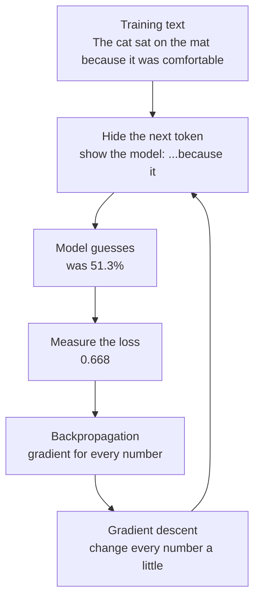
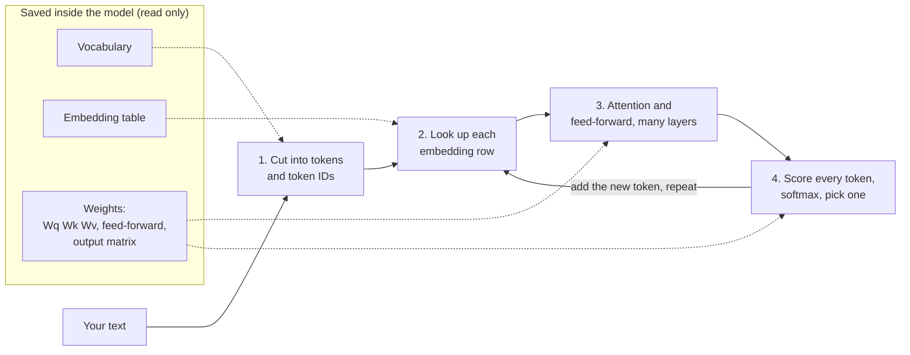

# Deep dive — How a language model learns and thinks

**Course:** [Building with the Claude API](https://academy.claude.com/courses/building-with-the-claude-api) &nbsp;·&nbsp; **Extra reading for Lesson 1:** What happens inside the model &nbsp;·&nbsp; **Written:** November 7, 2026

| Previous | Course | Next |
|:---|:---:|---:|
| [← Accessing the API](01-accessing-the-api.md) | [📚 Course index](README.md) | [Getting an API key →](02-getting-an-api-key.md) |

---

This page is not a course lesson. It answers the questions I had about [lesson 1's "What happens inside the model"](01-accessing-the-api.md#4-what-happens-inside-the-model), from the vocabulary all the way to how the model picks its next word. Everything here goes beyond the course. It is general knowledge about how large language models work, and it is true of models like Claude in outline. Anthropic does not publish the exact sizes or settings inside Claude.

Every number on this page is made up so the math stays small. But the numbers are not random: each result was calculated from the ones before it, so you can redo the math yourself and get the same answer.

**On this page**

| # | Section |
|:---:|:---|
| 1 | [Revision summary](#revision-summary) |
| 2 | [The big picture](#the-big-picture) |
| 3 | [Who's who](#whos-who) |
| 4 | [1. The three things saved inside the model](#1-the-three-things-saved-inside-the-model) |
| 5 | [2. Where the embedding numbers come from](#2-where-the-embedding-numbers-come-from) |
| 6 | [3. How training teaches the model](#3-how-training-teaches-the-model) |
| 7 | [4. How training fixes the numbers](#4-how-training-fixes-the-numbers) |
| 8 | [5. How words take meaning from their neighbours (attention)](#5-how-words-take-meaning-from-their-neighbours-attention) |
| 9 | [6. What else happens in each layer](#6-what-else-happens-in-each-layer) |
| 10 | [7. How the model picks the next token](#7-how-the-model-picks-the-next-token) |
| 11 | [8. Training compared with normal use](#8-training-compared-with-normal-use) |
| 12 | [Common mix-ups](#common-mix-ups) |
| 13 | [Test yourself](#test-yourself) |
| 14 | [Architect notes](#architect-notes) |
| 15 | [Recap](#recap) |
| 16 | [My notes / practice](#my-notes--practice) |
| 17 | [FAQ](#faq) |

---

### Revision summary

#### In one sentence

A language model is a very large collection of numbers that a training process tuned by showing it billions of sentences with the next word hidden, measuring how wrong its guess was, and nudging every number slightly so the next guess is better; when you later send it a message, it turns your words into rows of numbers, lets each word borrow meaning from the words before it, and calculates a chance for every possible next word, without changing any of its numbers.

#### What training saves inside the model

Training builds three things and saves them in the model. Your request reads them but never changes them.

- The **vocabulary** is the list of every token the model knows. A **token** is a small piece of text, such as a word, part of a word, or a symbol such as "?". Each token has a fixed number called its **token ID**, for example `cat` = 2207. A token ID is only a label, like a primary key in a database table. It carries no meaning.
- The **embedding table** has one row of numbers for each token ID. The row is called the token's **embedding** (or *embedding vector*), and it describes the token's usual meaning. The whole table is called the *embedding matrix*.
- The **weights** are all the other numbers the model learned. They are stored as many tables of numbers (called *matrices*) spread over many layers. They hold what the model knows about how words affect each other and which word tends to come next.
- A weight matrix does not multiply one number by one weight. Each number it produces is a **weighted sum of all** the input numbers. That mixing is how the model combines information.

#### How the embedding numbers get their values

Nobody types the embedding numbers in. They start random and training adjusts them.

- Before training, every row is filled with small random numbers, positive and negative, centred near zero. They do not need to be between 0 and 1.
- Every row has the same number of columns. The model's designers choose that number before training. Real models use hundreds or thousands of columns. For example, the public model GPT-2 has 50,257 tokens with 768 numbers each, about 38.6 million numbers in its embedding table alone.
- Nobody names the columns. After training, words used in similar sentences have similar rows. You compare two words by comparing their whole rows, never one column, because no single column means one thing.

#### How training teaches the model

Training turns ordinary text into practice questions with known answers.

- The training process takes a sentence such as "The cat sat on the mat," shows the model only the start ("The cat sat on the"), and hides the next token ("mat"). The model guesses, and the training process compares the guess with the hidden token.
- The right answer comes from the text itself, so no person has to label anything (this is called *self-supervised learning*). The model never searches the internet to check its guess.
- **Loss** is a score of how wrong the guess was. It is calculated as minus the natural log of the chance the model gave the right token. A chance of 10% gives a loss of 2.30, 50% gives 0.69, 90% gives 0.11, and 99% gives 0.01.

#### How training fixes the numbers

After each guess, two steps adjust the numbers. Backpropagation works out which way to change each number, and gradient descent makes the change.

- A **gradient** answers this question for one number: "If I make this number slightly bigger, does the loss go up or down, and how fast?" A positive gradient means bigger makes the loss worse. A negative gradient means bigger makes the loss better.
- **Backpropagation** calculates the gradient of every number in the model in one backward pass, starting from the loss and working back through each calculation. It changes nothing by itself.
- **Gradient descent** changes each number with the rule `new value = old value − (learning rate × gradient)`. The **learning rate** is a small setting, such as 0.1 in a toy example, that keeps each change small. Subtracting the gradient always moves the number in the direction that lowers the loss.
- The embedding numbers are trained the same way as the weights. Only the rows of tokens that took part in the calculation get changed in that step.
- One wrong sentence in the training text barely changes anything, because each change is tiny and is averaged over many sentences. Many wrong sentences can teach the model wrong patterns, so the quality of training text matters.

#### How words take meaning from their neighbours (attention)

A word's saved row is the same in every sentence, so each word needs to borrow meaning from the words around it. **Attention** is how it does that.

- Each token is turned into three new rows by multiplying its embedding by three weight matrices: a **Query** (what this token is looking for), a **Key** (what this token offers to others), and a **Value** (the information this token passes on). The matrices are called Wq, Wk, and Wv.
- Every token uses the **same** Wq, Wk, and Wv within one layer. Each layer has its own set.
- To find which earlier tokens matter to a token, the model multiplies its Query with each earlier token's Key, number by number, and adds the results (a **dot product**). It divides the scores by the square root of the Key length so they don't grow too big.
- **Softmax** turns the scores into percentages that add up to 100%. It raises the number *e* (about 2.718) to the power of each score and divides each result by the total.
- The token then takes that percentage of each earlier token's Value, adds them up, and adds the result to its own row.
- A token can only look at itself and the tokens **before** it, never after it (this is called *causal masking*), because the model writes from left to right.
- Each layer runs many attentions side by side (*multi-head attention*), then a **feed-forward network** that processes each token on its own. Real models stack dozens of such layers. The model also mixes in position information, because attention alone doesn't know word order.

#### How the model picks the next token

After the last layer, the model scores every token in its vocabulary and picks one.

- The model multiplies the last token's final row by an output matrix. That gives one score (called a **logit**) for every token in the vocabulary.
- Softmax turns the logits into chances that add up to 100%. The model then draws one token according to those chances (*sampling*), adds it to the answer, and repeats the whole process for the next token.
- **Temperature** divides the logits before softmax. A low temperature makes the likely token even more likely, and a high temperature spreads the chances out. The Claude API covers this setting in lesson 6.
- The model stops when it picks a special end token, when it reaches the `max_tokens` limit, or when it writes a stop sequence.

#### Training compared with normal use

Training changes the numbers. Normal use (*inference*) only reads them.

- During training, the model guesses, the loss is measured, backpropagation finds the gradients, and gradient descent changes the numbers. This happens once, on Anthropic's computers, before the model is released.
- During inference, the model reads the saved numbers to answer your request. Nothing it learns from your message is saved in its numbers. It does not remember your last conversation unless your app sends that conversation again.

#### Exam takeaways

- **A customer asks whether their conversations will change the model's behaviour for other users.** Sending requests does not change the model's numbers, because answering a request only reads them. Whether a provider may keep data or use it for future training is a separate question of contract and data policy, so point the customer to the provider's data-retention and training terms. (Governance, Safety & Risk Management)
- **A team sees different answers to the same prompt and wants more consistent output.** The model draws each token from a set of chances, so variety is normal. Lower the temperature, give clearer instructions and examples, and validate the output. A lower temperature makes answers more consistent but does not guarantee identical answers. (Claude Models, Prompting & Context Engineering)
- **A product manager asks why very long prompts cost more and are slower, and how to reduce that.** Every input token is processed through every layer, and each token's attention looks at all the tokens before it, so the work grows with length. Cut text the model doesn't need, retrieve only relevant passages, and use prompt caching for a long start of the prompt that doesn't change. (Solution Design & Architecture)

---

### The big picture

Everything on this page follows one example sentence:

```text
The cat sat on the mat because it was comfortable.
```

The question the model has to answer: after reading "The cat sat on the mat because it", what token comes next? (The right answer is "was".)

| Part | Plain meaning | When it happens | Section |
|---|---|---|:---:|
| Vocabulary, embedding table, weights | The three sets of saved numbers | Built during training, read on every request | 1 |
| Random start | All numbers begin as random guesses | Before training | 2 |
| Next-token practice | Hide the next word, guess it, score the guess | Training | 3 |
| Fixing the numbers | Find which way each number should move, then move it a little | Training | 4 |
| Attention | Each word borrows meaning from earlier words | Every request (and during training) | 5 |
| The rest of a layer | More processing, repeated in many layers | Every request (and during training) | 6 |
| Picking the next token | Score every token, turn scores into chances, draw one | Every request (and during training) | 7 |

> **Remember this:** Training sets the numbers. Your request only reads them.

---

### Who's who

| Player | Where it lives | What it does | Example |
|---|---|---|---|
| The training text | Anthropic's training computers | Supplies sentences with the right answers inside them | "The cat sat on the mat because it was comfortable." |
| The training process | Anthropic's training computers, before release | Hides the next token, scores the model's guess, and changes the model's numbers | Changes one weight from 1.5 to 1.5417 |
| The model | Anthropic's servers | Saved numbers plus the fixed math that uses them; it guesses the next token | Gives "was" a 51.3% chance |
| You and your app | Your computer and your server | Send text and receive the answer; never change the model | Sends "What is quantum computing?" |
| The model's designers (people at Anthropic) | Before training | Choose the sizes: vocabulary size, columns per row, number of layers | "Every row has 768 numbers" (GPT-2's choice) |

---

### 1. The three things saved inside the model

A computer can only do math on numbers. So before the model can work with "cat", it needs to turn "cat" into numbers. Training leaves three things saved inside the model for this.

#### The vocabulary: a lookup from text to ID

The **vocabulary** is the list of every token the model knows, each with a fixed **token ID**. For our sentence (the IDs are made up):

| Token | The | cat | sat | on | the | mat | because | it | was |
|---|:---:|:---:|:---:|:---:|:---:|:---:|:---:|:---:|:---:|
| Token ID | 101 | 2207 | 310 | 415 | 102 | 520 | 845 | 340 | 371 |

- "The" and "the" are different tokens, because a capital letter is a different piece of text.
- A token ID is only a label. ID 2207 does not mean "animal," and IDs 2207 and 2208 are not similar words. Think of it as an `int` primary key in a database table.
- The vocabulary is built once, just before training starts, by finding the most common pieces of text. It never changes afterward.

#### The embedding table: one row of numbers per token

The **embedding table** has one row for every token ID. Each row is a list of numbers that describes that token. Our toy table has 3 numbers per row (real models have thousands):

| Token ID | Token | Number 1 | Number 2 | Number 3 |
|---|---|:---:|:---:|:---:|
| 101 | The | 0.20 | 0.40 | 0.10 |
| 2207 | cat | 0.30 | 0.70 | 0.50 |
| 310 | sat | 0.60 | 0.20 | 0.80 |
| 415 | on | 0.10 | 0.50 | 0.30 |
| 102 | the | 0.25 | 0.35 | 0.15 |
| 520 | mat | 0.80 | 0.10 | 0.40 |
| 845 | because | 0.15 | 0.60 | 0.30 |
| 340 | it | 0.40 | 0.30 | 0.70 |

Looking up a row is a direct lookup by key, like this SQL:

```sql
SELECT Number1, Number2, Number3
FROM Embedding
WHERE TokenID = 2207;   -- cat
-- returns 0.30, 0.70, 0.50
```

> **Your question:** Are the numbers in a row other token IDs? **No.** 0.30, 0.70, and 0.50 are measurements that describe "cat". They don't point to other rows. Token IDs identify. Embedding numbers describe.

#### The weights: everything else the model learned

The **weights** are all the other numbers. They are not one table. They are many tables of numbers (each called a **matrix**, meaning a grid of rows and columns), and each layer of the model has its own. Sections 5 to 7 use three kinds of them:

| Weight matrix | What it does | Section |
|---|---|:---:|
| Wq, Wk, Wv (in every layer) | Turn a token's row into its Query, Key, and Value | 5 |
| Feed-forward matrices (in every layer) | Process each token's row further | 6 |
| The output matrix (once, at the end) | Turn the final row into a score for every token in the vocabulary | 7 |

A big model has billions of weights. That is what "a 70-billion-parameter model" means: 70 billion learned numbers, embeddings included (a **parameter** is any number the training process can change).

#### How the three work together: weights mix all the numbers

Lesson 1 showed weights like this, with one weight per number:

|  | Number 1 | Number 2 | Number 3 |
|---|:---:|:---:|:---:|
| Embedding numbers | 0.25 | 0.81 | 0.42 |
| Example weights | 0.50 | 0.20 | 0.80 |
| Multiplication result | 0.125 | 0.162 | 0.336 |

That is a simplified picture, and it hides the most important part. In a real model, **each result number uses all the input numbers**. A weight matrix has one weight for every pair of "input number" and "result number". Each result is a weighted sum of all the inputs:

```text
result 1 = (input 1 × weight) + (input 2 × weight) + (input 3 × weight)
```

The weights decide how much each input counts. A high weight does not "pick" a number; it makes that input count more in the sum. A negative weight makes an input count against the result. Because every result mixes every input, the model can combine information, for example "has to do with animals" and "is the subject of the sentence." Section 5, step 1 works through a full example.

> **Remember this:** The vocabulary turns text into IDs. The embedding table turns IDs into rows of numbers. The weights mix and reshape those rows until the model can score the next token.

---

### 2. Where the embedding numbers come from

#### First, an example where a person picks the numbers

Imagine you build a movie recommender in .NET and score each movie on three traits yourself:

| Movie | Action | Comedy | Animation |
|---|:---:|:---:|:---:|
| Batman | 9 | 2 | 0 |
| Superman | 8 | 3 | 0 |
| Finding Nemo | 1 | 7 | 10 |
| Toy Story | 2 | 8 | 10 |

Similar movies have similar rows, so your app can find "movies like Batman." You chose the columns and you typed the numbers.

An embedding table is the same idea with two differences:

1. **Nobody names the columns.** The designers only choose how many columns there are.
2. **Nobody types the numbers.** The training process finds them.

#### The numbers start random

Before training, every row is filled with small random numbers. They can be negative, and they don't need to be between 0 and 1:

| Token | Number 1 | Number 2 | Number 3 |
|---|:---:|:---:|:---:|
| cat (before training) | 0.25 | −0.31 | 0.42 |
| mat (before training) | −0.15 | 0.75 | −0.21 |

At this point, "cat" and "kitten" are no more alike than "cat" and "refrigerator". The rows mean nothing yet.

#### Training slowly gives them meaning

During training (sections 3 and 4), every time a token takes part in a guess, its row gets nudged in whichever direction makes the guess better. Words that appear in similar sentences ("cat" and "kitten" both appear before "purred" and after "fed the") get nudged in similar directions. After billions of nudges, similar words end up with similar rows, without anyone deciding what any column means.

#### Answers to the questions about rows and columns

| Question | Answer |
|---|---|
| How many columns does a real model have? | Hundreds or thousands. The designers choose the number before training. GPT-2 (a public model) uses 768. Anthropic does not publish Claude's number. |
| Does every token have the same number of columns? | Yes. Every row in one embedding table has exactly the same columns, like every row in a database table. |
| Are the starting numbers between 0 and 1? | No. They are small random numbers centred near zero, positive and negative. |
| Does one column mean "animal" or "grammar"? | No. A meaning is spread across many columns at once. That is why you compare whole rows. |
| Can I tell two words are similar from one column? | No. "Bank" 0.25 and "river" 0.30 in one column says nothing. Similarity is measured over all the columns together. |
| What are the words "vector" and "matrix"? | One row of numbers is a **vector**. A whole table of numbers is a **matrix**. |

---

### 3. How training teaches the model

#### Where the right answer comes from

The training process has the whole sentence. It turns it into practice questions by hiding one token at a time:

| Model is shown | Hidden right answer |
|---|---|
| The | cat |
| The cat | sat |
| The cat sat | on |
| The cat sat on | the |
| The cat sat on the | mat |
| The cat sat on the mat | because |
| The cat sat on the mat because | it |
| The cat sat on the mat because it | **was** |
| … | … |

Think of an exam. The training text is the answer key. The model is the student who only sees the question. The training process is the teacher who marks the answer.

> **Your question:** Why ask the model to predict a word the sentence already contains? Because the model is only shown the part before the word. The point is to practise guessing, the way a student practises on questions whose answers the teacher already has. Practise on billions of sentences and the model gets good at guessing text it has never seen.

> **Your question:** Does the model search Wikipedia to check its guess? **No.** The answer is already in the training text, and the training process just compares. During training the model never browses anything.

#### The model's guess

For the question "The cat sat on the mat because it ___", our toy model (worked out fully in sections 5 and 7) gives these chances:

| Possible next token | was | is | sat | cat | mat |
|---|:---:|:---:|:---:|:---:|:---:|
| Model's chance | **51.3%** | 18.2% | 14.9% | 8.2% | 7.5% |

A real vocabulary has many thousands of tokens, so the chances are spread over all of them. Our toy vocabulary has only these five.

#### Loss: how wrong was the guess?

**Loss** turns "how much chance did the model give the right answer?" into one number. The usual formula is `loss = −ln(chance of the right token)` (this is called *cross-entropy loss*; `ln` is the natural logarithm, a button on any scientific calculator).

| Chance given to the right token | Loss | Meaning |
|:---:|:---:|---|
| 10% | 2.30 | Very wrong |
| 50% | 0.69 | Unsure |
| **51.3%** (our toy model, "was") | **0.668** | Unsure |
| 90% | 0.11 | Mostly right |
| 99% | 0.01 | Almost perfect |

Loss never goes below zero, and it gets very large when the model gives the right answer almost no chance. The whole goal of training is to make the average loss over all the training text as small as possible.

> **Your question:** How does the model "know" that "The cat sat on the mat" is more likely than "The dog sat on the mat"? It doesn't know which is true. Its chances reflect patterns in the training text. If "mat" often followed "sat on the" in the text it trained on, training pushed its numbers toward giving "mat" a high chance there. Both sentences are fine English; the chances only reflect what was common.

---

### 4. How training fixes the numbers

The model's guess came from its numbers. To make the next guess better, training must change those numbers. But which ones, in which direction, and by how much? We'll answer that with one real weight from our toy model.

#### The nudge test: what a gradient means

In section 7, the score for "was" uses a weight in the output matrix whose value is **1.5**. Let's try making it a little bigger and rerun the whole calculation:

| | Weight value | Chance of "was" | Loss |
|---|:---:|:---:|:---:|
| Now | 1.50 | 51.3% | 0.6684 |
| Nudged up by 0.01 | 1.51 | a little higher | 0.6642 |

The loss went **down** by 0.0042 when the weight went **up** by 0.01. Dividing, the loss changes by −0.0042 ÷ 0.01 = **−0.42** for each step of 1 in the weight. That number is the weight's **gradient**: how fast the loss changes when this one weight grows.

| Gradient | Meaning | So the weight should… |
|:---:|---|---|
| Positive (such as +0.40) | Making the weight bigger makes the loss worse | Get smaller |
| Negative (such as −0.42) | Making the weight bigger makes the loss better | Get bigger |
| Zero | This weight didn't affect this guess | Stay the same |

#### Backpropagation: every gradient at once

The nudge test works, but a model with billions of numbers would need billions of reruns for one guess. **Backpropagation** gets the same answers for every number in one pass, without rerunning.

Think of a large Excel spreadsheet: inputs in the first cells, formulas in between, and the loss in the last cell. Backpropagation starts at the loss cell and walks backward through each formula. At each step it asks, "if this cell's input changed a little, how much would this cell's output change?" and multiplies those answers along the way back (calculus calls this the *chain rule*). When it reaches the first cells, it has the gradient for every one of them.

For our weight, the math gives an exact formula: gradient = (the input number this weight multiplies) × (chance of "was" − 1) = 0.855 × (0.513 − 1) = **−0.417**. That matches the −0.42 from the nudge test, which is how you know backpropagation isn't guessing.

Backpropagation only **calculates**. It doesn't change any number.

#### Gradient descent: making the change

**Gradient descent** changes every number using its gradient:

```text
new value = old value − (learning rate × gradient)
```

The **learning rate** keeps the step small, so one sentence can't throw the numbers far off. With a learning rate of 0.1:

```text
new value = 1.5 − (0.1 × −0.417)
          = 1.5 + 0.0417
          = 1.5417
```

Subtracting a negative gradient made the weight bigger, which is exactly what the table above said should happen. Now rerun the guess with the new weight:

| | Weight | Chance of "was" | Loss |
|---|:---:|:---:|:---:|
| Before the update | 1.5000 | 51.3% | 0.668 |
| After one update | 1.5417 | 52.1% | 0.651 |

One update, one weight, a small improvement. Training does this to **every** number at once, after every batch of sentences.

> **Your question:** What would gradient descent do with a gradient of −0.5? Increase the number. Subtracting a negative value adds to it: `old − (0.1 × −0.5) = old + 0.05`.

Think of it as walking down a hill in fog. The loss is your height. Backpropagation tells you which way is downhill for each step you could take. Gradient descent takes a small step that way.



#### The embedding rows get fixed too

Backpropagation doesn't stop at the weights. It keeps walking back, past attention, into the embedding rows of the tokens that were in the sentence: "it", "mat", "cat", and the rest. Those rows get their own gradients and their own small updates. Rows of tokens that weren't in the sentence, such as "refrigerator", get a gradient of zero in that step and stay the same. Over billions of steps, every row that appears in the training text gets shaped.

Wq, Wk, Wv, the feed-forward matrices, and the output matrix are trained in exactly the same loop. There is no separate training method for them.

#### How real training differs from this toy

- **Batches.** Real training guesses for a large batch of text at once, averages the gradients, and then updates. Averaging smooths out any single odd sentence.
- **Better update rules.** Real training uses improved versions of gradient descent (a common one is called *Adam*) that adjust the step size for each number. The idea is the same.
- **How many times.** Most training text is read about once or a few times (each full pass is called an *epoch*), but the numbers are updated over a very long run of steps.
- **More training afterward.** This next-token practice (*pre-training*) gives a model that continues text. Further training then teaches it to follow instructions and be helpful and safe. Anthropic uses methods such as human feedback and its own written principles (*Constitutional AI*) for this stage.

#### Can one wrong sentence damage what the model learned?

Suppose the model has seen "cats are animals" thousands of times and then reads "The cat is a refrigerator." The update from that one sentence is tiny and is averaged with the rest of its batch, so the model barely moves. If the training text said it thousands of times, the model would learn it. That is why the quality of training text matters: the model learns whatever patterns are common in it, true or not.

---

### 5. How words take meaning from their neighbours (attention)

#### Why the saved row isn't enough

The row for "it" is the same in every sentence: `[0.40, 0.30, 0.70]`. But "it" means something different in "The cat sat on the mat because it was comfortable" and in "I dropped my phone and it broke." To predict "was" well, "it" needs to pull in information from the words around it. **Attention** does that.

#### The idea in database terms

| Part | Plain meaning | Database comparison |
|---|---|---|
| **Query** | What this token is looking for | The search you type |
| **Key** | What this token offers, used for matching | The indexed column a search matches against |
| **Value** | The information this token hands over | The columns you get back |

The comparison has one important difference. SQL either matches a row or doesn't (`WHERE ... LIKE`). Attention gives **every** earlier token a match score, turns the scores into percentages, and returns a blend of all the Values, mostly from the best matches:

```sql
-- Not real SQL: what attention does, written as SQL
SELECT SUM(MatchPercent * Value)
FROM EarlierTokens;   -- every earlier token contributes a little
```

Now let's do it with real numbers for "it". There are five steps.

#### Step 1: make the Query (matrix multiplication)

Wq is a small table of weights, learned in training. It has one row per embedding number (3) and one column per Query number. The designers chose 2 Query numbers here to keep the math small:

| Wq | Query number 1 | Query number 2 |
|---|:---:|:---:|
| From embedding number 1 | 1.0 | 0.0 |
| From embedding number 2 | 0.0 | 1.0 |
| From embedding number 3 | 1.0 | 0.5 |

Each Query number is a weighted sum of **all three** embedding numbers of "it" `[0.40, 0.30, 0.70]`, using one column of Wq:

```text
Query number 1 = 0.40 × 1.0 + 0.30 × 0.0 + 0.70 × 1.0 = 1.10
Query number 2 = 0.40 × 0.0 + 0.30 × 1.0 + 0.70 × 0.5 = 0.65

Query of "it" = [1.10, 0.65]
```

That is all **matrix multiplication** is: for each result number, multiply each input by its weight and add them up. In C#:

```csharp
double[] Multiply(double[] row, double[,] W)       // row: 3 numbers, W: 3 x 2
{
    var result = new double[W.GetLength(1)];        // 2 results
    for (int col = 0; col < W.GetLength(1); col++)  // for each result number
        for (int i = 0; i < row.Length; i++)        // add up every input number
            result[col] += row[i] * W[i, col];      // times its weight
    return result;
}
// Multiply(itRow, Wq) returns { 1.10, 0.65 }
```

#### Step 2: make a Key for every earlier token

Wk is another learned table, the same shape as Wq but with different numbers:

| Wk | Key number 1 | Key number 2 |
|---|:---:|:---:|
| From embedding number 1 | 2.0 | 0.5 |
| From embedding number 2 | −0.5 | 0.5 |
| From embedding number 3 | 0.0 | −0.5 |

The model runs every token through the **same** Wk, the same way you call one C# method for every row of a table. For "mat" `[0.80, 0.10, 0.40]`:

```text
Key number 1 = 0.80 × 2.0 + 0.10 × −0.5 + 0.40 × 0.0  = 1.55
Key number 2 = 0.80 × 0.5 + 0.10 × 0.5  + 0.40 × −0.5 = 0.25
```

> **Your question:** Does every token have its own Wq, Wk, and Wv? **No.** Every token has its own embedding row and gets its own Query, Key, and Value. But all tokens use the same three matrices within one layer. Each layer has its own three. That is why "it" and "mat" can be compared at all: their Keys and Queries were made the same way.

**"It" can only look back.** "It" can see "The cat sat on the mat because it", including itself, but not "was comfortable". In a model that writes from left to right, the words after "it" don't exist yet when the model is writing "it". Hiding the later tokens is called *causal masking*.

#### Step 3: score each match (dot product)

To score how well the Query of "it" matches a Key, multiply them number by number and add the results. This is a **dot product**:

```text
"it" with "mat": 1.10 × 1.55 + 0.65 × 0.25 = 1.705 + 0.163 = 1.868
"it" with "cat": 1.10 × 0.25 + 0.65 × 0.25 = 0.275 + 0.163 = 0.438
```

A bigger result means a better match. Real models then divide every score by the square root of the Key length (here √2 ≈ 1.414), so the scores stay in a manageable range when rows have thousands of numbers.

#### Step 4: turn scores into percentages (softmax)

**Softmax** turns any list of scores into percentages that add up to 100%. It raises *e* (about 2.718) to the power of each score, which makes every result positive and stretches bigger scores further ahead. Then it divides each result by the total.

| Earlier token | Key | Dot product | ÷ 1.414 | e to that power | ÷ total (14.00) |
|---|:---:|:---:|:---:|:---:|:---:|
| The | [0.20, 0.25] | 0.383 | 0.270 | 1.311 | 9.4% |
| cat | [0.25, 0.25] | 0.438 | 0.309 | 1.363 | 9.7% |
| sat | [1.10, 0.00] | 1.210 | 0.856 | 2.353 | 16.8% |
| on | [−0.05, 0.15] | 0.043 | 0.030 | 1.031 | 7.4% |
| the | [0.33, 0.23] | 0.504 | 0.356 | 1.428 | 10.2% |
| **mat** | [1.55, 0.25] | 1.868 | 1.321 | 3.745 | **26.8%** |
| because | [0.00, 0.23] | 0.146 | 0.103 | 1.109 | 7.9% |
| it | [0.65, 0.00] | 0.715 | 0.506 | 1.658 | 11.8% |
| **Total** | | | | **13.997** | **100%** |

"Mat" gets the most attention, 26.8%. Notice that nobody wrote a rule saying "it refers to mat". The percentages come only from multiplying the learned numbers in Wq, Wk, and the embedding table.

> **Your question:** How did the model "know" to give "mat" the highest score? It didn't know. Training tuned Wq, Wk, and the embedding rows so that the matches they produce help predict the next token. Here, the best match happens to be "mat". In a real model, this exact sentence is honestly ambiguous ("it" could be the cat), and attention doesn't have to pick one. It only has to gather information that helps the next guess.

#### Step 5: blend the Values and add them to "it"

Wv turns each token's row into its Value. To keep the tables short, our toy Wv simply copies the embedding row, so each Value equals the row from section 1. (A real Wv mixes the numbers just like Wq does.) "It" takes each token's Value times its percentage and adds them up:

```text
blend number 1 = 9.4% × 0.20 (The) + 9.7% × 0.30 (cat) + ... + 26.8% × 0.80 (mat) + ... = 0.455
blend = [0.455, 0.322, 0.444]
```

Then the blend is **added** to the original row of "it":

| | Number 1 | Number 2 | Number 3 |
|---|:---:|:---:|:---:|
| Saved row of "it" (never changes) | 0.40 | 0.30 | 0.70 |
| + Blend from attention | 0.455 | 0.322 | 0.444 |
| = Working row of "it" in this sentence | **0.855** | **0.622** | **1.144** |

The saved row in the embedding table stays exactly as it was. Only this working copy, used for this one request, carries the context. Adding the blend instead of replacing the row (called a *residual connection*) keeps the original meaning of "it" while adding context.

> **Remember this:** Query asks, Key answers, softmax turns the matches into percentages, and Value is what gets handed over.

---

### 6. What else happens in each layer

Section 5 was one attention, in one layer. A real model does much more. Each item below works on the working rows from section 5.

| Part | What it does | Why it exists |
|---|---|---|
| **Many heads** (*multi-head attention*) | Each layer runs many attentions side by side, each with its own Wq, Wk, Wv. Their results are joined and mixed by one more weight matrix. | One head might track "what does 'it' refer to?", another "what is the verb?" Nobody assigns these jobs; training shapes them. |
| **Feed-forward network** | After attention, each token's row goes through two large matrix multiplications with a simple bend in between (negative results are cut off or squashed). | Attention moves information between tokens. The feed-forward step processes what each token now holds. Much of the model's stored knowledge lives in these weights. |
| **Normalization** (*layer normalization*) | Rescales each row so its numbers stay in a steady range. | Without it, numbers can grow or shrink out of control over many layers. |
| **Many layers** | The whole block (attention, then feed-forward) repeats in dozens of layers, each with its own weights. | Early layers capture simple patterns, later layers more abstract meaning. Each layer refines the working rows from the one before. |
| **Position information** | The model mixes each token's position into the math. A common method rotates the Query and Key numbers by an amount that depends on position (*rotary position embedding*, or RoPE). | Attention by itself treats a sentence like a bag of words. Without position, "dog bites man" and "man bites dog" would look alike. |

How big this gets: GPT-2, a small public model from 2019, has 12 layers, 12 heads per layer, and about 124 million weights. Today's large models have far more layers and billions of weights. Anthropic doesn't publish the sizes of Claude models.

---

### 7. How the model picks the next token

#### Step 1: score every token in the vocabulary

After the last layer, the model takes the working row of the **last** token ("it": `[0.855, 0.622, 1.144]`) and multiplies it by the **output matrix**. The output matrix has one column for every token in the vocabulary, so the result is one score per token. These raw scores are called **logits**. Our toy output matrix:

| Output matrix | was | is | sat | cat | mat |
|---|:---:|:---:|:---:|:---:|:---:|
| From number 1 | **1.5** | 0.8 | 0.6 | 0.2 | 0.4 |
| From number 2 | 0.5 | 0.9 | 0.3 | 1.0 | 0.2 |
| From number 3 | 1.2 | 0.6 | 0.9 | 0.3 | 0.5 |

The score for "was" is `0.855 × 1.5 + 0.622 × 0.5 + 1.144 × 1.2 = 2.966`. The **1.5** in bold is the weight that section 4 updated.

#### Step 2: turn the scores into chances

Softmax, the same as in section 5, turns the logits into chances:

| Token | was | is | sat | cat | mat |
|---|:---:|:---:|:---:|:---:|:---:|
| Logit | 2.966 | 1.930 | 1.729 | 1.136 | 1.038 |
| Chance | **51.3%** | 18.2% | 14.9% | 8.2% | 7.5% |

#### Step 3: pick one, using temperature

The model doesn't always take the top token. It draws one, like a weighted lucky draw, so "was" wins about half the time. **Temperature** divides the logits before softmax and changes how spread out the chances are:

| Temperature | was | is | sat | cat | mat | Effect |
|:---:|:---:|:---:|:---:|:---:|:---:|---|
| 0.5 | 79.5% | 10.0% | 6.7% | 2.0% | 1.7% | Safer, more repeatable |
| 1.0 | 51.3% | 18.2% | 14.9% | 8.2% | 7.5% | As trained |
| 1.5 | 39.8% | 20.0% | 17.5% | 11.8% | 11.0% | More varied, more surprising |

Other ways of picking, which you may see named in documentation:

- **Greedy decoding** always takes the top token. It gives the same answer every time for the same input, but text can become dull or repetitive.
- **Top-k** keeps only the k most likely tokens (for example 40) and draws from those.
- **Top-p** keeps the smallest group of top tokens whose chances add up to p (for example 90%) and draws from those.

The Claude API's temperature setting is covered in [lesson 6](06-temperature.md).

#### Step 4: repeat until done

The chosen token ("was") is added to the text. It gets its own embedding row, goes through every layer (looking back at everything before it), and the model scores the next token, and so on. The model stops when it picks a special end-of-answer token, reaches your `max_tokens` limit, or writes one of your stop sequences ([lesson 1](01-accessing-the-api.md#5-when-the-model-stops-and-what-comes-back)).

The model doesn't redo the work for earlier tokens on each round. It saves the Keys and Values it already calculated (the *KV cache*) and only calculates them for the new token.

---

### 8. Training compared with normal use

| | Training | Normal use (inference) |
|---|---|---|
| When | Once, before the model is released | Every time anyone sends a request |
| Where | Anthropic's training computers | Anthropic's servers |
| Text comes from | Huge collections of books, websites, and other text | Your request |
| Next token is | Hidden, then compared with the guess | Unknown; the model picks it |
| Loss, backpropagation, gradient descent | Yes, on every batch | No |
| Numbers change? | Yes, every step | **No.** They are only read. |
| Remembers you next time? | Not applicable | No. Your app must send the earlier conversation again. |

This is the whole journey of your request, using the saved numbers:



Things to notice:

- The arrows from the saved box are dotted because the request only **reads** from it.
- Stages 1 to 4 are the same four stages as lesson 1. This page explained what happens inside each one.

---

### Common mix-ups

| ❌ Wrong idea | ✅ What really happens |
|---|---|
| "The numbers in an embedding row are IDs of related words." | They are measurements that describe the token. Token IDs only label tokens. |
| "Each weight multiplies one embedding number, and a high weight picks that number." | Each result is a weighted sum of all the input numbers. A high weight makes one input count more in the sum; it doesn't pick anything. |
| "Backpropagation changes the numbers." | Backpropagation only calculates the gradients. Gradient descent makes the changes. |
| "Only the weights are trained; the embedding table is fixed." | The embedding rows are trained in the same loop, with their own gradients. |
| "Every token has its own Wq, Wk, and Wv." | All tokens share the same three matrices within one layer. Each layer has its own set. |
| "The model learns from my conversation." | Answering only reads the numbers. Nothing is saved into the model, and it doesn't remember you next time. |

---

### Test yourself

<details>
<summary>1. A weight has a gradient of +0.8 and the learning rate is 0.1. Does the weight go up or down, and to what value if it starts at 2.0?</summary>

Down, to 1.92. The rule is `2.0 − (0.1 × 0.8) = 1.92`. A positive gradient means making the weight bigger would make the loss worse, so gradient descent makes it smaller.
</details>

<details>
<summary>2. The Query of "it" is [1.10, 0.65] and the Key of "sat" is [1.10, 0.00]. What is their match score before scaling?</summary>

1.21. The dot product is `1.10 × 1.10 + 0.65 × 0.00 = 1.21`.
</details>

<details>
<summary>3. Why can't "it" pay attention to "comfortable" in "The cat sat on the mat because it was comfortable"?</summary>

The model writes from left to right. When it is processing "it", the words after it don't exist yet, so attention only looks at "it" and the tokens before it (causal masking).
</details>

<details>
<summary>4. The model gave the right token a 90% chance. Roughly what is the loss, and is that good?</summary>

About 0.11 (−ln 0.9). That is good: loss is 0 for a perfect guess, and it grows quickly as the chance of the right token falls (2.30 at 10%).
</details>

---

### Architect notes

#### Cost

- You pay per token, and every input token goes through every layer of the model. Long documents in a prompt cost real money even if the answer is short. Send only the passages the model needs, for example by retrieving relevant chunks (RAG, lessons 32–38) instead of whole files.
- Output tokens are generated one at a time, each a full pass through the model, which is one reason output tokens cost more than input tokens. Ask for the length you need. Prices change, so check Anthropic's current pricing page.

#### Speed

- Each new token's attention looks back at every earlier token, so very long prompts take longer, especially before the first answer token appears. Keep prompts lean when speed matters.
- Prompt caching (lessons 43–45) saves the work the model already did on an unchanged start of your prompt, so later requests that begin with the same text are faster and cheaper. Put the parts that never change, such as instructions and reference documents, at the start.

#### Limits

- The **context window** is the most tokens one request can hold (your input plus the answer). Attention can only use what is inside it, so anything you want the model to consider must be sent in that request. Look up each model's current limit.
- The model's knowledge comes from training text up to a cutoff date. It can't know newer facts unless you put them in the prompt or give it a search tool.

#### Security and data

- The model keeps no memory between requests, because inference doesn't change its numbers. Any memory your app needs (earlier conversation, user preferences) must be stored by your app and sent again. Store that data securely, because your app now holds it.
- Attention treats every token in the context the same way: there is no built-in wall between your instructions and text from a document or web page. That is why text hidden in a document can steer the model (*prompt injection*). Mark untrusted content with clear tags, limit what tools the model may use, and validate outputs.
- Whether Anthropic keeps or trains on your data is a policy and contract question, not something your requests do to the model. Check Anthropic's current commercial terms and data-retention options for each customer.

#### Design trade-offs

- Answers vary because tokens are drawn from chances. For tasks that need the same answer each time, such as classification, lower the temperature, give examples, and check the output in code. Don't promise a customer identical answers.
- Smaller models have fewer weights, so each token needs less math: they are faster and cheaper, but usually less capable. Test the smallest model that passes your evaluation set before choosing a bigger one.

---

### Recap

- **Three saved things.** The vocabulary gives each token an ID, the embedding table gives each ID a row of numbers, and the weights mix and reshape those numbers. Training saves all three; requests only read them.
- **Weights mix numbers.** Each result of a weight matrix is a weighted sum of all its inputs.
- **Random start.** Every number starts random. Nobody names the columns or types the values.
- **Practice with hidden answers.** Training hides the next token, the model guesses, and loss measures how wrong the guess was.
- **Fixing the numbers.** Backpropagation calculates every gradient; gradient descent moves every number a small step against its gradient. Embedding rows are trained the same way.
- **Attention.** Each token makes a Query, Key, and Value with shared matrices, scores earlier tokens by dot product, turns the scores into percentages with softmax, and adds a blend of their Values to its own working row.
- **Layers.** Many heads, a feed-forward step, normalization, and position information, repeated in dozens of layers.
- **Picking.** The final row becomes a score for every token, softmax turns scores into chances, temperature reshapes them, and the model draws one token at a time until it stops.

---

## My notes / practice

- [ ] Redo the Query of "it" by hand: `[0.40, 0.30, 0.70]` times Wq should give `[1.10, 0.65]`.
- [ ] Calculate the Key of "cat" with Wk and check that you get `[0.25, 0.25]`.
- [ ] Type the C# `Multiply` function into a console app and use it to make the Keys for all eight tokens.
- [ ] Calculate the softmax of `[2.966, 1.930]` by hand, using only those two tokens, and check that the chances add up to 100%.
- [ ] Explain backpropagation and gradient descent out loud in under one minute, using the 1.5 → 1.5417 example.

---

## FAQ

**Q1. What does "token ID" mean, and does the number carry any meaning?**
A token ID is the fixed number the vocabulary gives each token, such as 2207 for "cat". It is only a label, like a primary key in a database table. Two close IDs are not similar words.

**Q2. Are the numbers in an embedding row the IDs of other tokens?**
No. They are measurements that describe the token itself. For example, the row `[0.30, 0.70, 0.50]` describes "cat" and doesn't point to any other row.

**Q3. What do the columns of the embedding table mean?**
No single column has a name or one meaning. The designers only choose how many columns there are, and training fills them in. A meaning is spread across many columns, so you compare two words by their whole rows.

**Q4. Where do the embedding numbers come from?**
They start as small random numbers, positive and negative. Training nudges the rows of the tokens in each practice sentence, billions of times, until words used in similar sentences have similar rows.

**Q5. Why does training ask the model to predict a word that the sentence already contains?**
The model is shown only the words before the hidden word, and the training process keeps the hidden word as the answer key. Practising this on billions of sentences teaches the model to guess text it has never seen.

**Q6. What does "loss" mean?**
Loss is one number that says how wrong a guess was. It is minus the natural log of the chance the model gave the right token: 0.11 for a 90% chance, 2.30 for a 10% chance. Training tries to make the average loss as small as possible.

**Q7. What is the difference between backpropagation and gradient descent?**
Backpropagation calculates a gradient for every number: which way, and how strongly, that number affects the loss. Gradient descent then changes each number with `new = old − (learning rate × gradient)`. The first one calculates; the second one changes.

**Q8. Can one wrong sentence in the training text undo what the model learned?**
Usually not. Each update is tiny and is averaged with many other sentences. But if wrong information appears often in the training text, the model can learn it, which is why the quality of training text matters.

**Q9. Does every token have its own Wq, Wk, and Wv?**
No. Every token has its own embedding row and gets its own Query, Key, and Value, but all tokens share the same three matrices within one layer. Each layer has its own three.

**Q10. Why can't a token pay attention to the words after it?**
The model writes from left to right, so later words don't exist yet when it processes a token. Attention only looks at the token itself and the tokens before it (causal masking).

**Q11. (Exam angle) A customer asks whether their employees' conversations will change how the model answers other customers. How do you answer?**
No. Answering a request only reads the model's numbers and never changes them, and the model keeps no memory between requests. Whether a provider may keep data or use it to train future models is a separate contract and data-policy question, so point the customer to Anthropic's current commercial terms and data-retention options. (Governance, Safety & Risk Management)

**Q12. (Exam angle) A team gets different answers to the same prompt and needs more consistent output for a classification task. What do you recommend?**
Explain that the model draws each token from a set of chances, so some variation is normal. Lower the temperature, give clear instructions and examples, and validate the output in code. A lower temperature makes answers more consistent but doesn't guarantee identical answers. (Claude Models, Prompting & Context Engineering)

**Q13. (Exam angle) A product manager asks why requests with long documents cost more and respond more slowly. What do you tell them, and what do you change?**
Every input token is processed through every layer, and each token's attention looks back at all earlier tokens, so cost and time grow with prompt length. Send only relevant passages (retrieval), and put unchanging text such as instructions and reference documents at the start so prompt caching can reuse the work. (Solution Design & Architecture)

---

| Previous | Course | Next |
|:---|:---:|---:|
| [← Accessing the API](01-accessing-the-api.md) | [📚 Course index](README.md) | [Getting an API key →](02-getting-an-api-key.md) |
