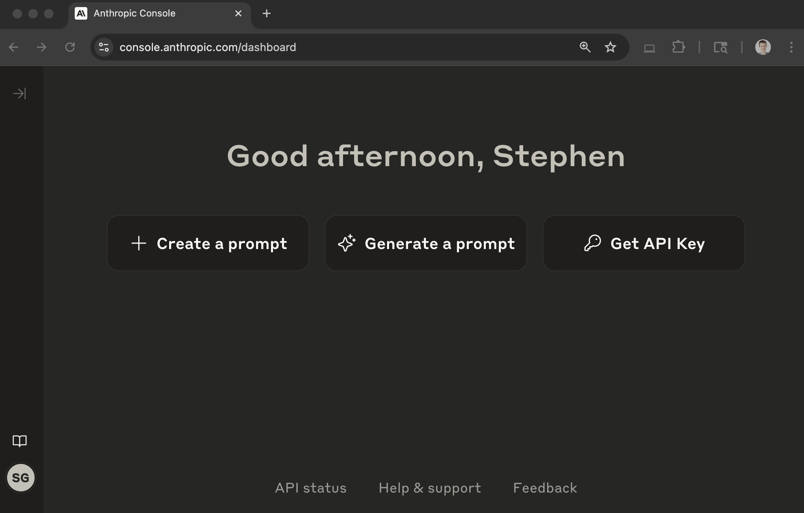
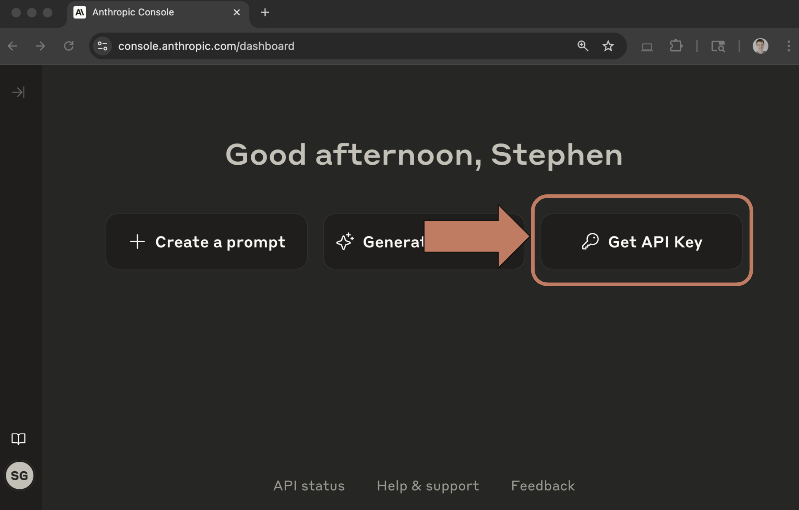
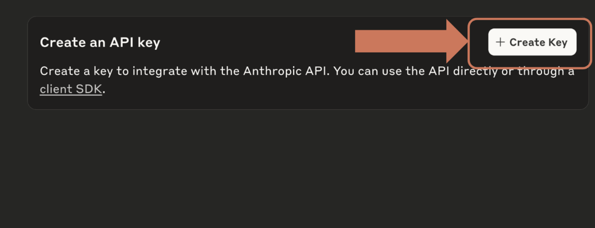
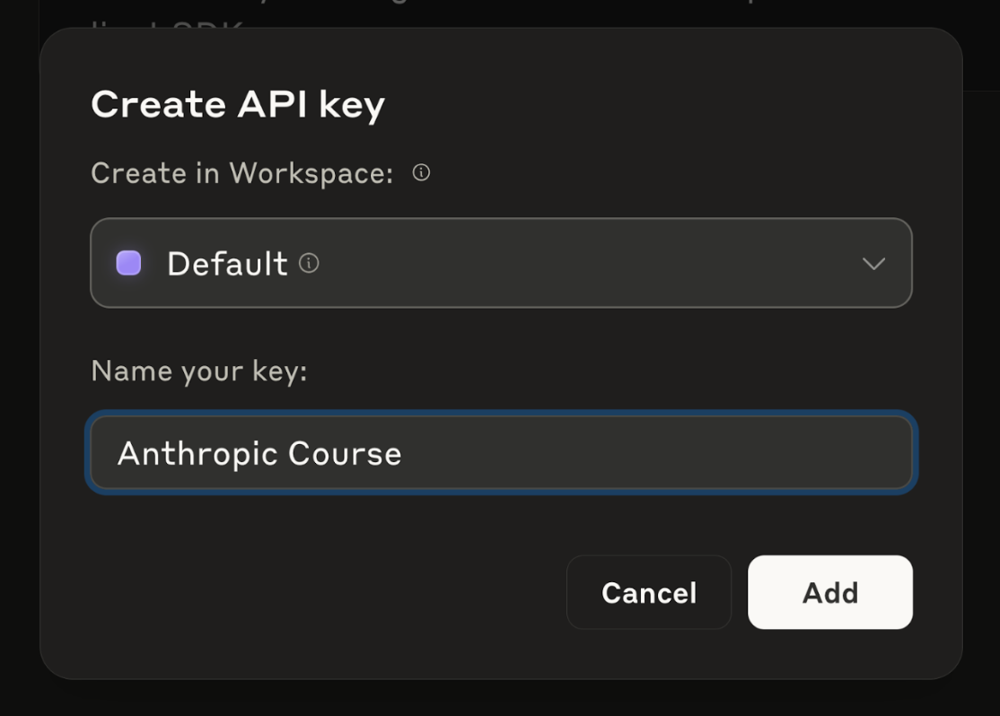
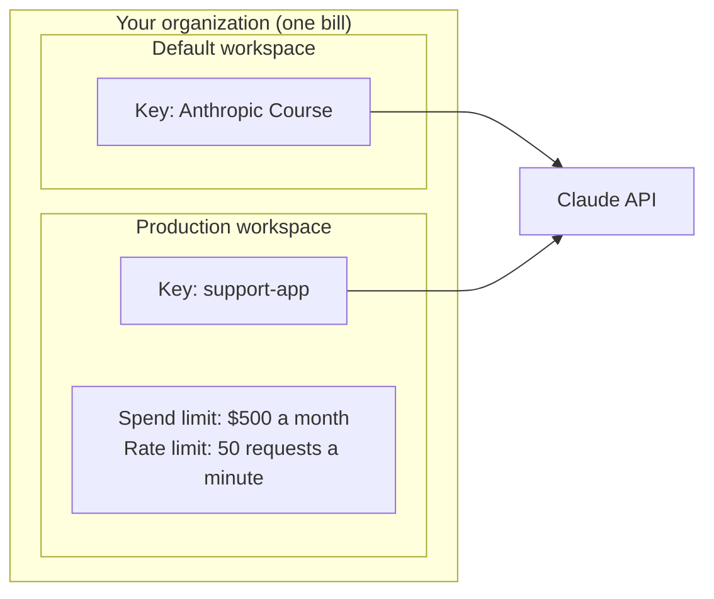

# Lesson 2 — Getting an API key

**Course:** [Building with the Claude API](https://academy.claude.com/courses/building-with-the-claude-api) &nbsp;·&nbsp; **Chapter 1:** Accessing Claude with the API &nbsp;·&nbsp; **Completed:** November 1, 2026

| Previous | Course | Next |
|:---|:---:|---:|
| [← Accessing the API](01-accessing-the-api.md) | [📚 Course index](README.md) | [Making a request →](03-making-a-request.md) |

---

**On this page**

| # | Section |
|:---:|:---|
| 1 | [Revision summary](#revision-summary) |
| 2 | [The big picture](#the-big-picture) |
| 3 | [Who's who](#whos-who) |
| 4 | [1. Creating a key, step by step](#1-creating-a-key-step-by-step) |
| 5 | [2. What a workspace is](#2-what-a-workspace-is) |
| 6 | [3. Keeping the key safe](#3-keeping-the-key-safe) |
| 7 | [Architect notes](#architect-notes) |
| 8 | [Recap](#recap) |
| 9 | [My notes / practice](#my-notes--practice) |
| 10 | [FAQ](#faq) |

---

### Revision summary

#### In one sentence

To let your code use Claude, you log in to the Claude Console (Anthropic's website for developers at `platform.claude.com`), create an API key, which is a long secret password such as `sk-ant-api03-...`, copy it straight away because it is shown only once, and store it outside your code, for example in an environment variable called `ANTHROPIC_API_KEY`.

#### How to create a key

The course walks through five steps in the Claude Console:

1. Log in to the Console at `platform.claude.com`.
2. Click **Get API Key** on the dashboard.
3. Click **Create Key**.
4. Choose a **workspace** (the course uses **Default**) and type a name that tells you what the key is for (the course uses "Anthropic Course").
5. Copy the key from the pop-up and save it somewhere safe.

#### The key is shown only once

- The Console shows the full key only in that pop-up. After you close it, nobody can see the key again, not even you.
- If you close the pop-up without copying the key, delete that key and create a new one. There is no way to recover it.

#### What a workspace is

A **workspace** is a folder inside your Anthropic account that groups API keys, people, and limits. Every account has a **Default** workspace that can't be renamed or deleted.

- You can create more workspaces, up to 100 per organization, to separate projects, teams, or environments such as development and production.
- Each workspace can have its own **spend limit** (the most it may cost per month) and **rate limits** (the most requests or tokens per minute). These can be lower than the account's limits, but not higher.

#### How to keep the key safe

- Never paste the key into your code, and never commit it to Git. Anyone who has the key can use Claude and you pay.
- Store it in an environment variable named `ANTHROPIC_API_KEY`, or in a `.env` file that Git ignores. The SDKs read `ANTHROPIC_API_KEY` automatically.
- If a key leaks, disable or delete it in the Console right away and create a new one. **Disable** can be undone; **Delete** is permanent.

#### When to use which kind of key

- **Use a personal key** for your own learning and scripts, such as this course. It acts as you and stops working if you leave the organization.
- **Use a service account key** for a shared or production app. It belongs to the app, not a person, so it keeps working when a developer leaves.
- **Use Workload Identity Federation** for production apps on AWS, Google Cloud, Azure, or in a CI pipeline. The app gets short-lived tokens, so there is no long-lived key to leak.

#### When to use a new workspace

- **Use the Default workspace** when you are learning or have one small project.
- **Use a separate workspace** when you need separate spending caps, separate keys, or separate access, for example one workspace for an experiment and another for production.

#### Exam takeaways

- **A production service stops working the day a developer leaves the company.** The service was using that developer's personal key. Use a service account key or Workload Identity Federation for production, so access belongs to the app, not a person. (Governance, Safety & Risk Management)
- **A team wants to try Claude on a side project without risking the main budget.** Create a separate workspace for the project and give it its own spend limit and rate limits. (Solution Design & Architecture)
- **A developer pushes an API key to a public GitHub repository.** Disable or delete the key in the Console at once, create a new key, update the app, and check usage for misuse. Then move keys into a secrets manager. (Governance, Safety & Risk Management)

---

### The big picture

| Part | In plain words | Everyday comparison |
|---|---|---|
| The Claude Console | Anthropic's website where you manage your account, keys, and billing. | Your bank's online banking site. |
| The API key | A secret password your code sends with every request. | A bank card PIN: whoever has it can spend your money. |
| The workspace | A folder in your account that holds keys and sets limits. | A separate account at the bank, each with its own spending cap. |
| Keeping it safe | The key lives outside your code, and you replace it if it leaks. | You don't write your PIN on the card, and you cancel the card if it's stolen. |

**The running example:** you are starting this course and need a key so that, in [lesson 3](03-making-a-request.md), your code can send its first request. You will create a key named "Anthropic Course" in the Default workspace and store it safely on your Windows laptop.

---

### Who's who

| Player | Where it lives | What it does in the example |
|---|---|---|
| **You** | At your computer | Log in, create the key, copy it, and store it. |
| **The Claude Console** | Anthropic's website, `platform.claude.com` | Creates the key and shows it to you once. |
| **Your organization** | Your account inside the Console | Owns the workspaces and pays the bill. |
| **The workspace** ("Default") | Inside your organization | Holds the key and applies any spend and rate limits. |
| **Your code** | On your computer now, on a server later | Reads the key from `ANTHROPIC_API_KEY` and sends it with each request. |
| **The Claude API** | Anthropic's servers, `api.anthropic.com` | Checks the key on every request and rejects bad ones. |

---

### 1. Creating a key, step by step

**Step 1. Log in to the Console.** Go to `platform.claude.com` and log in. You land on the dashboard.



**Step 2. Click "Get API Key".** It is the rightmost of the three buttons at the top right.



**Step 3. Click "Create Key".** It is at the top right of the API keys page.



**Step 4. Choose the workspace and name the key.** Pick **Default** as the workspace. Type a name that tells you later what the key is for, such as "Anthropic Course." Then click **Add**.



**Step 5. Copy the key.** A pop-up shows the full key, which looks like `sk-ant-api03-` followed by a long random string. Copy it now and store it (section 3). This is the only time the Console shows it.

> **Warning:** If you close the pop-up before copying, the key is lost for good. Delete it in the Console and create a new one.

Not in the course, from the official Claude API documentation: the newer Console also lets you open the API keys page directly at `platform.claude.com/settings/keys`. When you create a key, it asks for two extra things:

- **An expiration:** when the key stops working, such as 30 days or "Never." A key with an end date limits the damage if it ever leaks.
- **A linked account:** yourself for a personal key, or a service account for a shared key (see Architect notes).

---

### 2. What a workspace is

Your Anthropic account (your *organization*) can hold several workspaces. Each workspace has its own keys and its own limits, but the bill is shared.



Things to notice:

- A key belongs to one workspace, so its usage counts against that workspace's limits.
- If the Production workspace hits its $500 limit, only its keys are stopped. The course key in Default keeps working.

---

### 3. Keeping the key safe

#### Where the key should live

An **environment variable** is a named setting stored by your computer's operating system, outside any code file. The Anthropic SDKs look for one called `ANTHROPIC_API_KEY`, so if you set it, your code never needs to contain the key.

On Windows, run this once in PowerShell, then open a new terminal so it takes effect:

```powershell
setx ANTHROPIC_API_KEY "sk-ant-api03-your-key-here"
```

On macOS or Linux, add this line to your shell's settings file (such as `~/.zshrc`):

```bash
export ANTHROPIC_API_KEY="sk-ant-api03-your-key-here"
```

Many projects, including notebook-based ones, use a `.env` file instead. It is a plain text file in your project folder with one setting per line:

```text
course-project/
├── .env            ← ANTHROPIC_API_KEY="sk-ant-api03-..."   (never committed)
├── .gitignore      ← contains the line: .env
└── app.py          ← reads the key from the environment, never contains it
```

The `.gitignore` file lists files that Git must never save, so `.env` stays on your computer and never reaches GitHub.

#### What to do if the key leaks

1. In the Console, **disable** the key (this can be undone) or **delete** it (permanent).
2. Create a new key and put it where the old one was.
3. Check the Console's usage page for requests you didn't make.

> **Remember this:** Copy it once, store it outside your code, replace it if it leaks.

#### Common mix-ups

| ❌ Wrong idea | ✅ What really happens |
|---|---|
| "I can view my key again later in the Console." | The full key is shown only once, at creation. |
| "A key in a private repository is safe." | Private repositories get shared, cloned, and leaked. Keep keys out of Git entirely. |
| "Deleting a key and disabling it are the same." | Disable can be undone. Delete is permanent. |
| "One key for everything is simpler, so it's better." | Separate keys per app and environment let you revoke one without breaking the rest. |

#### Test yourself

<details>
<summary>1. You closed the pop-up without copying the key. What do you do?</summary>

Delete that key and create a new one. A lost key can't be shown again.
</details>

<details>
<summary>2. What environment variable do the Anthropic SDKs read the key from?</summary>

`ANTHROPIC_API_KEY`.
</details>

<details>
<summary>3. Your experiment must never cost more than $50 a month. Where do you set that?</summary>

Put the experiment in its own workspace and set that workspace's spend limit to $50.
</details>

---

### Architect notes

#### Key types and who owns them

- **Personal keys** act as you. They stop working when you leave the organization, so never use one for a shared or production app.
- **Service account keys** belong to a *service account*, an identity created for an app rather than a person. Use them for shared and production workloads.
- **Workspace keys** are the older kind that belong to a workspace. They still work but are now *legacy*, meaning Anthropic recommends the newer types for new work.
- **Workload Identity Federation** lets an app on AWS, Google Cloud, Azure, Kubernetes, or GitHub Actions swap its cloud identity for a short-lived Claude token. There is no long-lived key to store, rotate, or leak, so it is the strongest option for production.

#### How keys are sent and scoped

- Send the key as `Authorization: Bearer <key>`. The older `x-api-key: <key>` header still works.
- A key created for one workspace works only there. A key not tied to a workspace must send the `anthropic-workspace-id` header on every request, or the API returns a 400 error.
- Expired or deleted keys return a 401 `authentication_error`. A billing problem, such as no credit left, returns a 402 `billing_error`.

#### Limits and cost control

- Set a spend limit and rate limits on each workspace, so one runaway script can't use the whole organization's budget or rate limit.
- Give keys an expiration where you can. The Console offers 3 hours, 1 day, 7 days, 30 days, a custom length, or "Never." Expiration can't be changed after creation, and Anthropic emails a warning before longer-lived keys expire.

#### Client apps without a server

- [Lesson 1](01-accessing-the-api.md) says apps must go through your server. One exception now exists: **App Attest** lets a genuine, registered iOS or macOS app call the API directly with a token that lasts 1 hour and can only send messages. Every other client app still needs a server.

---

### Recap

- You create keys in the Claude Console at `platform.claude.com`: Get API Key, Create Key, pick a workspace, name it, copy it.
- The full key is shown only once; if you lose it, delete it and make a new one.
- A workspace groups keys and sets spend and rate limits; every account has a Default workspace.
- Store the key in `ANTHROPIC_API_KEY` or a Git-ignored `.env` file, never in code.
- Use personal keys for yourself, and service account keys or federation for production.

---

## My notes / practice

- [ ] Create a key named "Anthropic Course" in the Default workspace, with a 30-day expiration.
- [ ] Set `ANTHROPIC_API_KEY` with `setx`, open a new terminal, and run `echo $env:ANTHROPIC_API_KEY` to check it.
- [ ] Look at the Workspaces page and find where spend limits are set.
- [ ] Add `.env` to the `.gitignore` of your capstone repository.

---

## FAQ

**Q1. What does "API key" mean?**
An API key is a long secret password, such as `sk-ant-api03-...`, that your code sends with every request. Anthropic uses it to know which account is calling and which account to bill.

**Q2. Where do I create an API key?**
In the Claude Console at `platform.claude.com`. Click **Get API Key**, then **Create Key**, choose a workspace, name the key, and copy it.

**Q3. Why can I see the key only once?**
Anthropic doesn't show the full key again after creation, so it can't be read later by someone who gets into your Console. If you lose it, delete it and create a new one.

**Q4. What does "workspace" mean?**
A workspace is a folder in your Anthropic account that holds API keys, members, and limits. Every account has a Default workspace, and you can add more to separate projects or environments.

**Q5. Why would I create more than one workspace?**
To give each project its own keys and its own spending and rate limits. For example, an experiment can have a $50 monthly cap without affecting production.

**Q6. Where should I store my API key?**
In an environment variable named `ANTHROPIC_API_KEY`, a `.env` file that Git ignores, or a secrets manager on a server. Never in a code file or a Git repository.

**Q7. What does "environment variable" mean?**
It is a named setting stored by your operating system, outside your code. The Anthropic SDKs read `ANTHROPIC_API_KEY` automatically, so your code never needs to contain the key.

**Q8. What should I do if my API key leaks?**
Disable or delete it in the Console right away, create a new key, update your app, and check the usage page for requests you didn't make.

**Q9. What is the difference between disabling and deleting a key?**
Disabling stops the key but can be undone with **Re-enable**. Deleting is permanent.

**Q10. Which kind of key should a production app use?**
A service account key, or better, Workload Identity Federation. A personal key stops working when its owner leaves the organization.

**Q11. (Exam angle) A production service stopped working the day a developer left the company. What went wrong, and how do you prevent it?**
The service was using the developer's personal key, which stopped working when they were removed. Give production apps their own identity with a service account key or Workload Identity Federation. (Governance, Safety & Risk Management)

**Q12. (Exam angle) A team wants to try Claude on a new project without risking the main budget. What do you set up?**
A separate workspace for the project with its own keys, a monthly spend limit, and rate limits lower than the organization's. Its usage then can't affect other projects. (Solution Design & Architecture)

**Q13. (Exam angle) A developer pushed an API key to a public GitHub repository. What are the steps?**
Disable or delete the key at once, create a replacement and deploy it, and check usage for misuse. Then prevent a repeat: keep keys in a secrets manager, add `.env` to `.gitignore`, and give keys expiration dates. (Governance, Safety & Risk Management)

---

| Previous | Course | Next |
|:---|:---:|---:|
| [← Accessing the API](01-accessing-the-api.md) | [📚 Course index](README.md) | [Making a request →](03-making-a-request.md) |
