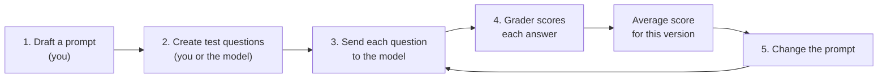
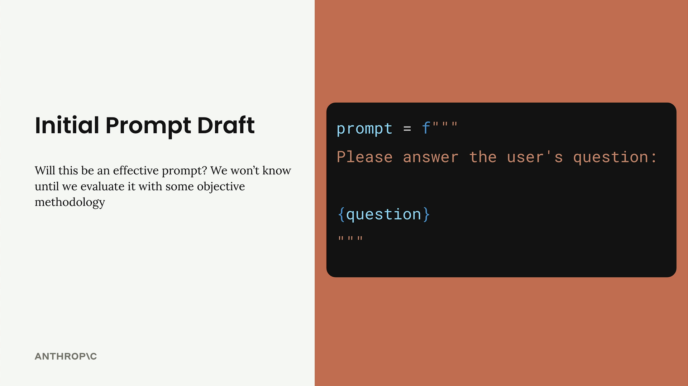
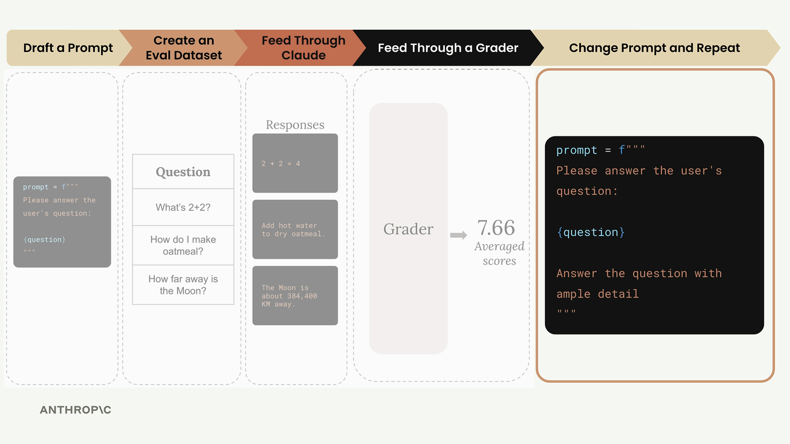

# Lesson 10 — A typical eval workflow

**Course:** [Building with the Claude API](https://academy.claude.com/courses/building-with-the-claude-api) &nbsp;·&nbsp; **Lesson page:** [A typical eval workflow](https://academy.claude.com/courses/building-with-the-claude-api/a-typical-eval-workflow) &nbsp;·&nbsp; **Chapter 2:** Prompt evaluation &nbsp;·&nbsp; **Completed:** November 16, 2026

| Previous | Course | Next |
|:---|:---:|---:|
| [← Prompt evaluation](09-prompt-evaluation.md) | [📚 Chapter index](README.md) | [Generating test datasets →](11-generating-test-datasets.md) |

**Practice this lesson:** in [capstone guide 2](../00_Capstone_Plan/guide/02-prompt-evaluation.md), solve:

- [Problem 1: Write your first test questions by hand](../00_Capstone_Plan/guide/02-prompt-evaluation.md#problem-1-write-your-first-test-questions-by-hand)
- [Problem 6: Change the prompt and prove it got better](../00_Capstone_Plan/guide/02-prompt-evaluation.md#problem-6-change-the-prompt-and-prove-it-got-better)

Do the guide's problems in order, after you finish the chapter, because each one builds on the one before.

---

**On this page**

| # | Section |
|:---:|:---|
| 1 | [Revision summary](#revision-summary) |
| 2 | [The big picture](#the-big-picture) |
| 3 | [1. Draft a prompt](#1-draft-a-prompt) |
| 4 | [2. Create an eval dataset](#2-create-an-eval-dataset) |
| 5 | [3. Feed the questions through the model](#3-feed-the-questions-through-the-model) |
| 6 | [4. Score the answers with a grader](#4-score-the-answers-with-a-grader) |
| 7 | [5. Change the prompt and repeat](#5-change-the-prompt-and-repeat) |
| 8 | [Architect notes](#architect-notes) |
| 9 | [Recap](#recap) |
| 10 | [My notes / practice](#my-notes--practice) |
| 11 | [FAQ](#faq) |

---

### Revision summary

**1. Your prompt is your production code**
When you build an AI-powered software feature—like an app that automatically sorts incoming customer emails into `billing`, `technical`, or `other`—your prompt is your production code. Every time a real customer sends an email, your app inserts that email into your prompt and sends it to Claude to get the right category.

**2. Why we need a test set**
Before trusting that prompt with real users, you need a **test set** to verify that your prompt handles normal, regular, and messy edge-case inputs reliably. A prompt test case works just like a **unit test** in software development: given a specific input, you check whether you get the expected answer. In practice, this is a saved file (like `test_set.json`) of sample customer emails paired with the exact right labels you expect back.

**3. How we verify it (The Eval Workflow)**
Once your `test_set.json` is ready, how do you actually verify your prompt? You run an **eval** (short for *evaluation*)—a repeatable, automated process that runs your prompt through every test case and gives it a concrete score:

* **Why hand-checking fails:** If you tweak a prompt and test it on just two questions by hand, both might look great—so you launch it. A week later, customers complain that 1 in 5 answers (20%) is missing key steps. Two test questions are too small a sample to catch a bug that happens 20% of the time.
* **How the automated check works:** Like a school exam or a unit test runner, your evaluation script sends all 50+ emails from `test_set.json` through your prompt to Claude, compares every reply against your expected labels, and outputs a final score (e.g., `45 / 50 = 90%`). If you edit your prompt and the score drops, you catch the regression immediately *before* real customers ever see it.

#### The five steps

An eval works like a school exam for your prompt. Every version of the prompt sits the same exam, and you compare the marks.

1. **Draft a prompt.** You write a first prompt with a slot, `{question}`, where each test question goes. Its score is the *baseline*, the score that later versions are compared with.
2. **Create an eval dataset.** You write a list of sample questions like the ones real users will ask. Real evals have tens to thousands of them, written by hand or by the model.
3. **Feed the questions through the model.** Your code puts each question into the slot and sends the prompt to the model. The model sends back one answer per question.
4. **Score the answers with a grader.** A *grader* reads each question with its answer and gives a score from 1 to 10. Your code averages the scores into one number.
5. **Change the prompt and repeat.** You edit the prompt and run the same questions through the same grader. If the average goes up, the change helped.

#### The course's example

- **Version 1** says "Please answer the user's question." The answers score 10, 4, and 9, so the average is (10 + 4 + 9) ÷ 3 = 7.67. The course shows 7.66 because it cuts off digits instead of rounding.
- **Version 2** adds the line "Answer the question with ample detail." The average rises to 8.7, so version 2 is the better prompt.

#### Exam takeaways

- **A team changes a prompt and says the new version "feels better."** Ask for an eval: run both versions on the same dataset with the same grader and compare the average scores. (Claude Models, Prompting & Context Engineering)
- **An eval shows a higher score only because the team also changed the test questions.** The comparison is invalid. Keep the dataset and grader fixed, and change only the prompt between runs. (Solution Design & Architecture)
- **A new prompt raises the average score, but answers are now three times longer.** Check cost and speed too. Longer answers use more output tokens, and a grader may favor long answers even when they are not better. (Solution Design & Architecture)

---

### The big picture

The five steps form a loop. You go around it once for each version of your prompt.




Two things to know before the steps:

- **There is no single standard way to do this.** Teams build their eval workflows in different ways.
- **Many tools can do it for you,** both free (open source) and paid. The course builds a small one from scratch in a Jupyter notebook, so you can see every step. You can start small and grow it later.

**The running example:** a general question-answering prompt, tested on three questions: "What's 2+2?", "How do I make oatmeal?", and "How far away is the Moon?"

---

### 1. Draft a prompt

You write a simple first prompt that you want to improve.

```python
prompt = f"""
Please answer the user's question:

{question}
"""
```

`{question}` is a slot. Python's *f-string* (the `f` before the quotes) swaps in whatever question you give it. The `"""` marks start and end text that runs over several lines.



You can't tell yet whether this prompt is good. Its score becomes the *baseline* that every later version is compared with.

---

### 2. Create an eval dataset

The *eval dataset* is the list of test questions. This prompt has only one input, the user's question, so the dataset is just a list of questions.


The course uses three questions to keep it simple. Real evals use tens, hundreds, or thousands, because with only a few questions one lucky answer can move the average a lot. You can write them by hand or ask the model to write them ([lesson 11](11-generating-test-datasets.md)).

---

### 3. Feed the questions through the model

Your code puts each question into the slot. The first finished prompt is exactly this:

```text
Please answer the user's question:

What's 2+2?
```

Your code sends each finished prompt to the model and saves each answer.


---

### 4. Score the answers with a grader

The grader gets each question paired with its answer, one pair at a time, and gives a score from 1 to 10. A 10 means the answer can't be improved. A low score means there is room to improve.


| Question | Answer | Score |
|---|---|:---:|
| What's 2+2? | "2 + 2 = 4" | 10, perfect |
| How do I make oatmeal? | "Add hot water to dry oatmeal." | 4, needs more detail |
| How far away is the Moon? | "The Moon is about 384,400 km away." | 9, very good |

Your code averages the scores: (10 + 4 + 9) ÷ 3 = **7.67** (the course shows 7.66). That one number describes how well version 1 did.

How the grader picks a score is covered later. A grader can be code, another model, or a person ([lesson 13](13-model-based-grading.md) and [lesson 14](14-code-based-grading.md)).

---

### 5. Change the prompt and repeat

The oatmeal answer was too short, so you add one line to guide the model:

```python
prompt = f"""
Please answer the user's question:

{question}

Answer the question with ample detail
"""
```



You run steps 3 and 4 again with the same three questions and the same grader. The new average is 8.7.


| Version | Change | Average score |
|---|---|:---:|
| v1 | The first prompt | 7.67 |
| v2 | Added "Answer the question with ample detail" | 8.7 |

The higher score is an objective sign that v2 is better. Now you can keep the best version and try again. Changing and retesting again and again is called *iterating*.

**Warning:** If you change the questions or the grader between runs, the scores no longer compare. A rise from 7.67 to 8.7 could come from easier questions, not a better prompt.

> **Remember this:** Same questions, same grader, new prompt. Compare the numbers.

---

### Architect notes

#### Cost

- Step 3 sends one request per question, and a model grader adds one more. So 100 questions graded by a model means 200 requests for each prompt version.
- "Answer with ample detail" makes answers longer, and you pay for every output token. A better score can mean a bigger bill. Prices change, so check Anthropic's pricing page.

#### Speed

- Longer answers take longer to arrive. Record how long each answer takes, not just its score.
- Sending requests one at a time is slow for big tests. Sending several at once is faster, but stay under your account's rate limits.

#### Trusting the score

- Answers vary a little between runs ([lesson 6](../01-accessing-claude-with-the-api/06-temperature.md)). Rerun before trusting a small difference.
- A model grader can favor long answers even when they are not better. Spot-check some scores by hand.
- Read the lowest-scoring answers each run. One bad answer can hide inside a good average.

---

### Recap

- An eval is an exam for your prompt: same questions, scored answers, one average.
- The five steps: draft a prompt, create test questions, get the answers, score them, change and repeat.
- Real evals need many questions, so one lucky answer can't fake an improvement.
- Keep the questions and grader the same, and change only the prompt.

---

## My notes / practice

- [ ] Write the three questions and send each one through the version 1 prompt.
- [ ] Score the three answers yourself from 1 to 10, and work out the average.
- [ ] Add "Answer the question with ample detail," rerun, and compare the score and the answer length.

---

## FAQ

**Q1. What does "eval workflow" mean?**
It is the fixed set of steps that gives a prompt a score: draft the prompt, create test questions, get the model's answers, score them, then change the prompt and repeat.

**Q2. What does "eval dataset" mean?**
It is the list of test questions. Each one goes into the prompt's `{question}` slot, one at a time.

**Q3. What does "baseline" mean in an eval?**
It is the score of your first prompt version. Every later version is compared with it to see whether a change helped.

**Q4. What does "regression" mean in an eval?**
A regression is a change that breaks something that used to work. For example, a prompt edit drops the score from 45 of 50 to 40 of 50. Rerunning the same test after every change catches it before customers see it.

**Q5. Why does an eval need so many test questions?**
With only a few questions, one lucky or unlucky answer moves the average a lot. Many questions also cover more of the kinds of things real users ask.

**Q6. What does "grader" mean?**
It is whatever scores each answer. It reads the question and the answer and gives a score, such as 1 to 10. It can be code, another model, or a person.

**Q7. Do I need a special tool to run an eval?**
No. Many free and paid tools exist, but there is no single standard way. The course builds a small eval from scratch in a Jupyter notebook to show that you can start small.

**Q8. Why must the questions and the grader stay the same between runs?**
So that only the prompt changes. If the questions or the grader also change, you can't tell which change moved the score.

**Q9. (Exam angle) A team changes a prompt and says the new version "feels better." What do you ask for?**
An eval: run both versions on the same dataset with the same grader, and compare the average scores. (Claude Models, Prompting & Context Engineering)

**Q10. (Exam angle) An eval shows a higher score, but the team also changed the test questions. Is the result valid?**
No. Keep the dataset and grader fixed, and change only the prompt, so the score difference comes from the prompt alone. (Solution Design & Architecture)

**Q11. (Exam angle) A new prompt raises the average score, but answers are now three times longer. What else do you check?**
Check cost and speed, because longer answers use more output tokens and take longer. Also check that the grader isn't simply rewarding length. (Solution Design & Architecture)

---

| Previous | Course | Next |
|:---|:---:|---:|
| [← Prompt evaluation](09-prompt-evaluation.md) | [📚 Chapter index](README.md) | [Generating test datasets →](11-generating-test-datasets.md) |
