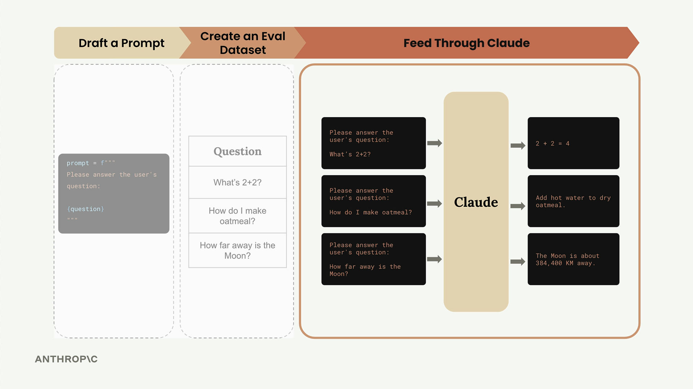

# Lesson 10 — A typical eval workflow

**Course:** [Building with the Claude API](https://academy.claude.com/courses/building-with-the-claude-api) &nbsp;·&nbsp; **Lesson page:** [A typical eval workflow](https://academy.claude.com/courses/building-with-the-claude-api/a-typical-eval-workflow) &nbsp;·&nbsp; **Chapter 2:** Prompt evaluation &nbsp;·&nbsp; **Completed:** November 16, 2026

| Previous | Course | Next |
|:---|:---:|---:|
| [← Prompt evaluation](09-prompt-evaluation.md) | [📚 Chapter index](README.md) | [Generating test datasets →](11-generating-test-datasets.md) |

---

**On this page**

| # | Section |
|:---:|:---|
| 1 | [Revision summary](#revision-summary) |
| 2 | [The big picture](#the-big-picture) |
| 3 | [1. Step 1: Draft a prompt](#1-step-1-draft-a-prompt) |
| 4 | [2. Step 2: Create an eval dataset](#2-step-2-create-an-eval-dataset) |
| 5 | [3. Step 3: Feed each question through Claude](#3-step-3-feed-each-question-through-claude) |
| 6 | [4. Step 4: Feed each answer through a grader](#4-step-4-feed-each-answer-through-a-grader) |
| 7 | [5. Step 5: Change the prompt and repeat](#5-step-5-change-the-prompt-and-repeat) |
| 8 | [Architect notes](#architect-notes) |
| 9 | [Recap](#recap) |
| 10 | [My notes / practice](#my-notes--practice) |
| 11 | [FAQ](#faq) |

---

### Revision summary

A prompt evaluation (an *eval*) turns "this prompt seems fine" into a number. A typical eval follows five steps:

1. **Draft a prompt.** Write a first version with a placeholder, such as `{question}`, where each test input will go. This first version is your *baseline*, the starting point you compare against.
2. **Create an eval dataset.** An *eval dataset* is a list of sample inputs like the ones real users will send. Real datasets hold tens to thousands of inputs. You can write them by hand or ask the model to generate them.
3. **Feed each input through Claude.** Your code puts each input into the placeholder and sends the finished prompt to the model. It saves every answer.
4. **Feed each answer through a grader.** A *grader* reads the input and the model's answer and gives a score, such as 1 to 10. Your code averages the scores into one number for the prompt.
5. **Change the prompt and repeat.** Edit the prompt, run steps 3 and 4 again on the same dataset, and compare the new average with the old one.

#### The course's worked example

The course tests a general question-answering prompt on three questions.

| Question | The model's answer (version 1) | Grader score |
|---|---|:---:|
| What's 2+2? | "2 + 2 = 4" | 10 |
| How do I make oatmeal? | "Add hot water to dry oatmeal." | 4 |
| How far away is the Moon? | "The Moon is about 384,400 km away." | 9 |

- **Version 1** ("Please answer the user's question") averages (10 + 4 + 9) ÷ 3 = 7.67. The course shows it cut short as 7.66.
- **Version 2** adds one line, "Answer the question with ample detail," and averages 8.7.
- The higher score shows with a number that the extra line helped, so you keep version 2 or keep improving it.

#### Rules that keep the comparison fair

- Run every prompt version on the **same** dataset with the **same** grader. Otherwise a score change might come from the new questions or the new grader, not the new prompt.
- There are many ready-made eval tools, both open source and paid. The course builds its own small one so you see every step.

#### Exam takeaways

- **A team changes a prompt and says the new version "feels better."** Ask for an eval: run both versions on the same dataset with the same grader and compare the average scores. (Claude Models, Prompting & Context Engineering)
- **An eval shows a higher score only because the team also changed the test questions.** The comparison is invalid. Keep the dataset and grader fixed, and change only the prompt between runs. (Solution Design & Architecture)
- **A new prompt raises the average score, but answers are now three times longer.** Check cost and speed too. Longer answers use more output tokens, and a grader may favor long answers even when they are not better. (Solution Design & Architecture)

---

### The big picture

The five steps form a loop. You go around it once for every prompt version.


| Step | In plain words | Everyday comparison: testing a new cake recipe |
|---|---|---|
| 1. Draft a prompt | Write the first version | Write the first recipe |
| 2. Create an eval dataset | Collect sample inputs | Invite a group of tasters |
| 3. Feed through Claude | Get the model's answer for each input | Bake a cake for each taster |
| 4. Feed through a grader | Score each answer and average them | Each taster gives a score, and you average them |
| 5. Change and repeat | Edit the prompt, then run the same test again | Change the recipe, then serve the same tasters again |

**The running example:** the course's general question-answering prompt and its three test questions: "What's 2+2?", "How do I make oatmeal?", and "How far away is the Moon?"

#### Who's who

| Player | Where it lives | What it does |
|---|---|---|
| **You, the developer** | Your notebook | Write the prompt and the dataset, read the scores, and decide what to change |
| **Your eval code** | Your notebook | Loops through the dataset, sends each prompt, collects answers, and averages scores |
| **The model** | Anthropic's servers | Answers each test question (step 3) |
| **The grader** | Your code, or a second request to a model | Scores each answer from 1 to 10 (step 4). Later lessons build both kinds. |

---

### 1. Step 1: Draft a prompt

Write a first version of the prompt. Leave a slot where each test question will go.

```python
prompt = f"""
Please answer the user's question:

{question}
"""
```

What each part means:

- `prompt = ...` saves the text in a variable named `prompt`.
- `"""` starts and ends a Python string that can run over several lines.
- The `f` before the quotes makes it an *f-string*. Python replaces `{question}` with the value of a variable called `question`.
- **Warning:** an f-string fills in `{question}` at the moment the line runs. So `question` must already hold a value. In an eval, you build the prompt inside the loop, once per question (step 3).


The slide asks the key question: will this prompt work well? You can't know until you measure it. This first version is the *baseline* that every later version is compared with.

---

### 2. Step 2: Create an eval dataset

An **eval dataset** is a list of sample inputs that look like what real users will send. Each input will go into the `{question}` slot. Putting a value into a slot like this is called *interpolation*.


In Python, the course's dataset can be a simple list:

```python
dataset = [
    "What's 2+2?",
    "How do I make oatmeal?",
    "How far away is the Moon?",
]
```

| | The course example | A real eval |
|---|---|---|
| Size | 3 questions | Tens, hundreds, or thousands of inputs |
| Who writes it | You, by hand | You by hand, or the model generates it ([lesson 11](11-generating-test-datasets.md)) |
| Variety | Math, cooking, science | Every kind of input real users send, including the odd ones ([lesson 9](09-prompt-evaluation.md#3-why-most-developers-test-too-little)) |

Three questions are enough to learn the steps. They are far too few to trust a real score.

---

### 3. Step 3: Feed each question through Claude

Your code takes each question, puts it into the prompt, and sends the finished prompt to the model. The first finished prompt is exactly this text:

```text
Please answer the user's question:

What's 2+2?
```



A minimal loop looks like this. It uses the `chat()` helper from [lesson 5](../01-accessing-claude-with-the-api/05-system-prompts.md):

```python
results = []
for question in dataset:
    prompt = f"""
Please answer the user's question:

{question}
"""
    messages = [{"role": "user", "content": prompt}]
    answer = chat(messages)
    results.append({"question": question, "answer": answer})
```

- `for question in dataset:` repeats the indented lines once for each question.
- Inside the loop, `question` holds the current question, so the f-string fills it in.
- `results.append(...)` saves the question and the answer together for the grader.

The three answers that come back:

| Question | Answer |
|---|---|
| What's 2+2? | "2 + 2 = 4" |
| How do I make oatmeal? | "Add hot water to dry oatmeal." |
| How far away is the Moon? | "The Moon is about 384,400 km away." |

---

### 4. Step 4: Feed each answer through a grader

A **grader** checks how good each answer is. It reads both the question and the answer, because "Add hot water to dry oatmeal" is only weak *as an answer to* "How do I make oatmeal?". The course scores from 1 to 10, where 10 is a perfect answer.


| Question | Score | Why it might get that score |
|---|:---:|---|
| What's 2+2? | 10 | Correct and complete |
| How do I make oatmeal? | 4 | Correct, but missing amounts, times, and steps |
| How far away is the Moon? | 9 | Correct, though it could say the distance changes |

Then your code averages the scores:

```text
(10 + 4 + 9) ÷ 3 = 23 ÷ 3 = 7.67
```

The course shows 7.66 because it cuts off the extra digits instead of rounding. Either way, this one number is the score for prompt version 1.

This lesson doesn't say *how* the grader decides. There are two common kinds:

| Grader | How it scores | Use it when |
|---|---|---|
| **Code** | Checks a fixed rule, such as "the answer contains 4" | There is one exact right answer ([lesson 14](14-code-based-grading.md)) |
| **A model** | A second request asks a model to score the answer against written rules | Quality needs judgment, such as "is this oatmeal answer helpful?" ([lesson 13](13-model-based-grading.md)) |

---

### 5. Step 5: Change the prompt and repeat

Now you have a baseline score of 7.67. The oatmeal answer was too short, so you add one line to the prompt:

```python
prompt = f"""
Please answer the user's question:

{question}

Answer the question with ample detail
"""
```


You run steps 3 and 4 again, with the **same three questions** and the **same grader**. The new average is 8.7.


| Version | Change | Average score |
|---|---|:---:|
| v1 | The first draft | 7.67 |
| v2 | Added "Answer the question with ample detail" | 8.7 |

Now you can:

1. **Compare versions by number** instead of by feel.
2. **Keep the version with the best score.**
3. **Keep improving** (*iterating*): change the prompt again, rerun, and compare.

> **Remember this:** Change one thing, rerun the same test, compare the number.

**Warning:** If you change the questions or the grader between runs, the scores no longer compare. A rise from 7.67 to 8.7 could come from easier questions, not a better prompt.

---

### Architect notes

#### Cost

- Each run sends one request per input in step 3. A model-based grader adds one more request per input in step 4. 100 questions graded by a model is 200 requests per prompt version.
- "Answer with ample detail" makes answers longer. You pay for every output token, so a better score can also mean a higher bill. Check prices on Anthropic's pricing page, since they change.

#### Speed

- Longer answers also take longer to arrive. Record how long each answer takes, not just its score.
- Sending requests one at a time is slow for large datasets. Running several at once is faster, but stay under your account's rate limits.

#### Reliability of the score

- Model answers vary between runs ([lesson 6](../01-accessing-claude-with-the-api/06-temperature.md)). On three questions, the jump from 7.67 to 8.7 could be partly luck. Use more questions, and rerun before trusting small differences.
- A model grader can favor longer answers even when they are not better. Write clear scoring rules, and spot-check some scores by hand.
- Anthropic's evaluation guide suggests grading with a different model from the one that wrote the answers.

#### Design trade-offs

- Don't chase only the average. One question scoring 2 can hide inside a good average. Read the lowest-scoring answers each run.
- Score more than quality when it matters: length, cost, and speed belong in the comparison too.

---

### Recap

- An eval has five steps: draft, dataset, feed through Claude, feed through a grader, change and repeat.
- The first prompt is the baseline that later versions are compared with.
- The dataset holds sample inputs that go into the prompt's `{question}` slot.
- The grader scores each answer, and the average is the prompt's score.
- Keep the dataset and grader fixed, and change only the prompt between runs.

---

## My notes / practice

- [ ] Build the three-question dataset as a Python list, and run the step 3 loop with the `chat()` helper.
- [ ] Score the three answers yourself from 1 to 10, and work out the average by hand.
- [ ] Add "Answer the question with ample detail," rerun, and score again. Note how much longer the answers got.
- [ ] Add five more questions of your own, and check whether version 2 still wins.

---

## FAQ

**Q1. What are the five steps of a typical prompt eval?**
Draft a prompt, create an eval dataset, feed each input through Claude, feed each answer through a grader, then change the prompt and repeat.

**Q2. What does "eval dataset" mean?**
It is a list of sample inputs that look like what real users will send. Each input goes into the prompt's placeholder, such as `{question}`. A real dataset holds tens to thousands of inputs.

**Q3. What does "baseline" mean in an eval?**
It is the score of your first prompt version. Every later version is compared with it to see whether a change helped.

**Q4. What does `{question}` do in the course's prompt?**
It is a slot in a Python f-string. Python replaces it with the current question, so one prompt template can be reused for every question in the dataset.

**Q5. What does "grader" mean?**
It is the part of the eval that scores each answer. It reads the question and the model's answer and gives a score, such as 1 to 10. It can be code or a request to another model.

**Q6. Why does the grader need the question as well as the answer?**
An answer is only good or bad for a given question. "Add hot water to dry oatmeal" is a weak answer to "How do I make oatmeal?" because it leaves out amounts and times.

**Q7. How is the final score of a prompt worked out?**
Your code averages the grader's scores. In the course, (10 + 4 + 9) ÷ 3 = 7.67, which the course shows as 7.66.

**Q8. Why must the dataset and the grader stay the same between runs?**
So that only the prompt changes. If the questions or the grader also change, you can't tell which change moved the score.

**Q9. Can I write the eval dataset myself, or should the model write it?**
Both work. You can write inputs by hand, or ask the model to generate many of them, which lesson 11 shows.

**Q10. (Exam angle) A team changes a prompt and says the new version "feels better." What do you ask for?**
An eval: run both versions on the same dataset with the same grader, and compare the average scores. (Claude Models, Prompting & Context Engineering)

**Q11. (Exam angle) An eval shows a higher score, but the team also changed the test questions. Is the result valid?**
No. Keep the dataset and grader fixed, and change only the prompt, so the score difference comes from the prompt alone. (Solution Design & Architecture)

**Q12. (Exam angle) A new prompt raises the average score, but answers are now three times longer. What else do you check?**
Check cost and speed, because longer answers use more output tokens and take longer. Also check that the grader isn't simply rewarding length. (Solution Design & Architecture)

---

| Previous | Course | Next |
|:---|:---:|---:|
| [← Prompt evaluation](09-prompt-evaluation.md) | [📚 Chapter index](README.md) | [Generating test datasets →](11-generating-test-datasets.md) |
