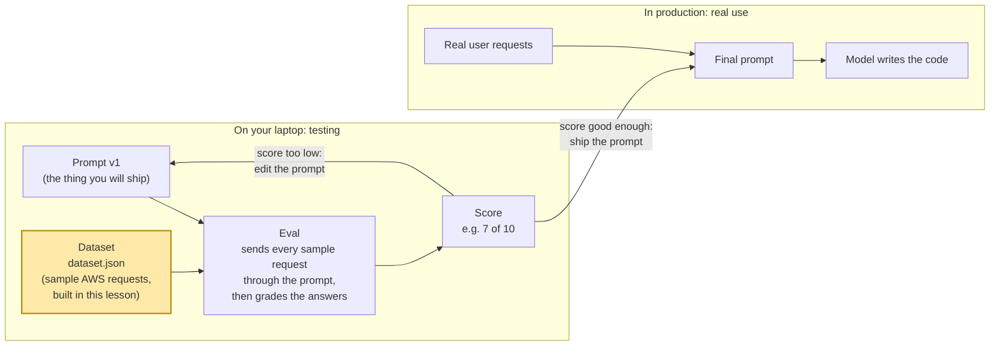
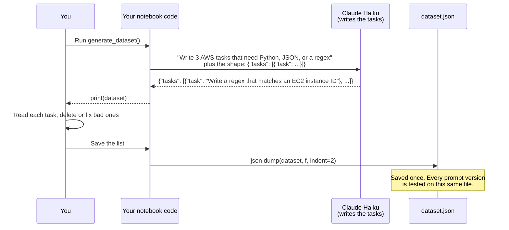

# Lesson 11 — Generating test datasets

**Course:** [Building with the Claude API](https://academy.claude.com/courses/building-with-the-claude-api) &nbsp;·&nbsp; **Lesson page:** [Generating test datasets](https://academy.claude.com/courses/building-with-the-claude-api/generating-test-datasets) &nbsp;·&nbsp; **Chapter 2:** Prompt evaluation &nbsp;·&nbsp; **Completed:** November 21, 2026

| Previous | Course | Next |
|:---|:---:|---:|
| [← A typical eval workflow](10-a-typical-eval-workflow.md) | [📚 Chapter index](README.md) | [Running the eval →](12-running-the-eval.md) |

**Practice this lesson:** in [capstone guide 2](../00_Capstone_Plan/guide/02-prompt-evaluation.md), solve:

- [Problem 2: Let the model write more test questions](../00_Capstone_Plan/guide/02-prompt-evaluation.md#problem-2-let-the-model-write-more-test-questions)

Do the guide's problems in order, after you finish the chapter, because each one builds on the one before.

---

**On this page**

| # | Section |
|:---:|:---|
| 1 | [Revision summary](#revision-summary) |
| 2 | [The big picture](#the-big-picture) |
| 3 | [1. What the dataset looks like](#1-what-the-dataset-looks-like) |
| 4 | [2. How the model writes the dataset](#2-how-the-model-writes-the-dataset) |
| 5 | [3. The code](#3-the-code) |
| 6 | [4. Check the tasks and save them once](#4-check-the-tasks-and-save-them-once) |
| 7 | [Architect notes](#architect-notes) |
| 8 | [Recap](#recap) |
| 9 | [My notes / practice](#my-notes--practice) |
| 10 | [FAQ](#faq) |

---

### Revision summary

**Why you need an eval:** a prompt that works on the two or three requests you try by hand can still fail on real users. For example, the AWS code prompt in this lesson might add "Sure! Here's your code:" before 1 answer in 5, and break every app that reads its output. An *eval* tests the prompt on many sample requests before it goes live and gives one score, such as "7 of 10." You then edit the prompt and compare the new score with the old one.

**Why you need a dataset:** to test on many sample requests, you first need those requests written down and saved. That saved list is the dataset, and making it is what this lesson is about.

An eval has three parts. This lesson builds the second one.

- **The prompt:** the thing you will ship to production. For example, "Please provide a solution to the following task: {task}".
- **The dataset:** a saved list of sample user requests, such as "Write a regex that matches an EC2 instance ID." It stands in for real users during testing and never goes to production. It is also called the *test set* or *eval dataset*.
- **The grader:** whatever decides whether each answer is good ([lesson 13](13-model-based-grading.md) and [lesson 14](14-code-based-grading.md)).

#### How to build the dataset

Typing 100 sample requests by hand is slow, so the course has a model write them:

1. **Decide the shape.** Each item is `{"task": "..."}`, one sample request.
2. **Ask a fast, cheap model to write the items.** Your code asks Claude Haiku for, say, 3 AWS tasks that need Python, JSON, or a regex.
3. **Get clean JSON back with structured outputs.** `client.messages.parse(..., output_format=Dataset)` makes the answer match your shape. The list sits inside a `tasks` field, because the top level must be an object.
4. **Read every item, then save the list once** to `dataset.json` with `json.dump(dataset, f, indent=2)`. Every prompt version is tested on this same file.

#### When to write the dataset by hand or with a model

- **Write it by hand** when you need only a few items, or when real user messages already exist.
- **Let a model write it** when you need many items quickly. Always read the result, because the model repeats itself and skips messy cases.

#### Things to check

- If `response.stop_reason` is `"max_tokens"`, the answer was cut off. Ask for fewer items per request.
- The course uses an older trick called prefill. Claude Haiku 5.5 and other newer models reject it with a 400 error, so use structured outputs.

#### Exam takeaways

- **A team needs 200 test inputs for a new prompt by tomorrow.** Have a small, cheap model such as Haiku generate them in batches with structured outputs, then have a person review a sample. (Claude Models, Prompting & Context Engineering)
- **A generator asked for 500 test tasks in one request returns an answer that is cut off.** The answer hit the `max_tokens` limit. Check `stop_reason`, and ask for smaller batches, such as 25 tasks per request. (Solution Design & Architecture)
- **Scores jump between runs, and the team regenerates the test cases before each run.** Generate the dataset once, save it under version control, and reuse it, so only the prompt changes between runs. (Solution Design & Architecture)

---

### The big picture

**Warning:** The course gets JSON back with prefill, which Claude Haiku 5.5 and other newer models reject. This page uses structured outputs instead.

#### The three parts of an eval

| Part | What it is | In this lesson's example | Goes to production? |
|---|---|---|---|
| **The prompt** | The thing being tested | "Please provide a solution to the following task: {task}" | Yes |
| **The dataset** | The list of sample requests to test it with | `dataset.json`, with requests like "Write a regex that matches an EC2 instance ID" | No |
| **The grader** | Decides whether each answer is good | Lessons 13 and 14 | No |

The highlighted box is what this lesson builds. It is the same picture as in [lesson 9](09-prompt-evaluation.md#how-the-pieces-fit-together), with this lesson's example.



- **Only the prompt goes to production.** In production, real user requests take the dataset's place.
- **The dataset stays fixed while you edit the prompt,** so the scores can be compared.

#### A concrete run with two requests

Say `dataset.json` holds two requests. The eval does this:

| Request from the dataset | What gets sent to the model | Model's answer | Grade |
|---|---|---|---|
| Write a regex that matches an EC2 instance ID | "Please provide a solution to the following task: Write a regex that matches an EC2 instance ID" | `^i-[0-9a-f]{8,17}$` | Good: only the regex |
| Write a JSON policy that gives read-only access to one S3 bucket | "Please provide a solution to the following task: Write a JSON policy …" | "Sure! Here's a policy: { … }" | Bad: it has an explanation line |

Score: 1 of 2. You edit the prompt and run the **same two requests** again.

**Compared with unit tests:** the prompt is your function, the dataset is the list of test inputs, and the eval is the test run.

**One difference from lesson 9:** there, each email came with its right answer, such as `billing`. Here, each item has **only the request**. A coding request has many correct answers, so a grader judges each answer later instead of comparing it with a stored one.

---

### 1. What the dataset looks like

The prompt being tested helps users write code for Amazon Web Services (AWS), Amazon's cloud platform. The answer must be only Python, only JSON, or only a regex (a short pattern that matches text), with no explanation around it.


The dataset is a JSON list of objects. Each object has one field, `task`.


| AWS word | What it means |
|---|---|
| **ARN** (Amazon Resource Name) | The full ID of anything in AWS, such as `arn:aws:iam::123456789012:user/sam`. The 12 digits are the account ID. |
| **S3 bucket** | A named storage folder in AWS |
| **JSON policy document** | A JSON file that says who may do what in AWS |
| **IAM** | AWS's permissions system |
| **boto3** | The Python library for AWS |

---

### 2. How the model writes the dataset

Think of a teacher who asks a teaching assistant to draft exam questions. It saves time, but the teacher still reads every question.



The model that writes the tasks (Haiku) is not the one being tested. It only drafts the requests. Haiku is fine for this because writing test tasks is an easy job, and it is the fastest, cheapest Claude model.

The prompt your code sends to Haiku:

```text
Generate an evaluation dataset for a prompt evaluation. The dataset will be used to
evaluate prompts that generate Python, JSON, or Regex specifically for AWS-related tasks.
Generate an array of JSON objects, each representing task that requires Python, JSON,
or a Regex to complete.

Example output:
[
  {"task": "Description of task"},
  ...additional
]

* Focus on tasks that can be solved by writing a single Python function, a single JSON
  object, or a single regex
* Focus on tasks that do not require writing much code

Please generate 3 objects.
```

| Line in the prompt | Why it is there |
|---|---|
| "Python, JSON, or Regex … AWS-related tasks" | Keeps the tasks on topic |
| "a single Python function, a single JSON object, or a single regex" and "not much code" | Keeps each answer small, so it is quick and cheap to run and easy to grade |
| "Please generate 3 objects" | Enough to check that the code works. Real datasets have many more. |

The course's example output has a comma after `"Description of task"`, which is not valid JSON. The version above leaves it out.

---

### 3. The code

```python
import json
from anthropic import Anthropic
from pydantic import BaseModel   # Pydantic: a library that describes data shapes

client = Anthropic()
model = "claude-haiku-5-5"       # fast, low-cost model; writing tasks is easy

class Task(BaseModel):           # one item: {"task": "..."}
    task: str

class Dataset(BaseModel):        # the list sits in a field, because the top level must be an object
    tasks: list[Task]

def generate_dataset():
    prompt = """...the prompt from section 2..."""
    response = client.messages.parse(   # sends the prompt AND the shape
        model=model,
        max_tokens=4000,
        messages=[{"role": "user", "content": prompt}],
        output_format=Dataset,          # the answer must match Dataset
    )
    # parsed_output is ready to use; model_dump() turns each Task into {"task": "..."}
    return [t.model_dump() for t in response.parsed_output.tasks]

dataset = generate_dataset()
print(dataset)
```

```text
[{'task': 'Write a Python function that lists all S3 buckets in an AWS account using boto3'},
 {'task': 'Create a JSON IAM policy that allows only read access to one DynamoDB table'},
 {'task': 'Write a regex that matches a valid EC2 instance ID such as i-0abcd1234ef567890'}]
```

You get one Python, one JSON, and one regex task. Your wording will differ, because the model writes new tasks each time. Structured outputs are explained in [lesson 8](../01-accessing-claude-with-the-api/08-structured-data.md).

**The course's way:** it adds a last assistant message containing ` ```json ` (a *prefill*) and stops at ` ``` `. Only older models such as `claude-haiku-4-5` accept this, so use the code above.

---

### 4. Check the tasks and save them once

Read every task and ask:

| Question | Bad example |
|---|---|
| Is it on topic? | "Write a JavaScript function that sorts a list" (not Python, JSON, or regex) |
| Is it different from the others? | Two tasks that both ask for an S3 read-only policy |
| Is it small? | "Build a full web app on AWS" |

Delete or fix the bad ones, then save:

```python
with open("dataset.json", "w") as f:
    json.dump(dataset, f, indent=2)   # indent=2 makes the file easy to read
```

`dataset.json` lands in the notebook's folder. [Lesson 12](12-running-the-eval.md) loads it and runs each task through prompt v1.

**Warning:** Don't regenerate the dataset before each run. New tasks could be easier or harder, so a score change might have nothing to do with the prompt.

---

### Architect notes

#### Cost

- Generating the dataset is one cheap Haiku request. Running the eval costs far more: one or two requests per task, for every prompt version. Prices change, so check Anthropic's pricing page.

#### Limits

- A request for 500 tasks can hit `max_tokens` and stop halfway. Check that `stop_reason` is `"end_turn"`.
- Ask in batches, such as 25 tasks per request on one subtopic each (S3, IAM, EC2). Batches by subtopic also give more varied tasks.

#### Quality

- Model-written tasks look alike and skip messy real cases, such as typos, vague requests, or two jobs in one. Ask for these on purpose, and add real user messages when you have them.
- The model that writes the tasks and the model that answers them may share blind spots. Have a person review at least a sample.
- Ask for a fixed mix, such as one third each of Python, JSON, and regex, then count the result.

#### Data and versioning

- If you build the dataset from real user messages, remove personal data such as names, emails, and account IDs first.
- Keep `dataset.json` in Git, so every score can be traced to the exact tasks it used.

---

### Recap

- An eval has three parts: the prompt, the dataset, and the grader. Only the prompt goes to production.
- The dataset is a list of sample requests. A cheap model such as Haiku can draft it, and you check it.
- Structured outputs return the list in a fixed shape your code can read.
- Save the dataset once and reuse it for every prompt version.

---

## My notes / practice

- [ ] Run `generate_dataset()` with Claude Haiku 5.5 and print the 3 tasks.
- [ ] Ask for 12 tasks, 4 of each kind, and count the kinds in the result.
- [ ] Ask for 50 tasks with `max_tokens=300`, print `response.stop_reason`, and see what a cut-off answer looks like.
- [ ] Save the list to `dataset.json` and open the file.

---

## FAQ

**Q1. What is a "dataset" in an eval?**
It is the saved list of sample user requests that the eval sends through your prompt, such as `{"task": "Write a regex that matches an EC2 instance ID"}`. It stands in for real users during testing and never goes to production.

**Q2. What is the difference between the dataset and the eval?**
The dataset is an input. The eval is the process that puts each dataset item into the prompt, sends it to the model, grades the answer, and gives a score.

**Q3. Why does this dataset have no right answers, when lesson 9's test set did?**
Lesson 9's emails each had one right group, such as `billing`. A coding request has many correct answers, so a grader judges each answer instead of comparing it with a stored one.

**Q4. Should I write the dataset by hand or let a model write it?**
By hand when you need only a few items or have real user messages. With a model when you need many items quickly. Either way, read them before you use them.

**Q5. Why does the course suggest Claude Haiku for writing test tasks?**
Writing test tasks is an easy job, and Haiku is the fastest, cheapest Claude model. A bigger model would cost more without making better tasks.

**Q6. Why is the list of tasks inside a `tasks` field?**
Structured outputs need an object at the top level, not a bare list. So the shape is `{"tasks": [...]}`, and your code takes the list out of that field.

**Q7. The course uses "prefill" to get JSON. Should I?**
No. Prefill works only on older models such as `claude-haiku-4-5`. Claude Haiku 5.5 and other newer models reject it with a 400 error. Use structured outputs.

**Q8. (Exam angle) A team needs 200 test inputs for a new prompt by tomorrow. What do you recommend?**
Have a small, cheap model such as Haiku generate them in batches with structured outputs. Then have a person review a sample for topic, variety, and realistic edge cases. (Claude Models, Prompting & Context Engineering)

**Q9. (Exam angle) A generator asked for 500 test tasks in one request, and the answer comes back cut off. What do you recommend?**
The answer hit the `max_tokens` limit. Check `stop_reason` on every response, and ask for smaller batches, such as 25 tasks per request on one subtopic each. (Solution Design & Architecture)

**Q10. (Exam angle) Eval scores jump between runs, and the team regenerates the test cases before each run. What do you tell them?**
Generate the dataset once, save it in version control, and reuse it. Then only the prompt changes between runs, so the scores can be compared. (Solution Design & Architecture)

---

| Previous | Course | Next |
|:---|:---:|---:|
| [← A typical eval workflow](10-a-typical-eval-workflow.md) | [📚 Chapter index](README.md) | [Running the eval →](12-running-the-eval.md) |
