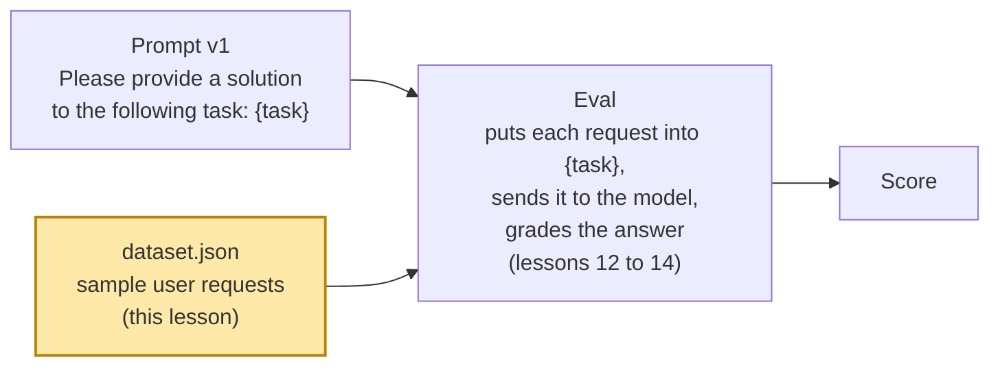
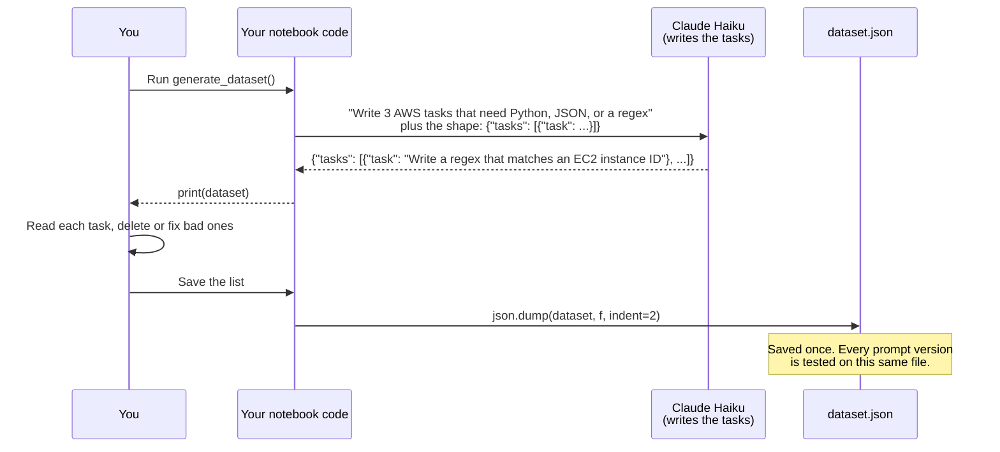

# Lesson 11 — Generating test datasets

**Course:** [Building with the Claude API](https://academy.claude.com/courses/building-with-the-claude-api) &nbsp;·&nbsp; **Lesson page:** [Generating test datasets](https://academy.claude.com/courses/building-with-the-claude-api/generating-test-datasets) &nbsp;·&nbsp; **Chapter 2:** Prompt evaluation &nbsp;·&nbsp; **Completed:** November 21, 2026

| Previous | Course | Next |
|:---|:---:|---:|
| [← A typical eval workflow](10-a-typical-eval-workflow.md) | [📚 Chapter index](README.md) | [Running the eval →](12-running-the-eval.md) |

**Practice this lesson:** in [capstone guide 2](../00_Capstone_Plan/guide/02-prompt-evaluation.md), solve:

- [Problem 2: Let the model write more test questions](../00_Capstone_Plan/guide/02-prompt-evaluation.md#problem-2-let-the-model-write-more-test-questions)

Do the guide's problems in order, after you finish the chapter, because each one builds on the one before.

---

**On this page**

| # | Section |
|:---:|:---|
| 1 | [Revision summary](#revision-summary) |
| 2 | [The big picture](#the-big-picture) |
| 3 | [1. What goes in the test dataset](#1-what-goes-in-the-test-dataset) |
| 4 | [2. The prompt that asks the model for test tasks](#2-the-prompt-that-asks-the-model-for-test-tasks) |
| 5 | [3. Get clean JSON back with structured outputs](#3-get-clean-json-back-with-structured-outputs) |
| 6 | [4. Check the tasks and save them to a file](#4-check-the-tasks-and-save-them-to-a-file) |
| 7 | [Architect notes](#architect-notes) |
| 8 | [Recap](#recap) |
| 9 | [My notes / practice](#my-notes--practice) |
| 10 | [FAQ](#faq) |

---

### Revision summary

A test dataset (also called a *test set*) is the list of sample user requests that an eval sends through your prompt. It stands in for real users during testing and never goes to production. [Lesson 9](09-prompt-evaluation.md#how-the-pieces-fit-together) shows how the prompt, the dataset, and the eval fit together. This lesson builds a dataset with code, in four steps:

1. **Decide the shape.** Each test case is a small JSON object with one field, such as `{"task": "Write a regex that matches an S3 bucket name"}`.
2. **Ask a fast, cheap model to write the cases.** Your code sends a prompt such as "Write 3 AWS tasks that need Python, JSON, or a regex" to a small model like Claude Haiku.
3. **Get the answer back as clean JSON.** Structured outputs make the model return data that always matches your shape, so your code can read it without errors.
4. **Read the cases, then save them to `dataset.json`.** You check each case by hand, and every later eval run loads the same file.

#### The running example

The prompt being tested helps users write code for Amazon Web Services (AWS), Amazon's cloud platform. A user describes a task. The answer must be only Python code, only a JSON configuration, or only a regular expression (a *regex*, a short pattern that matches text). It must have no explanation before or after it. Version 1 of the prompt says only "Please provide a solution to the following task: {task}".

#### Writing cases by hand or with a model

- **Write cases by hand** when you have few cases, or when real user messages already exist. Hand-written cases are slower to make but match real use.
- **Let a model write cases** when you need many cases quickly. A small model such as Claude Haiku is fast and cheap, and writing test tasks is an easy job.
- **Always read model-written cases.** The model can repeat itself, write tasks that are too easy, or drift away from your topic.

#### Getting clean JSON back

Your code describes the shape with a Python class and calls `client.messages.parse(..., output_format=YourClass)`. This is called *structured outputs*.

- The answer always matches the shape, and `response.parsed_output` holds it ready to use.
- Structured outputs need an object at the top level, so wrap the list of tasks in a field, such as `{"tasks": [...]}`.
- Check that `response.stop_reason` is `"end_turn"`. If it is `"max_tokens"`, the answer was cut off, so ask for fewer tasks per request.
- The course uses an older trick called prefill instead. Claude Haiku 5.5 and other newer models reject it, so don't use it.

#### Saving the dataset

- `json.dump(dataset, f, indent=2)` writes the list to `dataset.json` in the notebook's folder. `indent=2` makes the file easy to read.
- Generate the file once and keep it. Every prompt version must be tested on the same file, or the scores can't be compared.

#### Exam takeaways

- **A team needs 200 test inputs for a new prompt by tomorrow.** Have a small, cheap model such as Haiku generate them with structured outputs, then have a person review a sample before using them. (Claude Models, Prompting & Context Engineering)
- **A generator asked for 500 test tasks in one request returns an answer that is cut off.** The answer hit the `max_tokens` limit. Check `stop_reason`, and ask for smaller batches, such as 25 tasks per request on one subtopic each. (Solution Design & Architecture)
- **Scores jump between runs, and the team regenerates the test cases before each run.** Generate the dataset once, save it to a file under version control, and reuse it, so only the prompt changes between runs. (Solution Design & Architecture)

---

### The big picture

**Warning:** The course gets JSON back with prefill, which Claude Haiku 5.5 and other newer models reject with a 400 error. This page uses structured outputs instead. A short note at the end of [section 3](#3-get-clean-json-back-with-structured-outputs) shows the course's way.

This lesson is step 2 of the eval workflow from [lesson 10](10-a-typical-eval-workflow.md): create the test dataset. The highlighted box is what this lesson builds.



Here is the prompt that will be tested later.


```python
prompt = f"""
Please provide a solution to the following task:
{task}
"""
```

`{task}` is the slot. Each test task goes into it, one at a time. For example, a user asks "Write a regex that matches an EC2 instance ID". The ideal answer is only the pattern `^i-[0-9a-f]{8,17}$`, with no "Here is your regex:" line.

#### Who's who

| Player | Where it lives | What it does in this lesson |
|---|---|---|
| You | At your computer | Write the generation code, read the tasks, and decide which to keep |
| Your notebook code | A Jupyter notebook on your computer | Sends the generation prompt, reads the reply, and writes `dataset.json` |
| The generator model (Claude Haiku) | Anthropic's servers | Writes the test tasks. It is not being tested. |
| The model under test | Anthropic's servers | Answers each task with prompt v1 later, in [lesson 12](12-running-the-eval.md). Not used in this lesson. |

The generator and the model under test can be different models. A fast, cheap model is fine for writing tasks.

---

### 1. What goes in the test dataset

The dataset is a JSON array (a list) of objects. Each object has one field, `task`, which describes a job a user might ask for.


```json
[
  {"task": "Create a Python function to extract the AWS account ID from an ARN"},
  {"task": "Write a JSON policy document that allows read-only access to a specific S3 bucket"}
]
```

Three words in those tasks:

- **ARN** (Amazon Resource Name) is the full ID of anything in AWS, such as `arn:aws:iam::123456789012:user/sam`. The 12 digits are the account ID.
- **S3 bucket** is a named storage folder in AWS.
- **JSON policy document** is a JSON file that says who may do what in AWS.

You can write this list by hand or ask a model to write it. Writing 3 tasks by hand is easy. Writing 300 is slow, so this lesson asks a model.

Think of a teacher who asks a teaching assistant to draft exam questions. It saves time, but the teacher still reads every question before the exam.

---

### 2. The prompt that asks the model for test tasks

Here is the whole process of making the dataset, from start to finish:



Your notebook defines a function, `generate_dataset()`. Its prompt asks the model for test tasks:

```text
Generate an evaluation dataset for a prompt evaluation. The dataset will be used to
evaluate prompts that generate Python, JSON, or Regex specifically for AWS-related tasks.
Generate an array of JSON objects, each representing task that requires Python, JSON,
or a Regex to complete.

Example output:
[
  {"task": "Description of task"},
  ...additional
]

* Focus on tasks that can be solved by writing a single Python function, a single JSON
  object, or a single regex
* Focus on tasks that do not require writing much code

Please generate 3 objects.
```

What each part does:

| Part | Why it is there |
|---|---|
| "evaluate prompts that generate Python, JSON, or Regex … AWS-related tasks" | Tells the model the topic, so it doesn't write tasks about cooking or JavaScript |
| "Example output" | Shows the exact shape of each object |
| "a single Python function, a single JSON object, or a single regex" | Keeps each answer small enough to check |
| "do not require writing much code" | Keeps answers short, so each test run is quicker and cheaper |
| "Please generate 3 objects" | Three is enough to check that the code works. Real evals use many more. |

**Warning:** The course's example output ends the object with a comma: `"task": "Description of task",`. That is not valid JSON. The version above leaves the comma out, so the model doesn't copy the mistake.

---

### 3. Get clean JSON back with structured outputs

Without help, the model may wrap the list in a sentence such as "Here are 3 tasks:" and put it inside a ` ```json ` block. Then `json.loads()`, which turns JSON text into a Python list, crashes. **Structured outputs** fix this: you describe the shape, and the API makes the answer match it ([lesson 8](../01-accessing-claude-with-the-api/08-structured-data.md)).

```python
import json
from anthropic import Anthropic
from pydantic import BaseModel

client = Anthropic()
model = "claude-haiku-5-5"

class Task(BaseModel):
    task: str

class Dataset(BaseModel):
    tasks: list[Task]

def generate_dataset():
    prompt = """...the prompt from section 2..."""
    response = client.messages.parse(
        model=model,
        max_tokens=4000,
        messages=[{"role": "user", "content": prompt}],
        output_format=Dataset,
    )
    return [t.model_dump() for t in response.parsed_output.tasks]
```

Line by line:

- `model = "claude-haiku-5-5"` picks Claude Haiku 5.5, the fast, low-cost model. Writing test tasks is easy, so a bigger model isn't needed.
- `class Task(BaseModel)` uses **Pydantic**, a Python library that describes data shapes. A `Task` has one text field, `task`.
- `class Dataset` holds a list of `Task` objects in a field called `tasks`. The list sits inside an object because structured outputs need an object at the top level.
- `client.messages.parse(..., output_format=Dataset)` sends the prompt and the shape together. The API makes the model's answer match the shape.
- `response.parsed_output.tasks` is the list of `Task` objects, ready to use.
- `t.model_dump()` turns each `Task` into a plain dictionary, such as `{"task": "..."}`. So the function returns the same list shape the course uses.

Try it:

```python
dataset = generate_dataset()
print(dataset)
```

```text
[{'task': 'Write a Python function that lists all S3 buckets in an AWS account using boto3'},
 {'task': 'Create a JSON IAM policy that allows only read access to one DynamoDB table'},
 {'task': 'Write a regex that matches a valid EC2 instance ID such as i-0abcd1234ef567890'}]
```

You get one Python task, one JSON task, and one regex task, as asked. **boto3** is the Python library for AWS. **IAM** is AWS's system for permissions. Your wording will differ, because the model writes new tasks each time.

> **Remember this:** Describe the shape, and the API keeps the model to it.

**Note on the course's way:** the course gets clean JSON by adding a last assistant message that starts the answer for the model (a *prefill*), and by cutting the answer off at the closing ` ``` ` (a *stop sequence*):

```python
add_assistant_message(messages, "```json")       # prefill: newer models reject this
text = chat(messages, stop_sequences=["```"])
```

This works only on older models such as `claude-haiku-4-5`. Claude Haiku 5.5 and other newer models return a 400 error, so use structured outputs. [Lesson 8](../01-accessing-claude-with-the-api/08-structured-data.md#4-the-courses-way-prefill-and-stop-sequences-older-models-only) explains the old trick.

---

### 4. Check the tasks and save them to a file

First, read every task. Ask three questions:

1. Does it fit the topic (AWS, and Python, JSON, or a regex)?
2. Is it different from the other tasks, not the same job reworded?
3. Is it small enough to answer with one function, one JSON object, or one regex?

Delete or rewrite any task that fails. Then save the list:

```python
with open("dataset.json", "w") as f:
    json.dump(dataset, f, indent=2)
```

- `open("dataset.json", "w")` opens the file for writing (`"w"`), and creates it if it doesn't exist. It lands in the same folder as the notebook.
- `json.dump(dataset, f, indent=2)` writes the list as JSON text into the file. `indent=2` puts each item on its own indented lines.

The file now looks like this:

```json
[
  {
    "task": "Write a Python function that lists all S3 buckets in an AWS account using boto3"
  },
  ...
]
```

Why save it? Every prompt version must be tested on the same tasks ([lesson 10](10-a-typical-eval-workflow.md)). If you generated new tasks before each run, a higher score might only mean easier tasks. [Lesson 12](12-running-the-eval.md) loads this file and runs each task through prompt v1.

---

### Architect notes

#### Cost

- Generating the dataset is one request, so it costs very little on Claude Haiku. Running the eval later costs much more: one or two requests per task for every prompt version. Prices change, so check Anthropic's pricing page.
- Generate once and reuse the file. Regenerating before every run wastes money and breaks the comparison.

#### Limits

- One request can only return so much text. A request for 500 tasks can hit `max_tokens` and stop halfway. Check that `response.stop_reason` is `"end_turn"`, not `"max_tokens"`.
- For big datasets, ask in batches, such as 25 tasks per request on one subtopic each (S3, IAM, EC2). Batching by subtopic also gives more varied tasks.

#### Quality

- Model-written tasks tend to look alike and to skip messy real cases, such as typos, vague requests, or two jobs in one. Ask for these on purpose, and add real user messages when you have them.
- The model that writes the tasks and the model that answers them may share blind spots. Have a person review at least a sample.
- Ask for a fixed mix, such as "one third each of Python, JSON, and regex," then count the result. A lopsided dataset hides weak spots.

#### Security and data

- If you build the dataset from real user messages, remove personal data such as names, emails, and account IDs first. The dataset file is shared and stored in Git.
- Keep `dataset.json` under version control, so every score can be traced to the exact tasks it used.

---

### Recap

- A test dataset is the list of sample inputs an eval sends through your prompt. Here, each item is `{"task": "..."}`.
- A fast, cheap model such as Claude Haiku can write the tasks for you. You still read and fix them.
- Structured outputs return the list in a fixed shape that your code can read without errors.
- Save the list to `dataset.json` once, and reuse it for every prompt version.

---

## My notes / practice

- [ ] Run `generate_dataset()` with Claude Haiku 5.5 and structured outputs, and print the 3 tasks.
- [ ] Change the prompt to ask for 12 tasks, 4 of each kind, and count the kinds in the result.
- [ ] Save the list to `dataset.json` and open the file to check it.
- [ ] Ask for 50 tasks with `max_tokens=300`, print `response.stop_reason`, and see what a cut-off answer looks like.

---

## FAQ

**Q1. What does "test dataset" mean in an eval?**
It is the list of sample inputs that your eval code puts into the prompt, one at a time. In this lesson it is a JSON list of objects such as `{"task": "Write a regex that matches an S3 bucket name"}`.

**Q2. Should I write test cases by hand or let a model write them?**
Write them by hand when you need only a few, or when real user messages exist. Let a model write them when you need many quickly. Either way, read them before you use them.

**Q3. Why does the course suggest Claude Haiku for writing test tasks?**
Writing test tasks is an easy job, and Haiku is the fastest, cheapest Claude model. A bigger model would cost more without making better tasks.

**Q4. Is the model that writes the tasks the same one that gets tested?**
Not necessarily. The generator model only writes the tasks. The model under test answers them later with your prompt, and it can be a different model.

**Q5. Why does the generation prompt say "a single function" and "not much code"?**
Small tasks give short answers. Short answers are quicker and cheaper to run, and easier to grade.

**Q6. What does "structured outputs" mean?**
It is an API feature where you send a description of the data shape with your request. The model's answer always matches that shape, so your code can read it without crashing.

**Q7. Why is the list of tasks wrapped inside a `tasks` field?**
Structured outputs need an object at the top level, not a bare list. So the shape is `{"tasks": [...]}`, and your code takes the list out of the `tasks` field.

**Q8. The course uses "prefill" to get JSON. Should I?**
No. Prefill works only on older models such as `claude-haiku-4-5`, and Claude Haiku 5.5 and other newer models reject it with a 400 error. Use structured outputs instead.

**Q9. Why save the dataset to a file instead of generating it each time?**
Every prompt version must be tested on the same tasks. New tasks each run could change the score even when the prompt didn't change.

**Q10. (Exam angle) A team needs 200 test inputs for a new prompt by tomorrow. What do you recommend?**
Have a small, cheap model such as Haiku generate them in batches with structured outputs. Then have a person review a sample for topic, variety, and realistic edge cases. (Claude Models, Prompting & Context Engineering)

**Q11. (Exam angle) A generator asked for 500 test tasks in one request, and the answer comes back cut off. What do you recommend?**
The answer hit the `max_tokens` limit. Check `stop_reason` on every response, and ask for smaller batches, such as 25 tasks per request on one subtopic each, which also gives more varied tasks. (Solution Design & Architecture)

**Q12. (Exam angle) Eval scores jump between runs, and the team regenerates the test cases before each run. What do you tell them?**
Generate the dataset once, save it to a file in version control, and reuse it. Then only the prompt changes between runs, so the scores can be compared. (Solution Design & Architecture)

---

| Previous | Course | Next |
|:---|:---:|---:|
| [← A typical eval workflow](10-a-typical-eval-workflow.md) | [📚 Chapter index](README.md) | [Running the eval →](12-running-the-eval.md) |
