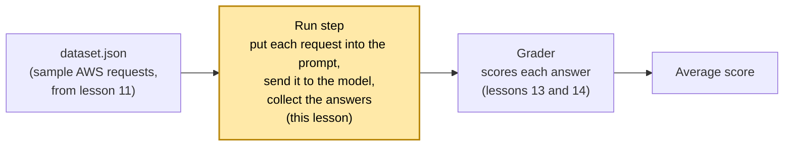
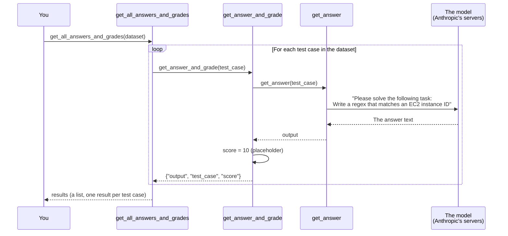

# Lesson 12 — Running the eval

**Course:** [Building with the Claude API](https://academy.claude.com/courses/building-with-the-claude-api) &nbsp;·&nbsp; **Lesson page:** [Running the eval](https://academy.claude.com/courses/building-with-the-claude-api/running-the-eval) &nbsp;·&nbsp; **Chapter 2:** Prompt evaluation &nbsp;·&nbsp; **Completed:** November 22, 2026

| Previous | Course | Next |
|:---|:---:|---:|
| [← Generating test datasets](11-generating-test-datasets.md) | [📚 Chapter index](README.md) | [Model based grading →](13-model-based-grading.md) |

**Practice this lesson:** in [capstone guide 2](../00_Capstone_Plan/guide/02-prompt-evaluation.md), solve:

- [Problem 3: Run every test question through the app](../00_Capstone_Plan/guide/02-prompt-evaluation.md#problem-3-run-every-test-question-through-the-app)

Do the guide's problems in order, after you finish the chapter, because each one builds on the one before.

---

**On this page**

| # | Section |
|:---:|:---|
| 1 | [Revision summary](#revision-summary) |
| 2 | [The big picture](#the-big-picture) |
| 3 | [1. get\_answer: send one task to the model and get its answer](#1-get_answer-send-one-task-to-the-model-and-get-its-answer) |
| 4 | [2. get\_answer\_and\_grade: get the answer, then grade it](#2-get_answer_and_grade-get-the-answer-then-grade-it) |
| 5 | [3. get\_all\_answers\_and\_grades: do it for every task in the dataset](#3-get_all_answers_and_grades-do-it-for-every-task-in-the-dataset) |
| 6 | [4. Run it and read the results](#4-run-it-and-read-the-results) |
| 7 | [Architect notes](#architect-notes) |
| 8 | [Recap](#recap) |
| 9 | [My notes / practice](#my-notes--practice) |
| 10 | [FAQ](#faq) |

---

### Revision summary

**Purpose of this lesson:**

1. You are building an AWS code helper. A user types a request, such as "Write a regex that matches an EC2 instance ID," and your prompt should make the model answer with code only.
2. Reading the prompt cannot tell you whether it works. You only find out by seeing what the model really answers.
3. The [dataset from lesson 11](11-generating-test-datasets.md), `dataset.json`, holds sample requests but no answers yet. A grader has nothing to score until every request has a answer.
4. This lesson writes the code that sends every sample request through the prompt and collects the answers. Grading comes in the next two lessons, so the score is a fixed placeholder for now.

**Why run the requests with code instead of trying them by hand:**

| | Trying requests by hand in a chat window | Running the eval with code |
|---|---|---|
| Time for 100 requests | Hours of copy and paste | One command, then wait |
| After every prompt change | Do it all again by hand | Run the same command again |
| Same prompt, model, and settings for every request? | Easy to slip | Yes, every time |
| Can two prompt versions be compared? | Not reliably | Yes, on the same requests |

The first run is useful even before a grader exists. Reading the answers here already shows the main problem with prompt v1: the model wraps its code in explanations.

The highlighted box is what this lesson builds.



The run step is three small Python functions. Each name says what the function gives back, and each one calls the one below it:

- **`get_answer(test_case)`:** puts one task from the dataset into the prompt, sends it to the model, and returns **only the model's answer**.
- **`get_answer_and_grade(test_case)`:** calls `get_answer`, then grades that answer. It returns **the task, the answer, and the grade** together in one record.
- **`get_all_answers_and_grades(dataset)`:** calls `get_answer_and_grade` for every task in the dataset and returns the list of records.

These notes use clearer names than the course. Match them to the course's code, videos, and quiz with this table:

| Name in these notes | Name in the course | Returns |
|---|---|---|
| `get_answer` | `run_prompt` | The model's answer only |
| `get_answer_and_grade` | `run_test_case` | The task, the answer, and the grade |
| `get_all_answers_and_grades` | `run_eval` | One record per task in the dataset |

#### What a "test case" and a "result" are

- **A test case** is one item from `dataset.json`, such as `{"task": "Write a regex that matches an EC2 instance ID"}`.
- **A result** is a Python dictionary with three fields: `output` (the model's answer), `test_case` (the item it answered), and `score` (the grade).
- `get_all_answers_and_grades` returns a list of results, one per test case. `print(json.dumps(results, indent=2))` prints that list in a readable layout.

#### What to expect on the first run

- **The run is slow.** The loop waits for each answer before sending the next request. The course's 3 to 5 tasks took about 31 seconds, even on Claude Haiku, the fastest model.
- **The answers are too long.** Prompt v1 is only "Please solve the following task:" plus the task, with no rule about format. So the model adds explanations around the code, which the next prompt versions must fix.
- **Every score is 10.** `score = 10` is a placeholder that lets you test the pipeline before a real grader exists.

#### When to use which way of running an eval

- **Use a plain loop** while you build and debug the eval on a few test cases. It is the simplest code to read.
- **Use several requests at once** (for example, a thread pool) when the dataset has dozens or hundreds of cases and you want results in minutes. Keep the number low enough to stay under your rate limit.
- **Use the Message Batches API** for large runs that can wait. It costs half the normal price, and most batches finish within an hour.

#### Exam takeaways

- **An eval of 2,000 test cases takes hours, because the code sends one request at a time.** Send several requests at once, within the account's rate limit. If the results can wait, use the Message Batches API at half the price. (Solution Design & Architecture)
- **An eval run crashes at test case 180 of 200, and all earlier answers are lost.** Catch errors for each test case, rely on the SDK's automatic retries, and save each result to a file as it arrives. (Solution Design & Architecture)
- **The eval copies the prompt text into its own script, and the production app later changes its prompt.** The eval should call the same function and prompt the app uses, or it scores a prompt nobody ships. (Claude Models, Prompting & Context Engineering)

---

### The big picture

#### Who's who

| Player | Where it lives | What it does in this lesson | Example |
|---|---|---|---|
| **You** | At your laptop | Run the notebook cells and read the results | You run `results = get_all_answers_and_grades(dataset)` |
| **Your notebook code** | A Jupyter notebook on your laptop | Holds the three functions and the loop | `get_all_answers_and_grades`, `get_answer_and_grade`, `get_answer` |
| **`dataset.json`** | A file next to the notebook | Holds the sample requests from [lesson 11](11-generating-test-datasets.md) | `[{"task": "Write a regex that matches an EC2 instance ID"}, ...]` |
| **The model** | Anthropic's servers | Answers each request. This is the prompt being tested. | Claude Haiku answers with a regex and an explanation |
| **The grader** | Not built yet | Will score each answer ([lesson 13](13-model-based-grading.md), [lesson 14](14-code-based-grading.md)) | For now, a fixed `score = 10` |

#### The two stages from the course slides

The course's slides use simple questions, such as "What's 2+2?", to show the stages. Each question is put into the prompt and sent to the model.


Then each question and its answer go to the grader, which gives a score. This lesson builds the first stage fully. The second stage gets only a placeholder.


#### How the three functions call each other

Think of a teacher marking a pile of exam papers. The teacher takes one paper (`get_all_answers_and_grades`'s loop), reads the student's answer (`get_answer`), writes a mark on it (`get_answer_and_grade`), and puts it on the done pile (the `results` list).



---

### 1. get_answer: send one task to the model and get its answer

```python
def get_answer(test_case):
    """Merges the prompt and test case input, then returns the result"""
    prompt = f"""
Please solve the following task:

{test_case["task"]}
"""

    messages = []
    add_user_message(messages, prompt)
    output = chat(messages)
    return output
```

Line by line:

- `test_case` is one item from the dataset, such as `{"task": "Write a regex that matches an EC2 instance ID"}`.
- `f"""..."""` is an *f-string*: Python text in which anything inside `{ }` is replaced by its value.
- `{test_case["task"]}` takes the `task` field out of the item. So the prompt becomes "Please solve the following task: Write a regex that matches an EC2 instance ID."
- `add_user_message` and `chat` are the helper functions from [lesson 4](../01-accessing-claude-with-the-api/04-multi-turn-conversations.md#3-three-helper-functions). The first adds the prompt to the message list as a user message. The second sends the list to the model and returns the answer text.
- `messages = []` starts a new, empty conversation for every test case. So the model never sees the other test cases, and each answer is independent.

This prompt is **prompt v1**, kept as simple as possible on purpose. It says nothing about format. The goal is code only, but the model will add explanations. Prompt engineering in chapter 3 fixes that, and the eval measures whether the fix worked.

---

### 2. get_answer_and_grade: get the answer, then grade it

```python
def get_answer_and_grade(test_case):
    """Calls get_answer, then grades the result"""
    output = get_answer(test_case)

    # TODO - Grading
    score = 10

    return {
        "output": output,
        "test_case": test_case,
        "score": score
    }
```

- `output = get_answer(test_case)` gets the model's answer for this one task.
- `score = 10` is a **placeholder**: a fixed value that stands in until real grading code exists. It lets you run the whole pipeline now. `# TODO` is a note to yourself that this part is unfinished.
- The function returns a dictionary that keeps the answer, the task it answered, and the score together. Keeping the task with the answer matters later: when a score is low, you can see which task caused it.

#### How this differs from get_answer

Both functions get the same record, `{"task": "Write a regex that matches an EC2 instance ID"}`. They return different things:

| | `get_answer` | `get_answer_and_grade` |
|---|---|---|
| Sends the task to the model being tested? | Yes | No, it lets `get_answer` do that |
| Grades the answer? | No | Yes |
| Returns | The answer text only: `"Here's a regular expression... ^i-[0-9a-f]{8,17}$ ..."` | One record: `{"output": "Here's a regular expression...", "test_case": {"task": "..."}, "score": 10}` |

Think of a restaurant. The cook makes the dish (`get_answer`). The inspector takes the dish, tastes it, and writes a report card with the order, the dish, and the score (`get_answer_and_grade`).

Keeping the two jobs apart means you can change one without touching the other. In this lesson the grade is a placeholder. The next lesson swaps in a real grader, and `get_answer` does not change. If you rewrite the prompt, only `get_answer` changes.

---

### 3. get_all_answers_and_grades: do it for every task in the dataset

```python
def get_all_answers_and_grades(dataset):
    """Loads the dataset and calls get_answer_and_grade with each case"""
    results = []

    for test_case in dataset:
        result = get_answer_and_grade(test_case)
        results.append(result)

    return results
```

- `results = []` starts an empty list.
- The `for` loop takes each test case in turn, runs it, and adds the result to the list with `append`.
- The function returns the whole list. In the video, the instructor first printed the results inside the function, then changed it to `return`. Returning is better, because other code, such as the code that averages the scores, can then use the list.

> **Remember this:** `get_answer` gets one answer. `get_answer_and_grade` adds a grade. `get_all_answers_and_grades` does it for every task.

---

### 4. Run it and read the results

In the next notebook cell, load the saved dataset and run the eval:

```python
import json

with open("dataset.json", "r") as f:   # opens the file saved in lesson 11, for reading
    dataset = json.load(f)              # turns the JSON text into a Python list

results = get_all_answers_and_grades(dataset)
```

**Warning:** Run all the cells above first, so that `client`, `chat`, and the three functions exist. Otherwise Python stops with a `NameError`.

The first run takes a while. The instructor's run took about 31 seconds on Claude Haiku, because each request waits for the one before it to finish.

Then print the results:

```python
print(json.dumps(results, indent=2))   # indent=2 puts each field on its own indented line
```

The output looks like this (shortened; your answers will differ):

```text
[
  {
    "output": "Here's a regular expression that matches an EC2 instance ID:\n\n```regex\n^i-[0-9a-f]{8}([0-9a-f]{9})?$\n```\n\n**Explanation:**\n- `^i-` matches the literal prefix...",
    "test_case": {
      "task": "Write a regex that matches a valid EC2 instance ID such as i-0abcd1234ef567890"
    },
    "score": 10
  },
  {
    "output": "Here's a JSON IAM policy that grants read-only access to a single DynamoDB table:\n\n```json\n{ ... }\n```\n\n**Key points:** ...",
    "test_case": {
      "task": "Create a JSON IAM policy that allows only read access to one DynamoDB table"
    },
    "score": 10
  }
]
```

What this shows:

| What you see | What it means |
|---|---|
| `"Here's a regular expression..."` and `**Explanation:**` around the code | Prompt v1 gives no format rule, so the model explains. The goal was code only. |
| `\n` inside `output` | A line break inside the answer. `json.dumps` writes it as `\n`. |
| Every `score` is 10 | The placeholder. A real grader would mark these answers down for the extra text. |

The course calls this the core of most eval pipelines: the loop is short, and the hard parts are the prompt, the grader, and speed.

---

### Architect notes

**Not in the course, from the official Claude API documentation:** prices and limits change, so check the current values.

#### Speed

- The plain loop sends one request at a time, so 200 test cases take about 200 times one answer. Send several at once, for example with Python's `concurrent.futures.ThreadPoolExecutor` or the SDK's `AsyncAnthropic` client.
- Your account has a **rate limit**: a maximum number of requests and tokens per minute. Too many requests at once return error `429`. Start with a small number at a time, such as 5, and raise it.

#### Cost

- Every eval run costs one request per test case, plus grading requests later. Ten prompt versions on 200 cases is 2,000 requests or more.
- The **Message Batches API** runs many requests in the background at half the normal price. Most batches finish within an hour, and all finish within 24 hours. It suits big eval runs, not quick debugging.

#### Reliability

- In the plain loop, one failed request stops the whole run and loses every result so far. Wrap each test case in `try`/`except` and record the error as that case's result.
- The Python SDK already retries some failed requests, such as `429` and `529` (overloaded), 2 times by default. You can raise this with `Anthropic(max_retries=5)`.
- Save results to a file as they arrive, such as one JSON line per case, so a crash does not lose finished work.

#### Results you can compare

- Store the prompt version, model name, and date with each run. A score means nothing if you cannot say which prompt produced it.
- `chat` uses temperature 1.0 by default ([lesson 6](../01-accessing-claude-with-the-api/06-temperature.md)), so answers vary between runs. Use the same temperature the app uses, and run important comparisons more than once.
- Call the same function and prompt the production app uses. A copy of the prompt inside the eval drifts out of date and scores the wrong thing.

---

### Recap

- The run step of an eval is three functions: `get_answer` gets one answer, `get_answer_and_grade` adds a grade, and `get_all_answers_and_grades` does it for every task. The course calls them `run_prompt`, `run_test_case`, and `run_eval`.
- `get_answer` puts each task into the prompt with an f-string and sends it as a new conversation.
- Each result keeps the answer, the test case, and the score together.
- The score is a placeholder of 10 until the graders in lessons 13 and 14 exist.
- The first run is slow and the answers are wordy. Both get fixed later: speed with parallel requests, wordiness with a better prompt.

---

## My notes / practice

- [ ] Write the three functions and run them on the `dataset.json` from lesson 11.
- [ ] Time the run with `import time` and `time.time()` before and after `get_all_answers_and_grades`.
- [ ] Print only `result["output"]` for each result and count how many answers contain an explanation.
- [ ] Add a `try`/`except` inside `get_all_answers_and_grades`, so a failed case records `{"error": str(e)}` instead of stopping the loop.
- [ ] Save `results` to `results.json` with `json.dump(results, f, indent=2)`.

---

## FAQ

**Q1. Why do I need to run the eval at all, when I already have the dataset?**
The dataset holds only sample requests, not the model's answers. You can't tell whether a prompt works until you see real answers, and a grader can't score anything until every request has one. Running it with code also sends every request the same way, so two prompt versions can be compared fairly.

**Q2. What does "test case" mean in this lesson?**
A test case is one item from `dataset.json`, such as `{"task": "Write a regex that matches an EC2 instance ID"}`. The eval runs each test case through the prompt once.

**Q3. What does each of the three functions do?**
`get_answer` sends one task to the model and returns only its answer. `get_answer_and_grade` calls `get_answer`, grades the answer, and returns the task, the answer, and the grade in one record. `get_all_answers_and_grades` does that for every task in the dataset. The course calls them `run_prompt`, `run_test_case`, and `run_eval`.

**Q4. Why does `get_answer` start a new, empty message list for each test case?**
So each task is answered on its own. If the list kept growing, the model would see earlier tasks and answers, and a answer could depend on the order of the dataset.

**Q5. Why is every score 10?**
`score = 10` is a placeholder that stands in until a real grader exists. It lets you test the rest of the pipeline first. Lessons 13 and 14 replace it.

**Q6. Why does the model's answer include explanations when the goal is code only?**
Prompt v1 is only "Please solve the following task:" plus the task. It has no rule about format, so the model explains its code. A later prompt version adds that rule, and the eval shows whether it helped.

**Q7. Why does the first run take about 30 seconds?**
The loop sends one request and waits for the answer before sending the next. The total time is the sum of every answer time. Sending several requests at once makes it much faster.

**Q8. Why does each result keep the test case next to the answer?**
So you can see which task produced which answer. When a score is low, you need to know the task to understand the failure.

**Q9. What does `json.dumps(results, indent=2)` do?**
It turns the Python list of results into JSON text, with each field on its own line, indented by 2 spaces. That makes a long result list easy to read.

**Q10. What happens if one request fails halfway through the loop?**
In the course's code, Python stops and every result so far is lost. Catch the error for each test case and save results as they arrive, so one failure costs only one case.

**Q11. (Exam angle) An eval of 2,000 test cases takes hours, because the code sends one request at a time. What do you recommend?**
Send several requests at once, staying under the account's rate limit. If the results can wait, use the Message Batches API, which costs half the normal price and usually finishes within an hour. (Solution Design & Architecture)

**Q12. (Exam angle) An eval run crashes at test case 180 of 200 and loses all earlier answers. How do you make it reliable?**
Catch errors for each test case, rely on the SDK's automatic retries for rate-limit and overload errors, and write each result to a file as it arrives. (Solution Design & Architecture)

**Q13. (Exam angle) The eval script has its own copy of the prompt, and the production app has since changed its prompt. What is the risk?**
The eval scores a prompt that nobody ships, so a good score proves nothing. The eval should call the same function and prompt the app uses. (Claude Models, Prompting & Context Engineering)

---

| Previous | Course | Next |
|:---|:---:|---:|
| [← Generating test datasets](11-generating-test-datasets.md) | [📚 Chapter index](README.md) | [Model based grading →](13-model-based-grading.md) |
