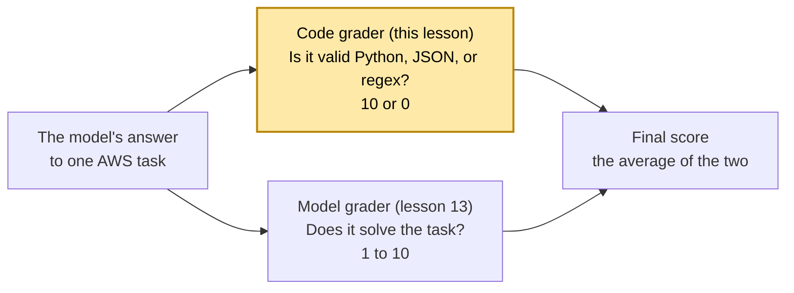
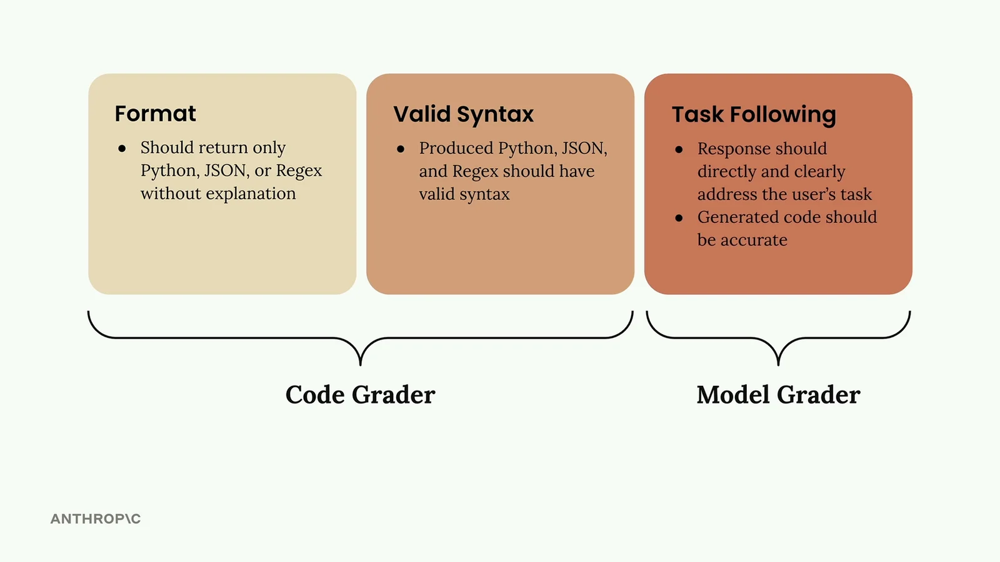
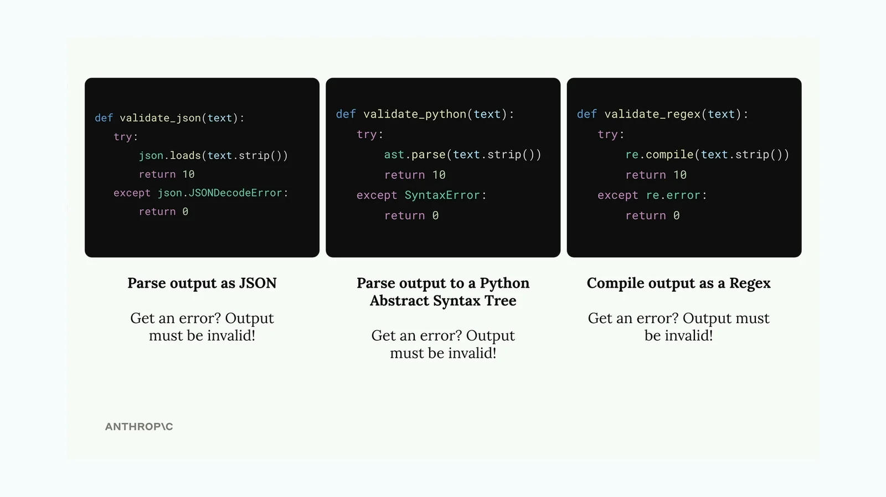

# Lesson 14 — Code based grading

**Course:** [Building with the Claude API](https://academy.claude.com/courses/building-with-the-claude-api) &nbsp;·&nbsp; **Lesson page:** [Code based grading](https://academy.claude.com/courses/building-with-the-claude-api/code-based-grading) &nbsp;·&nbsp; **Chapter 2:** Prompt evaluation &nbsp;·&nbsp; **Completed:** November 22, 2026

| Previous | Course | Next |
|:---|:---:|---:|
| [← Model based grading](13-model-based-grading.md) | [📚 Chapter index](README.md) | [Quiz on prompt evaluation →](README.md#quiz-review) |

**Practice this lesson:** in [capstone guide 2](../00_Capstone_Plan/guide/02-prompt-evaluation.md), solve:

- [Problem 4: Grade answers with code](../00_Capstone_Plan/guide/02-prompt-evaluation.md#problem-4-grade-answers-with-code)

Do the guide's problems in order, after you finish the chapter, because each one builds on the one before.

---

**On this page**

| # | Section |
|:---:|:---|
| 1 | [Revision summary](#revision-summary) |
| 2 | [The big picture](#the-big-picture) |
| 3 | [1. Three syntax checks](#1-three-syntax-checks) |
| 4 | [2. Tell each check which format to expect](#2-tell-each-check-which-format-to-expect) |
| 5 | [3. Ask the model for code only](#3-ask-the-model-for-code-only) |
| 6 | [4. Combine the code score and the model score](#4-combine-the-code-score-and-the-model-score) |
| 7 | [5. The course's way: prefill and stop sequences (older models only)](#5-the-courses-way-prefill-and-stop-sequences-older-models-only) |
| 8 | [Architect notes](#architect-notes) |
| 9 | [Recap](#recap) |
| 10 | [My notes / practice](#my-notes--practice) |
| 11 | [FAQ](#faq) |

---

### Revision summary

**Purpose of this lesson:**

1. You are building an AWS code helper. Its answers must be only Python, only JSON, or only a regex, and the code must be valid.
2. The model grader from [lesson 13](13-model-based-grading.md) judges whether an answer solves the task. But it reads code the way a person skims it, so it can miss a missing bracket, and every check costs a request.
3. Whether text is valid JSON, Python, or regex has one exact answer, and Python can check it in a fraction of a second, for free.
4. This lesson adds a code grader for format and syntax, and averages its score with the model grader's score.

**Why let code check the syntax:**

| | Model grader | Code grader (this lesson) |
|---|---|---|
| Is `{"Effect": "Allow"` (closing brace missing) valid JSON? | Might say "looks fine" | Always says no: `json.loads` fails |
| Same answer every run? | Not always | Yes |
| Cost per check | One API request | Free |
| Can it tell whether the code solves the task? | Yes | No |

So each grader does what it is good at: code checks the exact rules, and the model judges the meaning.



#### How the code grader works

1. **Each test case says which format it expects.** The dataset gets a `format` field: `"python"`, `"json"`, or `"regex"`.
2. **One check per format tries to read the answer.** `json.loads` reads JSON, `ast.parse` reads Python without running it, and `re.compile` reads a regex.
3. **If reading works, the score is 10. If it fails with an error, the score is 0.** An answer with an explanation around the code usually fails too, so this check also catches the format problem.
4. **`score_answer` averages the two scores.** A model score of 8 and a syntax score of 0 give 4.

#### Getting only the code back

- Tighten the prompt: "Respond only with Python, JSON, or a plain Regex. Do not add any comments or commentary or explanation."
- Use structured outputs with a one-field shape, `{"code": "..."}`, so no Markdown fences or opening sentence surround the code.

**Warning:** The course gets bare code with a prefilled ` ```code ` message and a ` ``` ` stop sequence. Claude Haiku 5.5 and other newer models reject prefill with a 400 error, so use structured outputs.

#### When to use which grader

- **Use a code grader** for anything with one exact answer: valid JSON, valid Python, a regex that compiles, a required field, a length limit, a banned word.
- **Use a model grader** for meaning: does the code solve the task, is it accurate, is it helpful.
- **Use both and combine them** when an answer must be both well-formed and correct, as code answers must.

#### Exam takeaways

- **A team uses a model grader to check that generated JSON configs are valid.** Use a code grader instead: `json.loads` gives an exact, free, repeatable answer. Keep the model grader for whether the config does the right thing. (Prompt Engineering & Structured Output)
- **An average of a model score and a syntax score lets broken code score 5 out of 10.** Make syntax a gate instead: if the code does not parse, the answer scores 0, whatever the model grader says. (Solution Design & Architecture)
- **A team wants its grader to run the model's generated Python to see if it works.** Never run generated code on your own machine or servers. Check syntax with `ast.parse`, which does not run the code, and run real tests only in an isolated sandbox. (Governance, Safety & Risk)

---

### The big picture

The course splits the three qualities from [lesson 13](13-model-based-grading.md#2-decide-what-good-means-first) between the two graders. This lesson builds the left side.



| Quality | Bad answer | Caught by |
|---|---|---|
| Format: code only | `Here's the policy: {"Effect": "Allow", ...}` | The code grader, because the opening sentence makes `json.loads` fail |
| Valid syntax | `{"Effect": "Allow"` with the closing brace missing | The code grader |
| Task following | Valid JSON that grants write access when the task asked for read-only | The model grader |

---

### 1. Three syntax checks



Each check tries to read the answer. Think of a ticket machine at a train station: it either reads your ticket or rejects it, with no opinion about your trip.

```python
import ast    # Python's own tools for reading Python code
import json
import re     # Python's tools for regular expressions

def validate_json(text):
    try:
        # Tries to read the text as JSON. strip() removes spaces and line breaks at the ends.
        json.loads(text.strip())
        return 10
    except json.JSONDecodeError:
        # Reading failed, so the text is not valid JSON.
        return 0

def validate_python(text):
    try:
        # Builds an abstract syntax tree: Python's map of the code's structure.
        # It only reads the code. It never runs it, so even harmful code is safe to check.
        ast.parse(text.strip())
        return 10
    except SyntaxError:
        return 0

def validate_regex(text):
    try:
        # Turns the text into a regex pattern. Fails on broken patterns such as "[a-z".
        re.compile(text.strip())
        return 10
    except re.error:
        return 0
```

`try` and `except` are Python's way to attempt something and catch the error if it fails, instead of crashing.

What each check returns for real answers:

| Answer | `validate_json` | `validate_python` | `validate_regex` |
|---|---|---|---|
| `{"Effect": "Allow", "Action": "s3:GetObject"}` | 10 | 10 (a Python dictionary looks the same) | 10 |
| `{"Effect": "Allow"` | 0 | 0 | 10 |
| `Here's the policy: {"Effect": "Allow"}` | 0 | 0 | 10 |
| `^i-[0-9a-f]{8,17}$` | 0 | 0 | 10 |

**Warning:** Look at the last column. Almost any text compiles as a regex, even "Here's the policy," because ordinary words are valid patterns. So the regex check only catches broken patterns. It cannot catch an explanation around the regex. Only the model grader, or a test that runs the regex against sample IDs, catches that.

That is why each answer must be checked with the check for its own format, which is the next section.

---

### 2. Tell each check which format to expect

The grader needs to know which check to use. So each test case in `dataset.json` gets a `format` field:

```json
{
    "task": "Create a Python function to validate an AWS IAM username",
    "format": "python"
}
```

To have the model write this field when it generates the dataset, add it to the `Task` shape from [lesson 11](11-generating-test-datasets.md#3-the-code):

```python
from typing import Literal

class Task(BaseModel):
    task: str
    # New: the format the answer must be in. Literal allows only these three words.
    format: Literal["python", "json", "regex"]
```

Then one function picks the check that matches the test case:

```python
def grade_syntax(test_case, answer):
    if test_case["format"] == "json":
        return validate_json(answer)
    if test_case["format"] == "python":
        return validate_python(answer)
    # Anything else is a regex task.
    return validate_regex(answer)
```

---

### 3. Ask the model for code only

The syntax checks fail on any extra text, so the model must return bare code. Two changes do that.

First, the prompt gets clear rules. This is **prompt v2**:

```text
Please solve the following task:

Create a Python function to validate an AWS IAM username

* Respond only with Python, JSON, or a plain Regex
* Do not add any comments or commentary or explanation
```

Second, `get_model_answer` from [lesson 12](12-running-the-eval.md#1-get_model_answer-get-the-models-answer-to-one-task) uses structured outputs ([lesson 8](../01-accessing-claude-with-the-api/08-structured-data.md)) with a one-field shape:

```python
class CodeAnswer(BaseModel):
    # The answer comes back as {"code": "..."}, with no Markdown fences or opening sentence.
    code: str

def get_model_answer(test_case):
    prompt = f"""
Please solve the following task:

{test_case["task"]}

* Respond only with Python, JSON, or a plain Regex
* Do not add any comments or commentary or explanation
"""
    response = client.messages.parse(
        model=model,
        max_tokens=1000,
        messages=[{"role": "user", "content": prompt}],
        output_format=CodeAnswer,
    )
    # Only the code text, ready for the syntax check.
    return response.parsed_output.code
```

The shape removes the fences and the opening sentence. The model could still put an explanation inside the `code` field, and the syntax check catches that for JSON and Python.

---

### 4. Combine the code score and the model score

`score_answer` now uses both graders. Rename lesson 13's model grader to `grade_with_model`, because `score_answer` is now the function that combines the two:

```python
def score_answer(test_case, answer):
    # Lesson 13's model grader, renamed. Returns strengths, weaknesses, reasoning, and score.
    model_grade = grade_with_model(test_case, answer)
    # This lesson's code grader: 10 or 0.
    syntax_score = grade_syntax(test_case, answer)
    return {
        # Equal weight for meaning and for valid syntax.
        "score": (model_grade["score"] + syntax_score) / 2,
        "reasoning": model_grade["reasoning"],
    }
```

`run_all_tasks` from [lesson 13](13-model-based-grading.md#4-plug-the-grader-into-the-eval-and-average-the-scores) does not change. It still reads `grade["score"]` and `grade["reasoning"]`.

How the average works out:

| Answer | Model score | Syntax score | Final score |
|---|---|---|---|
| Valid regex that matches EC2 instance IDs | 9 | 10 | 9.5 |
| Correct policy, but with an opening sentence | 7 | 0 | 3.5 |
| JSON with the closing brace missing | 8 | 0 | 4 |

You can change the weights if one quality matters more. The score itself is not good or bad. It is a **baseline**: the starting number you try to raise by changing the prompt.

---

### 5. The course's way: prefill and stop sequences (older models only)

The course gets bare code with the trick from [lesson 8](../01-accessing-claude-with-the-api/08-structured-data.md#4-the-courses-way-prefill-and-stop-sequences-older-models-only):

```python
# Prefill: the answer starts after an opening fence. "code" works for Python, JSON, or regex.
add_assistant_message(messages, "```code")
# Stop at the closing fence, so only the code is left.
output = chat(messages, stop_sequences=["```"])
```

- It works only on older models such as `claude-haiku-4-5`. Claude Haiku 5.5 and other newer models reject a prefilled last assistant message with a 400 error.
- The course's `grade_syntax(output, test_case)` takes its two inputs in the opposite order from the version above. The logic is the same.

---

### Architect notes

**Not in the course, from the official Claude API documentation:** prices and limits change, so check the current values.

#### Cost and speed

- Code checks are free and take microseconds. Run them first, and call the model grader only for what code cannot judge.
- If syntax fails, you can skip the model grader for that answer and save a request.

#### Gate or average

- An average lets broken code score up to 5. In production, broken JSON is a failure, not half a success. Use syntax as a gate: invalid means 0.
- Report the two scores separately as well as combined, so you can see whether a prompt change fixed format or correctness.

#### Security

- Never run model-generated code on your own machine to grade it. `ast.parse` and `json.loads` only read text.
- To test that code really works, run unit tests in an isolated sandbox with no network and no secrets.
- A regex can compile and still hang when you run it on long input (catastrophic backtracking). Test generated regexes with a time limit.

#### Stronger code checks

- Check JSON against a schema, such as "must have `Effect` and `Action`", not only that it parses.
- Run a generated regex against known good and bad examples, such as `i-0abcd1234ef567890` and `i-xyz`. That checks meaning, which compiling cannot.

---

### Recap

- A code grader checks exact rules, such as valid syntax, for free and with the same answer every time.
- Three checks: `json.loads` for JSON, `ast.parse` for Python (without running it), and `re.compile` for regex. Each returns 10 or 0.
- Each test case gets a `format` field, so the grader picks the right check.
- Ask for code only, with clear prompt rules and structured outputs. The course's prefill trick fails on newer models.
- `score_answer` averages the code score and the model score, which gives a baseline to improve.

---

## My notes / practice

- [ ] Run the three checks on the four answers in the section 1 table and confirm the scores.
- [ ] Add the `format` field to the dataset generator from lesson 11 and generate 6 tasks.
- [ ] Run the eval with prompt v1, then prompt v2, and compare the average scores.
- [ ] Change `score_answer` to a gate (invalid syntax means 0) and see how the average moves.

---

## FAQ

**Q1. Why check syntax with code when the model grader already reads the answer?**
Whether text is valid JSON or Python has one exact answer. Code finds it every time, for free. A model grader can miss a missing bracket and costs a request per answer.

**Q2. What does "code grader" mean?**
A code grader is a function you write that scores an answer with fixed rules, such as "does this parse as JSON?" It needs no model.

**Q3. What does `ast.parse` do, and does it run the code?**
It reads Python code and builds an abstract syntax tree, Python's map of the code's structure. It never runs the code, so it is safe to use on any answer.

**Q4. Why does each test case need a `format` field?**
The grader must know which check to use. Without it, a valid regex would fail the JSON check and score 0 for no good reason.

**Q5. Why does the regex check accept an answer with an explanation?**
Ordinary words are valid regex patterns, so "Here's the regex: ^i-..." compiles. The regex check only catches broken patterns, such as `[a-z` with no closing bracket.

**Q6. How do I get only the code back from the model?**
On current models, add clear rules to the prompt and use structured outputs with a `{"code": "..."}` shape. On older models such as `claude-haiku-4-5`, the course prefills ` ```code ` and stops at ` ``` `; newer models reject the prefill.

**Q7. How are the two scores combined?**
`score_answer` averages them: a model score of 8 and a syntax score of 0 give 4. You can change the weights, or make syntax a gate.

**Q8. Is a final score of 6 good or bad?**
Neither. It is a baseline. What matters is whether a prompt change raises it on the same dataset with the same graders.

**Q9. (Exam angle) A team uses a model grader to check that generated JSON configs are valid. What do you recommend?**
Use a code grader with `json.loads` for validity: it is exact, free, and repeatable. Keep the model grader for whether the config does the right thing. (Prompt Engineering & Structured Output)

**Q10. (Exam angle) Broken code still scores 5 out of 10 because syntax and model scores are averaged. How do you fix the scoring?**
Make syntax a gate: if the code does not parse, the answer scores 0. Report both scores separately so you can see which one a prompt change improved. (Solution Design & Architecture)

**Q11. (Exam angle) A team wants its eval to run the generated Python to see if it works. What do you advise?**
Never run generated code on your own machine or servers. Check syntax with `ast.parse`, which only reads the code, and run real tests only in an isolated sandbox with no network or secrets. (Governance, Safety & Risk)

---

| Previous | Course | Next |
|:---|:---:|---:|
| [← Model based grading](13-model-based-grading.md) | [📚 Chapter index](README.md) | [Quiz on prompt evaluation →](README.md#quiz-review) |
