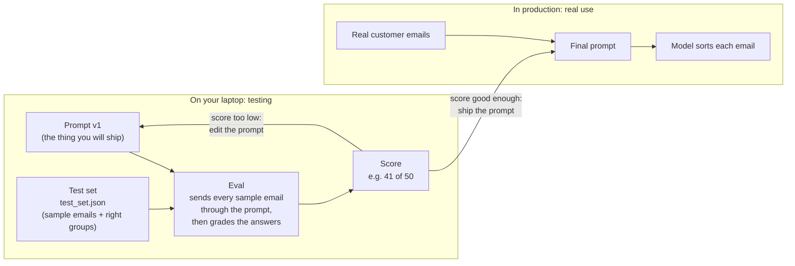

# Chapter 2 — Prompt evaluation

**Course:** [Building with the Claude API](https://academy.claude.com/courses/building-with-the-claude-api) &nbsp;·&nbsp; **Chapter 2:** Prompt evaluation (lessons 9–14) &nbsp;·&nbsp; **Status:** In progress

| Previous | Course | Next |
|:---|:---:|---:|
| [← Chapter 1: Accessing Claude with the API](../01-accessing-claude-with-the-api/README.md) | [📚 Course index](../README.md) | Chapter 3: Prompt engineering techniques → |

---

**After this chapter, practise it:**

1. Read the lesson notes on this page, then take the chapter quiz.
2. Open **[capstone guide 2](../00_Capstone_Plan/guide/02-prompt-evaluation.md)** and solve its problems. Everything you need is on that one page: an optional warm-up with example notebooks, the problems, and the hidden step-by-step answers.
3. When you finish, mark guide 2 as done in the [capstone index](../00_Capstone_Plan/README.md#the-chapter-guides).

This page will sum up the whole chapter for revision once its lessons are done. Each lesson summary will end with a link to the full lesson notes.

## How the pieces fit together

This whole chapter builds one thing: an **eval**, a process that scores a prompt before you ship it.

- **The prompt** is what you will ship to production. You test it on your laptop first.
- **The test set** (also called the *dataset* or *eval dataset*) is a saved list of sample user messages. It stands in for real users during testing, and it never goes to production.
- **The eval** puts each sample into the prompt, sends it to the model, grades the answer, and gives one score, such as "41 of 50."
- **The grader** is the part of the eval that decides whether each answer is good. It can be code, another model, or a person.

Where each lesson fits:

| Lesson | Which piece it covers |
|---|---|
| [9. Prompt evaluation](09-prompt-evaluation.md) | Why you need an eval at all |
| [10. A typical eval workflow](10-a-typical-eval-workflow.md) | The five steps, from prompt to score |
| [11. Generating test datasets](11-generating-test-datasets.md) | Where the test set comes from: a model drafts it, you check it, you save it |
| [12. Running the eval](12-running-the-eval.md) | Sending every sample through the prompt and collecting the answers |
| [13. Model based grading](13-model-based-grading.md) and 14. Code based grading | How the grader scores each answer |

## Lessons in this chapter

| # | Lesson | Lesson page | Notes | Status |
|:---:|:---|:---|:---|:---:|
| 9 | Prompt evaluation | [Prompt evaluation](https://academy.claude.com/courses/building-with-the-claude-api/prompt-evaluation) | [09-prompt-evaluation.md](09-prompt-evaluation.md) | ✅ Done |
| 10 | A typical eval workflow | [A typical eval workflow](https://academy.claude.com/courses/building-with-the-claude-api/a-typical-eval-workflow) | [10-a-typical-eval-workflow.md](10-a-typical-eval-workflow.md) | ✅ Done |
| 11 | Generating test datasets | [Generating test datasets](https://academy.claude.com/courses/building-with-the-claude-api/generating-test-datasets) | [11-generating-test-datasets.md](11-generating-test-datasets.md) | ✅ Done |
| 12 | Running the eval | [Running the eval](https://academy.claude.com/courses/building-with-the-claude-api/running-the-eval) | [12-running-the-eval.md](12-running-the-eval.md) | ✅ Done |
| 13 | Model based grading | [Model based grading](https://academy.claude.com/courses/building-with-the-claude-api/model-based-grading) | [13-model-based-grading.md](13-model-based-grading.md) | ✅ Done |
| 14 | Code based grading | | `14-code-based-grading.md` | ⬜ |
| — | Quiz on prompt evaluation | | Quiz review section on this page | ⬜ |

## Lesson summaries

### 9. Prompt evaluation

- **Prompt engineering** means changing the words of a prompt to make it better, such as adding a few sample questions with their right answers.
- **Prompt evaluation** means checking a prompt with a score: code sends it many test questions and counts the right answers, such as "41 of 50."
- **Three ways to check a new prompt:** try it once, try a few and fix what you find, or score it on a whole test set and improve it until the score is good.
- **Trying once or a few times is a trap.** Real users send messages you never imagined, such as empty ones, two problems in one, or other languages.
- **Scoring on a test set costs more time and money,** but it finds problems before users do and shows which prompt version really is better.

[Full lesson →](09-prompt-evaluation.md)

### 10. A typical eval workflow

- **An eval is like a school exam for your prompt:** the same test questions every time, each answer scored, and one average score.
- **Five steps:** write the prompt with a `{question}` slot, write the test questions, get the model's answers, score each answer, then change the prompt and test again.
- **Many questions are needed.** With 3 questions, one answer going from 4 to 9 raises the average by 1.67. With 100 questions, it raises it by only 0.05.
- **A grader scores each answer.** It can be code (checks a rule, such as "contains 4"), another model (a second prompt asks for a score from 1 to 10), or a person (spot-checks).
- **The course's example:** version 1 averages 7.67, and version 2, which adds "Answer the question with ample detail," averages 8.7. Keep the questions and grader the same between runs.

[Full lesson →](10-a-typical-eval-workflow.md)

### 11. Generating test datasets

- **A test dataset is the list of sample inputs** an eval sends through the prompt. Here each item is `{"task": "..."}`, such as "Write a regex that matches an EC2 instance ID."
- **A fast, cheap model such as Claude Haiku can write the tasks.** The prompt names the topic, shows the shape, keeps tasks small, and says how many to write.
- **Use structured outputs to get clean JSON.** `client.messages.parse(..., output_format=Dataset)` returns the list in a fixed shape. The list sits in a `tasks` field, because the top level must be an object.
- **Check `stop_reason`.** If it is `"max_tokens"`, the answer was cut off, so ask for fewer tasks per request. The course's prefill trick is outdated: newer models reject it.
- **Read the tasks, then save them once** to `dataset.json` with `json.dump(dataset, f, indent=2)`. Every prompt version is tested on that same file.

[Full lesson →](11-generating-test-datasets.md)

### 12. Running the eval

- **The run step is three functions.** `send_one_task_to_model` sends one task to the model and returns only its answer. `send_one_task_and_score_answer` adds a score and returns the task, answer, and score together. `send_every_task_and_score_answers` does that for every task. (The course calls them `run_prompt`, `run_test_case`, and `run_eval`.)
- **Each test case gets a new, empty conversation,** so the model answers each task on its own.
- **Each result is a dictionary** with `output` (the reply), `test_case` (the task), and `score`. `print(json.dumps(results, indent=2))` shows them readably.
- **The score is a fixed 10 for now.** It is a placeholder until the graders in lessons 13 and 14 exist.
- **The first run is slow and wordy.** One request at a time took about 31 seconds even on Haiku, and prompt v1 has no format rule, so the model explains its code.

[Full lesson →](12-running-the-eval.md)

### 13. Model based grading

- **Three kinds of grader:** code checks a fixed rule (valid JSON, length), a model judges meaning (does the code solve the task?), and a person spot-checks.
- **Write the evaluation criteria first.** For the AWS code helper: format and valid syntax go to a code grader, and task following goes to a model grader.
- **Ask for strengths, weaknesses, and reasoning before the score.** Asked only for a number, models drift toward a middling 6.
- **Get the grade back with structured outputs:** `client.messages.parse(..., output_format=Grade)`. The course's prefill and stop-sequence trick works only on older models such as `claude-haiku-4-5`.
- **`send_one_task_and_score_answer` stores the score and reasoning,** and `send_every_task_and_score_answers` prints the average with `statistics.mean`, such as 7.33.

[Full lesson →](13-model-based-grading.md)

## Exam takeaways

- **A team tested a new prompt on three sample inputs and wants to ship it today.** Build an evaluation pipeline first, with realistic test inputs including edge cases and an automatic score. (Claude Models, Prompting & Context Engineering) [Lesson 9](09-prompt-evaluation.md)
- **Two engineers disagree about which of two prompt versions is better.** Run both on the same test set and compare scores. (Solution Design & Architecture) [Lesson 9](09-prompt-evaluation.md)
- **A prompt that worked in development fails in production.** Add the failing inputs to the test set, fix the prompt, and rerun the whole set. (Governance, Safety & Risk) [Lesson 9](09-prompt-evaluation.md)
- **A team says a changed prompt "feels better."** Run both versions on the same dataset with the same grader and compare average scores. (Claude Models, Prompting & Context Engineering) [Lesson 10](10-a-typical-eval-workflow.md)
- **An eval score rose, but the test questions also changed.** The comparison is invalid. Change only the prompt between runs. (Solution Design & Architecture) [Lesson 10](10-a-typical-eval-workflow.md)
- **A new prompt scores higher but makes answers three times longer.** Check cost and speed too, and make sure the grader isn't just rewarding length. (Solution Design & Architecture) [Lesson 10](10-a-typical-eval-workflow.md)

- **A team needs 200 test inputs by tomorrow.** Have a small, cheap model such as Haiku generate them in batches with structured outputs, then have a person review a sample. (Claude Models, Prompting & Context Engineering) [Lesson 11](11-generating-test-datasets.md)
- **A generator asked for 500 test tasks in one request returns a cut-off answer.** It hit `max_tokens`. Check `stop_reason` and ask for smaller batches, such as 25 tasks per request. (Solution Design & Architecture) [Lesson 11](11-generating-test-datasets.md)
- **Scores jump because the test cases are regenerated before each run.** Generate the dataset once, save it under version control, and reuse it. (Solution Design & Architecture) [Lesson 11](11-generating-test-datasets.md)

- **An eval of 2,000 test cases takes hours, one request at a time.** Send several requests at once within the rate limit, or use the Message Batches API at half the price when results can wait. (Solution Design & Architecture) [Lesson 12](12-running-the-eval.md)
- **An eval run crashes at case 180 of 200 and loses everything.** Catch errors per test case, rely on SDK retries, and save each result as it arrives. (Solution Design & Architecture) [Lesson 12](12-running-the-eval.md)
- **The eval keeps its own copy of the prompt, and production changed.** Call the same function and prompt the app uses, or the score proves nothing. (Claude Models, Prompting & Context Engineering) [Lesson 12](12-running-the-eval.md)

- **A model grader gives almost every answer a 6.** Ask for strengths, weaknesses, and reasoning before the score, and add a rubric. (Claude Models, Prompting & Context Engineering) [Lesson 13](13-model-based-grading.md)
- **A team must check valid JSON and helpfulness.** Valid JSON with a code grader, helpfulness with a model grader. (Solution Design & Architecture) [Lesson 13](13-model-based-grading.md)
- **A team wants to trust model-grader scores with no human check.** Have people score a sample and compare first. (Governance, Safety & Risk) [Lesson 13](13-model-based-grading.md)

## Quiz review

Added after the chapter quiz.

---

| Previous | Course | Next |
|:---|:---:|---:|
| [← Chapter 1: Accessing Claude with the API](../01-accessing-claude-with-the-api/README.md) | [📚 Course index](../README.md) | Chapter 3: Prompt engineering techniques → |
