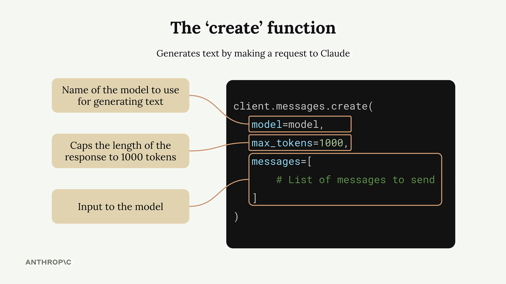
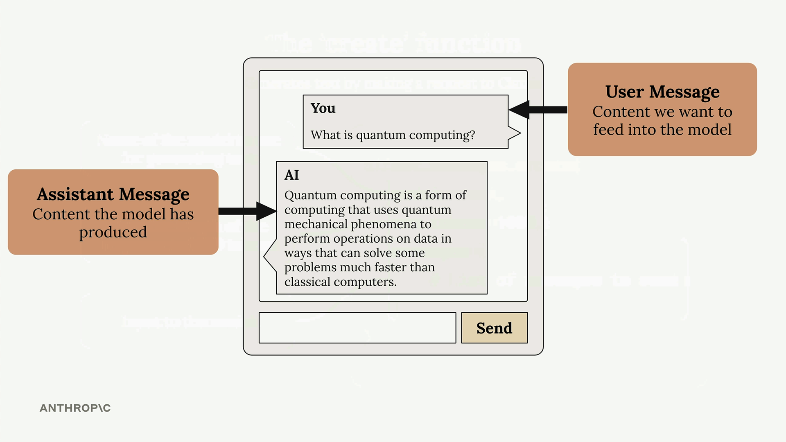
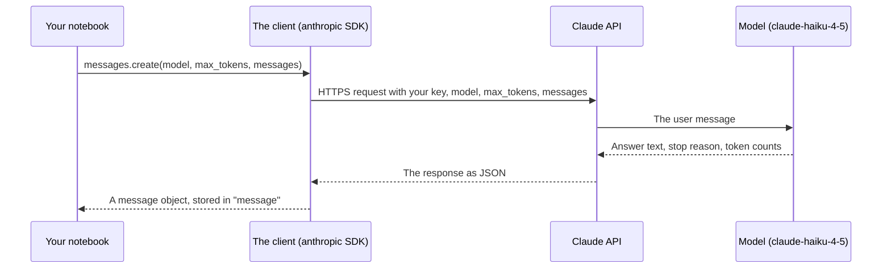

# Lesson 3 — Making a request

**Course:** [Building with the Claude API](https://academy.claude.com/courses/building-with-the-claude-api) &nbsp;·&nbsp; **Chapter 1:** Accessing Claude with the API &nbsp;·&nbsp; **Completed:** November 1, 2026

| Previous | Course | Next |
|:---|:---:|---:|
| [← Getting an API key](02-getting-an-api-key.md) | [📚 Course index](README.md) | [Multi-Turn conversations →](04-multi-turn-conversations.md) |

---

**On this page**

| # | Section |
|:---:|:---|
| 1 | [Revision summary](#revision-summary) |
| 2 | [The big picture](#the-big-picture) |
| 3 | [Who's who](#whos-who) |
| 4 | [1. Setting up the notebook](#1-setting-up-the-notebook) |
| 5 | [2. The create function and its three settings](#2-the-create-function-and-its-three-settings) |
| 6 | [3. Messages: who said what](#3-messages-who-said-what) |
| 7 | [4. Sending the request and reading the answer](#4-sending-the-request-and-reading-the-answer) |
| 8 | [Architect notes](#architect-notes) |
| 9 | [Recap](#recap) |
| 10 | [My notes / practice](#my-notes--practice) |
| 11 | [FAQ](#faq) |

---

### Revision summary

#### In one sentence

To get your first answer from Claude in Python, you install Anthropic's `anthropic` library, put your API key in a `.env` file, create a client object, call `client.messages.create()` with a model name such as `claude-haiku-4-5`, a `max_tokens` limit such as 1000, and a list holding one user message such as "What is quantum computing? Answer in one sentence", and then read the answer's text from `message.content[0].text`.

#### How to set up the project

The course runs its code in a **Jupyter notebook**, a file where you write Python in small boxes (*cells*) and run them one at a time.

1. Install two packages in a notebook cell: `%pip install "anthropic<1" python-dotenv`. The `anthropic` package is Anthropic's official Python library (the *SDK*). The `python-dotenv` package reads `.env` files. `"anthropic<1"` means "any version below 1.0," so the course code keeps working as recorded.
2. Create a `.env` file next to the notebook with one line: `ANTHROPIC_API_KEY="your-api-key-here"`. Add `.env` to `.gitignore` so Git never saves it.
3. In the notebook, call `load_dotenv()` to copy the key from `.env` into the environment, then `client = Anthropic()`. The client finds `ANTHROPIC_API_KEY` by itself, so the key never appears in your code.
4. Store the model name in a variable: `model = "claude-haiku-4-5"`.

#### The three settings of `client.messages.create()`

`client.messages.create()` is the Python function that sends one request to Claude and waits for the answer. It needs three settings:

| Setting | What it is | Course example |
|---|---|---|
| `model` | Which Claude model writes the answer. | `"claude-haiku-4-5"` |
| `max_tokens` | The most tokens the answer may contain. It is a safety cap, not a target. | `1000` |
| `messages` | The conversation so far, as a list of messages. | One user message |

- `max_tokens` is only a ceiling. Claude writes the length it thinks is right and stops early when it is done. If it reaches the cap, the answer is cut off mid-sentence.
- To get a short answer, ask for one in the message ("Answer in one sentence"). Lowering `max_tokens` only cuts the answer off.

#### What a message is

Each message is a Python dictionary with two keys: `role` and `content`.

- A message with `"role": "user"` holds what a person (or your code) sends to Claude.
- A message with `"role": "assistant"` holds an answer that Claude wrote earlier.
- The `messages` list works like a chat transcript, oldest message first. Your first request has just one user message.

#### How to read the answer

- `client.messages.create()` returns a **message object** with the answer plus extra details: an ID, the model name, the stop reason, and the token counts (see [lesson 1](01-accessing-the-api.md#5-when-the-model-stops-and-what-comes-back)).
- The answer's text is in `message.content[0].text`. `content` is a list of *content blocks*, and the first block holds the text.
- Check `message.stop_reason` too. `end_turn` means Claude finished; `max_tokens` means the answer was cut off.

#### When to use which model for practice

- **Use `claude-haiku-4-5`** when following this course. It is fast and cheap ($1 per million input tokens and $5 per million output tokens), and matches the course's outputs.
- **Use the newest Haiku** (`claude-haiku-5-5` at the time of writing) for your own cheap, fast experiments. It is newer and cheaper, but some advanced settings work differently from Haiku 4.5.
- **Use a larger model**, such as the current Sonnet or Opus, when the task needs deeper reasoning, such as writing code or analysing a long document.

Prices and model names change, so check the current list before choosing.

#### Exam takeaways

- **A team sets `max_tokens` to 50 to get short answers, and users see sentences cut off halfway.** `max_tokens` is a hard cutoff, not a length instruction. Ask for the length in the prompt and keep `max_tokens` high enough for a complete answer. (Claude Models, Prompting & Context Engineering)
- **Code that reads `message.content[0].text` crashes after the team adds tools or thinking.** With those features, the first content block can be a tool request or a thinking block, which has no `text`. Loop over `content` and pick the blocks whose `type` is `"text"`, and check `stop_reason`. (Integration)
- **A notebook that worked last month fails after someone reinstalls the packages.** An unpinned `pip install anthropic` pulled a new major version with breaking changes. Pin versions (`"anthropic<1"` or an exact version) and upgrade on purpose. (Solution Design & Architecture)

---

### The big picture

| Part | In plain words | Everyday comparison |
|---|---|---|
| Setup | Install the library, store the key, create the client. | Getting a phone and saving the shop's number. |
| `client.messages.create()` | The one function that sends a request. | Placing the call. |
| `messages` | What you say, as a list of turns. | Your order, read from a written list. |
| `message.content[0].text` | Where the answer's text sits in the reply. | The item you want from a box full of packing slips. |

**The running example:** in a Jupyter notebook, you ask `claude-haiku-4-5` "What is quantum computing? Answer in one sentence" and print the answer.

---

### Who's who

| Player | Where it lives | What it does in the example |
|---|---|---|
| **You** | At your computer | Write and run the notebook cells. |
| **The Jupyter notebook** | A file on your computer, such as `course-project/001_requests.ipynb` | Holds your Python code in cells and shows each cell's output below it. |
| **The `.env` file** | `course-project/.env`, next to the notebook | Holds your API key. You write it once; `load_dotenv()` reads it. |
| **The client** (`client = Anthropic()`) | An object inside your running notebook | Holds your key and sends requests to the Claude API for you. |
| **The Claude API** | Anthropic's servers, `api.anthropic.com` | Checks your key and passes the request to the model. |
| **The model** (`claude-haiku-4-5`) | Anthropic's servers | Reads your message and writes the answer. |

---

### 1. Setting up the notebook

#### What a Jupyter notebook is

A **Jupyter notebook** (a `.ipynb` file) mixes code and its output on one page. You type code into a box called a **cell**, press **Shift+Enter** to run it, and the output appears underneath. Variables you create in one cell, such as `client`, stay available in later cells. You can open notebooks in VS Code or in the Jupyter app in a browser.

The project folder looks like this:

```text
course-project/
├── .env                 ← ANTHROPIC_API_KEY="sk-ant-api03-..."   (you write it; never committed)
├── .gitignore           ← contains the line: .env
└── 001_requests.ipynb   ← the notebook with the cells below
```

#### Cell 1: install the packages

```python
%pip install "anthropic<1" python-dotenv
```

- `%pip` is a notebook command that runs `pip`, Python's package installer, and installs into the same Python that the notebook uses. A plain `pip` in a terminal can install into a different Python by mistake.
- `"anthropic<1"` installs the newest version below 1.0. The quotes are needed because `<` has a special meaning in a terminal.
- `python-dotenv` is a small package that reads `.env` files.

You run this cell once. After that, the packages stay installed.

#### Cell 2: load the key and create the client

```python
from dotenv import load_dotenv
load_dotenv()

from anthropic import Anthropic

client = Anthropic()
model = "claude-haiku-4-5"
```

Line by line:

1. `from dotenv import load_dotenv` brings in the `load_dotenv` function from the `python-dotenv` package.
2. `load_dotenv()` opens `.env` in the current folder and copies each line into the environment, so `ANTHROPIC_API_KEY` now exists as an environment variable (see [lesson 2](02-getting-an-api-key.md#3-keeping-the-key-safe)).
3. `from anthropic import Anthropic` brings in the client class from the SDK.
4. `client = Anthropic()` creates the client. With no arguments, it looks for `ANTHROPIC_API_KEY` in the environment and uses it.
5. `model = "claude-haiku-4-5"` saves the model name in a variable, so you can change the model in one place later.

> **Warning:** If you see `Could not resolve authentication method` or a 401 `authentication_error`, the key wasn't found or is wrong. Check that `.env` sits in the same folder as the notebook, that the variable name is exactly `ANTHROPIC_API_KEY`, and that you ran `load_dotenv()` before `Anthropic()`.

---

### 2. The create function and its three settings

`client.messages.create()` sends one request to the Claude API and waits until the whole answer comes back.



| Setting | Callout in the picture | What to know |
|---|---|---|
| `model=model` | Name of the model to use for generating text | Any current model ID works, such as `"claude-haiku-4-5"`. A wrong name returns a 404 `not_found_error`. |
| `max_tokens=1000` | Caps the length of the response to 1000 tokens | A token is a small piece of text, roughly three-quarters of a word ([lesson 1](01-accessing-the-api.md#4-what-happens-inside-the-model)). |
| `messages=[...]` | Input to the model | The list of messages described in section 3. |

The `name=value` style is Python's **keyword arguments**: each setting is passed by name, so their order doesn't matter.

#### `max_tokens` is a cap, not a target

Think of `max_tokens` as a page limit on an exam answer. A student who has said everything stops early; a student who reaches the limit is stopped mid-sentence. The limit never makes anyone write more.

- Set it to 1000 and ask for one sentence: Claude writes about 40 tokens and stops.
- Set it to 20 and ask for a paragraph: Claude is cut off after 20 tokens, and `stop_reason` is `max_tokens`.

> **Remember this:** The prompt decides the length. `max_tokens` only decides where to cut.

---

### 3. Messages: who said what

The `messages` list is a written record of a chat, like the one in this picture.



| Role | Who writes it | In the picture |
|---|---|---|
| `"user"` | You, a person using your app, or your code | "What is quantum computing?" |
| `"assistant"` | The model, in an earlier answer | "Quantum computing is a form of computing that…" |

In Python, each message is a **dictionary**, which is a set of `key: value` pairs inside curly braces. The list of messages sits inside square brackets:

```python
messages=[
    {
        "role": "user",
        "content": "What is quantum computing? Answer in one sentence"
    }
]
```

Your first request has only one user message. In [lesson 4](04-multi-turn-conversations.md), you add Claude's answer back as an `assistant` message so the conversation can continue. The API doesn't remember earlier requests, so your code must send the whole conversation every time.

---

### 4. Sending the request and reading the answer

#### Cell 3: send the request

```python
message = client.messages.create(
    model=model,
    max_tokens=1000,
    messages=[
        {
            "role": "user",
            "content": "What is quantum computing? Answer in one sentence"
        }
    ]
)
```

The cell waits a second or two, then stores the reply in the variable `message`. Here is what happens during that wait:



#### Cell 4: read the text

The message object holds a lot of detail. If you display the whole object, you see something like this (shortened):

```text
Message(id='msg_01AbC...', type='message', role='assistant', model='claude-haiku-4-5-20251001',
        content=[TextBlock(type='text', text='Quantum computing is a type of computation that ...')],
        stop_reason='end_turn', stop_sequence=None,
        usage=Usage(input_tokens=17, output_tokens=46, ...))
```

Usually you only want the text:

```python
message.content[0].text
```

- `message.content` is a list of **content blocks**. A content block is one piece of the answer, labelled with a `type`.
- `[0]` takes the first block. In a plain text request like this one, there is just one block, of type `text`.
- `.text` takes the words out of that block.

The output is the answer: "Quantum computing is a type of computation that leverages quantum mechanics principles like superposition and entanglement to process information using quantum bits (qubits), potentially solving certain complex problems exponentially faster than classical computers."

The token counts above are examples. Your answer will also differ slightly each time, because the model doesn't always pick the same next word ([lesson 1](01-accessing-the-api.md#4-what-happens-inside-the-model)).

#### Common mix-ups

| ❌ Wrong idea | ✅ What really happens |
|---|---|
| "`max_tokens=1000` makes Claude write about 1000 tokens." | It is only a ceiling. Claude stops when the answer is done. |
| "Claude remembers my last request." | Each request stands alone. You send the earlier messages yourself. |
| "`message` is the answer text." | `message` is an object. The text is in `message.content[0].text`. |
| "`content[0]` is always text." | With tools or thinking turned on, the first block can be another type. |
| "I must pass my key to `Anthropic()`." | The client reads `ANTHROPIC_API_KEY` from the environment by itself. |

#### Test yourself

<details>
<summary>1. What three settings does client.messages.create() need?</summary>

`model`, `max_tokens`, and `messages`. The key is added by the client.
</details>

<details>
<summary>2. You want shorter answers. Should you lower max_tokens?</summary>

No. Ask for a shorter answer in the message. Lowering `max_tokens` only cuts the answer off mid-sentence.
</details>

<details>
<summary>3. What does "role": "assistant" mean in a message?</summary>

That message is an answer Claude wrote earlier. Messages you send have the role `user`.
</details>

<details>
<summary>4. How do you get only the answer text from the reply?</summary>

`message.content[0].text`.
</details>

---

### Architect notes

#### SDK versions

- `"anthropic<1"` installs the last 0.x release. Version 1.x needs Python 3.10 or later and switches the library's network layer (from `httpx` to `httpx2`). Version 2.x sends a newer API version (`2026-10-21`) that rejects the `temperature` setting covered in [lesson 6](06-temperature.md). The pin keeps the course code working as recorded.
- In production, pin the SDK to an exact version or a major range in `requirements.txt`, and upgrade on purpose after testing. An unpinned install can break a working app overnight.

#### Errors and retries

- The SDK raises a typed error for each failure: `AuthenticationError` (401, bad key), `NotFoundError` (404, unknown model name), `BadRequestError` (400, bad request format), `RateLimitError` (429, too many requests), and a server error class for 500 and 529 (529 means Anthropic's servers are overloaded).
- The SDK retries 408, 409, 429, and 5xx errors and connection failures automatically, 2 times by default, with growing waits between tries. Change this with `Anthropic(max_retries=5)`. Don't retry 400 or 401 errors yourself: the same request fails the same way.
- The default timeout is 10 minutes per request. Set a shorter one, such as `Anthropic(timeout=30.0)`, for a chat screen where a user is waiting.

#### Reading the response safely

- Check `stop_reason` before trusting the text. `max_tokens` means the answer is incomplete; `refusal` means the model declined for safety reasons.
- Pick text blocks by `type` instead of trusting position `[0]`: `"".join(b.text for b in message.content if b.type == "text")`. This keeps working when you add tools or thinking later.

#### Cost and limits

- Haiku 4.5 costs $1 per million input tokens and $5 per million output tokens, has a 200,000-token context window, and can write up to 64,000 tokens per answer. Prices change, so check the current pricing page.
- Log `message.usage.input_tokens` and `message.usage.output_tokens` from every response to track cost per request.
- A request with a very large `max_tokens` can take longer than the timeout. For long answers, use streaming ([lesson 7](07-response-streaming.md)).

---

### Recap

- Install `"anthropic<1"` and `python-dotenv`, keep the key in a Git-ignored `.env`, call `load_dotenv()`, then `client = Anthropic()`.
- `client.messages.create()` needs `model`, `max_tokens`, and `messages`.
- `max_tokens` is a safety cap, not a target; control length in the prompt.
- Each message is a dictionary with a `role` (`user` or `assistant`) and `content`.
- The answer's text is in `message.content[0].text`; check `stop_reason` too.

---

## My notes / practice

- [ ] Create `course-project/` with `.env`, `.gitignore`, and a notebook, and run the four cells.
- [ ] Display the whole `message` object and find `stop_reason` and `usage`.
- [ ] Set `max_tokens=10` and ask for a paragraph. Check that `stop_reason` is `max_tokens`.
- [ ] Change the model name to a made-up one and read the 404 error.

---

## FAQ

**Q1. What does "Jupyter notebook" mean?**
It is a file (`.ipynb`) where you write Python in small boxes called cells and run them one at a time, with each cell's output shown below it. The course uses one so you can try the API step by step.

**Q2. Why does the course install "anthropic<1" instead of the newest version?**
`"anthropic<1"` installs the newest version below 1.0, so the code works exactly as the course shows. Newer major versions change some things, such as rejecting the `temperature` setting.

**Q3. What does load_dotenv() do?**
It reads the `.env` file in the current folder and copies each setting, such as `ANTHROPIC_API_KEY`, into the environment. Then `Anthropic()` finds the key without it appearing in your code.

**Q4. What three settings does client.messages.create() need?**
`model` (which Claude model answers), `max_tokens` (the most tokens the answer may use), and `messages` (the conversation so far).

**Q5. Does max_tokens tell Claude how long to make the answer?**
No. It is only a ceiling. Claude writes what it thinks is right and stops early; if it reaches the ceiling, the answer is cut off. Ask for the length you want in the message.

**Q6. What is the difference between a "user" message and an "assistant" message?**
A user message is what you or your app sends to Claude. An assistant message is an answer Claude wrote earlier, which you send back when continuing a conversation.

**Q7. Does Claude remember my earlier requests?**
No. Each request stands alone, so your code must send the earlier messages every time ([lesson 4](04-multi-turn-conversations.md)).

**Q8. How do I get just the answer text from the reply?**
Read `message.content[0].text`. The reply is an object, `content` is a list of blocks, and the first block holds the text.

**Q9. What else is in the reply besides the text?**
An ID, the model name, the stop reason (why Claude stopped), and the token counts for input and output, which decide the cost.

**Q10. What should I check if Anthropic() can't find my API key?**
Check that `.env` sits next to the notebook, that the variable is named exactly `ANTHROPIC_API_KEY`, and that `load_dotenv()` ran before `Anthropic()`.

**Q11. (Exam angle) A team sets max_tokens to 50 to keep answers short, and users complain about sentences cut off halfway. What do you advise?**
`max_tokens` is a hard cutoff, not a length instruction. Put the length request in the prompt ("Answer in two sentences"), keep `max_tokens` high enough for a full answer, and treat `stop_reason: "max_tokens"` as incomplete. (Claude Models, Prompting & Context Engineering)

**Q12. (Exam angle) Code that reads message.content[0].text crashes after the team turns on tools. Why, and how do you fix it?**
With tools or thinking, the first content block can be a tool request or a thinking block, which has no `text`. Check `stop_reason`, and loop over `content` to collect only blocks whose `type` is `"text"`. (Integration)

**Q13. (Exam angle) An app worked last month but fails after the packages are reinstalled on a new server. What is the likely cause, and how do you prevent it?**
An unpinned install pulled a new major SDK version with breaking changes. Pin the SDK version in `requirements.txt`, test upgrades before deploying, and read the SDK's migration guide. (Solution Design & Architecture)

---

| Previous | Course | Next |
|:---|:---:|---:|
| [← Getting an API key](02-getting-an-api-key.md) | [📚 Course index](README.md) | [Multi-Turn conversations →](04-multi-turn-conversations.md) |
