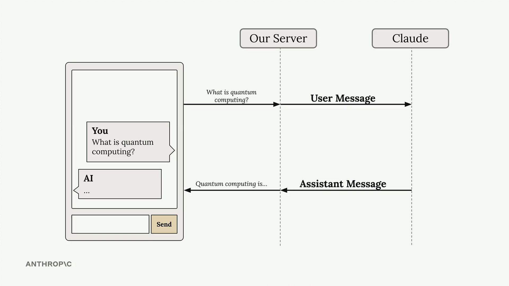
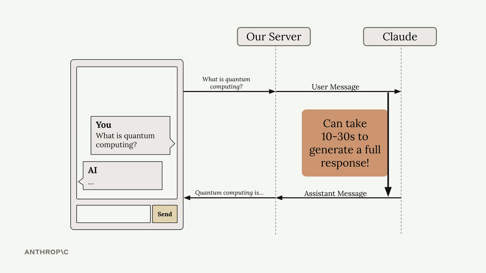
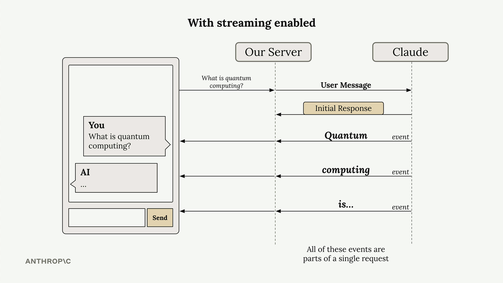
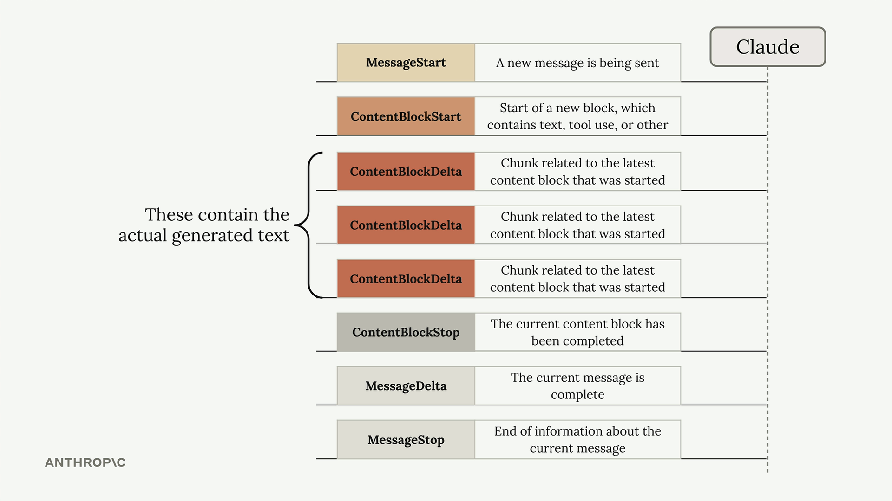

# Lesson 7 — Response streaming

**Course:** [Building with the Claude API](https://academy.claude.com/courses/building-with-the-claude-api) &nbsp;·&nbsp; **Lesson page:** [Response streaming](https://academy.claude.com/courses/building-with-the-claude-api/response-streaming) &nbsp;·&nbsp; **Chapter 1:** Accessing Claude with the API &nbsp;·&nbsp; **Completed:** November 15, 2026

| Previous | Course | Next |
|:---|:---:|---:|
| [← Temperature](06-temperature.md) | [📚 Course index](README.md) | [Structured data →](08-structured-data.md) |

---

**On this page**

| # | Section |
|:---:|:---|
| 1 | [Revision summary](#revision-summary) |
| 2 | [The big picture](#the-big-picture) |
| 3 | [1. The problem: users wait with nothing to read](#1-the-problem-users-wait-with-nothing-to-read) |
| 4 | [2. How streaming works](#2-how-streaming-works) |
| 5 | [3. The six kinds of stream event](#3-the-six-kinds-of-stream-event) |
| 6 | [4. Three ways to stream in Python](#4-three-ways-to-stream-in-python) |
| 7 | [Architect notes](#architect-notes) |
| 8 | [Recap](#recap) |
| 9 | [My notes / practice](#my-notes--practice) |
| 10 | [FAQ](#faq) |

---

### Revision summary

- **The problem:** a full answer can take 10 to 30 seconds. Without streaming, your server waits for the whole answer, and the user stares at a loading spinner.
- **Streaming:** the API sends the answer in small pieces as the model writes it. Your server passes each piece on, so the user sees the text appear word by word.
- **One request:** all the pieces belong to a single request. Streaming doesn't send more requests or cost more.

#### The stream events, in order

With streaming on, the API sends a series of *events* (small messages, each with a type and some data):

1. **MessageStart:** a new message is starting.
2. **ContentBlockStart:** a new block of content is starting. A block can hold text, a tool call, or other content.
3. **ContentBlockDelta:** a chunk of the generated text. Many of these arrive, and they are the ones to show the user.
4. **ContentBlockStop:** the current block is finished.
5. **MessageDelta:** final details about the whole message, such as why it stopped and the output token count.
6. **MessageStop:** the message is complete.

#### When to use each way of streaming in Python

- **Use `client.messages.create(..., stream=True)`** when you need every raw event, such as to handle tool calls yourself. You loop over `stream` and check each event's type.
- **Use `client.messages.stream(...)` with `stream.text_stream`** when you only want the text to show users. It filters out every event except the text chunks.
- **Use `stream.get_final_message()`** after the loop when you also need the complete message, such as to save it in a database or add it to the chat history.

#### Exam takeaways

- **Users of a chat app complain that answers take 20 seconds to appear.** Turn on streaming and pass each text chunk to the app as it arrives. The full answer takes the same time, but the first words appear within a second or two. (Solution Design & Architecture)
- **A team streams answers but must also save every full answer and its token usage.** Stream with `client.messages.stream()`, send `text_stream` chunks to users, then call `get_final_message()` and save that. (Integration)
- **Long answers with a large `max_tokens` keep failing with timeout errors.** Use streaming. Data then keeps flowing during generation, so the connection doesn't sit idle until a timeout ends it. (Integration)

---

### The big picture

| Part | In plain words | Everyday comparison |
|---|---|---|
| Without streaming | Wait for the whole answer, then show it at once | Waiting for a printed letter to arrive by post |
| With streaming | Show each piece of the answer as it is written | Watching someone type a message to you live |
| Events | The labelled pieces the API sends during one answer | Parcels in one delivery, each with a label: "starting", "contents", "finished" |

**The running example:** a user types "What is quantum computing?" into your chat app. Later, your code asks the model for "a 1 sentence description of a fake database" and streams the answer.

#### Who's who

| Player | Where it lives | What it does |
|---|---|---|
| **The user** | In front of your chat app | Asks the question and watches the answer appear |
| **Your chat app** (the client) | The user's phone or browser | Shows each text chunk the moment your server forwards it |
| **Your server** | A computer you run | Calls the Claude API with streaming on, and forwards each chunk to the app |
| **The Claude API and the model** | Anthropic's servers | Writes the answer and sends it as a series of events |

---

### 1. The problem: users wait with nothing to read

In a normal request ([lesson 1](01-accessing-the-api.md)), your server sends the user's message to the API and waits for the complete answer. Only then does it send anything back to the app.



The model writes one token at a time, so a long answer takes a while. During that time, the user sees only "...".



---

### 2. How streaming works

With streaming on, the API doesn't wait for the full answer:

1. The API sends an initial response right away, saying it got the request and has started.
2. As the model writes, the API sends a series of events. Each one holds a small piece of the answer, such as "Quantum", then "computing", then "is".
3. Your server forwards each piece to the app as it arrives.
4. The app adds each piece to the screen, so the answer builds up word by word.



Things to notice:

- All the events belong to **one** request. Streaming is not many small requests.
- The total time to write the whole answer is about the same. What changes is when the user sees the first words.

> **Remember this:** Streaming doesn't make the model faster. It lets the user start reading sooner.

---

### 3. The six kinds of stream event

Each event has a type that tells your code what it holds:



| Event | What it means | What your code usually does |
|---|---|---|
| **MessageStart** | A new message is starting | Gets ready, for example by clearing an "AI is typing" area |
| **ContentBlockStart** | A new block is starting. It may hold text, a tool call, or other content. | Notes what kind of block it is |
| **ContentBlockDelta** | A chunk of the generated content. "Delta" means "the change since last time." | Shows the text chunk to the user |
| **ContentBlockStop** | The current block is finished | Marks that block as done |
| **MessageDelta** | Final details about the message, such as the stop reason and output tokens | Reads the stop reason and usage |
| **MessageStop** | The whole message is finished | Closes the stream |

**Warning:** The course says MessageDelta means "the current message is complete." It actually carries the last details of the message, such as `stop_reason` and the output token count. The message is fully finished only at MessageStop.

**Not in the course, from the official Claude API documentation:** in the raw API, the event names are written in lowercase with underscores, such as `message_start` and `content_block_delta`. The stream can also include `ping` events, which keep the connection alive and can be ignored, and `error` events, such as when Anthropic's servers are overloaded mid-answer.

---

### 4. Three ways to stream in Python

#### Way 1: every raw event, with `stream=True`

```python
messages = []
add_user_message(messages, "Write a 1 sentence description of a fake database")

stream = client.messages.create(
    model=model,
    max_tokens=1000,
    messages=messages,
    stream=True
)

for event in stream:
    print(event)
```

- `add_user_message()` is the helper from [lesson 4](04-multi-turn-conversations.md).
- `stream=True` turns streaming on. Instead of one finished message, `create()` returns a stream of events.
- `for event in stream:` handles each event as it arrives, in order.
- `print(event)` shows the raw event. The output starts with a `RawMessageStartEvent`, then a `RawContentBlockStartEvent`, then many delta events.

<!-- IMAGE: Notebook output of the stream=True code, starting with a RawMessageStartEvent and then a RawContentBlockStartEvent → images/07-raw-event-output.png -->

#### Way 2: only the text, with `messages.stream()`

Picking the text out of raw events by hand is tedious. The SDK has a simpler way:

```python
with client.messages.stream(
    model=model,
    max_tokens=1000,
    messages=messages
) as stream:
    for text in stream.text_stream:
        print(text, end="")
```

- `client.messages.stream(...)` is the SDK's streaming helper. It needs no `stream=True`.
- `with ... as stream:` opens the stream and closes the connection cleanly when the block ends, even if an error happens.
- `stream.text_stream` gives only the text chunks, such as "A", " fake", " database". Every other event is filtered out.
- `print(text, end="")` prints each chunk with no line break, so the chunks join into one sentence on screen.

#### Way 3: text for the user, plus the full message for your code

You usually also need the complete answer, for example to save it or add it to the chat history:

```python
with client.messages.stream(
    model=model,
    max_tokens=1000,
    messages=messages
) as stream:
    for text in stream.text_stream:
        # Send each chunk to your client
        pass

    # Get the complete message for database storage
    final_message = stream.get_final_message()
```

- `pass` is a placeholder. In a real app, you would send `text` to the user's app here.
- `stream.get_final_message()` returns the whole message, built from all the chunks. It looks the same as a normal, non-streamed response: the full text, `stop_reason`, and `usage`.

This gives you both: live text for the user, and a complete message for your code.

| Way | Use it when |
|---|---|
| `create(..., stream=True)` | You need every raw event, such as for tool calls |
| `stream()` with `text_stream` | You only need the text to show users |
| `stream()`, then `get_final_message()` | You show the text live and also save or reuse the full message |

---

### Architect notes

#### Speed

- Streaming improves *time to first token*: how long until the first word appears. It does not shorten the total time. Measure both.
- Your server must forward chunks as they arrive. If it collects them and sends everything at the end, the user gets no benefit.

#### Reliability

- Long requests without streaming can hit timeouts, because no data flows until the end. The SDKs recommend streaming for long answers and require it for very large `max_tokens` values.
- A stream can fail partway, after some text was already shown. Plan for it: show an error, keep or discard the partial text, and let the user retry.
- Check the stop reason from the final message. A `max_tokens` stop means the streamed answer was cut off ([lesson 3](03-making-a-request.md)).

#### Cost

- Streaming costs the same as a normal request. You pay for the same input and output tokens.
- Read `usage` from `get_final_message()` to log the cost of each streamed request.

#### Design

- Your server needs a way to push chunks to the app, such as Server-Sent Events (a simple one-way stream over HTTP) or WebSockets (a two-way connection).
- Save the chat history from `get_final_message()`, not from chunks you joined yourself. Then you also get the stop reason and token counts.

---

### Recap

- Full answers can take 10 to 30 seconds, so without streaming users wait with nothing to read.
- Streaming sends the answer as a series of events in one request, so text appears word by word.
- The events are MessageStart, ContentBlockStart, ContentBlockDelta (the text), ContentBlockStop, MessageDelta, and MessageStop.
- `stream=True` gives raw events. `messages.stream()` with `text_stream` gives only the text.
- `get_final_message()` gives the complete message after the stream ends.

---

## My notes / practice

- [ ] Run the `stream=True` example and list each event type you see, in order.
- [ ] Run the `text_stream` example on a long answer, and watch the text appear piece by piece.
- [ ] Call `get_final_message()` and print its `stop_reason` and `usage`.
- [ ] Time a long request with and without streaming. Compare when the first word appears.

---

## FAQ

**Q1. What does "response streaming" mean?**
It means the API sends the answer in small pieces while the model writes it, instead of all at once at the end. Your app can show each piece right away.

**Q2. Does streaming make the model write faster?**
No. The whole answer takes about the same time. The user just starts reading the first words much sooner.

**Q3. Is each streamed chunk a separate request?**
No. All the events belong to one request. You send one request and receive many events back.

**Q4. What does "event" mean in streaming?**
An event is one small message in the stream, with a type and some data. For example, a ContentBlockDelta event holds a chunk of text, such as "Quantum".

**Q5. Which event holds the text to show the user?**
ContentBlockDelta. Many of these arrive during one answer, and each holds the next small piece of text.

**Q6. What is the difference between "stream=True" and "client.messages.stream()"?**
`stream=True` on `create()` gives you every raw event to handle yourself. `client.messages.stream()` is an SDK helper with shortcuts, such as `text_stream` for only the text and `get_final_message()` for the full message.

**Q7. How do I get the full answer when I stream?**
Call `stream.get_final_message()` after the loop. It returns the complete message, with the text, stop reason, and token usage.

**Q8. Does streaming cost more?**
No. You pay for the same input and output tokens as a normal request.

**Q9. What happens if the stream breaks halfway?**
The user may have seen part of the answer already. Your app should show an error and offer a retry, and not save the partial answer as if it were complete.

**Q10. (Exam angle) Users of a chat app complain that answers take 20 seconds to appear. What do you change?**
Turn on streaming and forward each text chunk to the app as it arrives. The full answer takes the same time, but the first words appear within a second or two. (Solution Design & Architecture)

**Q11. (Exam angle) A team streams answers but must also save every full answer and its token usage. How do they do both?**
Use `client.messages.stream()`, send `text_stream` chunks to users, then call `get_final_message()` and save that message and its `usage`. (Integration)

**Q12. (Exam angle) Long answers with a large "max_tokens" keep failing with timeout errors. What do you recommend?**
Use streaming. Data then flows during generation, so the connection doesn't sit idle until a timeout ends it. The SDKs require streaming for very large `max_tokens` values. (Integration)

---

| Previous | Course | Next |
|:---|:---:|---:|
| [← Temperature](06-temperature.md) | [📚 Course index](README.md) | [Structured data →](08-structured-data.md) |
