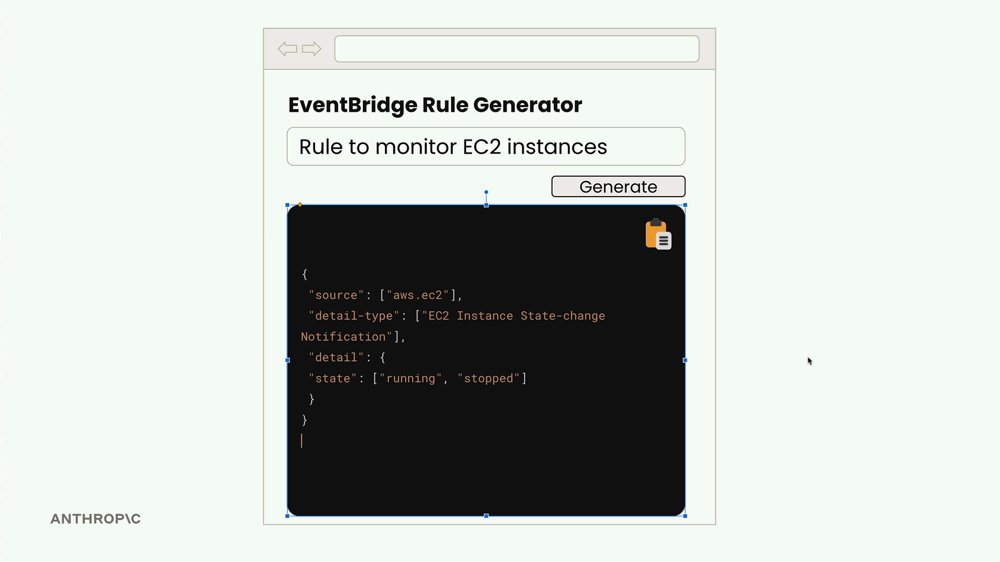

# Lesson 8 — Structured data

**Course:** [Building with the Claude API](https://academy.claude.com/courses/building-with-the-claude-api) &nbsp;·&nbsp; **Lesson page:** [Structured data](https://academy.claude.com/courses/building-with-the-claude-api/structured-data) &nbsp;·&nbsp; **Chapter 1:** Accessing Claude with the API &nbsp;·&nbsp; **Completed:** November 15, 2026

| Previous | Course | Next |
|:---|:---:|---:|
| [← Response streaming](07-response-streaming.md) | [📚 Course index](README.md) | [Prompt evaluation →](09-prompt-evaluation.md) |

---

**On this page**

| # | Section |
|:---:|:---|
| 1 | [Revision summary](#revision-summary) |
| 2 | [The big picture](#the-big-picture) |
| 3 | [1. The problem: extra text around the data](#1-the-problem-extra-text-around-the-data) |
| 4 | [2. Structured outputs: the current way](#2-structured-outputs-the-current-way) |
| 5 | [3. Nested JSON and more than one JSON](#3-nested-json-and-more-than-one-json) |
| 6 | [4. Beyond JSON: code, CSV, and lists](#4-beyond-json-code-csv-and-lists) |
| 7 | [5. The course's way: prefill and stop sequences (older models only)](#5-the-courses-way-prefill-and-stop-sequences-older-models-only) |
| 8 | [Architect notes](#architect-notes) |
| 9 | [Recap](#recap) |
| 10 | [My notes / practice](#my-notes--practice) |
| 11 | [FAQ](#faq) |

---

### Revision summary

- **The problem:** when you ask the model for JSON, it usually wraps the JSON in a Markdown code block and adds a sentence of explanation. Your app then can't use the answer as it is.
- **Structured outputs (the current way):** you send a JSON schema with the request, in the `output_config.format` setting. The API then returns plain JSON that always matches that schema, with no fences and no explanation.
- **Prefill and stop sequences (the course's way):** an older trick that starts the model's answer for it and cuts it off at the closing fence. It works only on older models such as `claude-haiku-4-5`. Newer models reject it with a 400 error.

#### How structured outputs work

Your code sends one request, and the API does the rest:

1. Your code writes a *JSON schema*: a description of the fields the answer must have and the type of each one.
2. Your code sends the schema in `output_config={"format": {"type": "json_schema", "schema": ...}}`, next to the normal messages.
3. While the model writes, the API only lets it write text that fits the schema. Fences, explanations, and missing fields are impossible.
4. The answer is plain JSON. Your code reads it with `json.loads(response.content[0].text)`.

The Python SDK also has `client.messages.parse()`, which takes a Pydantic class instead of a raw schema and returns a ready Python object in `response.parsed_output`.

#### What structured outputs guarantee, and what they don't

- **Guaranteed:** the JSON is valid, every required field is there, every field has the right type, and no extra field appears.
- **Not guaranteed:** that the values are true. The model can still put a wrong state name in a correct field, so check values that matter.
- **Check `stop_reason` first.** If it is `"max_tokens"` (the answer was cut off) or `"refusal"` (the model declined), the answer may not match the schema.

#### When to use what

| Model | How to get clean JSON |
|---|---|
| Claude Opus 4.6, Sonnet 4.6, and every newer model, such as `claude-opus-5-5` | Structured outputs. A prefilled last assistant message fails with a 400 error on these models. |
| Older models, such as `claude-haiku-4-5` (the course's model) | Prefill ` ```json ` and stop on ` ``` `. The JSON shape is not guaranteed, so check it in code. |

- **Use structured outputs** for anything your code must parse, such as a rule, a record, or a list of orders.
- **Use a system prompt instruction** ("Answer with the content only, with no introduction") when the answer is plain text, not data, and you only want to skip the opening sentence.

#### Exam takeaways

- **A web app shows generated JSON with a copy button, but users keep copying Markdown fences and an explanation.** Use structured outputs with a JSON schema. The answer is then plain JSON with nothing around it. (Integration)
- **A team moves prefill code from Haiku 4.5 to a newer model, and every request now fails with a 400 error.** Newer models reject a prefilled last assistant message. Remove the prefill and the ` ``` ` stop sequence, and add `output_config.format` with a JSON schema. For plain-text answers, a system prompt instruction replaces the prefill. (Claude Models, Prompting & Context Engineering)
- **A pipeline parses model JSON and sometimes crashes on a missing field.** Use structured outputs and list the field under `required`, so it is always present. Also check `stop_reason` for `"max_tokens"` and validate values that matter. (Solution Design & Architecture)

---

### The big picture

**Warning:** The course teaches the prefill trick (section 5). It is outdated: newer models reject it with a 400 error. This page teaches the current way, structured outputs, first.

| Part | In plain words | Everyday comparison |
|---|---|---|
| The problem | The model adds wrapping and chat around the data | Ordering a part and getting it in gift wrap with a card |
| Structured outputs | The API forces the answer into a JSON shape you give | A paper form with fixed boxes: nothing fits outside the boxes |
| Prefill + stop sequence (old) | You write the start of the answer, and the API cuts it off at the closing fence | Starting someone's sentence, then hanging up before they add a remark |

**The running example:** a web app called "EventBridge Rule Generator." A user types "Rule to monitor EC2 instances" and clicks **Generate**. The app should show clean JSON with a copy button.

- **AWS EventBridge** is an Amazon Web Services service that watches for events, such as a server starting. A **rule** is a small piece of JSON that says which events to catch.
- **EC2 instances** are virtual servers rented from Amazon.



#### Who's who

| Player | Where it lives | What it does |
|---|---|---|
| **The user** | In front of the web app | Types a description and copies the JSON |
| **Your app** (Python code) | Your server | Writes the schema, calls the API, and reads the JSON |
| **The Claude API** | Anthropic's servers | Checks every piece the model writes against your schema |
| **The model** | Anthropic's servers | Writes the rule, only in ways the schema allows |

---

### 1. The problem: extra text around the data

By default, a request for JSON returns something like this:

````text
```json
{
  "source": ["aws.ec2"],
  "detail-type": ["EC2 Instance State-change Notification"],
  "detail": {
    "state": ["running"]
  }
}
```

This rule captures EC2 instance state changes when instances start running.
````

The JSON is correct. But it sits between Markdown fences (the ` ``` ` lines that mark a code block), and a sentence follows it. If the copy button copies the whole answer, the user pastes text that AWS rejects.

The model adds this wrapping to be helpful in a chat. In an app, your code is the reader, and code needs the raw data only.

---

### 2. Structured outputs: the current way

**Not in the course, from the official Claude API documentation.**

#### How it works

A **JSON schema** is a description of a JSON shape: which fields exist, what type each one is, and which ones are required. You send it with the request. While the model writes, the API only lets it choose tokens that keep the answer valid for that schema (this is called *constrained decoding*). A Markdown fence or an opening sentence would break the schema, so the model can't write them.

Think of a paper form with fixed boxes. You can write anything inside a box, but nothing outside the boxes.

#### The request

```python
import json

response = client.messages.create(
    model="claude-opus-5-5",
    max_tokens=1000,
    messages=[{"role": "user", "content": "Generate a very short EventBridge rule to monitor EC2 instances"}],
    output_config={
        "format": {
            "type": "json_schema",
            "schema": {
                "type": "object",
                "properties": {
                    "source": {"type": "array", "items": {"type": "string"}},
                    "detail-type": {"type": "array", "items": {"type": "string"}},
                    "detail": {
                        "type": "object",
                        "properties": {
                            "state": {"type": "array", "items": {"type": "string"}}
                        },
                        "required": ["state"],
                        "additionalProperties": False
                    }
                },
                "required": ["source", "detail-type", "detail"],
                "additionalProperties": False
            }
        }
    }
)

rule = json.loads(response.content[0].text)
print(rule["source"])   # ['aws.ec2']
```

- `output_config` holds settings about the output. Its `format` part says "answer as JSON matching this schema."
- `"type": "object"` means the answer is a JSON object, the `{ ... }` kind.
- `"properties"` lists the fields. `{"type": "array", "items": {"type": "string"}}` means "a list of text values," such as `["aws.ec2"]`.
- `"detail"` is an object inside the object. Each object, including nested ones, gets its own `required` list.
- `"required"` lists the fields that must appear. `"additionalProperties": False` forbids any other field.
- `json.loads()` turns the JSON text into a Python dictionary. No `.strip()` and no fence removal are needed.

The answer text is plain JSON, ready for the copy button:

```json
{"source": ["aws.ec2"], "detail-type": ["EC2 Instance State-change Notification"], "detail": {"state": ["running"]}}
```

#### The shortcut: `client.messages.parse()` with Pydantic

Writing schemas by hand is tedious. *Pydantic* is a Python library where you describe data as a class. The SDK can turn that class into a schema for you:

```python
from pydantic import BaseModel

class Customer(BaseModel):
    id: str
    name: str
    email: str

response = client.messages.parse(
    model="claude-opus-5-5",
    max_tokens=1000,
    messages=[{"role": "user", "content": "Extract the customer: Asha Rao, ID C-101, asha@example.com"}],
    output_format=Customer,
)

customer = response.parsed_output   # a Customer object
print(customer.email)               # asha@example.com
```

- `output_format=Customer` passes the class. The SDK builds the schema and sends it for you.
- `response.parsed_output` is already a checked `Customer` object, so you skip `json.loads()`.

> **Remember this:** Describe the shape, and the API holds the model to it.

---

### 3. Nested JSON and more than one JSON

**Not in the course; my answer to a follow-up question.** Say your app needs two things from one answer: customer data and that customer's orders.

- **Nested JSON works.** *Nested* means objects inside objects, or lists of objects, like `detail` inside the rule above. The schema simply describes the inner objects.
- **Two JSONs: put them in one object.** A schema describes one JSON value. So ask for one object with a key per part, then read `data["customer"]` and `data["orders"]`.

```json
{
  "customer": {"id": "C-101", "name": "Asha Rao", "email": "asha@example.com"},
  "orders": [
    {"order_id": "O-1", "total": 49.99},
    {"order_id": "O-2", "total": 15.00}
  ]
}
```

<details>
<summary>The schema for this customer-and-orders object</summary>

```python
schema = {
    "type": "object",
    "properties": {
        "customer": {
            "type": "object",
            "properties": {
                "id": {"type": "string"},
                "name": {"type": "string"},
                "email": {"type": "string"}
            },
            "required": ["id", "name", "email"],
            "additionalProperties": False
        },
        "orders": {
            "type": "array",
            "items": {
                "type": "object",
                "properties": {
                    "order_id": {"type": "string"},
                    "total": {"type": "number"}
                },
                "required": ["order_id", "total"],
                "additionalProperties": False
            }
        }
    },
    "required": ["customer", "orders"],
    "additionalProperties": False
}
```

- `"type": "array"` with `"items"` means "a list, where every item has this shape." Every order has an `order_id` and a `total`.
- Pass `schema` in `output_config` exactly as in section 2.

</details>

| Need | Use it when | How |
|---|---|---|
| One combined object | The parts belong together, such as a customer and their orders | One schema with a key per part (recommended) |
| Two separate requests | The parts are unrelated, or each one is large | One request and one schema per JSON |

---

### 4. Beyond JSON: code, CSV, and lists

Structured outputs return JSON. For other content, you have two current options:

| You want | Use it when | How |
|---|---|---|
| Code, CSV, or a list that your code reads | Your code must pull the content out reliably | Put it in a JSON field, such as a schema with a `"code"` string or a `"rows"` list, and read that field |
| Text a person reads | You only want to skip the introduction | A system prompt instruction, such as "Answer with the CSV only, with no introduction or code fences" |

---

### 5. The course's way: prefill and stop sequences (older models only)

The course solves the problem with two settings. This works only on older models such as `claude-haiku-4-5`.

- A **stop sequence** is text you list in `stop_sequences`. The moment the model writes it, the API ends the answer, and `stop_reason` becomes `"stop_sequence"`. The stop text is not included.
- **Prefilling** means you add an assistant message as the last message. The model continues your text instead of starting fresh.

```python
add_user_message(messages, "Generate a very short event bridge rule as json")
add_assistant_message(messages, "```json")     # the prefill
text = chat(messages, stop_sequences=["```"])  # stop at the closing fence
rule = json.loads(text.strip())                # remove leftover line breaks, then parse
```

The prefill makes the model think it already opened a JSON block, so it writes only JSON. When it tries to close the block with ` ``` `, the stop sequence ends the answer. The course's `chat()` helper just gains a `stop_sequences` option that it passes on as `params["stop_sequences"]`.


**Warning:** On Claude Opus 4.6, Sonnet 4.6, and every newer model, a prefilled last assistant message fails with a 400 error. Stop sequences still work there, but you no longer need them for JSON. The trick also never guaranteed valid JSON, and two JSON blocks in one answer lose the second one, because the stop sequence fires when the first block closes.

---

### Architect notes

#### Reliability

- Check `stop_reason` before parsing. `"max_tokens"` means the JSON was cut off, and `"refusal"` means the model declined. In both cases the answer may not match the schema.
- The schema guarantees the shape, not the facts. Validate values your app depends on, such as allowed state names.

#### Limits

- Not every JSON Schema feature is supported. For example, recursive schemas (a shape that contains itself) and number limits such as `minimum` are not. Check the current list in the structured outputs documentation.
- Structured outputs can't be combined with citations, a feature covered later in this course. That combination returns a 400 error.

#### Cost and speed

- The first request with a new schema takes a little longer, while the API prepares the schema. Later requests with the same schema reuse that work. Look up the current behaviour, because it can change.
- Structured output answers have no fences or explanation, so you pay for fewer output tokens.

#### Design trade-offs

- Keep schemas small and flat where you can. Each extra field is more for the model to fill in and more for you to maintain.
- When you upgrade old prefill code, change the request (remove the prefill and the stop sequence, add `output_config`) and simplify the parsing code too.

---

### Recap

- By default, the model wraps JSON in Markdown fences and adds an explanation, so apps can't use the answer as it is.
- Structured outputs send a JSON schema in `output_config.format`, and the API returns plain JSON that matches it.
- `client.messages.parse()` builds the schema from a Pydantic class and returns a ready object.
- Nested JSON works. To get two JSONs, put both in one object.
- For code, CSV, or lists, put the content in a JSON field, or use a system prompt instruction for text people read.
- The course's prefill and stop sequence trick works only on older models. Newer models reject the prefill with a 400 error.

---

## My notes / practice

- [ ] Ask a current model for an EventBridge rule as JSON with no schema, and look at the extra text.
- [ ] Send the same request with the schema from section 2, and parse the answer with `json.loads()`.
- [ ] Rewrite it with `client.messages.parse()` and a Pydantic class.
- [ ] Build the customer-and-orders schema and print `data["orders"]`.
- [ ] Send a prefill request to a newer model, read the 400 error, then fix it with structured outputs.

---

## FAQ

**Q1. Why does the model add text around the JSON I asked for?**
It is trained to be helpful in a chat, so it formats code in Markdown blocks and explains what it wrote. That suits a person, but not code that needs to read the data.

**Q2. What does "structured outputs" mean?**
It is an API setting, `output_config.format`, where you send a JSON schema with the request. The API then makes sure the answer is plain JSON that matches the schema.

**Q3. What does "JSON schema" mean?**
It is a description of a JSON shape: which fields exist, the type of each one, and which ones are required. For example, "`source` is a list of text values and must appear."

**Q4. How does the API make the model follow the schema?**
While the model writes, the API only lets it choose tokens that keep the answer valid for the schema. So a Markdown fence, an opening sentence, or a missing required field can't happen.

**Q5. Does structured outputs guarantee the data is correct?**
It guarantees the shape: valid JSON, every required field, and the right types. It doesn't guarantee the values are true, and a `"max_tokens"` or `"refusal"` stop can leave the answer unfinished. Check `stop_reason` and validate important values.

**Q6. What does "client.messages.parse()" do?**
It is a Python SDK shortcut. You pass a Pydantic class as `output_format`, the SDK turns it into a schema, and `response.parsed_output` holds a ready, checked Python object.

**Q7. Can structured outputs return nested JSON?**
Yes. Nested JSON means objects inside objects, or lists of objects, such as a customer with an address inside it. The schema simply describes the inner objects, each with its own `required` list.

**Q8. Can one answer return two JSONs, such as customer data and order data?**
Put both in one object, such as `{"customer": {...}, "orders": [...]}`, and describe that shape in one schema. Then read `data["customer"]` and `data["orders"]`. If the two parts are unrelated, make two requests instead.

**Q9. How do I get clean code, CSV, or a list from a newer model?**
If your code reads it, put it in a JSON field, such as a `"code"` string, and use structured outputs. If a person reads it, a system prompt instruction such as "Answer with the CSV only, with no introduction" is enough.

**Q10. What were "prefill" and "stop sequence" in the course's method, and do I still need them?**
A prefill is an assistant message you write as the last message, which the model continues. A stop sequence is text that ends the answer when the model writes it. On newer models you don't need them for JSON: the prefill fails with a 400 error, and structured outputs replace both.

**Q11. (Exam angle) A web app shows generated JSON with a copy button, but users keep copying Markdown fences and an explanation. How do you fix the output?**
Use structured outputs with a JSON schema in `output_config.format`. The answer is then plain JSON with nothing around it, ready to copy. (Integration)

**Q12. (Exam angle) A team moves prefill code from Haiku 4.5 to a newer model, and every request now fails with a 400 error. What do you tell them?**
Newer models don't accept a prefilled last assistant message, and they don't need it. Remove the prefill and the ` ``` ` stop sequence, and add `output_config.format` with a JSON schema. For plain-text answers, use a system prompt instruction instead. (Claude Models, Prompting & Context Engineering)

**Q13. (Exam angle) A data pipeline parses model JSON and sometimes crashes on a missing field. What do you recommend?**
Use structured outputs and list the field under `required`, so it is always present. Also check `stop_reason` for `"max_tokens"`, which means the answer was cut off, and validate values the pipeline depends on. (Solution Design & Architecture)

---

| Previous | Course | Next |
|:---|:---:|---:|
| [← Response streaming](07-response-streaming.md) | [📚 Course index](README.md) | [Prompt evaluation →](09-prompt-evaluation.md) |
