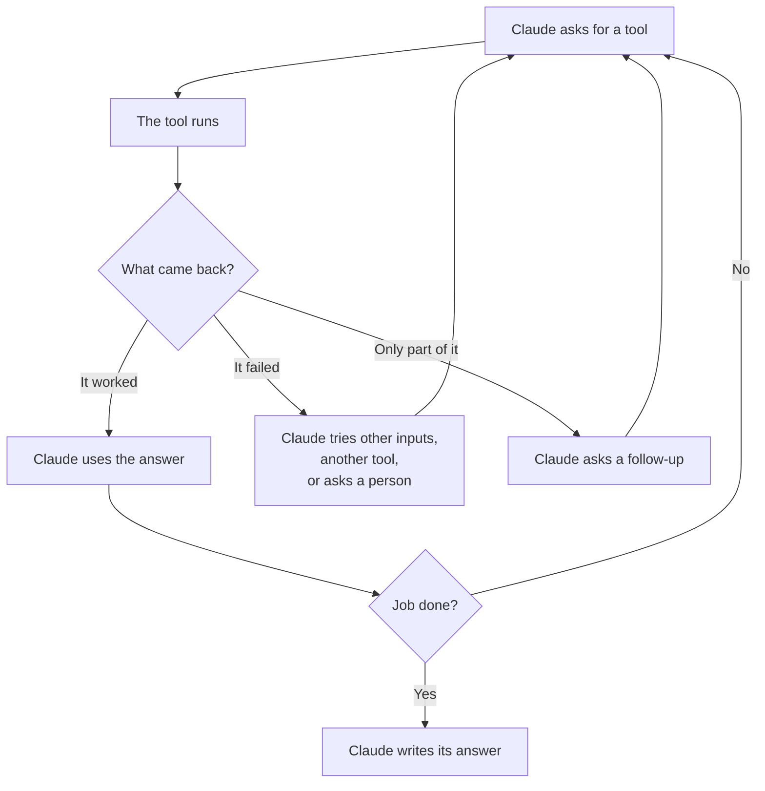

# Lesson 4 — Tool Use as the Foundation of Agency

**Course:** [CCAR-F 2026 Exam Prep](https://www.udemy.com/course/certified-claude-architect-masterclass-2026/) &nbsp;·&nbsp; **Domain 1:** Agentic Architecture & Orchestration &nbsp;·&nbsp; **Completed:** November 15, 2026

| Previous | Course | Next |
|:---|:---:|---:|
| [← Agents, Workflows, and Chatbots](03-agents-workflows-and-chatbots.md) | [📚 Course index](../README.md) | Perception, Reasoning, Action, and Observation (not written yet) |

---

**On this page**

| # | Section |
|:---:|:---|
| 1 | [Revision summary](#revision-summary) |
| 2 | [Words to know](#words-to-know) |
| 3 | [1. One tool call, step by step](#1-one-tool-call-step-by-step) |
| 4 | [2. Who runs the tool?](#2-who-runs-the-tool) |
| 5 | [3. What the model does with the result](#3-what-the-model-does-with-the-result) |
| 6 | [4. Three kinds of tools](#4-three-kinds-of-tools) |
| 7 | [5. The tool description is the steering wheel](#5-the-tool-description-is-the-steering-wheel) |
| 8 | [Exam traps](#exam-traps) |
| 9 | [Architect notes](#architect-notes) |
| 10 | [My notes / practice](#my-notes--practice) |
| 11 | [FAQ](#faq) |

---

### Revision summary

Every action an agent takes is the same small exchange, repeated:

1. **Claude asks for a tool.** It reads the tool descriptions, then asks for one tool by name, with its inputs.
2. **A program runs the tool.** Your code runs tools you wrote. Anthropic runs built-in tools, such as web search.
3. **The result goes back to Claude.** Claude then calls another tool or gives its answer.

#### The three parts of every exchange

| Part | Plain meaning | Who makes it |
|---|---|---|
| **Tool definition** | The tool's "label": its name, what it does, and what inputs it needs. | You, the developer |
| **Tool call** | Claude's request: "use this tool, with these inputs." | Claude |
| **Observation** | The tool's answer, handed back to Claude. | The program that ran the tool |

When Claude asks for a tool, its reply is marked "tool use" (the API's *stop reason*). That mark tells your program: "Claude is waiting for a tool's answer, not finished."

#### Who runs the tool

- **Client tools** are tools you build. Your own program runs them and sends back the answer.
- **Server tools** are built-in tools, such as web search. Anthropic runs them for you.

#### Workflow or agent

If the developer decides which tools run, and in what order, it is a workflow. If Claude picks the tool while it runs, it is an agent. In an agent, the order can change from one run to the next.

#### What Claude does with the answer

- **It worked:** Claude uses the answer and moves on.
- **It failed:** Claude tries again with different inputs, tries another tool, or hands over to a person.
- **Only part of the answer came back:** Claude asks a follow-up tool call first.
- **Several tools are needed that don't depend on each other:** Claude can ask for all of them at once. Your program runs them at the same time, which saves waiting.

#### When to use which kind of tool

- **Use a "read" tool** to get information, such as searching the web or reading a file. Risk: the information may be old or wrong.
- **Use a "compute" tool** for work text alone can't do reliably, such as running code or doing math. Risk: code may cause harm if it is not sealed off.
- **Use a "change" tool** to do something in the world, such as sending an email. Risk: the effect is real and often can't be undone. Add a person's approval.

#### The description decides which tool Claude picks

Claude chooses a tool by reading its description, never its code. A clear description says what the tool does, what it needs, and what it returns. A vague one causes quiet mistakes: Claude picks the wrong tool, or skips one, with no error message.

#### Exam takeaways

- **An agent searches help articles when it should search the user's tickets, and there is no error.** Rewrite both tool descriptions so each says what it searches and when to use it. (Tool Design & MCP Integration)
- **A developer is surprised that Claude asked for three tools in one reply.** That is normal. Run all three, then send all three answers back together. (Tool Design & MCP Integration)
- **A team must rank its agent's tools by risk.** "Change" tools are highest, so give them a person's approval. Then "compute," then "read." (Agentic Architecture & Orchestration)

---

### Words to know

[Lesson 3](03-agents-workflows-and-chatbots.md#words-to-know) defined *model*, *tool*, *tool call*, *runtime*, and *observation*. This lesson adds:

| Word | What it means in plain words |
|---|---|
| **Tool definition** | The description you give Claude for one tool: its name, what it does, and its inputs. Claude reads it like a label on a box. |
| **Client tool** | A tool your own program runs, such as "look up order." |
| **Server tool** | A built-in tool that Anthropic runs for you, such as web search. |
| **Sandbox** | A sealed-off place to run code. Mistakes inside it cannot reach your real systems. |
| **SKU** | A product's stock code, such as KET-BLUE for a blue kettle. |

---

### 1. One tool call, step by step

We use the same online shop as lesson 3. A customer asks: *"Is the blue kettle in stock?"*

The shop's developer has made a tool called "check stock." Here is what happens.

1. **Your program sends Claude the question**, plus the label of every tool. The "check stock" label says: "Looks up how many units of a product are in stock, using its SKU."
2. **Claude reads the labels and decides it needs "check stock."** It does not answer in words. Instead it replies with a tool call: "use check stock, with SKU KET-BLUE." The reply is marked "tool use."
3. **Your program sees the mark and runs the tool.** It asks the inventory database. The database says: 14 units.
4. **Your program sends the answer back to Claude.** It also says which tool call the answer belongs to. This answer is the observation.
5. **Claude reads the observation and replies:** *"Yes, 14 blue kettles are in stock."*

> **Remember this:** Claude asks. Your program does. The answer goes back to Claude.

This exchange is the smallest unit of every agent. A real task repeats it many times.

---

### 2. Who runs the tool?

| | Client tools | Server tools |
|---|---|---|
| **Who runs it** | Your own program | Anthropic |
| **Examples** | "Check stock," "look up order" | Web search |
| **What you must do** | Run it and send back the answer | Nothing. The answer arrives with Claude's reply. |
| **Use it when** | The tool needs your own data or systems | You need a common skill, such as searching the web, without building it |

Everyday comparison: a client tool is like cooking at home from a recipe. A server tool is like a restaurant cooking the dish and bringing it to you.

---

### 3. What the model does with the result

This is where an agent differs from a fixed list of steps. A fixed list runs its steps and stops. An agent looks at each answer and decides what to do next.

**An example of a failure.** The "check stock" tool replies: "SKU KET-BLU not found." Claude notices the typo, tries again with "KET-BLUE," and gets 14 units.

That only works because the error message was clear. If the tool had replied "Error 500," Claude would have nothing to go on.

**Asking for several tools at once.** Suppose the customer asks: "Is the blue kettle in stock, and where is my order #1234?" The two lookups don't depend on each other. So Claude asks for "check stock" and "look up order" in the same reply. Your program runs both at the same time, then sends both answers back together.

---

### 4. Three kinds of tools

The course sorts tools into three groups. Each group fails in its own way, and carries its own risk.

| Group | What it does | Examples | How it goes wrong | Risk |
|---|---|---|---|---|
| **Read** (the course says *data access*) | Gets information | Web search, read a file, query a database | Returns old or wrong information | Lowest |
| **Compute** (*computation*) | Does work that text alone can't do reliably | Run Python code in a sandbox, do a calculation | Code escapes a loose sandbox and changes things | Medium |
| **Change** (*external API*) | Does something in the world | Send an email, create a calendar event, update a record | Writes to the wrong file or record | Highest |

Knowing a tool's group is the first step in judging how risky it is.

---

### 5. The tool description is the steering wheel

Claude never sees a tool's code. It only sees the description. So the description decides when Claude uses the tool.

| ❌ Vague description | ✅ Clear description |
|---|---|
| "Processes data." | "Looks up how many units of one product are in stock, using its SKU (such as KET-BLUE). Returns the number of units. Use it when a customer asks if a product is available. It does not reserve stock." |

A good description answers four questions, in plain words:

1. What does the tool do?
2. When should Claude use it, and when not?
3. What inputs does it need? Give an example.
4. What does it return?

Leave out how it works inside, such as which database it uses. Claude doesn't need that to choose. The course's test: could a non-engineer read it and know when to use the tool?

**Warning:** A bad description rarely causes an error message. Instead, Claude quietly picks the wrong tool, or skips the right one. This is one of the most common reasons agents go wrong.

---

### Exam traps

| ❌ Trap | ✅ What is true |
|---|---|
| A tool call is plain text, like "please check the stock." | It is a structured request: the tool's name plus its inputs. |
| My program runs every tool Claude uses. | Your program runs client tools. Anthropic runs server tools, such as web search. |
| If Claude fills in a tool's inputs, it is an agent. | It is an agent only if Claude picks which tool runs. |
| A broken tool setup always shows an error. | It usually fails quietly: the wrong tool is picked, or a tool is skipped. |

---

### Architect notes

- **Speed:** when Claude asks for several tools at once, run them at the same time. Running them one by one makes the customer wait longer.
- **Cost:** every tool answer is added to the conversation and resent with each request. Return only what Claude needs, such as "14 units," not a whole database row. Web search also costs extra per search. Prices change, so check the current pricing page.
- **Safety:** answers from "read" tools can hide tricks, such as a web page saying "ignore your rules." Treat every tool answer as untrusted.
- **"Change" tools:** give them the smallest possible reach, and have a person approve anything permanent.
- **Errors:** make tools return clear error messages, such as "order 1234 not found." Claude can then fix its request and try again.
- **Quiet failures:** log every tool call and answer. Reading the logs is how you spot a wrong or skipped tool.

---

## My notes / practice

- [ ] Find a vague tool description in a real project. Rewrite it using the four questions in section 5.
- [ ] Sort Claude Code's tools into read, compute, and change: Read, Grep, Bash, Edit, WebSearch.

---

## FAQ

**Q1. What does "observation" mean?**
It is the tool's answer, handed back to Claude. Claude reads it to decide what to do next.

**Q2. How does my program know that Claude wants a tool?**
Claude's reply is marked "tool use" instead of being a normal answer. It contains the tool's name and the inputs to use.

**Q3. What is the difference between "client tools" and "server tools"?**
Your own program runs client tools, such as "check stock." Anthropic runs server tools, such as web search, and sends the answer for you.

**Q4. What happens when a tool fails?**
Your program sends Claude a clear error message. Claude then tries different inputs, tries another tool, or hands over to a person.

**Q5. Can Claude ask for several tools at once?**
Yes, when the tools don't depend on each other. Your program runs them at the same time and sends all the answers back together.

**Q6. What are the three kinds of tools?**
Read tools get information. Compute tools do work such as running code. Change tools do something in the world, such as sending an email. Risk rises in that order.

**Q7. What should a tool description say?**
What the tool does, when to use it, what inputs it needs, and what it returns. Write it so a non-engineer could understand it.

**Q8. (Exam angle) A support agent keeps searching help articles when users ask about their own tickets. The logs show no errors. What do you fix first?**
The tool descriptions. Claude picks tools by reading them. Make each one say exactly what it searches and when to use it instead of the other. (Tool Design & MCP Integration)

**Q9. (Exam angle) A developer's agent breaks when Claude asks for two tools in one reply. What is wrong?**
The program expects only one tool call per reply. It must run every requested tool, then send all the answers back together. (Tool Design & MCP Integration)

**Q10. (Exam angle) A security team reviews an agent with web search, a code sandbox, and a send-email tool. How do you rank the risks?**
Send-email is highest, because its effect is real and permanent, so add a person's approval. The sandbox is next, so keep it sealed off. Web search only reads, but its results can hide tricks, so treat them as untrusted. (Agentic Architecture & Orchestration)

---

| Previous | Course | Next |
|:---|:---:|---:|
| [← Agents, Workflows, and Chatbots](03-agents-workflows-and-chatbots.md) | [📚 Course index](../README.md) | Perception, Reasoning, Action, and Observation (not written yet) |
