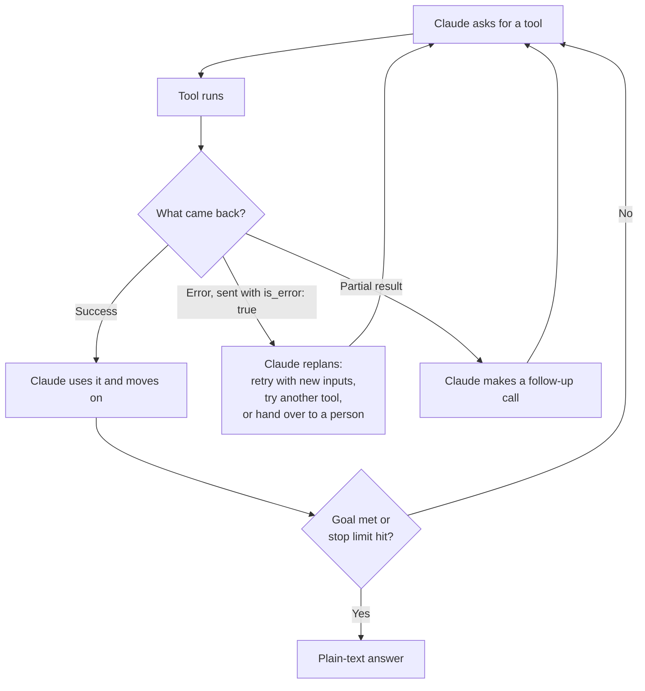

# Lesson 4 — Tool Use as the Foundation of Agency

**Course:** [CCAR-F 2026 Exam Prep](https://www.udemy.com/course/certified-claude-architect-masterclass-2026/) &nbsp;·&nbsp; **Domain 1:** Agentic Architecture & Orchestration &nbsp;·&nbsp; **Completed:** November 15, 2026

| Previous | Course | Next |
|:---|:---:|---:|
| [← Agents, Workflows, and Chatbots](03-agents-workflows-and-chatbots.md) | [📚 Course index](README.md) | Lesson 5 (not written yet) |

---

**On this page**

| # | Section |
|:---:|:---|
| 1 | [Revision summary](#revision-summary) |
| 2 | [What this lesson adds](#what-this-lesson-adds) |
| 3 | [1. One tool call, message by message](#1-one-tool-call-message-by-message) |
| 4 | [2. Who runs the tool: client tools vs. server tools](#2-who-runs-the-tool-client-tools-vs-server-tools) |
| 5 | [3. What happens after the result comes back](#3-what-happens-after-the-result-comes-back) |
| 6 | [4. Three kinds of tools, three kinds of risk](#4-three-kinds-of-tools-three-kinds-of-risk) |
| 7 | [5. Writing a description Claude can choose from](#5-writing-a-description-claude-can-choose-from) |
| 8 | [Architect notes](#architect-notes) |
| 9 | [Recap](#recap) |
| 10 | [My notes / practice](#my-notes--practice) |
| 11 | [FAQ](#faq) |

---

### Revision summary

Every action an agent takes is one small exchange that repeats: Claude reads the tool descriptions and asks for a tool by name with its inputs, a program runs that tool (your code for tools you wrote, or Anthropic for built-in tools such as web search), and the result goes back to Claude, which then decides whether to call another tool or give its answer.

#### The three parts of every tool exchange

Each tool exchange has three named parts.

| Part | What it is | Who makes it |
|---|---|---|
| **Tool definition** | The description of a tool: a `name`, a plain-words `description`, and an `input_schema` (the inputs it takes). | You, the developer. You send it with each request. |
| **Tool call** | Claude's request to use a tool: a `tool_use` block holding an `id`, the tool `name`, and the inputs as JSON. It is structured data, not plain text. | Claude. |
| **Observation** | The tool's result, sent back to Claude so it can plan the next step (the course calls this *tool result injection*). | The program that ran the tool. |

#### The round trip in the API

1. Claude's reply has `stop_reason: "tool_use"` and one or more `tool_use` blocks.
2. Your code runs each tool.
3. Your code sends a new `user` message with one `tool_result` block per tool call. Each `tool_result` has a `tool_use_id` that matches the `id` of its `tool_use` block. The `tool_result` blocks must come first in that message, before any text.
4. Claude reads the results and either calls more tools or answers in plain text.

#### Client tools and server tools

Who runs a tool depends on its kind.

- **Client tools** run in your application. They include tools you write and Anthropic's ready-made tool designs such as `bash`, `text_editor`, and computer use. You must run them and send back the `tool_result`.
- **Server tools** run on Anthropic's servers. They include `web_search`, `web_fetch`, and `code_execution`. Anthropic runs them and puts the result in Claude's reply, so your code does nothing. A long server-tool turn can stop early with `stop_reason: "pause_turn"`; send the reply back as it is to let Claude continue.

#### Workflow or agent: who picks the tool

If the developer decides which tools run and in what order, it is a **workflow**, even if Claude fills in the inputs at every step. If Claude picks the tool while it runs, based on what it has found so far, it is an **agent**. The order of tools can then change from one run to the next.

#### Handling the result

What Claude does next depends on what came back.

- **Success:** Claude uses the result and moves on.
- **Error:** your code sends a `tool_result` with `"is_error": true` and a clear message. Claude then *replans*: it retries with different inputs, tries another tool, or hands the problem to a person.
- **Partial result:** Claude makes a follow-up call before moving on.
- **Several independent tools at once:** Claude can put several `tool_use` blocks in one reply (*parallel tool use*). Your code can run them at the same time, which saves time, and must send all the results back in one `user` message. To turn this off, set `"disable_parallel_tool_use": true` inside `tool_choice`.

#### When to use which kind of tool

Tools fall into three groups, and each carries a different risk.

- **Use a data access tool** to read from the world, such as reading a file or querying a database. Main risk: the data is out of date or wrong.
- **Use a computation tool** for work text generation cannot do reliably, such as running Python or doing math. Main risk: code in a loose sandbox can change things outside it.
- **Use an external action tool** to change the world, such as sending an email or updating a record. Main risk: real, often permanent effects. Add human approval for these.

#### Tool descriptions control reliability

Claude decides which tool to use by reading its description, never its code. Write descriptions a non-engineer could act on: what the tool does, when to use it, what inputs it needs, and what it returns. Leave out how it works inside. When tool use goes wrong, there is rarely an error message. Instead, Claude calls the wrong tool or skips one, and a vague description is the most common cause.

#### Exam takeaways

- **An agent calls `search_docs` when it should call `search_tickets`, and no error appears.** Rewrite both descriptions to say what each searches, what it returns, and when to use it instead of the other. (Tool Design & MCP Integration)
- **A developer's loop crashes because Claude asked for three tools at once.** That is parallel tool use. Run all three, then return all three `tool_result` blocks, matched by `tool_use_id`, in one `user` message. (Tool Design & MCP Integration)
- **A team must rank its agent's tools by risk.** Sort them into data access, computation, and external action tools. External action tools carry the most risk, so give them human approval and the narrowest permissions. (Agentic Architecture & Orchestration)

---

### What this lesson adds

[Lesson 3](03-agents-workflows-and-chatbots.md) covered the basics: why a model needs tools, the four-step loop, and that the `description` matters most. This lesson zooms in on **one tool call** and adds what lesson 3 left out: the exact messages, who runs which tool, what happens on an error, the three groups of tools, and parallel calls.

**Running example:** the same online shop as lesson 3. A customer asks: *"Is the blue kettle in stock, and where is my order #1234?"*

**Who's who**

| Player | Where it lives | What it does here |
|---|---|---|
| **Claude** (the model) | Anthropic's servers | Reads the tool descriptions and asks for tools. Never runs them itself. |
| **Your app** (the runtime) | Your server | Sends messages to Claude, runs client tools, and sends back results. |
| **Anthropic's servers** | Anthropic | Also run server tools, such as web search, for you. |
| **Your tools** | Your systems | `check_stock` (inventory database) and `get_order` (orders database). |

---

### 1. One tool call, message by message

The customer's question needs two independent lookups, so Claude asks for both tools in one reply (parallel tool use).

**Claude's reply (shortened):**

```json
{
  "stop_reason": "tool_use",
  "content": [
    { "type": "tool_use", "id": "toolu_A", "name": "check_stock", "input": { "product_sku": "KET-BLUE" } },
    { "type": "tool_use", "id": "toolu_B", "name": "get_order",   "input": { "order_id": "1234" } }
  ]
}
```

- `stop_reason: "tool_use"` tells your app: "Claude is waiting for tool results, not finished."
- A **SKU** is a product's stock code, here `KET-BLUE`.
- Each `id` is a label for that one call. Your reply must use it.

**Your app runs both tools at once, then sends one `user` message:**

```json
{
  "role": "user",
  "content": [
    { "type": "tool_result", "tool_use_id": "toolu_A", "content": "In stock: 14 units" },
    { "type": "tool_result", "tool_use_id": "toolu_B", "content": "Shipped Nov 2, arriving Nov 17" }
  ]
}
```

Claude reads these two observations and answers in plain text: *"Yes, 14 blue kettles are in stock. Your order shipped on November 2 and should arrive on November 17."*

> **Remember this:** Claude asks, your app runs, the `tool_use_id` ties the answer to the question.

**Warning:** If you send the results back in two separate messages, or leave one out, the API rejects the request. Every `tool_use` needs its own `tool_result`, all in the next `user` message.

---

### 2. Who runs the tool: client tools vs. server tools

| | Client tools | Server tools |
|---|---|---|
| **Who runs it** | Your app | Anthropic's servers |
| **Examples** | Your own tools (`get_order`), `bash`, `text_editor`, computer use | `web_search`, `web_fetch`, `code_execution` |
| **What your code does** | Runs the tool and sends a `tool_result` | Nothing. The result arrives inside Claude's reply. |
| **Use it when** | The tool touches your own systems or data | You need a common capability, such as searching the web, without building it |

Everyday comparison: a client tool is cooking at home from the chef's recipe; a server tool is the chef's kitchen cooking for you and handing you the plate.

---

### 3. What happens after the result comes back

This is where an agent differs from a plain pipeline. A pipeline runs its steps and stops. An agent looks at each result and decides what to do next.



For example, if `get_order` fails, your app sends:

```json
{ "type": "tool_result", "tool_use_id": "toolu_B", "is_error": true, "content": "Order 1234 not found. Check the number." }
```

Claude might then ask the customer to confirm the order number. A clear error message lets Claude recover; a bare "Error 500" leaves it guessing.

---

### 4. Three kinds of tools, three kinds of risk

| Group | What it does | Examples | Typical failure | Risk |
|---|---|---|---|---|
| **Data access** | Reads from the world | Read a file, query a database, fetch a web page, search | Out-of-date search results | Low: it only reads, but the data may hold hidden instructions |
| **Computation** | Does work text generation can't do reliably | Run Python in a sandbox, parse a file, do math | A loose sandbox lets code change things outside it | Medium |
| **External action** | Changes the world | Send an email, create a calendar event, update a record | Writes to the wrong file or record | High: effects are real and often permanent |

Knowing a tool's group is the first step in judging its risk. A sandbox is a sealed-off place to run code, so mistakes cannot reach your real systems.

---

### 5. Writing a description Claude can choose from

Claude reads the description, not the code. So the description is not just documentation: it is how you steer which tool Claude picks.

| ❌ Vague | ✅ Clear |
|---|---|
| "Processes data." | "Looks up the current stock count for one product in the inventory database, using its SKU (stock code, such as KET-BLUE). Returns the number of units in stock. Use it when a customer asks whether a product is available. It does not reserve or change stock." |

A good description says, in plain words:

1. **What the tool does.**
2. **When to use it**, and when not to.
3. **What inputs it needs**, with an example.
4. **What it returns.**

Leave out how it works inside, such as "uses a Redis cache." Claude doesn't need that to choose. Aim for at least 3 to 4 sentences.

---

### Architect notes

#### Speed

- Parallel tool calls cut waiting time. Run independent tools at the same time in your app instead of one after another.
- Server tools save you building code, but each search or fetch adds time to Claude's reply.

#### Cost

- Server tools can cost extra on top of tokens; for example, web search is charged per search. Prices change, so check the current pricing page.
- Every tool result is added to the conversation and resent each round. Return only the fields Claude needs, such as `"In stock: 14 units"`, not the whole database row.

#### Security

- Data access tools are a door for *prompt injection*: a web page or email can hide text such as "ignore your rules." Treat every tool result as untrusted.
- Give external action tools the narrowest scope (for example, only send email to the customer on the order) and require human approval for anything permanent.
- Run code execution only in a sandbox with no access to your real systems.

#### Production pitfalls

- Return clear errors with `"is_error": true`. When Claude sends bad or missing inputs, it usually retries 2 to 3 times with corrections before giving up.
- Silent failure is the hard case: no error, just the wrong tool or a skipped tool. Log every `tool_use` and `tool_result`, and review the logs to spot it.
- Handle `pause_turn` for server tools: send the reply back to let Claude continue, and cap how many times you do this.

---

### Recap

- Every tool use has three parts: the **definition** (you write it), the **tool call** (Claude asks), and the **observation** (the result goes back).
- Claude's reply says `stop_reason: "tool_use"`. You answer with `tool_result` blocks, matched by `tool_use_id`, in one `user` message.
- **Client tools** run in your app. **Server tools**, such as web search, run on Anthropic's servers.
- If the developer picks the tool order, it is a workflow. If Claude picks, it is an agent.
- On an error, Claude replans. Independent tools can run in parallel.
- Tools are data access, computation, or external action. Risk rises in that order.
- The description is how you steer tool choice. Bad descriptions cause silent wrong choices.

---

## My notes / practice

- [ ] Rewrite three vague tool descriptions from a real project using the four-part checklist in section 5.
- [ ] Sort the tools of an agent you know, such as Claude Code (Read, Edit, Bash, WebSearch), into data access, computation, and external action.
- [ ] Write out by hand the `tool_use` and `tool_result` messages for a question that needs two tools at once.

<details>
<summary><strong>Test yourself</strong></summary>

**1. Claude's reply has two `tool_use` blocks. How do you send the results back?**
In one `user` message with two `tool_result` blocks, each with a `tool_use_id` that matches its `tool_use` block's `id`.

**2. Does your app run the `web_search` tool?**
No. It is a server tool, so Anthropic runs it and puts the result in Claude's reply.

**3. A system always calls `get_order` and then `send_email`, and Claude fills in the email text. Is it an agent?**
No. The developer fixed which tools run and in what order, so it is a workflow.

**4. Which group of tools carries the most risk, and why?**
External action tools, because they change real things, such as sending emails or updating records, and the effects are often permanent.

</details>

### Common mix-ups

| ❌ Wrong idea | ✅ What is true |
|---|---|
| A tool call is plain text like "please check stock." | It is a structured `tool_use` block with an `id`, a tool name, and JSON inputs. |
| My app runs every tool Claude uses. | Your app runs client tools. Anthropic runs server tools such as web search. |
| If Claude fills in the inputs, it is an agent. | It is an agent only if Claude picks which tool runs. |
| Results for parallel calls can go in separate messages. | All results go back in one `user` message. |
| A broken tool setup always shows an error. | It usually fails silently: Claude picks the wrong tool or skips one. |

---

## FAQ

**Q1. What does "observation" mean?**
An observation is a tool's result after it runs, sent back into Claude's conversation. Claude reads it to decide the next step. The course calls this step *tool result injection*.

**Q2. What does Claude's reply look like when it wants a tool?**
The reply has `stop_reason: "tool_use"` and one or more `tool_use` blocks. Each block has an `id`, the tool `name`, and the inputs as JSON.

**Q3. How does my app send a tool's result back to Claude?**
Send a new `user` message containing a `tool_result` block. Its `tool_use_id` must match the `id` of the `tool_use` block, and the `tool_result` blocks must come before any text in that message.

**Q4. What is the difference between "client tools" and "server tools"?**
Client tools run in your application, so you run them and return the result; examples are your own tools and `bash`. Server tools, such as `web_search` and `code_execution`, run on Anthropic's servers, which return the result for you.

**Q5. What does `pause_turn` mean?**
It is a `stop_reason` you can get with server tools when a long turn stops partway. Send Claude's reply back as it is, and Claude continues where it stopped.

**Q6. How do I tell Claude that a tool failed?**
Send the `tool_result` with `"is_error": true` and a clear message, such as "Order 1234 not found." Claude can then retry with other inputs, try another tool, or ask a person.

**Q7. Can Claude ask for several tools at once?**
Yes. This is parallel tool use: Claude puts several `tool_use` blocks in one reply when the tools don't depend on each other. Run them at the same time and send all results back in one message. Turn it off with `"disable_parallel_tool_use": true` inside `tool_choice`.

**Q8. What are the three groups of tools?**
Data access tools read from the world, computation tools do work such as running code, and external action tools change the world, such as sending an email. Risk rises in that order.

**Q9. What should a tool description say?**
What the tool does, when to use it, what inputs it needs, and what it returns, in words a non-engineer could follow. Leave out how it works inside, and aim for at least 3 to 4 sentences.

**Q10. How can I tell that a tool description is bad?**
Usually there is no error. Claude calls the wrong tool or skips a tool it should have used. Check your logs of tool calls when answers look wrong.

**Q11. (Exam angle) A support agent keeps searching the help articles when users ask about their own tickets, and nothing in the logs shows an error. What do you fix first?**
The tool descriptions. Claude chooses tools from their descriptions, so make each one say exactly what it searches, what it returns, and when to use it instead of the other tool. (Tool Design & MCP Integration)

**Q12. (Exam angle) A developer's agent fails when Claude returns two `tool_use` blocks in one reply. What is wrong, and how do you fix it?**
The code expects one tool call per reply. Claude used parallel tool use, so the code must run every tool and return every `tool_result`, matched by `tool_use_id`, in one `user` message. If the tools must run one at a time, set `disable_parallel_tool_use` in `tool_choice`. (Tool Design & MCP Integration)

**Q13. (Exam angle) A security team reviews an agent with a web search tool, a Python sandbox, and a send-email tool. How do you rank the risks?**
Send-email is highest, because it is an external action with real, permanent effects, so give it narrow scope and human approval. The sandbox is next, so keep it sealed off. Web search only reads, but its results can carry prompt injection, so treat them as untrusted. (Agentic Architecture & Orchestration)

---

| Previous | Course | Next |
|:---|:---:|---:|
| [← Agents, Workflows, and Chatbots](03-agents-workflows-and-chatbots.md) | [📚 Course index](README.md) | Lesson 5 (not written yet) |
