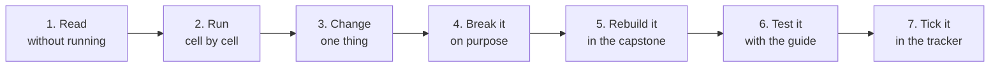

# Build along with the Claude Cookbook

**Part of:** [Study plan](readme.md) &nbsp;·&nbsp; **Created:** November 7, 2026 &nbsp;·&nbsp; **Repository:** [anthropics/claude-cookbooks](https://github.com/anthropics/claude-cookbooks)

---

**On this page**

| # | Section |
|:---:|:---|
| 1 | [In short](#in-short) |
| 2 | [What "build along" means](#what-build-along-means) |
| 3 | [One-time setup](#one-time-setup) |
| 4 | [The routine for every notebook](#the-routine-for-every-notebook) |
| 5 | [Which notebooks to run](#which-notebooks-to-run) |
| 6 | [What to skip until after the exam](#what-to-skip-until-after-the-exam) |
| 7 | [Keeping the cost low](#keeping-the-cost-low) |
| 8 | [Progress tracker](#progress-tracker) |

---

### In short

The Claude Cookbook is a free GitHub repository from Anthropic with about 110 Jupyter notebooks. Each notebook is a working code example for one technique, such as prompt caching or tool use. "Building along" means you run a notebook, change it until you understand it, and then write your own version of the technique inside your capstone project.

- **When:** each capstone guide starts with an optional warm-up that names its notebooks. You open this page only for the one-time setup and the routine below.
- **How much:** about 20 notebooks in total, roughly 22 hours, spread across the guides.
- **What you end up with:** a working capstone (the support assistant in the [capstone plan](02_BuildingWithTheClaudeAPI/00_Capstone_Plan/README.md)) where every feature is backed by a Cookbook technique you have run and changed yourself.

> **Remember this:** The course tells you what a technique is. The notebook shows it working. The capstone proves you can do it without help.

---

### What "build along" means

A **Jupyter notebook** (a file ending in `.ipynb`) is a document made of *cells*. Some cells hold explanations. Other cells hold Python code that you run one at a time, and the result appears right under the cell. You open notebooks in VS Code, which is already installed on your computer.

Building along is **not** copying code into your project. Copying gives you working code that you can't explain, and the exam asks you to explain and choose between designs. The routine in section 4 makes you change and break each example first, so you learn why it works.

#### Who's who

| Player | Where it lives | What it does | Example |
|---|---|---|---|
| You | Your computer | Run notebooks, change them, write the capstone code | You change the cache settings and rerun the cell |
| The Cookbook | `claude-cookbooks/`, a folder next to this repository (a copy you download) | Gives you example code to run and study | `misc\prompt_caching.ipynb` |
| VS Code with the Jupyter extension | Your computer | Opens notebooks and runs their cells | You press Shift+Enter to run a cell |
| The Claude API | Anthropic's servers | Receives each request from a cell, runs the model, and sends back the answer | A cell sends a question and prints the reply |
| Your capstone folder | `02_BuildingWithTheClaudeAPI/00_Capstone_Plan/`, inside this repository (layout in the [capstone plan](02_BuildingWithTheClaudeAPI/00_Capstone_Plan/README.md#where-the-files-go)) | Holds your own version of each technique | `app\tools.py` with your ticket lookup tool |
| Claude Code | Your terminal, opened in either folder | Acts as a tutor: explains a cell you don't understand and reviews your capstone code | "Explain what `cache_control` does in cell 6" |

#### Where the folders sit

Keep the Cookbook **outside** this notes repository. It is a separate download of someone else's code, and you should never commit it here.

```text
(the folder that holds this repository)
├── ClaudeArchitectStudyGuide\       your study notes (this repository)
│   └── 02_BuildingWithTheClaudeAPI\
│       └── 00_Capstone_Plan\        your capstone project: your own code
│           ├── app\client.py
│           ├── app\tools.py
│           └── evaluations\cases.jsonl
└── claude-cookbooks\                the Cookbook: read and run, never commit
    ├── .env                         your API key (you create this; Git ignores it)
    ├── misc\prompt_caching.ipynb
    └── tool_use\customer_service_agent.ipynb
```

---

### One-time setup

This takes about an hour. Run the commands in Terminal on the Mac, or in PowerShell on Windows. Start in the top folder of this study-notes repository.

1. **Install uv, if `uv --version` prints nothing.** uv is a tool that installs Python packages and the right Python version for a project. The Cookbook needs Python 3.11 or 3.12, and uv downloads Python 3.12 just for the Cookbook folder, whatever Python your computer already has.

   **Mac:**

   ```bash
   curl -LsSf https://astral.sh/uv/install.sh | sh
   ```

   **Windows:**

   ```powershell
   powershell -ExecutionPolicy ByPass -c "irm https://astral.sh/uv/install.ps1 | iex"
   ```

   Close and reopen the terminal, then check that `uv --version` prints a version number.

2. **Download the Cookbook** (Git calls this *cloning*):

   ```bash
   cd ..
   git clone https://github.com/anthropics/claude-cookbooks.git
   cd claude-cookbooks
   ```

3. **Install the packages.** This command creates a private Python environment in a `.venv` folder inside `claude-cookbooks` and installs everything the notebooks need, including the `anthropic` package.

   ```bash
   uv sync --all-extras
   ```

4. **Add your API key.** Copy the example file, then open `.env` in VS Code and replace the placeholder after `ANTHROPIC_API_KEY=` with your key from the Claude Console (lesson 2 of the API course).

   **Mac:**

   ```bash
   cp .env.example .env
   code .env
   ```

   **Windows:**

   ```powershell
   copy .env.example .env
   code .env
   ```

   Leave `CLAUDE_MODEL=claude-haiku-5-5` as it is. Haiku is the cheapest current model (see section 7).

   **Warning:** never paste your key into a notebook cell. Notebooks are often shared or committed, and a key inside one is easy to leak. The notebooks read the key from `.env` with a library called `python-dotenv`.

5. **Set up VS Code.** Install the **Python** and **Jupyter** extensions from Microsoft (Extensions panel: Ctrl+Shift+X on Windows, Cmd+Shift+X on the Mac). Then open the folder with `code .`. On the Mac, if `code` is not found, open VS Code, press Cmd+Shift+P, and run **Shell Command: Install 'code' command in PATH** once.

6. **Choose the kernel.** A **kernel** is the Python program that runs a notebook's cells. Open any notebook, click **Select Kernel** in the top right, and choose the `.venv` environment inside `claude-cookbooks`. If you pick another Python, such as Anaconda's, cells fail with "module not found" errors.

7. **Test it.** Open `misc/how_to_enable_json_mode.ipynb` and run the first few cells with Shift+Enter. If a reply from the model appears, the setup works.

**Tip:** many notebooks start with a `%pip install ...` cell. Skip it, because `uv sync` already installed those packages.

---

### The routine for every notebook

Use the same seven steps for every notebook. A small notebook takes about 45 minutes, and a large one takes about 2 hours.



1. **Read it first, without running anything (10 minutes).** The Cookbook saves every notebook with its results already shown, so you can see what each cell produces without spending money. Write down in one sentence what problem the notebook solves.
2. **Run it, one cell at a time.** Before each cell, guess what it will print. If the result surprises you, stop and find out why. Ask Claude Code, for example: "Explain cell 7 of `misc/prompt_caching.ipynb` line by line."
3. **Change one thing and predict the result.** Each guide's warm-up suggests a change under **Try this**. Write your prediction down before you run the cell, then compare.
4. **Break it on purpose.** Remove a required field, send a bad input, or make a tool raise an error. Read the exact error message. The exam asks what happens when things fail, and this step is how you learn it.
5. **Rebuild the technique in the capstone, from memory.** Close the notebook and solve the matching problems in the capstone guide. Look back at the notebook only when you are stuck.
6. **Test it.** The guide's problems include eval cases and tests for each feature.
7. **Tick it** in the progress tracker at the end of this page.

---

### Which notebooks to run

You don't need to come back to this page after the setup. Each capstone guide lists its own notebooks in an "Optional warm-up" step under "Before you start", with links and a "Try this" exercise. This table is only an overview.

| Capstone guide | Notebooks in its warm-up |
|---|---|
| [Guide 1: Accessing Claude with the API](02_BuildingWithTheClaudeAPI/00_Capstone_Plan/guide/01-accessing-claude-with-the-api.md) | `how_to_enable_json_mode`, `extracting_structured_json` |
| [Guide 2: Prompt evaluation](02_BuildingWithTheClaudeAPI/00_Capstone_Plan/guide/02-prompt-evaluation.md) | `building_evals`, `generate_test_cases` |
| [Guide 3: Prompt engineering techniques](02_BuildingWithTheClaudeAPI/00_Capstone_Plan/guide/03-prompt-engineering-techniques.md) | `metaprompt` |
| [Guide 4: Tool use with Claude](02_BuildingWithTheClaudeAPI/00_Capstone_Plan/guide/04-tool-use-with-claude.md) | `calculator_tool`, `customer_service_agent`, `tool_choice`, `parallel_tools` |
| [Guide 5: RAG and agentic search](02_BuildingWithTheClaudeAPI/00_Capstone_Plan/guide/05-rag-and-agentic-search.md) | `retrieval_augmented_generation/guide`, and optionally `contextual-embeddings/guide` |
| [Guide 6: Features of Claude](02_BuildingWithTheClaudeAPI/00_Capstone_Plan/guide/06-features-of-claude.md) | `using_citations`, `pdf_upload_summarization`, `prompt_caching` |
| Guides 7 and 8 | None. The Cookbook has no notebooks for MCP or Claude Code. |
| [Guide 9: Agents and workflows](02_BuildingWithTheClaudeAPI/00_Capstone_Plan/guide/09-agents-and-workflows.md) | `basic_workflows`, `evaluator_optimizer`, `building_moderation_filter` |
| [Guide 10: Final measurements and write-ups](02_BuildingWithTheClaudeAPI/00_Capstone_Plan/guide/10-final-measurements-and-write-ups.md) | `batch_processing`, `cost_optimization`, `latency_optimization` |

---

### What to skip until after the exam

| Folder | Why skip it for now |
|---|---|
| `claude_agent_sdk/`, `managed_agents/`, `skills/` | Advanced agent building, which the exam needs little of |
| `third_party/` | Other companies' products (Pinecone, LlamaIndex, MongoDB); the exam is about Claude |
| `multimodal/`, `finetuning/` | Images and fine-tuning are not part of the capstone |
| `observability/usage_cost_api.ipynb` | Needs an organization admin key; read it, don't run it |

---

### Keeping the cost low

- **Use Haiku** (`claude-haiku-5-5`) while learning. If a notebook names a larger model in a variable such as `MODEL`, change it to Haiku unless the lesson is about comparing models. Haiku is the cheapest current model; prices change, so check the current pricing page.
- **Set a monthly spend limit** in the Claude Console before you start.
- **Read before you run.** Saved outputs let you understand most of a notebook for free.
- **Rerun one cell, not the whole notebook,** when you change something.

---

### Progress tracker

- [ ] Setup: the JSON mode notebook returns a reply
- [ ] Guide 1: `how_to_enable_json_mode`, `extracting_structured_json`
- [ ] Guide 2: `building_evals`, `generate_test_cases`
- [ ] Guide 3: `metaprompt`
- [ ] Guide 4: `calculator_tool`, `customer_service_agent`, `tool_choice`, `parallel_tools`
- [ ] Guide 5: `retrieval_augmented_generation/guide` (optional: `contextual-embeddings/guide`)
- [ ] Guide 6: `using_citations`, `pdf_upload_summarization`, `prompt_caching`
- [ ] Guide 9: `basic_workflows`, `evaluator_optimizer`, `building_moderation_filter`
- [ ] Guide 10: `batch_processing`, `cost_optimization`, `latency_optimization`
