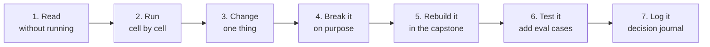

# Build along with the Claude Cookbook

**Part of:** [Study plan](readme.md) &nbsp;·&nbsp; **Created:** November 7, 2026 &nbsp;·&nbsp; **Repository:** [anthropics/claude-cookbooks](https://github.com/anthropics/claude-cookbooks)

---

**On this page**

| # | Section |
|:---:|:---|
| 1 | [In short](#in-short) |
| 2 | [What "build along" means](#what-build-along-means) |
| 3 | [One-time setup on Windows](#one-time-setup-on-windows) |
| 4 | [The routine for every notebook](#the-routine-for-every-notebook) |
| 5 | [The plan, phase by phase](#the-plan-phase-by-phase) |
| 6 | [What to skip until after the exam](#what-to-skip-until-after-the-exam) |
| 7 | [Keeping the cost low](#keeping-the-cost-low) |
| 8 | [Progress tracker](#progress-tracker) |

---

### In short

The Claude Cookbook is a free GitHub repository from Anthropic with about 110 Jupyter notebooks. Each notebook is a working code example for one technique, such as prompt caching or tool use. "Building along" means you run a notebook, change it until you understand it, and then write your own version of the technique inside your capstone project.

- **When:** after each chapter of *Building with the Claude API*, do the matching phase below. The plan follows the course chapters, not calendar dates, so it still works if you fall behind or move ahead.
- **How much:** about 20 notebooks in 8 phases, roughly 22 hours in total. These hours come out of the 30-hour capstone budget in the study plan, so the plan adds no new weekly time.
- **What you end up with:** a working capstone (the knowledge and support assistant in section 6 of the study plan) where every feature is backed by a Cookbook technique you have run and changed yourself.

> **Remember this:** The course tells you what a technique is. The notebook shows it working. The capstone proves you can do it without help.

---

### What "build along" means

A **Jupyter notebook** (a file ending in `.ipynb`) is a document made of *cells*. Some cells hold explanations. Other cells hold Python code that you run one at a time, and the result appears right under the cell. You open notebooks in VS Code, which is already installed on your computer.

Building along is **not** copying code into your project. Copying gives you working code that you can't explain, and the exam asks you to explain and choose between designs. The routine in section 4 makes you change and break each example first, so you learn why it works.

#### Who's who

| Player | Where it lives | What it does | Example |
|---|---|---|---|
| You | Your computer | Run notebooks, change them, write the capstone code | You change the cache settings and rerun the cell |
| The Cookbook | `C:\Projects\Personal\claude-cookbooks\` (a copy you download) | Gives you example code to run and study | `misc\prompt_caching.ipynb` |
| VS Code with the Jupyter extension | Your computer | Opens notebooks and runs their cells | You press Shift+Enter to run a cell |
| The Claude API | Anthropic's servers | Receives each request from a cell, runs the model, and sends back the answer | A cell sends a question and prints the reply |
| Your capstone repository | `C:\Projects\Personal\claude-capstone\` (layout in section 5 of the study plan) | Holds your own version of each technique | `app\tools.py` with your ticket lookup tool |
| Claude Code | Your terminal, opened in either folder | Acts as a tutor: explains a cell you don't understand and reviews your capstone code | "Explain what `cache_control` does in cell 6" |

#### Where the folders sit

Keep the Cookbook **outside** this notes repository. It is a separate download of someone else's code, and you should never commit it here.

```text
C:\Projects\Personal\
├── ClaudeArchitectStudyGuide\   your study notes (this repository)
├── claude-cookbooks\            the Cookbook: read and run, never commit
│   ├── .env                     your API key (you create this; Git ignores it)
│   ├── misc\prompt_caching.ipynb
│   └── tool_use\customer_service_agent.ipynb
└── claude-capstone\             your capstone project: your own code
    ├── app\client.py
    ├── app\tools.py
    └── evaluations\cases.jsonl
```

---

### One-time setup on Windows

This takes about an hour. Run the commands in PowerShell.

1. **Install uv.** uv is a tool that installs Python packages and the right Python version for a project. The Cookbook needs Python 3.11 or 3.12. Your computer has Python 3.13 (from Anaconda), which the Cookbook does not support, and uv solves this by downloading Python 3.12 just for the Cookbook folder.

   ```powershell
   powershell -ExecutionPolicy ByPass -c "irm https://astral.sh/uv/install.ps1 | iex"
   ```

   Close and reopen PowerShell, then check that `uv --version` prints a version number.

2. **Download the Cookbook** (Git calls this *cloning*):

   ```powershell
   cd C:\Projects\Personal
   git clone https://github.com/anthropics/claude-cookbooks.git
   cd claude-cookbooks
   ```

3. **Install the packages.** This command creates a private Python environment in a `.venv` folder inside `claude-cookbooks` and installs everything the notebooks need, including the `anthropic` package.

   ```powershell
   uv sync --all-extras
   ```

4. **Add your API key.** Copy the example file, then open `.env` in VS Code and replace the placeholder after `ANTHROPIC_API_KEY=` with your key from the Claude Console (lesson 2 of the API course).

   ```powershell
   copy .env.example .env
   code .env
   ```

   Leave `CLAUDE_MODEL=claude-haiku-5-5` as it is. Haiku is the cheapest current model (see section 7).

   **Warning:** never paste your key into a notebook cell. Notebooks are often shared or committed, and a key inside one is easy to leak. The notebooks read the key from `.env` with a library called `python-dotenv`.

5. **Set up VS Code.** Install the **Python** and **Jupyter** extensions from Microsoft (Extensions panel, Ctrl+Shift+X). Then open the folder with `code .`.

6. **Choose the kernel.** A **kernel** is the Python program that runs a notebook's cells. Open any notebook, click **Select Kernel** in the top right, and choose the `.venv` environment inside `claude-cookbooks`. If you pick Anaconda's Python instead, cells fail with "module not found" errors.

7. **Test it.** Open `misc\how_to_enable_json_mode.ipynb` and run the first few cells with Shift+Enter. If a reply from the model appears, the setup works.

**Tip:** many notebooks start with a `%pip install ...` cell. Skip it, because `uv sync` already installed those packages.

---

### The routine for every notebook

Use the same seven steps for every notebook. A small notebook takes about 45 minutes, and a large one takes about 2 hours.



1. **Read it first, without running anything (10 minutes).** The Cookbook saves every notebook with its results already shown, so you can see what each cell produces without spending money. Write down in one sentence what problem the notebook solves.
2. **Run it, one cell at a time.** Before each cell, guess what it will print. If the result surprises you, stop and find out why. Ask Claude Code, for example: "Explain cell 7 of `misc/prompt_caching.ipynb` line by line."
3. **Change one thing and predict the result.** Each phase below lists a suggested change. Write your prediction down before you run the cell, then compare.
4. **Break it on purpose.** Remove a required field, send a bad input, or make a tool raise an error. Read the exact error message. The exam asks what happens when things fail, and this step is how you learn it.
5. **Rebuild the technique in the capstone, from memory.** Close the notebook. Write your own version in the capstone file named in the phase. Look back at the notebook only when you are stuck, and write down what you had to look up.
6. **Test it.** Add at least one case to `evaluations\cases.jsonl` (the capstone's test questions) that checks the new feature.
7. **Log it.** Add one entry to `study\decision-journal.md` with three lines: what you tried, what you expected, and what happened. Then tick the notebook in section 8.

---

### The plan, phase by phase

Do each phase after you finish the matching course chapter. File names in the "Build in the capstone" rows match the capstone layout in section 5 of the study plan.

| Phase | Do it after | Notebooks | Hours | Capstone result |
|:---:|---|---:|---:|---|
| 0 | Now | Setup only | 1 | Cookbook runs; capstone folder exists |
| 1 | API course chapter 1 (lessons 1–8) | 2 | 2 | Client with retries and JSON output |
| 2 | Chapter 2, Prompt evaluation | 2 | 3 | First 10 eval cases and an eval script |
| 3 | Chapter 3, Prompt engineering | 1 | 1 | System prompt with XML tags |
| 4 | Chapter 4, Tool use | 4 | 4 | Ticket lookup and approved ticket creation |
| 5 | Chapter 5, RAG | 1 (+1 optional) | 3 | Answers from documents |
| 6 | Chapter 6, Features of Claude | 3 | 3 | Citations and prompt caching, measured |
| 7 | Chapter 9, Agents and workflows | 3 | 3 | A workflow pattern and a safety filter |
| 8 | Cloud course and ADR week | 3 | 2 | Cost, latency, and batch measurements |

Chapters 7 (MCP) and 8 (Anthropic apps) have no Cookbook phase, because the Cookbook has no matching notebooks. Use the MCP documentation reading in section 3 of the study plan instead.

#### Phase 0: setup (now)

- Do the one-time setup above.
- Create the capstone folder `C:\Projects\Personal\claude-capstone\` with the layout from section 5 of the study plan. You can ask Claude Code to create the empty folders and files for you.
- **Done when:** the JSON mode notebook returns a reply, and `claude-capstone` is a Git repository with a `.gitignore` that lists `.env`.

#### Phase 1: calling the API and getting structured output

| Notebook | What it teaches |
|---|---|
| [`misc/how_to_enable_json_mode.ipynb`](https://github.com/anthropics/claude-cookbooks/blob/main/misc/how_to_enable_json_mode.ipynb) | How to make the model answer in JSON by asking for it in the prompt |
| [`tool_use/extracting_structured_json.ipynb`](https://github.com/anthropics/claude-cookbooks/blob/main/tool_use/extracting_structured_json.ipynb) | A more reliable way: describe the JSON shape as a tool, so the API checks the fields |

- **Change:** ask for one extra field in the JSON, such as `"priority"`. **Break:** make the prompt ask for JSON but give it text that has no answer, and see what comes back.
- **Build in the capstone:** `app\client.py` (one function that sends a question and returns the reply) and `app\retry.py` (retries a failed request with a growing wait between tries, called *exponential backoff*).
- **Done when:** you can explain why the tool method is more reliable than asking for JSON in the prompt.

#### Phase 2: evaluations

An **eval** (evaluation) is a set of test questions with known good answers that you run against your app to measure its quality.

| Notebook | What it teaches |
|---|---|
| [`misc/building_evals.ipynb`](https://github.com/anthropics/claude-cookbooks/blob/main/misc/building_evals.ipynb) | Three ways to grade answers: with code, with a model, and by a person |
| [`misc/generate_test_cases.ipynb`](https://github.com/anthropics/claude-cookbooks/blob/main/misc/generate_test_cases.ipynb) | Using the model to write test questions for you |

- **Change:** grade the same answers with code and then with a model, and compare where they disagree.
- **Build in the capstone:** the first 10 cases in `evaluations\cases.jsonl` and a small script that runs them and saves the scores in `evaluations\results\`.
- **Done when:** you can say when to grade with code (exact facts, such as a ticket number) and when to grade with a model (open answers, such as "is this polite?").

#### Phase 3: prompting

| Notebook | What it teaches |
|---|---|
| [`misc/metaprompt.ipynb`](https://github.com/anthropics/claude-cookbooks/blob/main/misc/metaprompt.ipynb) | Using the model to draft a strong first prompt for a task |

- **Build in the capstone:** a system prompt that wraps documents in `<documents>` tags and instructions in `<instructions>` tags. Rerun your 10 eval cases and record whether the score changed.

#### Phase 4: tool use

A **tool** is a function in your code that the model can ask your app to run, such as "look up ticket 1042." The model never runs the function itself; your code does.

| Notebook | What it teaches |
|---|---|
| [`tool_use/calculator_tool.ipynb`](https://github.com/anthropics/claude-cookbooks/blob/main/tool_use/calculator_tool.ipynb) | The smallest complete tool loop: define, call, return the result |
| [`tool_use/customer_service_agent.ipynb`](https://github.com/anthropics/claude-cookbooks/blob/main/tool_use/customer_service_agent.ipynb) | Several tools for a support agent: very close to your capstone |
| [`tool_use/tool_choice.ipynb`](https://github.com/anthropics/claude-cookbooks/blob/main/tool_use/tool_choice.ipynb) | Forcing, allowing, or blocking tool use with the `tool_choice` setting |
| [`tool_use/parallel_tools.ipynb`](https://github.com/anthropics/claude-cookbooks/blob/main/tool_use/parallel_tools.ipynb) | Getting several tool calls in one turn to save time |

- **Change:** add a second tool to the calculator example. **Break:** make your tool function raise an error, and send the error back to the model as the tool result. Watch how the model responds.
- **Build in the capstone:** `app\tools.py` with `lookup_ticket` (read only) and `create_ticket` (a write). Before `create_ticket` runs, your code prints the planned ticket and waits for you to type `yes` (the *approval gate*). Add `tests\test_tools.py` with one test per tool.
- **Done when:** you can explain why the write needs approval and the lookup doesn't: a lookup changes nothing, but a wrong ticket reaches a real person.

#### Phase 5: retrieval (RAG)

**RAG** (retrieval-augmented generation) means your app first finds the document passages that match the question, then sends only those passages to the model along with the question.

| Notebook | What it teaches |
|---|---|
| [`capabilities/retrieval_augmented_generation/guide.ipynb`](https://github.com/anthropics/claude-cookbooks/blob/main/capabilities/retrieval_augmented_generation/guide.ipynb) | Building basic RAG, measuring it, and improving it step by step |
| [`capabilities/contextual-embeddings/guide.ipynb`](https://github.com/anthropics/claude-cookbooks/blob/main/capabilities/contextual-embeddings/guide.ipynb) (optional) | Contextual retrieval: adding a short summary to each chunk to improve search |

- **Extra key needed:** both notebooks use Voyage AI for *embeddings* (lists of numbers that capture what a text means, used to find similar passages). You need a free `VOYAGE_API_KEY` in `.env`. The optional notebook also needs a Cohere key. If you don't want extra accounts, read these notebooks without running them and use the BM25 keyword search from lesson 37 of the API course in your capstone.
- **Build in the capstone:** retrieval over 5–10 fictional documents in `sample_documents\`. Add 3 eval cases whose answer is **not** in the documents, and check that the app says so.

#### Phase 6: citations, PDFs, and prompt caching

| Notebook | What it teaches |
|---|---|
| [`misc/using_citations.ipynb`](https://github.com/anthropics/claude-cookbooks/blob/main/misc/using_citations.ipynb) | Getting answers that point to the exact sentence they came from |
| [`misc/pdf_upload_summarization.ipynb`](https://github.com/anthropics/claude-cookbooks/blob/main/misc/pdf_upload_summarization.ipynb) | Sending a PDF to the model |
| [`misc/prompt_caching.ipynb`](https://github.com/anthropics/claude-cookbooks/blob/main/misc/prompt_caching.ipynb) | Saving the unchanging start of a prompt so later requests cost less and return faster |

- **Change:** in the caching notebook, put something that changes (such as the time) at the start of the prompt, and watch the cache stop working. This shows why the stable part must come first.
- **Build in the capstone:** citations in every answer, and caching for the system prompt and documents. Record the cache hit rate and the cost per question, with and without caching, in `evaluations\results\benchmark.json`.

#### Phase 7: agent patterns and safety

| Notebook | What it teaches |
|---|---|
| [`patterns/agents/basic_workflows.ipynb`](https://github.com/anthropics/claude-cookbooks/blob/main/patterns/agents/basic_workflows.ipynb) | Chaining, routing, and running steps in parallel |
| [`patterns/agents/evaluator_optimizer.ipynb`](https://github.com/anthropics/claude-cookbooks/blob/main/patterns/agents/evaluator_optimizer.ipynb) | One model call writes an answer and a second call checks and improves it |
| [`misc/building_moderation_filter.ipynb`](https://github.com/anthropics/claude-cookbooks/blob/main/misc/building_moderation_filter.ipynb) | Using the model to screen user messages before your app acts on them |

- **Build in the capstone:** a router that sends each question either to document search or to the ticket tools, and a filter that refuses misuse requests. Add 3 misuse cases to the evals.
- **Done when:** you can explain when a fixed workflow is better than an agent that decides its own steps (it is cheaper, faster, and easier to test).

#### Phase 8: cost, speed, and batch processing

| Notebook | What it teaches |
|---|---|
| [`misc/batch_processing.ipynb`](https://github.com/anthropics/claude-cookbooks/blob/main/misc/batch_processing.ipynb) | The Message Batches API: about half the price, with results within 24 hours |
| [`cost_optimization/cost_optimization.ipynb`](https://github.com/anthropics/claude-cookbooks/blob/main/cost_optimization/cost_optimization.ipynb) | A checklist for cutting cost while measuring the pass rate |
| [`latency_optimization/latency_optimization.ipynb`](https://github.com/anthropics/claude-cookbooks/blob/main/latency_optimization/latency_optimization.ipynb) | Ways to make answers arrive faster, measured |

- These two optimization notebooks are long (77 and 101 cells). Read them first and run only the sections that match your capstone, because running everything costs more.
- **Build in the capstone:** run your eval set through the Batches API once. Compare cost and latency for Haiku and one larger model. Use the numbers in your ADR on model choice.

---

### What to skip until after the exam

| Folder | Why skip it for now |
|---|---|
| `claude_agent_sdk/`, `managed_agents/`, `skills/` | Advanced agent building; matches the courses already deferred in the study plan |
| `third_party/` | Other companies' products (Pinecone, LlamaIndex, MongoDB); the exam is about Claude |
| `multimodal/`, `finetuning/` | Images and fine-tuning are not part of the capstone |
| `observability/usage_cost_api.ipynb` | Needs an organization admin key; read it, don't run it |

---

### Keeping the cost low

- **Use Haiku** (`claude-haiku-5-5`) while learning. If a notebook names a larger model in a variable such as `MODEL`, change it to Haiku unless the lesson is about comparing models. Haiku is the cheapest current model; prices change, so check the current pricing page.
- **Set a monthly spend limit** in the Claude Console before you start.
- **Read before you run.** Saved outputs let you understand most of a notebook for free.
- **Rerun one cell, not the whole notebook,** when you change something.

---

### Progress tracker

- [ ] Phase 0: setup and capstone folder
- [ ] Phase 1: `how_to_enable_json_mode`, `extracting_structured_json`
- [ ] Phase 2: `building_evals`, `generate_test_cases`
- [ ] Phase 3: `metaprompt`
- [ ] Phase 4: `calculator_tool`, `customer_service_agent`, `tool_choice`, `parallel_tools`
- [ ] Phase 5: `retrieval_augmented_generation/guide` (optional: `contextual-embeddings/guide`)
- [ ] Phase 6: `using_citations`, `pdf_upload_summarization`, `prompt_caching`
- [ ] Phase 7: `basic_workflows`, `evaluator_optimizer`, `building_moderation_filter`
- [ ] Phase 8: `batch_processing`, `cost_optimization`, `latency_optimization`
